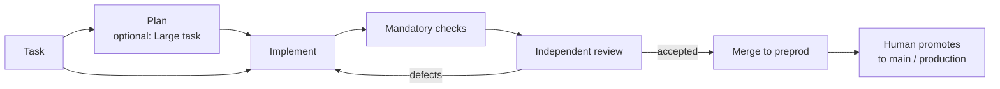

<div align="center">

# Darkfactory

**A self-hosted AI software factory: it plans the work, writes the code, runs mandatory checks and an independent review, and ships only to `preprod`.**

[](LICENSE)
[](pyproject.toml)
[](compose.yaml)
[](https://fastapi.tiangolo.com)
[](https://www.postgresql.org)

**English** · [Русский](docs/readme/README.ru.md) · [中文](docs/readme/README.zh.md) · [हिन्दी](docs/readme/README.hi.md) · [Español](docs/readme/README.es.md) · [العربية](docs/readme/README.ar.md) · [Français](docs/readme/README.fr.md) · [বাংলা](docs/readme/README.bn.md) · [Português](docs/readme/README.pt.md) · [日本語](docs/readme/README.ja.md)

</div>

Darkfactory gives you one shared UI and API, organizations with isolated projects, a PostgreSQL-backed queue, and a separate container for every task. Verified changes land automatically in `preprod` only. A human updates the main branch and production.

## Why Darkfactory

- 🏭 **Self-hosted.** One UI and API, organizations and isolated projects, a PostgreSQL queue and a dedicated container per task.
- 🛡️ **Ships only to `preprod`.** Production and the main branch are updated by a human, never by the factory.
- ✅ **Mandatory checks and independent review.** Checks and review are bound to one final commit. Without configured checks, automatic merge is off.
- 🔒 **Isolated task containers.** Non-root, read-only root filesystem, limited CPU/RAM/PIDs, network disabled, no access to the Docker socket, PostgreSQL, other projects or production secrets.
- 🔀 **Subscription pools with fallback.** Codex for development and Claude for review by default; account and engine switching with quota awareness; paid API only by explicit opt-in with a money budget.
- 🧠 **Factory Director.** A chat (web and CLI) that creates projects, roles and tasks, and resolves stalled tasks within the user's own permissions.

## Task pipeline



By default a task goes straight to a single developer, with no plan and no subtasks. A plan with blocking questions stops until you answer.

## Contents

- [Quick start](#quick-start)
- [Your first project](#your-first-project)
- [Executor connections](#executor-connections)
- [Isolation and dependencies](#isolation-and-dependencies)
- [Initializing an existing project](#initializing-an-existing-project)
- [Project artifacts](#project-artifacts)
- [Roles, delegation, skills and MCP](#roles-delegation-skills-and-mcp)
- [Factory Director](#factory-director)
- [Human notifications](#human-notifications)
- [Limits and incidents](#limits-and-incidents)
- [Implementation checks](#implementation-checks)
- [Browser UI testing](#browser-ui-testing)
- [Stand testing and GitLab deploys](#stand-testing-and-gitlab-deploys)
- [Schedules](#schedules)
- [API and data](#api-and-data)
- [Interface languages](#interface-languages)
- [License](#license)

## Quick start

You need Docker Engine with Docker Compose and `volume.subpath` support. Docker Desktop works on macOS.

> [!IMPORTANT]
> There is no default PostgreSQL password: without `POSTGRES_PASSWORD` in `.env`, Compose will not start. An installation created earlier used the password `darkfactory-local`: put it in `.env`, then change the password in PostgreSQL (`ALTER USER darkfactory PASSWORD …`) and in `.env`.

For a new installation, from the project directory:

```sh
echo "POSTGRES_PASSWORD=$(openssl rand -hex 32)" >> .env
docker compose up -d --build
docker compose exec app cat /data/bootstrap-token
```

Open [localhost:8080](http://localhost:8080) and paste the owner token.

- **Set the owner token yourself.** Instead of the generated file, run `echo "DARKFACTORY_ADMIN_TOKEN=$(openssl rand -hex 32)" >> .env` before the first start.
- **Changing it later.** After a restart, a new value of the variable replaces the previous token from `.env`. In an already running installation the variable is added to the owner from `/data/bootstrap-token`. A revoked token from `.env` is not restored: set a new value.
- **First build.** It downloads Python, Node, PostgreSQL, Codex CLI and Claude Code. Later starts use the built images.

### Services

| Service | Purpose |
|---|---|
| `app` | Serves the UI and API |
| `worker` | Manages tasks |
| `db` | Stores the queue (PostgreSQL) |
| `executor-image` | Builds the image for temporary task containers |

The Docker socket is available only to the trusted worker; a task does not get it.

### Configuration

Compose settings are read from `.env`:

| Variable | Meaning | Default |
|---|---|---|
| `PORT` | Published port | `8080` (per `compose.yaml`) |
| `BIND_ADDRESS` | Address the port binds to | `127.0.0.1` |
| `POSTGRES_PASSWORD` | PostgreSQL password | none, required |
| `GLOBAL_CONCURRENCY` | Global task concurrency | `4` |
| `EXECUTOR_CPUS` | CPUs per task container | `4` |
| `DATA_VOLUME` | Name of the `data` volume | `darkfactory_data` (per `compose.yaml`) |
| `DARKFACTORY_ADMIN_TOKEN` | Owner token chosen by you | generated into `/data/bootstrap-token` |
| `DARKFACTORY_PERSONAL_MODE` | Personal local pilot mode (see [Executor connections](#executor-connections)) | `0` |
| `DARKFACTORY_PUBLIC_URL` | Factory address used in notification links | `http://127.0.0.1:8080` |
| `DARKFACTORY_DIRECTOR_MODEL_CLAUDE`, `DARKFACTORY_DIRECTOR_MODEL_CODEX` | Model for the Director chat on that provider's subscriptions, for example a lighter one than the agents use. A project's Director profile with a model wins. With the Claude variable set, the Director tries Claude subscriptions first | empty: the connection's model |

> [!WARNING]
> For employee access, put an HTTPS reverse proxy in front of the application. PostgreSQL is not published externally.

## Your first project

1. Click **"Connect project"** and enter a name, a Git repository and, if needed, an access token.
2. A manager, analyst, developer and reviewer with the standard skills appear immediately. Roles inherit the project's executors: Codex for development and Claude for review. MCP servers are connected separately.
3. Connect subscriptions to the organization's shared pool. If a pool already exists, the new project uses it; otherwise the factory creates a "Shared pool". Projects can later pick dedicated pools in their settings.
4. In the project settings, define the mandatory check commands. Without them, automatic merge is off.
5. Create a task in the UI or through the API. A plan with blocking questions stops until you answer.

### Supported repositories

HTTPS Git, SSH and local bare repositories in `/repos` are supported. GitHub and GitLab, including self-hosted domains, get PRs/MRs. For any other Git, the factory creates an internal change record with the diff, checks and review. SSH requires a dedicated key and an explicitly set `known_hosts`; host keys are not inherited.

For local projects, use the shared `repos` volume, mounted into app and worker as `/repos`. You can create a repository with `docker compose exec worker sh`; the test scenario [below](#implementation-checks) shows a full example. Host directories are not mounted into the task container.

### Merge behavior

- When no checks are configured, the task ends with a change record and the `review_required` state: automatic merge is forbidden.
- Checks and review are bound to one final commit.
- A change to the `preprod` tip triggers re-integration and acceptance.
- Project merges run sequentially.

### Access roles

| Role | Can |
|---|---|
| Owner | Manage settings and connections |
| Operator | Manage tasks |
| Observer | Read |

Member and token permissions intersect; revoking permissions applies to subsequent requests. A new organization gets its own owner and a one-time displayed token. The owner issues member tokens in the settings ("Team access") or through `POST /api/members`; there can be several members with the `owner` role. Additional tokens of your own are issued with `POST /api/tokens` and revoked with `DELETE /api/tokens/{id}`.

## Executor connections

| Connection | Credentials and notes |
|---|---|
| **Codex for company** | JSON credentials `{"auth_method":"siwc","accessToken":"..."}`. Uses the documented external OAuth provider for App Server. Requires a Sign in with ChatGPT token with access to this scenario. Refresh the token through reconnect. |
| **Claude Code** | `{"oauth_token":"..."}` for a permitted subscription connection. The isolated session receives only the selected token; `--bare` is not used. |
| **API** | HTTPS OpenAI-compatible Chat Completions with tool calls. Specify the model and `{"base_url":"https://example.com/v1","api_key":"...","input_usd_per_million":0.0,"output_usd_per_million":0.0}` with real prices. A `ca_cert` field is available for a custom TLS CA. |

### Personal local pilot

For a personal local pilot you can use the current `codex login` through ChatGPT.

1. Add `DARKFACTORY_PERSONAL_MODE=1` to the local `.env`.
2. Run `docker compose up -d --build`.
3. On the host, run `python3 scripts/connect_personal_codex.py`. The script creates the `Personal Codex` pool and a connection in the bootstrap token's organization.
4. Assign this pool to a project; a separate Codex session can also perform reviews.

Without a gateway, every Codex request to ChatGPT (the backend and the model calls, `openai_base_url`) goes through a loopback relay in the executor that adds the real token. Codex 0.160 or later is needed for the current models, and it reaches the ChatGPT backend only over HTTPS, so the relay serves a certificate signed by a one-off CA that only that Codex trusts (`CODEX_CA_CERTIFICATE`). Only the access token and account ID from `~/.codex/auth.json` are imported; the refresh token and the host directory are not passed into containers. The token is stored encrypted. After the token expires or is revoked, repeat the import while the connection is idle. Personal mode is off by default, and a hosted or commercial installation uses SIWC. The scope of the built-in authorization is described in the [official App Server documentation](https://learn.chatgpt.com/docs/app-server#auth-endpoints).

If your personal Codex already works through a local subscription gateway, pass its Docker-reachable address and the configured model:

```sh
python3 scripts/connect_personal_codex.py --base-url http://host.docker.internal:8787/v1 --model MODEL_NAME
```

This mode accepts only local HTTP addresses and requires `DARKFACTORY_PERSONAL_MODE=1`. The executor connects to the given gateway through a fixed tunnel and the existing allow-list of addresses; the container network stays `none`. This mode does not enable a paid API.

### Pools and engine selection

Pools define priorities, models, available engines, concurrency, the number of switches and the pause before re-checking quota. The baseline choice is Codex for development and Claude for review. Switching accounts and switching Codex ↔ Claude is allowed; the API is not connected automatically by default. For a paid fallback, the owner explicitly enables a project policy and the task gets a money budget. An explicitly assigned API also requires a budget.

The **"+ Subscription"** button starts the standard Claude login through a link and a one-time browser code. In personal mode, Codex device-auth is available: the link and code appear in the same form. Pick pools before signing in; after confirmation the account is added automatically. You can close the form and resume an unfinished sign-in from the settings. A sign-in is valid for at most 15 minutes, can be cancelled, and runs in a separate container. OAuth tokens are never passed to the browser. Automatic refresh of expired tokens is not implemented; repeat the sign-in or reconnect.

| Pool default | Value |
|---|---|
| Reserve kept | **10%** |
| Observation counts as fresh for | **300 seconds** |
| Unknown quota | allowed |

- A fresh, known quota below the reserve excludes the subscription. Among suitable accounts of the selected engine, the one with the larger confirmed remainder is preferred.
- The reserve, snapshot age and "known quota required" settings are in the pool form.
- Personal Codex re-checks limits before calling the model.
- For providers without available data, the strict policy waits for a confirmed remainder.
- Limits can change while work is running: saving the code and handing over the context lets work continue with another account.

On a switch, the code and artifacts are handed over, not the account's internal session. Quota and occupancy are tracked per connection, including a known shared `quota_group`; reconnecting the same credentials does not create a new quota. An unknown remainder is never declared unlimited. An authorization error requires reconnect; a quota error requires waiting for the control check.

When an executor reports its remaining quota and reset time, the factory stores them and shows them in the connection settings together with the observation time. This is the last received snapshot, not continuous polling of the account. When no data is available, "remaining quota unknown" is displayed. Reconnecting with new credentials clears the previous snapshot. The time of the control attempt is shown separately from the reset time reported by the provider.

### Deleting pools

Pools can be deleted in the settings or through `DELETE /api/pools/{id}`, including through the Director. Deletion is available to the owner of the whole organization. Subscriptions, authorization and membership in other pools are preserved. If the pool is assigned to a project, first select another pool for development and review. An unfinished subscription sign-in must also be completed or cancelled before deletion.

### Official basis

[Codex App Server](https://learn.chatgpt.com/docs/app-server), [SIWC external tokens](https://developers.openai.com/siwc/token-sharing-open-source/codex-app-server), [Claude Code headless](https://code.claude.com/docs/en/headless).

> [!NOTE]
> The existence of an adapter does not confirm that the subscription scenario is available to a particular company: you need permitted connections.

## Isolation and dependencies

A task gets its own working copy and branch, a non-root container, a read-only root filesystem, limited CPU/RAM/PIDs and an internal deadline. `.git` is write-protected for the agent. The verifier gets the working copy read-only. There is no access to the Docker socket, PostgreSQL, other projects or production secrets.

The container network is disabled. HTTPS is available through a CONNECT proxy only to the selected provider and the project's explicitly allowed `host:port` entries. Checks are offline by default. Test secrets are passed separately; the proxy does not open arbitrary host access.

> [!WARNING]
> The factory merges only into `preprod`. A deploy runs only after the owner merges into `main`, through the project's own GitLab job ([Stand testing and GitLab deploys](#stand-testing-and-gitlab-deploys)).

### Executor image and test settings

The image contains Python, Node and Git. If a project needs other dependencies, build your own image from `darkfactory-executor:local`, install the dependencies ahead of time and set `executor_image` in the project settings.

- The owner configures the allowed test endpoints and `test_env`.
- Names in `test_env` are only `TEST_*`, `APP_*` or `E2E_*`.
- `allowed_hosts`, the Git remote and the PR/MR server must be fully qualified names.
- An internal address (loopback, private network, link-local, CGNAT) is accepted only if its exact `ip:port` is listed in `allowed_hosts`.

### Task relations

Task relations: `depends_on`, parent → subtask (`parent`), `related_to`, and confirmed `duplicate`. A code dependency waits for an accepted result in `preprod`; an artifact dependency can accept a specific verified commit. Cycles and cross-organization relations are forbidden. A parent waits for its mandatory child tasks and for its own integration check.

### Decomposition and review

- By default a task goes straight to a single developer, with no plan and no subtasks.
- Review sends work back only for defects and unmet criteria; improvements are marked `[LATER]` and go to the backlog.
- For a task marked "Large task", the planner can itself create up to eight subtasks with acceptance criteria and dependencies.
- Independent children get separate working directories and can run in parallel.
- Nested automatic decomposition is forbidden.
- Before its own implementation, the parent collects the accepted code of its children.
- Time, fixes, switches and money are bounded by a single budget for the whole tree; creating children does not multiply the limits. Parallel runs reserve shares of the remaining time.
- Cancelling a parent cancels the agents it created; cancelled children are not resumed automatically.

### Dependency changes

Accepted dependency SHAs are stored in the task. A SHA change or revocation of an accepted result stops the current executor and resets the old checks and reviews. After unblocking, the task repeats input assembly, implementation and acceptance, keeping the working code and accumulated counters. Before merge, the dependency check and the Git operation run under a shared controller lock, so an input change cannot slip in between them.

## Initializing an existing project

When you add a project, **"Initial indexing and Markdown documents"** is on by default. The factory queues a regular task: first it saves a map of the tracked Git files, then the executor studies the repository and creates or extends four files:

| File | Content |
|---|---|
| `docs/darkfactory/INDEX.md` | Project map, entry points and module purposes |
| `docs/darkfactory/ARCHITECTURE.md` | Components, dependencies, data and system boundaries |
| `docs/darkfactory/DEVELOPMENT.md` | Installation, running, configuration and checks |
| `docs/darkfactory/CONTRACTS.md` | Discovered APIs, events and external integrations |

The source map with SHAs is also in the task artifacts: `repository-index.md`. It lists the first 1000 tracked files and the full count. The executor must support conclusions with project files, preserve useful existing documentation and mark what is unknown. Changes outside the four documents are rejected by the worker check.

The task uses the project's connections, limits, checks and independent review. If there are no connections yet, it waits for them to be set up. The documents go through the regular Git pipeline: with successful mandatory checks the changes merge into `preprod`; without configured checks they are left for manual merge. After review, all four documents appear in the registry as **drafts**, with the source task and the SHA of the verified commit. The owner accepts the versions they want explicitly; existing accepted versions are preserved.

For a project connected earlier, open **"Project artifacts" → "Index project"**. The button is available to the owner and opens the existing initialization task if it was already created, without duplicates. Project creation through the API accepts `initialize` (default `true`); `false` disables the automatic start. For an existing project: `POST /api/projects/{id}/initialize`.

## Project artifacts

Open **"Project artifacts"** and add requirements, analytics, architecture, an API contract, a report or any other text document. An artifact has a stable key within the project, a title and a history of immutable versions. Content is stored in the DB; editing creates a new version. This is a separate project knowledge registry that complements the task working files (`plan.md`, `diff.patch`, `checks.txt`, `review.txt`, `handoff.md`) and browser evidence.

- The operator adds drafts, the owner accepts a selected version or revokes acceptance, the observer reads.
- Exactly one version of each artifact is accepted at a time.
- Optionally specify a source task: it must have a current commit with an independent review. A version stores the task ID and SHA; a change of the source's result or of its inputs makes the document stale.
- Regular documents are published through the form or the API; project initialization adds its own documents automatically after review.

### Using artifacts as task inputs

When creating a task, select accepted versions. In the card of a stopped task you can add, replace or remove an input. The task receives the full text of exactly the selected versions, their keys, numbers and source SHAs. Delegated subtasks inherit these versions.

| Limit | Value |
|---|---|
| Characters per version | 100,000 |
| Inputs per task | up to 10 |
| Characters per task in total | 200,000 |

Accepting a new version does not change tasks' selections automatically: consumers of the old version wait for an explicit input replacement. Revoked acceptance and a stale source also block execution. The factory resets the checks and reviews of the previous inputs, stops the active executor and re-verifies the inputs before merge. Working code and accumulated counters are preserved. The artifact card shows the history, source tasks and consumers; earlier versions remain readable.

### Artifact API

| Purpose | Routes |
|---|---|
| Artifacts | `GET/POST /api/projects/{id}/artifacts` |
| Versions | `POST /api/project-artifacts/{id}/versions`, `GET /api/project-artifacts/{id}/versions/{version_id}` |
| Acceptance | `POST …/versions/{version_id}/accept`, `POST /api/project-artifacts/{id}/revoke` |
| Task inputs | `GET /api/tasks/{id}/artifact-inputs`, `PUT/DELETE /api/tasks/{id}/artifact-inputs/{artifact_id}` |
| Task creation | accepts `artifact_version_ids` |

Access is limited by organization, the user's projects and the token scope; cycles with regular dependencies are forbidden. New tables are created at startup without changing existing tasks.

## Roles, delegation, skills and MCP

Open **"Agents, skills and MCP"** in the left menu and select a project. The **"Add ready-made team"** button installs the project agent, analyst, developer and reviewer. The **"Roles"**, **"Skills"** and **"MCP"** tabs offer catalogs: add ready-made configurations with buttons and attach skills and tools to a role through lists. Instructions, engine and model can be changed in the role card. Profiles can also be assigned to an individual task.

### Delegation

While planning, the project agent creates subtasks and assigns them an `agent_profile`. For an "analysis → development" scenario, create the `analyst` and `developer` profiles: the developer subtask lists the analysis key in `depends_on`. The developer starts after the verified merge of the analysis into `preprod` and receives the accepted commit and artifacts. The analyst saves the result in the repository. Every agent with delegation permission can create further subtasks within the configured depth and total count.

| Delegation default | Value |
|---|---|
| Depth | 2 |
| Maximum subtasks per tree | 16 |
| Direct subtasks per plan | 8 |

Time, fixes and the money budget are shared across the tree.

### Catalog

The catalog contains seven skills and four MCP servers: browser, project file read/search, Git status/diff/log reading, and Jira. The first three run inside the task container and need no external server.

### Jira MCP

The **Jira** MCP (`mcp-atlassian`, installed in the executor image) reads Jira Server/Data Center or Cloud issues, JQL search, boards and sprints. Write tools are disabled both in the gateway and in the server itself (`--read-only`). After adding it from the catalog, open its card and fill in:

- **Addresses that need access:** `jira.example.com:443`. Without this, the task's egress will not let the server reach Jira, including a private address.
- **Secret environment:** `JIRA_URL=https://jira.example.com` and `JIRA_PERSONAL_TOKEN=<PAT>` (Jira → Profile → Personal Access Tokens). For Jira Cloud use `JIRA_USERNAME` and `JIRA_API_TOKEN` instead of a PAT.

Then attach `jira` to the roles that need it, for example the analyst and the manager. The service account only needs read permission for the relevant projects.

### Custom MCP

An advanced form is available for your own MCP: an HTTPS endpoint or a stdio command from the executor image, exact names of allowed tools, and secret headers or environment. Secrets are encrypted and never returned in the UI/API. Native Codex and Claude receive tools through a local gateway that filters the list and forbids calls outside the allowed set. The planner and the reviewer accept only connections marked by the owner as read-safe; the service account's own permissions must also match the role. The paid API adapter does not support MCP.

## Factory Director

The **"Factory Director"** dialog is open on the right. Select the whole factory or a single project. Through the dialog you can create organizations, projects, pools, roles and skills, connect ready-made MCP servers, create tasks and change available settings. For example: "Add an analyst and a developer to the project, give them file and Git read access".

- **"New chat"** starts a separate history and context. Old chats stay in the list.
- **"Cancel message"** removes a request from the queue or stops the active executor. Actions already started may finish; their log is preserved. The subscription is released after the container stops.

The Director runs through **Codex CLI or Claude CLI** from a connected subscription pool. It uses the same API and permissions as the user: an operator does not gain owner rights, and access to one project does not open the others. A paid API is not enabled for the Director automatically. When the pool is busy, the request stays in the queue. If the outcome is uncertain after a restart, actions are not blindly repeated: the Director asks you to check the state.

> [!CAUTION]
> Add passwords, keys and sign-in codes through the connection forms. The Director can start a sign-in and give a link, but it never receives tokens or device codes. Access to a created organization is issued separately and once through the interface.

### Stalled tasks

The Director also handles tasks that have stopped and wait for a human: the review-cycle limit, a developer's question, a closed network, expired time. It reads the code and the task history (the repository is connected read-only) and decides by itself: continue with guidance, return for re-review, allow an address, cancel. It calls the owner only for access, money, product choices and destructive actions. While it is thinking, the task on the board shows "Director deciding".

The **"Decisions"** button in the chat shows its decisions for the project. Those marked "Waiting for you" need your decision: reply to the Director in the chat, for example "for task … continue, use …", and it continues or cancels the task by itself.

Project settings: "Director resolves stops instead of you" and "Director decisions per task tree" (default 6, variable `DARKFACTORY_DIRECTOR_LIMIT`). The Director's model and instructions are set by the "Director" role on the "Roles" screen.

### Director from the terminal

The same dialog is available from the terminal:

```sh
uv sync
uv run darkfactory director --token-file /path/to/api-token "Покажи проекты и текущие задачи"
uv run darkfactory director --token-file /path/to/api-token --project PROJECT_ID
```

Without a message, an interactive dialog opens.

| Option / variable | Purpose |
|---|---|
| `--token-file` or `DARKFACTORY_TOKEN` | API token (file or environment) |
| `--url` or `DARKFACTORY_URL` | Server address (default `http://127.0.0.1:8080`) |
| `--project` | Work with a specific project |
| `--timeout` | Wait time; default 600 seconds |
| `--resume MESSAGE_ID` | Wait for the same request without resending; use the previous token and `--project` |
| `--new-chat` | Start a separate CLI dialog |
| `--thread CHAT_ID` | Continue an existing chat |
| `--cancel MESSAGE_ID` | Cancel a message without resending the command |

The command is also available as `python -m darkfactory.cli director`. If the terminal is closed or the wait times out, the request keeps running.

## Human notifications

In the settings add a Rocket.Chat channel with an HTTPS webhook and an optional recipient `@username` or `#channel`, or Telegram with a bot token and a chat ID. A Rocket.Chat recipient needs channel override in the incoming webhook (see below). The recipient can be changed without re-entering the URL. Select a project or the whole organization, then the events: questions, stops, errors, limits, accepted changes and incidents. Setting up a channel does not send any messages by itself. Agent questions and pipeline stops enter the queue automatically. The API `POST /api/tasks/{id}/notify` with `{"message":"..."}` sends a message to the task's configured channels.

Delivery runs separately from tasks, with five attempts and a delay between retries. Secrets are not shown again. After a failure between sending and saving the acknowledgement, a duplicate message is possible. Answers to questions are entered in the task card or directly in the chat.

### Chat commands

Chat commands are enabled by an API token with the operator role in the channel settings: commands run with its permissions and project scope, so issue a dedicated token with the minimum needed. The channel does not accept an owner token. Without `allowed_senders`, any chat member can use commands; with an `allowed_senders` list (Telegram `from.id`, Rocket.Chat `user_id`), only the listed ones can. The sender is recorded in the task event.

- `!director text` (in Telegram `/director text`) hands an assignment to the Director, for example `!director show tasks`. In Telegram groups with privacy mode, the bot sees only `/director`. Telegram replies to the message with the command, Rocket.Chat replies in that message's thread. While the Director is busy, a new command is refused.
- A reply to a question or stop notification continues the task with that text, like the "Continue" button in the card. In Telegram, reply to the bot's message or forward it to the bot in a private chat with a comment. In Rocket.Chat, reply in the notification's thread.
- Telegram is read by long polling through `getUpdates`, so no public address is needed; the bot must not have a webhook. Channels sharing one bot split messages by chat ID.

### Managing from Telegram

With a command token, the Telegram bot provides a button menu. `/start` or `меню` opens it. Screens are updated in the same message.

- Projects → board with the columns "Ready to run", "In progress", "Needs attention", "Done" → task list → card. The card shows the agent's question and buttons according to the task state.
- "✍️ Reply" passes an answer to the agent and continues the task. The "Reply" and "Card" buttons are also under every task notification.
- Queue order changes with the "⏫ Higher" and "⏬ Lower" buttons or "➡️ Move" → "To start" and "To end": this is the task's priority. "Move" also returns a task to run, merges it or cancels it; cancellation asks for confirmation.
- "➕ New task": the first line of the reply is the title, the whole text is the description.
- "🧠 Director" hands a message to the Director. In a private chat with the bot, any plain text also goes to the Director, and a reply to its message continues the conversation.
- Subscriptions are connected only in the web settings: the chat does not start a sign-in.

### Setting up Rocket.Chat commands

Create an outgoing webhook for the "Message sent" event in the same room as the incoming one. URL: `https://<factory>/api/chat-commands/rocketchat/<channel id>` (shown in the channel list); set the webhook token in the channel settings. Leave the trigger words empty and do not exclude the bot's messages: the factory uses them to learn which task a thread belongs to. Rocket.Chat does not pass unknown slash commands, so commands there start with `!`:

- `!director text`: an assignment to the Director.
- `!projects`: projects and the number of tasks in each board column.
- `!waiting`: tasks waiting for an answer or a merge.
- `!task <id>`: the task card.
- `!help`: the command list.

In a task notification's thread, plain text is the answer to the agent, and `!task`, `!resume`, `!merge` and `!cancel` act on that task.

The incoming webhook works in two modes, chosen by its "Override Destination Channel" setting:

- **Override off** (the Rocket.Chat default): leave the channel's recipient empty. Every message goes to the webhook's own channel, and thread answers carry only the thread ID (`tmid`). Rocket.Chat refuses any request with `roomId` or `channel` here (`overriding destination channel is disabled for this integration`), so with override off a recipient makes every delivery fail. Put the outgoing webhook in the same room as the incoming one, or answers land outside the thread.
- **Override on**: the recipient picks where notifications go, and command answers name the room they came from (`roomId`) next to `tmid`. Use this mode when notifications go to a room other than the webhook's own.

Delivery state is in the channel's outbox (`notification_deliveries`). A Director answer to a chat command counts as replied (`director_dialogues.origin_replied`) only after Rocket.Chat or Telegram accepted it; a refused answer stays unreplied with the provider's HTTP status in `last_error`. Notifications arrive as Rocket.Chat markdown under the name Darkfactory; with `DARKFACTORY_PUBLIC_URL` set, the factory logo is their avatar.

### Merge notifications

After a verified merge into `preprod`, the channel receives the task and project names, a short developer summary, the SHA and a link to the accepted commit. For GitHub/GitLab the link leads to the commit page; for local and generic Git it leads to an authorized card with the diff in the factory. Unsuccessful attempts do not send a completion message.

For employees, set a factory address reachable by them through `DARKFACTORY_PUBLIC_URL` in `.env`, for example `https://factory.company.ru`, then restart Compose. By default links use `http://127.0.0.1:8080`. Tokens are not added to links; sign-in may be required.

### Promoting to main

When a top-level task completes, the notification also contains a **"Merge to main / reject"** link. This is a merge proposal inside the factory, available for local Git as well. It pins the accepted commit and shows the full diff against the current `main` (up to 100,000 characters, with a truncation mark). The owner can merge or reject it; the GET link changes nothing by itself. The transfer includes all `preprod` changes up to the specified commit, including subtasks. Rejection keeps `preprod`.

> [!NOTE]
> There is no automatic transfer to `main`; the Director cannot make this decision. A GitLab project with a deploy job deploys after the owner's merge ([below](#stand-testing-and-gitlab-deploys)). If `main` has diverged from the accepted commit, integration and re-checks are needed first. Old completed tasks do not get new proposals automatically.

### Syncing main back into preprod

The reverse direction is automatic: on the project's **"Merge main into preprod"** [schedule](#schedules) (hourly by default; `DARKFACTORY_MAIN_SYNC_SECONDS=0` turns syncing off for the installation) the factory merges new `main` commits into `preprod`, for example the owner's hotfixes. If `preprod` has not moved ahead, it simply catches up with `main`; otherwise a merge commit is created. On conflict, a task "Merge main into preprod: conflict" appears with the merge started and markers in the working folder; the agent resolves the conflict, after which the task goes through the regular review and checks.

## Limits and incidents

### Priorities

Tasks have four priorities: critical (`critical`), high (`high`), normal (`normal`, default) and low (`low`). Priority is chosen at creation and changed in the task card by the owner or an operator; API: `PUT /api/tasks/{id}/priority` with the `priority` field. The Director can use the same API.

- `preprod` fixes are picked first, then ready tasks by priority and creation time.
- Priority does not override dependencies, quotas and limits and does not interrupt work already running.
- Subtasks inherit the parent's priority at creation. Old tasks get normal priority.

### Defaults

| Limit | Default |
|---|---|
| Active tasks | 2 |
| Total active task time | 60 minutes |
| Fix cycles after the first implementation | 3 |

Waiting does not consume active time. A restart, an account switch and a repeat of the same failure preserve the counters. A limit stops the task until an explicit human decision. Cancelled tasks are not resumed automatically.

### Incidents

After a merge, and then periodically, the worker repeats the `preprod` checks. A breakage opens a priority fix, stops new merges of the project and the tasks that depend on its broken result. Other projects keep working. The fix goes through the regular checks and review. A repeat of the same diagnosis returns to the earlier incident with the earlier limits. You can also report an incident separately from the UI/API. There is no automatic rollback.

## Implementation checks

Current results and the remaining acceptance: [VALIDATION.md](VALIDATION.md).

```sh
uv sync --extra dev
uv run pytest -q
uv run ruff check darkfactory tests scripts
node --check darkfactory/static/app.js
docker compose exec -T worker python - < scripts/docker_smoke.py
```

The Docker smoke test creates a separate organization, two real local bare Git repositories and 13 tasks (10 fixes, 3 features). Real PostgreSQL, the queue, containers, Git, checks, independent review sessions and merges all take part. Instead of a paid model, a separate deterministic HTTPS fixture is used. This verifies infrastructure; it is not proof of real model quality or of user subscriptions working. The product API contains no test executor.

To test SSH, build a separate test OpenSSH server and enable the `SMOKE_SSH` mode:

```sh
docker build -t darkfactory-smoke-ssh:local - < scripts/ssh-git.Dockerfile
docker compose exec -T -e SMOKE_SSH=1 worker python - < scripts/docker_smoke.py
```

In this mode the second project goes through the whole pipeline over SSH. Refusal on a wrong server key and on a wrong client key is also verified. The test server publishes no host ports and is removed on completion, including on error. After a successful run, periodic checks of its project are disabled; repositories and results remain in the volumes for inspection.

## Browser UI testing

The executor image includes Chromium, Playwright Test and Playwright MCP. Add the ready-made **"Browser UI testing"** skill (`browser-testing`) and the `project-browser` MCP from the catalog to the developer. The browser runs inside the isolated task container; the local application starts there too. For projects with a UI, set a mandatory Playwright command in the project checks. The skill and MCP help the agent explore the interface; it is the mandatory check that blocks the merge on failure.

Save screenshots, JSON reports and traces to `/run/evidence` (variable `DARKFACTORY_EVIDENCE_DIR`). In the task card, the **"Browser checks"** button opens the artifact list and an image preview. Other files are downloaded; HTML reports are not executed inside the factory. History is split by runs and roles. These files complement the mandatory checks and review; a screenshot alone does not prove correctness.

### Live browser pilot

The real browser pilot creates a separate local Git project with bugs in a form and in mobile layout. The checks must fail first, then Codex fixes the page, an independent session verifies the result, and the accepted preprod passes eight browser scenarios again. The script saves a checkpoint and continues the same task when run again:

```sh
docker compose exec -T -e CODEX_CONNECTION_ID=<connection-id> worker python - < scripts/live_browser_smoke.py
```

## Stand testing and GitLab deploys

The factory can test the deployed application itself and deploy `main` through GitLab. Both are set in the project settings.

### Stand tester

Set **"Stand address"** to the page the tester opens first, for example the Studio of the stand. List the other hosts the stand calls (sign-in server, API) in **"Other stand hosts"** as `host:port`. Internal addresses are allowed here: the owner chooses them like allowed hosts. Put test accounts into the test variables (`E2E_USER`, `E2E_PASSWORD` and so on); the tester reads them from its environment, and their values never reach the prompt or the transcript.

On the project's **"Stand testing"** [schedule](#schedules) (every 4 hours by default, created when the stand address is set), after each successful deploy and on the **"Test stand"** button, an agent opens the stand in Chromium (Playwright MCP) and works like a manual tester: it signs in, goes through the main flows, forms, both viewports, console errors and failed requests. The preprod code is mounted read-only so the agent can name the likely files. The browser reaches only the stand hosts, through the task's egress proxy; certificate errors of an internal CA are ignored for those origins.

Each defect the agent reproduced twice becomes an ordinary fix task with the steps, the expected and actual result and the screenshots attached. At most `qa_max_tasks` tasks per run (3 by default); open stand bugs are passed to the next run so they are not reported again, and scheduled runs are skipped while 8 of them are open. The agent creates only its own data with the `df-qa-` prefix and never changes users or settings. After a deploy it first re-checks the stand bugs whose fixes went out: a confirmed fix is marked on the task, and a bug that still reproduces gets a new related task.

Notifications: `qa_reported` and `qa_not_fixed`. API: `POST /api/projects/{id}/qa` starts a run now. The run uses the project's writer pool and lasts at most `DARKFACTORY_QA_SECONDS` (1800); `DARKFACTORY_STAND_QA=0` turns stand testing off for the whole installation.

### GitLab deploys

For a GitLab project, set **"GitLab deploy job"** to the name of a manual job in the `main` pipeline (for example `deploy`). A project with GitLab MRs uses the MR server and its token; a project without them uses the API beside its HTTPS Git URL (`https://host/api/v4`) and the Git token, so it keeps working without MRs. The token needs the `api` scope and the right to run that job, including a protected environment. After the owner merges into `main` (see [Promoting to main](#promoting-to-main)), the factory:

1. finds the pipeline of the new `main` commit;
2. waits until the jobs of the `build` stage finish, so the images of the commit exist;
3. plays the deploy job and follows it;
4. reports the result on the promoted task (`deploy_started`, `deploy_succeeded`, `deploy_failed` with the end of the job log) and in the notification channels;
5. after a successful deploy, starts the stand tester.

A failed image build stops the deploy without playing the job. A deploy job already started from GitLab is followed, not started again. While one deploy runs, a newer merge waits for it. The **"Deploy main"** button and `POST /api/projects/{id}/deploy` deploy the current `main` tip on the owner's request. There is no automatic rollback; the job itself decides how to handle a failed release.

## Schedules

The **"Schedules"** page of a project lists its recurring jobs. Each schedule has a cron line (`minute hour day month weekday`, for example `0 9 * * 1-5`; `@hourly`, `@daily`, `@weekly` and `@monthly` work too), a time zone, an on/off switch, its next and last run and the last result. Ready-made presets fill the cron line. The owner creates, changes and deletes schedules; an operator can also start one at once with **"Run now"**, which leaves its regular time as it was.

| Job | What a run does |
|---|---|
| Stand testing | asks the [stand tester](#stand-tester) for a run; skipped while 8 stand bugs are open |
| Backlog into tasks | groups the open backlog notes into tasks; nothing happens without new notes |
| Merge main into preprod | [syncs `main` into `preprod`](#syncing-main-back-into-preprod) |
| Task | creates an ordinary task with the saved title, request and priority; skipped while the task of the previous run is still open |

A new project gets an hourly main sync and a backlog run every 4 hours; the stand tester schedule appears when a stand address is set. Projects connected earlier get the same schedules from their old interval settings once. After a factory outage the missed runs of a schedule collapse into one. `DARKFACTORY_TIMEZONE` sets the default time zone (UTC); the form offers the browser's.

API: `GET|POST /api/projects/{id}/schedules`, `PUT|DELETE /api/schedules/{id}`, `POST /api/schedules/{id}/run`.

## API and data

The specification is available in [Swagger UI](http://localhost:8080/docs). All `/api/*` requests require `Authorization: Bearer <token>`.

| Main resources |
|---|
| `/api/projects` |
| `/api/projects/{id}/tasks` |
| `/api/tasks/{id}` |
| `/api/pools` |
| `/api/connections` |
| `/api/members` |
| `/api/tokens` |
| `/api/organizations` |

Task creation supports `idempotency_key`. Artifacts and history are available in the task card.

### Storage and backup

State is stored in the named volumes PostgreSQL, `data` and `repos`. `data` holds the encrypted connections, the encryption key, Git copies and artifacts.

> [!WARNING]
> Back up PostgreSQL and both file volumes consistently; losing the key makes credentials unrecoverable. The bootstrap token is shown by the command above; member tokens are issued once, and only hashes are stored in the DB.

### Updating

Update with `docker compose up -d --build`. So that tasks do not wait for the old worker to finish its current steps, update the worker through `scripts/deploy-worker.sh`: the new worker takes work immediately, the old one finishes what it started and stops. The current migrations add missing columns and preserve existing data. To roll back, restore the previous code/images and restart the services; the added columns can stay. Do not delete volumes during a regular update.

## Interface languages

The web UI ships in 10 languages: English, 中文, हिन्दी, Español, العربية, Français, বাংলা, Português, Русский, 日本語. It picks the browser language and falls back to English. The picker is on the login card and in the sidebar footer. The choice is stored in the `localStorage` key `df-lang`.

> [!NOTE]
> Messages generated by the server (task events, reasons) remain in Russian.

**For contributors**

- UI strings are Russian source keys wrapped in `tr()` in `darkfactory/static/*.js`.
- Translations live in `darkfactory/static/locales/<code>.json`.
- `python scripts/i18n_check.py` reports unwrapped strings, missing keys and placeholder mismatches.

## License

Darkfactory is released under the [MIT License](LICENSE).
