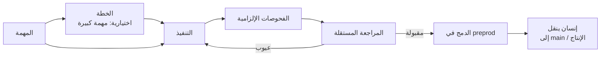

<div align="center">

# Darkfactory

**مصنع برمجيات ذكي مستضاف ذاتيًا: يخطط للعمل، ويكتب الشيفرة، ويشغّل فحوصات إلزامية ومراجعة مستقلة، ولا يسلّم إلا إلى `preprod`.**

[](../../LICENSE)
[](../../pyproject.toml)
[](../../compose.yaml)
[](https://fastapi.tiangolo.com)
[](https://www.postgresql.org)

[English](../../README.md) · [Русский](README.ru.md) · [中文](README.zh.md) · [हिन्दी](README.hi.md) · [Español](README.es.md) · **العربية** · [Français](README.fr.md) · [বাংলা](README.bn.md) · [Português](README.pt.md) · [日本語](README.ja.md)

</div>

<div dir="rtl">

يوفّر Darkfactory واجهة مستخدم وواجهة برمجية مشتركتين، ومؤسسات ذات مشاريع معزولة، وطابور مبنيًا على PostgreSQL، وحاوية منفصلة لكل مهمة. تصل التغييرات التي جرى التحقق منها تلقائيًا إلى `preprod` فقط. أما الفرع الرئيسي والإنتاج فيحدّثهما إنسان.

## لماذا Darkfactory

- 🏭 **مستضاف ذاتيًا.** واجهة مستخدم وواجهة برمجية واحدة، ومؤسسات ومشاريع معزولة، وطابور PostgreSQL، وحاوية مخصصة لكل مهمة.
- 🛡️ **التسليم إلى `preprod` فقط.** يحدّث إنسانٌ الإنتاجَ والفرعَ الرئيسي، ولا يحدّثهما المصنع أبدًا.
- ✅ **فحوصات إلزامية ومراجعة مستقلة.** ترتبط الفحوصات والمراجعة بإيداع نهائي واحد. وإذا لم تُضبط فحوصات يتوقف الدمج التلقائي.
- 🔒 **حاويات مهام معزولة.** مستخدم غير جذر، ونظام ملفات جذري للقراءة فقط، وحدود لوحدة المعالجة المركزية والذاكرة وعدد العمليات (PIDs)، والشبكة معطّلة، ولا وصول إلى مقبس Docker أو PostgreSQL أو المشاريع الأخرى أو أسرار الإنتاج.
- 🔀 **مجموعات اشتراكات مع تبديل احتياطي.** Codex للتطوير وClaude للمراجعة افتراضيًا؛ تبديل الحسابات والمحركات مع مراعاة الحصص؛ ولا تُستخدم الواجهة البرمجية المدفوعة إلا بموافقة صريحة وبميزانية مالية محددة.
- 🧠 **مدير المصنع.** محادثة (على الويب وفي CLI) تنشئ المشاريع والأدوار والمهام، وتعالج المهام المتوقفة ضمن صلاحيات المستخدم نفسه.

## مسار المهمة



تذهب المهمة افتراضيًا مباشرةً إلى مطوّر واحد، دون خطة ودون مهام فرعية. وإذا تضمنت الخطة أسئلة حاجبة فإن العمل يتوقف إلى أن تجيب.

## المحتويات

- [البدء السريع](#البدء-السريع)
- [مشروعك الأول](#مشروعك-الأول)
- [اتصالات المنفذ](#اتصالات-المنفذ)
- [العزل والتبعيات](#العزل-والتبعيات)
- [تهيئة مشروع قائم](#تهيئة-مشروع-قائم)
- [مواد المشروع](#مواد-المشروع)
- [الأدوار والتفويض والمهارات وMCP](#الأدوار-والتفويض-والمهارات-وmcp)
- [مدير المصنع](#مدير-المصنع)
- [إشعارات البشر](#إشعارات-البشر)
- [الحدود والحوادث](#الحدود-والحوادث)
- [فحوصات التنفيذ](#فحوصات-التنفيذ)
- [اختبار واجهة المتصفح](#اختبار-واجهة-المتصفح)
- [اختبار البيئة وعمليات نشر GitLab](#اختبار-البيئة-وعمليات-نشر-gitlab)
- [واجهة البرمجة والبيانات](#واجهة-البرمجة-والبيانات)
- [لغات الواجهة](#لغات-الواجهة)
- [الترخيص](#الترخيص)

## البدء السريع

تحتاج إلى Docker Engine مع Docker Compose ودعم `volume.subpath`. يعمل Docker Desktop على macOS.

> [!IMPORTANT]
> لا توجد كلمة مرور افتراضية لـ PostgreSQL: فبدون `POSTGRES_PASSWORD` في `.env` لن يبدأ Compose. كان التثبيت الذي أُنشئ سابقًا يستخدم كلمة المرور `darkfactory-local`: ضعها في `.env`، ثم غيّر كلمة المرور في PostgreSQL (`ALTER USER darkfactory PASSWORD …`) وفي `.env`.

لتثبيت جديد، من دليل المشروع:

```sh
echo "POSTGRES_PASSWORD=$(openssl rand -hex 32)" >> .env
docker compose up -d --build
docker compose exec app cat /data/bootstrap-token
```

افتح [localhost:8080](http://localhost:8080) والصق رمز المالك.

- **حدّد رمز المالك بنفسك.** بدلًا من الملف المولَّد، نفّذ `echo "DARKFACTORY_ADMIN_TOKEN=$(openssl rand -hex 32)" >> .env` قبل التشغيل الأول.
- **التغيير لاحقًا.** بعد إعادة التشغيل تحلّ القيمة الجديدة للمتغير محل الرمز السابق من `.env`. وفي تثبيت يعمل بالفعل يُضاف المتغير إلى المالك الموجود في `/data/bootstrap-token`. لا يُستعاد رمز ملغى من `.env`: عيّن قيمة جديدة.
- **البناء الأول.** ينزّل Python وNode وPostgreSQL وCodex CLI وClaude Code. وتستخدم عمليات التشغيل اللاحقة الصور المبنية.

### الخدمات

| الخدمة | الغرض |
|---|---|
| `app` | يخدم واجهة المستخدم والواجهة البرمجية |
| `worker` | يدير المهام |
| `db` | يخزّن الطابور (PostgreSQL) |
| `executor-image` | يبني الصورة المستخدمة لحاويات المهام المؤقتة |

مقبس Docker متاح للعامل الموثوق (worker) فقط؛ ولا تحصل عليه المهمة.

### الإعدادات

تُقرأ إعدادات Compose من `.env`:

| المتغير | المعنى | القيمة الافتراضية |
|---|---|---|
| `PORT` | المنفذ المنشور | `8080` (بحسب `compose.yaml`) |
| `BIND_ADDRESS` | العنوان الذي يرتبط به المنفذ | `127.0.0.1` |
| `POSTGRES_PASSWORD` | كلمة مرور PostgreSQL | لا توجد، وهي مطلوبة |
| `GLOBAL_CONCURRENCY` | التزامن العام للمهام | `4` |
| `EXECUTOR_CPUS` | عدد وحدات المعالجة لكل حاوية مهمة | `4` |
| `DATA_VOLUME` | اسم وحدة التخزين `data` | `darkfactory_data` (بحسب `compose.yaml`) |
| `DARKFACTORY_ADMIN_TOKEN` | رمز المالك الذي تختاره | يُولَّد في `/data/bootstrap-token` |
| `DARKFACTORY_PERSONAL_MODE` | وضع التجربة المحلية الشخصية (انظر [اتصالات المنفذ](#اتصالات-المنفذ)) | `0` |
| `DARKFACTORY_PUBLIC_URL` | عنوان المصنع المستخدم في روابط الإشعارات | `http://127.0.0.1:8080` |
| `DARKFACTORY_DIRECTOR_MODEL_CLAUDE` و`DARKFACTORY_DIRECTOR_MODEL_CODEX` | نموذج دردشة Director على اشتراكات ذلك المزوّد، مثلًا نموذج أخف من نموذج الوكلاء. وتتقدم عليه ملفات Director للمشروع التي تحدد نموذجًا. عند ضبط متغير Claude يجرّب Director اشتراكات Claude أولًا | فارغ: نموذج الاتصال |

> [!WARNING]
> لإتاحة الوصول للموظفين، ضع وكيلًا عكسيًا (reverse proxy) بـ HTTPS أمام التطبيق. لا يُنشر PostgreSQL إلى الخارج.

## مشروعك الأول

1. انقر **«ربط مشروع»** وأدخل اسمًا ومستودع Git ورمز وصول عند الحاجة.
2. يظهر فورًا مدير ومحلل ومطوّر ومراجع بالمهارات القياسية. ترث الأدوار منفّذات المشروع: Codex للتطوير وClaude للمراجعة. وتُربط خوادم MCP بشكل منفصل.
3. اربط الاشتراكات بالمجموعة المشتركة للمؤسسة. إذا كانت هناك مجموعة موجودة فسيستخدمها المشروع الجديد؛ وإلا ينشئ المصنع «مجموعة مشتركة». ويمكن للمشاريع لاحقًا اختيار مجموعات مخصصة في إعداداتها.
4. حدّد في إعدادات المشروع أوامر الفحص الإلزامية. وبدونها يتوقف الدمج التلقائي.
5. أنشئ مهمة من الواجهة أو عبر الواجهة البرمجية. وإذا تضمنت الخطة أسئلة حاجبة فإن العمل يتوقف إلى أن تجيب.

### المستودعات المدعومة

تُدعم مستودعات Git عبر HTTPS وSSH والمستودعات المحلية العارية (bare) في `/repos`. تحصل GitHub وGitLab، بما في ذلك النطاقات المستضافة ذاتيًا، على PR/MR. أما مع أي Git آخر فينشئ المصنع سجل تغيير داخليًا يتضمن الفروقات (diff) والفحوصات والمراجعة. يتطلب SSH مفتاحًا مخصصًا و`known_hosts` يُحدَّد صراحةً؛ ولا تُورَّث مفاتيح المضيف.

للمشاريع المحلية استخدم وحدة التخزين المشتركة `repos`، وهي مركّبة في app وworker على المسار `/repos`. يمكنك إنشاء مستودع باستخدام `docker compose exec worker sh`؛ ويعرض سيناريو الاختبار [أدناه](#فحوصات-التنفيذ) مثالًا كاملًا. لا تُركَّب أدلة المضيف داخل حاوية المهمة.

### سلوك الدمج

- عند عدم ضبط أي فحوصات تنتهي المهمة بسجل تغيير وبالحالة `review_required`: الدمج التلقائي محظور.
- ترتبط الفحوصات والمراجعة بإيداع نهائي واحد.
- يؤدي تغيّر رأس `preprod` إلى إعادة التكامل والقبول.
- تُنفَّذ عمليات دمج المشروع بالتتابع.

### أدوار الوصول

| الدور | الصلاحيات |
|---|---|
| المالك (Owner) | إدارة الإعدادات والاتصالات |
| المشغّل (Operator) | إدارة المهام |
| المراقب (Observer) | القراءة |

تتقاطع صلاحيات العضو والرمز؛ ويسري سحب الصلاحيات على الطلبات اللاحقة. تحصل المؤسسة الجديدة على مالكها الخاص ورمز يُعرض مرة واحدة. يُصدر المالك رموز الأعضاء من الإعدادات («الوصول للفريق») أو عبر `POST /api/members`؛ ويمكن أن يوجد عدة أعضاء بدور `owner`. وتُصدر رموزك الإضافية عبر `POST /api/tokens` وتُلغى عبر `DELETE /api/tokens/{id}`.

## اتصالات المنفذ

| الاتصال | بيانات الاعتماد وملاحظات |
|---|---|
| **Codex للشركات** | بيانات اعتماد JSON بالصيغة `{"auth_method":"siwc","accessToken":"..."}`. يستخدم موفّر OAuth الخارجي الموثّق لـ App Server. يتطلب رمز Sign in with ChatGPT مع صلاحية الوصول إلى هذا السيناريو. جدّد الرمز عبر إعادة الاتصال. |
| **Claude Code** | `{"oauth_token":"..."}` لاتصال اشتراك مسموح به. تتلقى الجلسة المعزولة الرمز المحدد فقط؛ ولا يُستخدم `--bare`. |
| **API** | واجهة Chat Completions متوافقة مع OpenAI عبر HTTPS مع استدعاءات الأدوات. حدّد النموذج و`{"base_url":"https://example.com/v1","api_key":"...","input_usd_per_million":0.0,"output_usd_per_million":0.0}` مع الأسعار الحقيقية. يتوفر الحقل `ca_cert` لسلطة شهادات TLS مخصصة. |

### التجربة المحلية الشخصية

للتجربة المحلية الشخصية يمكنك استخدام `codex login` الحالي عبر ChatGPT.

1. أضف `DARKFACTORY_PERSONAL_MODE=1` إلى ملف `.env` المحلي.
2. نفّذ `docker compose up -d --build`.
3. على المضيف نفّذ `python3 scripts/connect_personal_codex.py`. ينشئ السكربت المجموعة `Personal Codex` واتصالًا في مؤسسة رمز التمهيد (bootstrap token).
4. عيّن هذه المجموعة لمشروع؛ ويمكن لجلسة Codex منفصلة أن تجري المراجعات أيضًا.

بدون بوابة يمر كل طلب من Codex إلى ChatGPT (الواجهة الخلفية واستدعاءات النموذج، `openai_base_url`) عبر relay على loopback داخل المنفّذ يضيف الرمز الحقيقي. تتطلب النماذج الحالية Codex 0.160 أو أحدث، ولا يصل إلى الواجهة الخلفية لـ ChatGPT إلا عبر HTTPS، لذلك يقدّم الـ relay شهادة موقّعة من CA لمرة واحدة لا يثق بها إلا ذلك الـ Codex (`CODEX_CA_CERTIFICATE`). يُستورد رمز الوصول ومعرّف الحساب فقط من `~/.codex/auth.json`؛ ولا يُمرَّر رمز التجديد ولا دليل المضيف إلى الحاويات. يُخزَّن الرمز مشفّرًا. بعد انتهاء صلاحية الرمز أو إلغائه، كرّر الاستيراد أثناء خمول الاتصال. الوضع الشخصي معطّل افتراضيًا، أما التثبيت المستضاف أو التجاري فيستخدم SIWC. يوضَّح نطاق التفويض المدمج في [وثائق App Server الرسمية](https://learn.chatgpt.com/docs/app-server#auth-endpoints).

إذا كان Codex الشخصي لديك يعمل بالفعل عبر بوابة اشتراك محلية، فمرّر عنوانها الذي يمكن الوصول إليه من Docker والنموذج المضبوط:

```sh
python3 scripts/connect_personal_codex.py --base-url http://host.docker.internal:8787/v1 --model MODEL_NAME
```

يقبل هذا الوضع عناوين HTTP المحلية فقط ويتطلب `DARKFACTORY_PERSONAL_MODE=1`. يتصل المنفذ بالبوابة المحددة عبر نفق ثابت وقائمة العناوين المسموح بها الحالية؛ وتبقى شبكة الحاوية `none`. ولا يفعّل هذا الوضع الواجهة البرمجية المدفوعة.

### المجموعات واختيار المحرك

تحدد المجموعات الأولويات والنماذج والمحركات المتاحة والتزامن وعدد التبديلات والإيقاف المؤقت قبل إعادة فحص الحصة. الاختيار الأساسي هو Codex للتطوير وClaude للمراجعة. ويُسمح بتبديل الحسابات وبالتبديل بين Codex وClaude؛ ولا تُربط الواجهة البرمجية تلقائيًا افتراضيًا. وللاحتياط المدفوع يفعّل المالك سياسة المشروع صراحةً وتحصل المهمة على ميزانية مالية. كما أن الواجهة البرمجية المعيَّنة صراحةً تتطلب ميزانية أيضًا.

يبدأ الزر **«+ اشتراك»** تسجيل دخول Claude القياسي عبر رابط ورمز لمرة واحدة في المتصفح. وفي الوضع الشخصي تتوفر مصادقة الجهاز (device-auth) لـ Codex: يظهر الرابط والرمز في النموذج نفسه. اختر المجموعات قبل تسجيل الدخول؛ وبعد التأكيد يُضاف الحساب تلقائيًا. يمكنك إغلاق النموذج واستئناف تسجيل دخول لم يكتمل من الإعدادات. صلاحية تسجيل الدخول 15 دقيقة كحد أقصى، ويمكن إلغاؤه، ويجري في حاوية منفصلة. لا تُمرَّر رموز OAuth إلى المتصفح أبدًا. التجديد التلقائي للرموز المنتهية غير منفّذ؛ كرّر تسجيل الدخول أو أعد الاتصال.

| الإعداد الافتراضي للمجموعة | القيمة |
|---|---|
| الاحتياطي المحفوظ | **10%** |
| تُعدّ الملاحظة حديثة لمدة | **300 ثانية** |
| الحصة المجهولة | مسموح بها |

- الحصة الحديثة المعروفة التي تقل عن الاحتياطي تستبعد الاشتراك. ومن بين الحسابات المناسبة للمحرك المحدد يُفضَّل الحساب ذو المتبقي المؤكَّد الأكبر.
- إعدادات الاحتياطي وعمر اللقطة و«اشتراط معرفة الحصة» موجودة في نموذج المجموعة.
- يعيد Codex الشخصي فحص الحدود قبل استدعاء النموذج.
- بالنسبة للموفّرين الذين لا تتوفر بياناتهم، تنتظر السياسة الصارمة متبقيًا مؤكَّدًا.
- قد تتغير الحدود أثناء العمل: فحفظ الشيفرة وتسليم السياق يتيحان متابعة العمل بحساب آخر.

عند التبديل تُسلَّم الشيفرة والمواد، لا الجلسة الداخلية للحساب. تُتتبَّع الحصة والإشغال لكل اتصال، بما في ذلك `quota_group` المشترك المعروف؛ وإعادة توصيل بيانات الاعتماد نفسها لا تنشئ حصة جديدة. ولا يُعلَن المتبقي المجهول غير محدود أبدًا. يتطلب خطأ التفويض إعادة اتصال؛ ويتطلب خطأ الحصة انتظار الفحص الدوري.

عندما يبلّغ المنفذ عن حصته المتبقية ووقت إعادة ضبطها، يخزّنها المصنع ويعرضها في إعدادات الاتصال مع وقت الملاحظة. هذه آخر لقطة وردت، وليست استطلاعًا مستمرًا للحساب. وعند عدم توفر بيانات تظهر عبارة «الحصة المتبقية مجهولة». وتؤدي إعادة الاتصال ببيانات اعتماد جديدة إلى مسح اللقطة السابقة. ويُعرض وقت محاولة الفحص بشكل منفصل عن وقت إعادة الضبط الذي أبلغ عنه الموفّر.

### حذف المجموعات

يمكن حذف المجموعات من الإعدادات أو عبر `DELETE /api/pools/{id}`، بما في ذلك عبر المدير. الحذف متاح لمالك المؤسسة بأكملها. وتبقى الاشتراكات والتفويض والعضوية في المجموعات الأخرى. وإذا كانت المجموعة معيّنة لمشروع فاختر أولًا مجموعة أخرى للتطوير والمراجعة. كما يجب إكمال أو إلغاء أي تسجيل دخول اشتراك غير مكتمل قبل الحذف.

### الأساس الرسمي

[Codex App Server](https://learn.chatgpt.com/docs/app-server)، [رموز SIWC الخارجية](https://developers.openai.com/siwc/token-sharing-open-source/codex-app-server)، [Claude Code headless](https://code.claude.com/docs/en/headless).

> [!NOTE]
> وجود المحوّل (adapter) لا يؤكد أن سيناريو الاشتراك متاح لشركة بعينها: أنت بحاجة إلى اتصالات مسموح بها.

## العزل والتبعيات

تحصل المهمة على نسخة عمل وفرع خاصين بها، وحاوية بمستخدم غير جذر، ونظام ملفات جذري للقراءة فقط، وحدود لوحدة المعالجة والذاكرة وعدد العمليات، ومهلة داخلية. المجلد `.git` محمي من الكتابة بالنسبة للوكيل. ويحصل المدقّق (verifier) على نسخة العمل للقراءة فقط. ولا يوجد وصول إلى مقبس Docker أو PostgreSQL أو المشاريع الأخرى أو أسرار الإنتاج.

شبكة الحاوية معطّلة. يتوفر HTTPS عبر وكيل CONNECT إلى الموفّر المحدد وإلى مدخلات `host:port` المسموح بها صراحةً للمشروع فقط. الفحوصات تعمل دون اتصال افتراضيًا. وتُمرَّر أسرار الاختبار بشكل منفصل؛ ولا يفتح الوكيل وصولًا اعتباطيًا إلى المضيفين.

> [!WARNING]
> يسلّم المصنع إلى `preprod` فقط. لا يُنفَّذ النشر إلا بعد أن يدمج المالك في `main`، عبر مهمة GitLab الخاصة بالمشروع ([اختبار البيئة وعمليات نشر GitLab](#اختبار-البيئة-وعمليات-نشر-gitlab)).

### صورة المنفذ وإعدادات الاختبار

تتضمن الصورة Python وNode وGit. وإذا كان المشروع يحتاج إلى تبعيات أخرى فابنِ صورتك الخاصة انطلاقًا من `darkfactory-executor:local`، وثبّت التبعيات مسبقًا، وعيّن `executor_image` في إعدادات المشروع.

- يضبط المالك نقاط نهاية الاختبار المسموح بها و`test_env`.
- يجب أن تكون الأسماء في `test_env` من الأنواع `TEST_*` أو `APP_*` أو `E2E_*` فقط.
- يجب أن تكون `allowed_hosts` ومستودع Git البعيد وخادم PR/MR أسماء مؤهلة بالكامل.
- لا يُقبل عنوان داخلي (loopback أو شبكة خاصة أو link-local أو CGNAT) إلا إذا كان `ip:port` الدقيق مدرجًا في `allowed_hosts`.

### علاقات المهام

علاقات المهام: `depends_on`، والأصل ← المهمة الفرعية (`parent`)، و`related_to`، و`duplicate` المؤكَّدة. تنتظر تبعية الشيفرة نتيجة مقبولة في `preprod`؛ ويمكن لتبعية المواد أن تقبل إيداعًا محددًا جرى التحقق منه. الدورات والعلاقات بين المؤسسات محظورة. ينتظر الأصل مهامه الفرعية الإلزامية وفحص التكامل الخاص به.

### التجزئة والمراجعة

- تذهب المهمة افتراضيًا مباشرةً إلى مطوّر واحد، دون خطة ودون مهام فرعية.
- تعيد المراجعة العمل فقط بسبب العيوب والمعايير غير المستوفاة؛ وتُوسَم التحسينات بـ `[LATER]` وتنتقل إلى السجل المتراكم (backlog).
- بالنسبة لمهمة موسومة «مهمة كبيرة»، يمكن للمخطِّط أن ينشئ بنفسه حتى ثماني مهام فرعية بمعايير قبول وتبعيات.
- تحصل الفروع المستقلة على أدلة عمل منفصلة ويمكن تشغيلها بالتوازي.
- التجزئة التلقائية المتداخلة محظورة.
- قبل تنفيذه الخاص، يجمع الأصل الشيفرة المقبولة من فروعه.
- يُقيَّد الوقت والإصلاحات والتبديلات والمال بميزانية واحدة لكامل الشجرة؛ وإنشاء الفروع لا يضاعف الحدود. وتحجز عمليات التشغيل المتوازية حصصًا من الوقت المتبقي.
- يؤدي إلغاء الأصل إلى إلغاء الوكلاء الذين أنشأهم؛ ولا تُستأنف الفروع الملغاة تلقائيًا.

### تغييرات التبعيات

تُخزَّن بصمات SHA للتبعيات المقبولة في المهمة. ويؤدي تغيّر SHA أو سحب نتيجة مقبولة إلى إيقاف المنفذ الحالي وإعادة ضبط الفحوصات والمراجعات القديمة. وبعد رفع الحجب تكرّر المهمة تجميع المدخلات والتنفيذ والقبول، مع الإبقاء على الشيفرة العاملة والعدّادات المتراكمة. وقبل الدمج يعمل فحص التبعيات وعملية Git تحت قفل مشترك للمتحكّم، بحيث لا يمكن لتغيير في المدخلات أن يتسلل بينهما.

## تهيئة مشروع قائم

عند إضافة مشروع يكون خيار **«الفهرسة الأولية ومستندات Markdown»** مفعّلًا افتراضيًا. يضع المصنع مهمة عادية في الطابور: يحفظ أولًا خريطة ملفات Git المتتبَّعة، ثم يدرس المنفذ المستودع وينشئ أربعة ملفات أو يوسّعها:

| الملف | المحتوى |
|---|---|
| `docs/darkfactory/INDEX.md` | خريطة المشروع ونقاط الدخول وأغراض الوحدات |
| `docs/darkfactory/ARCHITECTURE.md` | المكوّنات والتبعيات والبيانات وحدود النظام |
| `docs/darkfactory/DEVELOPMENT.md` | التثبيت والتشغيل والإعداد والفحوصات |
| `docs/darkfactory/CONTRACTS.md` | الواجهات البرمجية والأحداث والتكاملات الخارجية المكتشفة |

توجد خريطة المصدر مع بصمات SHA أيضًا في مواد المهمة: `repository-index.md`. وهي تسرد أول 1000 ملف متتبَّع والعدد الكامل. يجب على المنفذ أن يدعم استنتاجاته بملفات المشروع، وأن يحافظ على الوثائق القائمة المفيدة، وأن يشير إلى ما هو مجهول. وتُرفض التغييرات خارج المستندات الأربعة بفحص العامل (worker).

تستخدم المهمة اتصالات المشروع وحدوده وفحوصاته ومراجعته المستقلة. وإذا لم توجد اتصالات بعد فإنها تنتظر إعدادها. تمرّ المستندات عبر مسار Git المعتاد: فمع نجاح الفحوصات الإلزامية تُدمج التغييرات في `preprod`؛ وبدون فحوصات مضبوطة تُترك للدمج اليدوي. وبعد المراجعة تظهر المستندات الأربعة كلها في السجل بصفة **مسوّدات**، مع المهمة المصدر وبصمة SHA للإيداع الذي جرى التحقق منه. يقبل المالك الإصدارات التي يريدها صراحةً؛ وتبقى الإصدارات المقبولة الموجودة كما هي.

لمشروع رُبط سابقًا افتح **«مواد المشروع» ← «فهرسة المشروع»**. الزر متاح للمالك ويفتح مهمة التهيئة الموجودة إن كانت قد أُنشئت، دون تكرار. يقبل إنشاء المشروع عبر الواجهة البرمجية الحقل `initialize` (القيمة الافتراضية `true`)؛ والقيمة `false` تعطّل البدء التلقائي. ولمشروع قائم: `POST /api/projects/{id}/initialize`.

## مواد المشروع

افتح **«مواد المشروع»** وأضف المتطلبات والتحليلات والبنية المعمارية وعقد الواجهة البرمجية وتقريرًا أو أي مستند نصي آخر. للمادة مفتاح ثابت داخل المشروع وعنوان وسجل لإصدارات غير قابلة للتغيير. يُخزَّن المحتوى في قاعدة البيانات؛ ويؤدي التحرير إلى إنشاء إصدار جديد. هذا سجل معرفة منفصل للمشروع يكمّل ملفات عمل المهمة (`plan.md` و`diff.patch` و`checks.txt` و`review.txt` و`handoff.md`) وأدلة المتصفح.

- يضيف المشغّل المسوّدات، ويقبل المالك إصدارًا محددًا أو يسحب القبول، ويقرأ المراقب.
- يُقبل إصدار واحد بالضبط من كل مادة في كل وقت.
- يمكن اختياريًا تحديد مهمة مصدر: يجب أن يكون لها إيداع حالي مع مراجعة مستقلة. يخزّن الإصدار معرّف المهمة وبصمة SHA؛ وتغيّر نتيجة المصدر أو مدخلاته يجعل المستند قديمًا.
- تُنشر المستندات العادية عبر النموذج أو الواجهة البرمجية؛ وتضيف تهيئة المشروع مستنداتها الخاصة تلقائيًا بعد المراجعة.

### استخدام المواد كمدخلات للمهام

عند إنشاء مهمة اختر الإصدارات المقبولة. وفي بطاقة المهمة المتوقفة يمكنك إضافة مدخل أو استبداله أو إزالته. تتلقى المهمة النص الكامل للإصدارات المحددة بالضبط، ومفاتيحها وأرقامها وبصمات SHA لمصادرها. وترث المهام الفرعية المفوَّضة هذه الإصدارات.

| الحد | القيمة |
|---|---|
| الأحرف لكل إصدار | 100,000 |
| المدخلات لكل مهمة | حتى 10 |
| إجمالي الأحرف لكل مهمة | 200,000 |

لا يغيّر قبول إصدار جديد اختيارات المهام تلقائيًا: فمستهلكو الإصدار القديم ينتظرون استبدالًا صريحًا للمدخل. كما أن القبول المسحوب والمصدر القديم يحجبان التنفيذ أيضًا. يعيد المصنع ضبط فحوصات ومراجعات المدخلات السابقة، ويوقف المنفذ النشط، ويعيد التحقق من المدخلات قبل الدمج. وتبقى الشيفرة العاملة والعدّادات المتراكمة. تعرض بطاقة المادة السجل والمهام المصدر والمستهلكين؛ وتبقى الإصدارات السابقة قابلة للقراءة.

### الواجهة البرمجية للمواد

| الغرض | المسارات |
|---|---|
| المواد | `GET/POST /api/projects/{id}/artifacts` |
| الإصدارات | `POST /api/project-artifacts/{id}/versions`، `GET /api/project-artifacts/{id}/versions/{version_id}` |
| القبول | `POST …/versions/{version_id}/accept`، `POST /api/project-artifacts/{id}/revoke` |
| مدخلات المهمة | `GET /api/tasks/{id}/artifact-inputs`، `PUT/DELETE /api/tasks/{id}/artifact-inputs/{artifact_id}` |
| إنشاء المهمة | يقبل `artifact_version_ids` |

يُقيَّد الوصول بحسب المؤسسة ومشاريع المستخدم ونطاق الرمز؛ والدورات مع التبعيات العادية محظورة. تُنشأ الجداول الجديدة عند بدء التشغيل دون تغيير المهام الموجودة.

## الأدوار والتفويض والمهارات وMCP

افتح **«الوكلاء والمهارات وMCP»** في القائمة اليسرى واختر مشروعًا. يثبّت الزر **«إضافة فريق جاهز»** وكيل المشروع والمحلل والمطوّر والمراجع. وتقدّم التبويبات **«الأدوار»** و**«المهارات»** و**«MCP»** كتالوجات: أضف إعدادات جاهزة بالأزرار واربط المهارات والأدوات بدور عبر القوائم. يمكن تغيير التعليمات والمحرك والنموذج في بطاقة الدور. ويمكن أيضًا تعيين الملفات التعريفية لمهمة بعينها.

### التفويض

أثناء التخطيط ينشئ وكيل المشروع مهامًا فرعية ويعيّن لها `agent_profile`. ولسيناريو «تحليل ← تطوير» أنشئ الملفين التعريفيين `analyst` و`developer`: تدرج المهمة الفرعية للمطوّر مفتاح التحليل في `depends_on`. يبدأ المطوّر بعد الدمج الذي جرى التحقق منه للتحليل في `preprod` ويتلقى الإيداع المقبول والمواد. يحفظ المحلل النتيجة في المستودع. ويمكن لكل وكيل لديه صلاحية التفويض أن ينشئ مهامًا فرعية أخرى ضمن العمق والعدد الإجمالي المضبوطين.

| الإعداد الافتراضي للتفويض | القيمة |
|---|---|
| العمق | 2 |
| الحد الأقصى للمهام الفرعية لكل شجرة | 16 |
| المهام الفرعية المباشرة لكل خطة | 8 |

الوقت والإصلاحات والميزانية المالية مشتركة عبر الشجرة.

### الكتالوج

يتضمن الكتالوج سبع مهارات وأربعة خوادم MCP: المتصفح، وقراءة ملفات المشروع والبحث فيها، وقراءة حالة Git وفروقاته وسجله، وJira. تعمل الثلاثة الأولى داخل حاوية المهمة ولا تحتاج إلى خادم خارجي.

### Jira MCP

يقرأ **Jira** MCP (`mcp-atlassian`، المثبَّت في صورة المنفذ) قضايا Jira Server/Data Center أو Cloud، والبحث بـ JQL، واللوحات والسبرنتات. أدوات الكتابة معطّلة في البوابة وفي الخادم نفسه (`--read-only`). بعد إضافته من الكتالوج افتح بطاقته واملأ:

- **العناوين التي تحتاج إلى وصول:** `jira.example.com:443`. وبدون ذلك لن يسمح خروج شبكة المهمة (egress) للخادم بالوصول إلى Jira، بما في ذلك العنوان الخاص.
- **البيئة السرية:** `JIRA_URL=https://jira.example.com` و`JIRA_PERSONAL_TOKEN=<PAT>` (Jira ← Profile ← Personal Access Tokens). وفي Jira Cloud استخدم `JIRA_USERNAME` و`JIRA_API_TOKEN` بدلًا من PAT.

ثم اربط `jira` بالأدوار التي تحتاج إليه، مثل المحلل والمدير. يحتاج حساب الخدمة إلى صلاحية القراءة فقط للمشاريع ذات الصلة.

### MCP مخصص

يتوفر نموذج متقدم لخادم MCP الخاص بك: نقطة نهاية HTTPS أو أمر stdio من صورة المنفذ، وأسماء دقيقة للأدوات المسموح بها، ورؤوس أو بيئة سرية. تُشفَّر الأسرار ولا تُعاد أبدًا في الواجهة أو الواجهة البرمجية. يتلقى Codex وClaude الأصليان الأدوات عبر بوابة محلية تصفّي القائمة وتمنع الاستدعاءات خارج المجموعة المسموح بها. لا يقبل المخطِّط والمراجع إلا الاتصالات التي وسمها المالك بأنها آمنة للقراءة؛ ويجب أن تتطابق صلاحيات حساب الخدمة نفسه مع الدور أيضًا. ولا يدعم محوّل الواجهة البرمجية المدفوعة MCP.

## مدير المصنع

حوار **«مدير المصنع»** مفتوح على اليمين. اختر المصنع كله أو مشروعًا واحدًا. من خلال الحوار يمكنك إنشاء المؤسسات والمشاريع والمجموعات والأدوار والمهارات، وربط خوادم MCP الجاهزة، وإنشاء المهام، وتغيير الإعدادات المتاحة. على سبيل المثال: «أضف محللًا ومطوّرًا إلى المشروع، وامنحهما صلاحية قراءة الملفات وGit».

- يبدأ **«محادثة جديدة»** سجلًا وسياقًا منفصلين. وتبقى المحادثات القديمة في القائمة.
- يزيل **«إلغاء الرسالة»** الطلب من الطابور أو يوقف المنفذ النشط. قد تنتهي الإجراءات التي بدأت بالفعل؛ ويُحفظ سجلها. ويُحرَّر الاشتراك بعد توقف الحاوية.

يعمل المدير عبر **Codex CLI أو Claude CLI** من مجموعة اشتراكات متصلة. ويستخدم الواجهة البرمجية والصلاحيات نفسها التي لدى المستخدم: فالمشغّل لا يكتسب حقوق المالك، والوصول إلى مشروع واحد لا يفتح المشاريع الأخرى. ولا تُفعَّل الواجهة البرمجية المدفوعة للمدير تلقائيًا. وعندما تكون المجموعة مشغولة يبقى الطلب في الطابور. وإذا كانت النتيجة غير مؤكدة بعد إعادة التشغيل فلا تُكرَّر الإجراءات عشوائيًا: يطلب منك المدير التحقق من الحالة.

> [!CAUTION]
> أضف كلمات المرور والمفاتيح ورموز تسجيل الدخول عبر نماذج الاتصال. يمكن للمدير بدء تسجيل دخول وإعطاء رابط، لكنه لا يتلقى الرموز ولا رموز الجهاز أبدًا. ويُمنح الوصول إلى مؤسسة أُنشئت بشكل منفصل ومرة واحدة عبر الواجهة.

### المهام المتوقفة

يعالج المدير أيضًا المهام التي توقفت وتنتظر إنسانًا: حد دورة المراجعة، أو سؤال من مطوّر، أو شبكة مغلقة، أو وقت منتهٍ. يقرأ الشيفرة وسجل المهمة (المستودع متصل للقراءة فقط) ويقرر بنفسه: المتابعة مع توجيه، أو الإرجاع لمراجعة جديدة، أو السماح بعنوان، أو الإلغاء. ولا يستدعي المالك إلا في الوصول والمال والخيارات المتعلقة بالمنتج والإجراءات الهدّامة. وأثناء تفكيره تعرض المهمة على اللوحة «المدير يقرر».

يعرض الزر **«القرارات»** في المحادثة قراراته للمشروع. وتلك الموسومة «بانتظارك» تحتاج إلى قرارك: أجب المدير في المحادثة، مثلًا «للمهمة … تابع، استخدم …»، وسيتابع المهمة أو يلغيها بنفسه.

إعدادات المشروع: «المدير يعالج التوقفات بدلًا منك» و«قرارات المدير لكل شجرة مهام» (الافتراضي 6، المتغير `DARKFACTORY_DIRECTOR_LIMIT`). ويُحدَّد نموذج المدير وتعليماته عبر دور «المدير» في شاشة «الأدوار».

### المدير من الطرفية

يتوفر الحوار نفسه من الطرفية:

```sh
uv sync
uv run darkfactory director --token-file /path/to/api-token "Покажи проекты и текущие задачи"
uv run darkfactory director --token-file /path/to/api-token --project PROJECT_ID
```

بدون رسالة يُفتح حوار تفاعلي.

| الخيار / المتغير | الغرض |
|---|---|
| `--token-file` أو `DARKFACTORY_TOKEN` | رمز الواجهة البرمجية (ملف أو متغير بيئة) |
| `--url` أو `DARKFACTORY_URL` | عنوان الخادم (الافتراضي `http://127.0.0.1:8080`) |
| `--project` | العمل مع مشروع محدد |
| `--timeout` | مدة الانتظار؛ الافتراضي 600 ثانية |
| `--resume MESSAGE_ID` | انتظار الطلب نفسه دون إعادة إرساله؛ استخدم الرمز السابق و`--project` |
| `--new-chat` | بدء حوار CLI منفصل |
| `--thread CHAT_ID` | متابعة محادثة قائمة |
| `--cancel MESSAGE_ID` | إلغاء رسالة دون إعادة إرسال الأمر |

الأمر متاح أيضًا بالصيغة `python -m darkfactory.cli director`. وإذا أُغلقت الطرفية أو انتهت مهلة الانتظار يستمر الطلب في العمل.

## إشعارات البشر

أضف في الإعدادات قناة Rocket.Chat مع webhook عبر HTTPS ومستلم اختياري `@username` أو `#channel`، أو Telegram مع رمز بوت ومعرّف محادثة. يتطلب مستلم Rocket.Chat تجاوز القناة في webhook الوارد (انظر أدناه). يمكن تغيير المستلم دون إعادة إدخال الرابط. اختر مشروعًا أو المؤسسة بأكملها، ثم الأحداث: الأسئلة والتوقفات والأخطاء والحدود والتغييرات المقبولة والحوادث. لا يرسل إعداد القناة أي رسائل بحد ذاته. وتدخل أسئلة الوكلاء وتوقفات المسار الطابورَ تلقائيًا. وتُرسل الواجهة `POST /api/tasks/{id}/notify` مع `{"message":"..."}` رسالةً إلى القنوات المضبوطة للمهمة.

يعمل التسليم بشكل منفصل عن المهام، بخمس محاولات وتأخير بين إعادات المحاولة. ولا تُعرض الأسرار مرة أخرى. وبعد فشل بين الإرسال وحفظ الإقرار قد تحدث رسالة مكررة. تُدخَل الإجابات عن الأسئلة في بطاقة المهمة أو مباشرةً في المحادثة.

### أوامر المحادثة

تُفعَّل أوامر المحادثة برمز واجهة برمجية بدور المشغّل في إعدادات القناة: تعمل الأوامر بصلاحياته ونطاق مشروعه، لذا أصدر رمزًا مخصصًا بالحد الأدنى اللازم. لا تقبل القناة رمز المالك. وبدون `allowed_senders` يمكن لأي عضو في المحادثة استخدام الأوامر؛ ومع قائمة `allowed_senders` (في Telegram القيمة `from.id`، وفي Rocket.Chat القيمة `user_id`) يستطيع المدرجون فقط ذلك. ويُسجَّل المرسل في حدث المهمة.

- يسلّم `!director text` (أو `/director text`) مهمةً إلى المدير، مثل `!director اعرض المهام`. في مجموعات Telegram ذات وضع الخصوصية لا يرى البوت سوى `/director`. يرد Telegram على الرسالة التي تحتوي على الأمر، ويرد Rocket.Chat في سلسلة تلك الرسالة. وما دام المدير مشغولًا يُرفض أي أمر جديد.
- الرد على إشعار سؤال أو توقف يتابع المهمة بذلك النص، مثل زر «متابعة» في البطاقة. في Telegram ردّ على رسالة البوت أو أعد توجيهها إلى البوت في محادثة خاصة مع تعليق. وفي Rocket.Chat ردّ في سلسلة الإشعار.
- يُقرأ Telegram بالاستطلاع الطويل (long polling) عبر `getUpdates`، فلا حاجة إلى عنوان عام؛ ويجب ألا يكون للبوت webhook. القنوات التي تشترك في بوت واحد توزّع الرسائل بحسب معرّف المحادثة.

### الإدارة من Telegram

مع رمز الأوامر يوفّر بوت Telegram قائمة أزرار. يفتحها `/start` أو `меню`. تُحدَّث الشاشات في الرسالة نفسها.

- المشاريع ← لوحة بالأعمدة «جاهزة للتشغيل» و«قيد التنفيذ» و«تحتاج إلى انتباه» و«منجزة» ← قائمة المهام ← البطاقة. تعرض البطاقة سؤال الوكيل وأزرارًا بحسب حالة المهمة.
- يمرّر «✍️ رد» إجابة إلى الوكيل ويتابع المهمة. وزرّا «رد» و«البطاقة» موجودان أيضًا تحت كل إشعار مهمة.
- يتغير ترتيب الطابور بالزرين «⏫ أعلى» و«⏬ أدنى» أو «➡️ نقل» ← «إلى البداية» و«إلى النهاية»: وهذه هي أولوية المهمة. كما يعيد «نقل» مهمة إلى التشغيل أو يدمجها أو يلغيها؛ ويطلب الإلغاء تأكيدًا.
- «➕ مهمة جديدة»: السطر الأول من الرد هو العنوان، والنص كله هو الوصف.
- يسلّم «🧠 المدير» رسالة إلى المدير. وفي محادثة خاصة مع البوت يذهب أي نص عادي إلى المدير أيضًا، والرد على رسالته يتابع الحوار.
- تُربط الاشتراكات في إعدادات الويب فقط: فالمحادثة لا تبدأ تسجيل دخول.

### إعداد أوامر Rocket.Chat

أنشئ webhook صادرًا للحدث «Message sent» في الغرفة نفسها التي فيها webhook الوارد. الرابط: `https://<factory>/api/chat-commands/rocketchat/<channel id>` (يظهر في قائمة القنوات)؛ وعيّن رمز webhook في إعدادات القناة. اترك كلمات التشغيل فارغة ولا تستبعد رسائل البوت: فالمصنع يستخدمها ليعرف إلى أي مهمة تنتمي السلسلة. لا يمرّر Rocket.Chat الأوامر المائلة غير المعروفة، لذا تبدأ الأوامر هناك بـ `!`:

- `!director text`: تسليم مهمة إلى المدير.
- `!projects`: المشاريع وعدد المهام في كل عمود من أعمدة اللوحة.
- `!waiting`: المهام التي تنتظر إجابة أو دمجًا.
- `!task <id>`: بطاقة المهمة.
- `!help`: قائمة الأوامر.

في سلسلة إشعار المهمة يكون النص العادي ردًّا على الوكيل، وتعمل `!task` و`!resume` و`!merge` و`!cancel` على تلك المهمة.

يعمل webhook الوارد بنمطين يحددهما إعداد «Override Destination Channel»:

- **Override معطّل** (الافتراضي في Rocket.Chat): اترك مستلم القناة فارغًا. تذهب كل الرسائل إلى قناة webhook نفسها، وتحمل الردود داخل السلسلة معرّف السلسلة فقط (`tmid`). يرفض Rocket.Chat هنا أي طلب يحتوي على `roomId` أو `channel` (`overriding destination channel is disabled for this integration`)، لذلك فإن تحديد مستلم مع تعطيل override يجعل كل عملية تسليم تفشل. ضع webhook الصادر في الغرفة نفسها التي فيها webhook الوارد، وإلا وصلت الردود خارج السلسلة.
- **Override مفعّل**: يحدد المستلم وجهة الإشعارات، وتذكر ردود الأوامر الغرفة التي جاءت منها (`roomId`) إلى جانب `tmid`. استخدم هذا النمط عندما تذهب الإشعارات إلى غرفة غير غرفة webhook نفسها.

حالة التسليم موجودة في outbox القناة (`notification_deliveries`). ويُعدّ ردّ Director على أمر في الدردشة مُرسَلًا (`director_dialogues.origin_replied`) فقط بعد أن يقبله Rocket.Chat أو Telegram؛ أما الرد المرفوض فيبقى غير مُرسَل، ويُسجَّل رمز HTTP الخاص بالمزوّد في `last_error`. تصل الإشعارات بتنسيق Markdown الخاص بـ Rocket.Chat باسم Darkfactory؛ وعند ضبط `DARKFACTORY_PUBLIC_URL` تكون صورة الحساب شعار المصنع.

### إشعارات الدمج

بعد دمج جرى التحقق منه في `preprod` تتلقى القناة اسمي المهمة والمشروع، وملخصًا قصيرًا من المطوّر، وSHA، ورابطًا إلى الإيداع المقبول. في GitHub/GitLab يؤدي الرابط إلى صفحة الإيداع؛ وفي Git المحلي والعام يؤدي إلى بطاقة مصرَّح بها تحتوي الفروقات داخل المصنع. لا ترسل المحاولات الفاشلة رسالة إكمال.

للموظفين عيّن عنوانًا للمصنع يمكنهم الوصول إليه عبر `DARKFACTORY_PUBLIC_URL` في `.env`، مثل `https://factory.company.ru`، ثم أعد تشغيل Compose. تستخدم الروابط افتراضيًا `http://127.0.0.1:8080`. لا تُضاف الرموز إلى الروابط؛ وقد يلزم تسجيل الدخول.

### الترقية إلى main

عند اكتمال مهمة من المستوى الأعلى يتضمن الإشعار أيضًا رابط **«الدمج في main / الرفض»**. هذا اقتراح دمج داخل المصنع، متاح لـ Git المحلي كذلك. يثبّت الإيداع المقبول ويعرض الفروقات الكاملة مقابل `main` الحالي (حتى 100,000 حرف، مع علامة اقتطاع). يمكن للمالك الدمج أو الرفض؛ ورابط GET لا يغيّر شيئًا بحد ذاته. يشمل النقل جميع تغييرات `preprod` حتى الإيداع المحدد، بما فيها المهام الفرعية. ويُبقي الرفضُ `preprod` كما هو.

> [!NOTE]
> لا يوجد نقل تلقائي إلى `main` ولا نشر؛ ولا يستطيع المدير اتخاذ هذا القرار. يُنشر مشروع GitLab الذي يملك مهمة نشر بعد دمج المالك ([أدناه](#اختبار-البيئة-وعمليات-نشر-gitlab)). وإذا انحرف `main` عن الإيداع المقبول فيلزم أولًا التكامل وإعادة الفحوصات. ولا تحصل المهام المكتملة القديمة على اقتراحات جديدة تلقائيًا.

### مزامنة main إلى preprod

الاتجاه المعاكس تلقائي: مرة كل ساعة (`DARKFACTORY_MAIN_SYNC_SECONDS`، والقيمة `0` تعطّله) يدمج المصنع إيداعات `main` الجديدة في `preprod`، مثل الإصلاحات العاجلة (hotfixes) للمالك. وإذا لم يتقدّم `preprod` فإنه يلحق بـ `main` ببساطة؛ وإلا يُنشأ إيداع دمج. وعند التعارض تظهر مهمة «دمج main في preprod: تعارض» مع الدمج المبدوء وعلامات التعارض في مجلد العمل؛ ويحل الوكيل التعارض، وبعدها تمرّ المهمة بالمراجعة والفحوصات المعتادة.

## الحدود والحوادث

### الأولويات

للمهام أربع أولويات: حرجة (`critical`)، وعالية (`high`)، وعادية (`normal`، وهي الافتراضية)، ومنخفضة (`low`). تُختار الأولوية عند الإنشاء ويغيّرها المالك أو المشغّل في بطاقة المهمة؛ والواجهة البرمجية: `PUT /api/tasks/{id}/priority` مع الحقل `priority`. ويمكن للمدير استخدام الواجهة نفسها.

- تُلتقط إصلاحات `preprod` أولًا، ثم المهام الجاهزة بحسب الأولوية ووقت الإنشاء.
- لا تتجاوز الأولوية التبعيات والحصص والحدود، ولا تقاطع عملًا يجري بالفعل.
- ترث المهام الفرعية أولوية الأصل عند الإنشاء. وتحصل المهام القديمة على الأولوية العادية.

### الإعدادات الافتراضية

| الحد | القيمة الافتراضية |
|---|---|
| المهام النشطة | 2 |
| إجمالي وقت المهام النشطة | 60 دقيقة |
| دورات الإصلاح بعد التنفيذ الأول | 3 |

الانتظار لا يستهلك الوقت النشط. وإعادة التشغيل وتبديل الحساب وتكرار الفشل نفسه تحافظ على العدّادات. ويوقف الحدُّ المهمةَ إلى أن يُتخذ قرار بشري صريح. ولا تُستأنف المهام الملغاة تلقائيًا.

### الحوادث

بعد الدمج، ثم بشكل دوري، يكرر العامل فحوصات `preprod`. ويفتح الكسر إصلاحًا ذا أولوية، ويوقف عمليات الدمج الجديدة للمشروع والمهام التي تعتمد على نتيجته المكسورة. وتواصل المشاريع الأخرى عملها. يمرّ الإصلاح بالفحوصات والمراجعة المعتادة. وتكرار التشخيص نفسه يعود إلى الحادث السابق بحدوده السابقة. ويمكنك أيضًا الإبلاغ عن حادث بشكل منفصل من الواجهة أو الواجهة البرمجية. ولا يوجد تراجع تلقائي (rollback).

## فحوصات التنفيذ

النتائج الحالية والقبول المتبقي: [VALIDATION.md](../../VALIDATION.md).

```sh
uv sync --extra dev
uv run pytest -q
uv run ruff check darkfactory tests scripts
node --check darkfactory/static/app.js
docker compose exec -T worker python - < scripts/docker_smoke.py
```

ينشئ اختبار Docker الدخاني (smoke test) مؤسسة منفصلة ومستودعي Git محليين عاريين حقيقيين و13 مهمة (10 إصلاحات و3 ميزات). ويشارك فيه كل من PostgreSQL الحقيقي والطابور والحاويات وGit والفحوصات وجلسات المراجعة المستقلة وعمليات الدمج. وبدلًا من نموذج مدفوع تُستخدم أداة اختبار (fixture) حتمية منفصلة عبر HTTPS. هذا يتحقق من البنية التحتية؛ وليس دليلًا على جودة النموذج الحقيقي أو على عمل اشتراكات المستخدمين. ولا تحتوي الواجهة البرمجية للمنتج على منفذ اختبار.

لاختبار SSH ابنِ خادم OpenSSH اختباريًا منفصلًا وفعّل الوضع `SMOKE_SSH`:

```sh
docker build -t darkfactory-smoke-ssh:local - < scripts/ssh-git.Dockerfile
docker compose exec -T -e SMOKE_SSH=1 worker python - < scripts/docker_smoke.py
```

في هذا الوضع يمرّ المشروع الثاني بالمسار كاملًا عبر SSH. ويجري التحقق أيضًا من الرفض عند مفتاح خادم خاطئ وعند مفتاح عميل خاطئ. لا ينشر خادم الاختبار أي منافذ مضيف ويُزال عند الانتهاء، بما في ذلك عند الخطأ. وبعد تشغيل ناجح تُعطَّل الفحوصات الدورية لمشروعه؛ وتبقى المستودعات والنتائج في وحدات التخزين للفحص.

## اختبار واجهة المتصفح

تتضمن صورة المنفذ Chromium وPlaywright Test وPlaywright MCP. أضف للمطوّر المهارة الجاهزة **«اختبار واجهة المتصفح»** (`browser-testing`) وخادم `project-browser` MCP من الكتالوج. يعمل المتصفح داخل حاوية المهمة المعزولة؛ ويبدأ التطبيق المحلي هناك أيضًا. وللمشاريع ذات الواجهة، عيّن أمر Playwright إلزاميًا في فحوصات المشروع. تساعد المهارة وMCP الوكيل على استكشاف الواجهة؛ أما الفحص الإلزامي فهو الذي يحجب الدمج عند الفشل.

احفظ لقطات الشاشة وتقارير JSON والتتبعات (traces) في `/run/evidence` (المتغير `DARKFACTORY_EVIDENCE_DIR`). في بطاقة المهمة يفتح الزر **«فحوصات المتصفح»** قائمة المواد ومعاينة للصور. وتُنزَّل الملفات الأخرى؛ ولا تُنفَّذ تقارير HTML داخل المصنع. ينقسم السجل بحسب عمليات التشغيل والأدوار. تكمّل هذه الملفات الفحوصات الإلزامية والمراجعة؛ ولقطة الشاشة وحدها لا تثبت الصحة.

### تجربة المتصفح الحية

تنشئ تجربة المتصفح الحقيقية مشروع Git محليًا منفصلًا يحتوي على أخطاء في نموذج وفي التخطيط على الجوال. يجب أن تفشل الفحوصات أولًا، ثم يصلح Codex الصفحة، وتتحقق جلسة مستقلة من النتيجة، ويجتاز preprod المقبول ثمانية سيناريوهات متصفح من جديد. يحفظ السكربت نقطة تحقق ويتابع المهمة نفسها عند إعادة التشغيل:

```sh
docker compose exec -T -e CODEX_CONNECTION_ID=<connection-id> worker python - < scripts/live_browser_smoke.py
```

## اختبار البيئة وعمليات نشر GitLab

يمكن للمصنع اختبار التطبيق المنشور بنفسه ونشر `main` عبر GitLab. يُضبط الأمران في إعدادات المشروع.

### مختبِر البيئة

اضبط **"عنوان البيئة"** على الصفحة التي يفتحها المختبِر أولًا، مثل Studio البيئة. أدرج في **"عناوين بيئة أخرى"** المضيفات الأخرى التي تستدعيها البيئة (خادم المصادقة، API) بصيغة `host:port`. العناوين الداخلية مسموحة هنا: يختارها المالك كما يختار المضيفات المسموح بها. ضع حسابات الاختبار في متغيرات الاختبار (`E2E_USER` و`E2E_PASSWORD` وغيرهما)؛ يقرؤها المختبِر من بيئته، ولا تصل قيمها إلى الموجِّه أو السجل أبدًا.

كل **N ساعة** (`qa_hours`، افتراضيًا 4، و`0` يوقف المؤقت)، وبعد كل نشر ناجح، وعند زر **"اختبار البيئة"**، يفتح الوكيل البيئة في Chromium (Playwright MCP) ويعمل كمختبِر يدوي: يسجّل الدخول، ويمرّ على المسارات الرئيسية والنماذج والنافذتين (viewport) وأخطاء الكونسول والطلبات الفاشلة. يُركَّب كود preprod للقراءة فقط كي يتمكن الوكيل من تسمية الملفات المحتملة. لا يصل المتصفح إلا إلى مضيفات البيئة عبر وكيل الخروج الخاص بالمهمة؛ وتُتجاهل أخطاء شهادات CA الداخلية لتلك المصادر.

كل عيب أعاد الوكيل إنتاجه مرتين يصبح مهمة إصلاح عادية تحمل الخطوات والنتيجة المتوقعة والفعلية والصور المرفقة. بحد أقصى `qa_max_tasks` مهمة لكل تشغيل (3 افتراضيًا)؛ تُمرَّر عيوب البيئة المفتوحة إلى التشغيل التالي كي لا تُبلَّغ من جديد، ويتوقف المؤقت عندما تكون 8 منها مفتوحة. ينشئ الوكيل بياناته الخاصة فقط بالبادئة `df-qa-` ولا يغيّر المستخدمين أو الإعدادات أبدًا. بعد النشر يعيد أولًا فحص عيوب البيئة التي صدرت إصلاحاتها: يُعلَّم الإصلاح المؤكَّد على المهمة، ويحصل العيب الذي ما زال يتكرر على مهمة مرتبطة جديدة.

الإشعارات: `qa_reported` و`qa_not_fixed`. API: `POST /api/projects/{id}/qa` يبدأ تشغيلًا الآن. يستخدم التشغيل مجمع الكاتبين الخاص بالمشروع ولا يتجاوز `DARKFACTORY_QA_SECONDS` (1800)؛ و`DARKFACTORY_STAND_QA=0` يوقف اختبار البيئة لكامل التثبيت.

### عمليات نشر GitLab

في مشروع GitLab، اضبط **"مهمة نشر GitLab"** على اسم مهمة يدوية في خط أنابيب `main` (مثلًا `deploy`). المشروع الذي يستخدم طلبات الدمج في GitLab يستعمل خادم MR ورمزه؛ والمشروع الذي لا يستعملها يستعمل API بجوار عنوان Git عبر HTTPS (`https://host/api/v4`) ورمز Git، فيبقى يعمل من دون طلبات الدمج. يحتاج رمز الوصول إلى نطاق `api` وصلاحية تشغيل تلك المهمة، بما في ذلك البيئة المحمية. بعد أن يدمج المالك في `main` (انظر [الترقية إلى main](#الترقية-إلى-main))، يقوم المصنع بما يلي:

1. يجد خط أنابيب كومِت `main` الجديد؛
2. ينتظر حتى تنتهي مهام مرحلة `build` كي توجد صور الكومِت؛
3. يشغّل مهمة النشر ويتابعها؛
4. يبلغ النتيجة على المهمة المُرقّاة (`deploy_started` و`deploy_succeeded` و`deploy_failed` مع نهاية سجل المهمة) وفي قنوات الإشعارات؛
5. بعد نشر ناجح يبدأ مختبِر البيئة.

يوقف فشلُ بناء الصورة النشرَ دون تشغيل المهمة. المهمة التي بدأت من GitLab تُتابَع ولا تُبدأ من جديد. وأثناء تنفيذ نشر واحد ينتظر دمجٌ أحدث حتى ينتهي. يُنفّذ زر **"نشر main"** و`POST /api/projects/{id}/deploy` نشرَ رأس `main` الحالي بطلب من المالك. لا يوجد تراجع تلقائي؛ المهمة نفسها تقرر كيف تتعامل مع إصدار فاشل.

## واجهة البرمجة والبيانات

المواصفة متاحة في [Swagger UI](http://localhost:8080/docs). تتطلب كل طلبات `/api/*` الترويسة `Authorization: Bearer <token>`.

| الموارد الرئيسية |
|---|
| `/api/projects` |
| `/api/projects/{id}/tasks` |
| `/api/tasks/{id}` |
| `/api/pools` |
| `/api/connections` |
| `/api/members` |
| `/api/tokens` |
| `/api/organizations` |

يدعم إنشاء المهام `idempotency_key`. والمواد والسجل متاحان في بطاقة المهمة.

### التخزين والنسخ الاحتياطي

تُخزَّن الحالة في وحدات التخزين المسماة: PostgreSQL و`data` و`repos`. تحتوي `data` على الاتصالات المشفّرة ومفتاح التشفير ونسخ Git والمواد.

> [!WARNING]
> انسخ PostgreSQL ووحدتي الملفات احتياطيًا بشكل متسق؛ فضياع المفتاح يجعل بيانات الاعتماد غير قابلة للاسترداد. يُعرض رمز التمهيد بالأمر المذكور أعلاه؛ وتُصدر رموز الأعضاء مرة واحدة، ولا تُخزَّن في قاعدة البيانات إلا قيم التجزئة (hashes).

### التحديث

حدّث بالأمر `docker compose up -d --build`. ولكي لا تنتظر المهام انتهاء العامل القديم من خطواته الحالية، حدّث العامل عبر `scripts/deploy-worker.sh`: يأخذ العامل الجديد العمل فورًا، ويُنهي القديم ما بدأه ثم يتوقف. تضيف عمليات الترحيل (migrations) الحالية الأعمدة الناقصة وتحافظ على البيانات الموجودة. وللتراجع استعد الشيفرة/الصور السابقة وأعد تشغيل الخدمات؛ ويمكن أن تبقى الأعمدة المضافة. لا تحذف وحدات التخزين أثناء التحديث العادي.

## لغات الواجهة

تأتي واجهة الويب بعشر لغات: English و中文 وहिन्दी وEspañol والعربية وFrançais وবাংলা وPortuguês وРусский و日本語. تختار لغة المتصفح وتعود إلى الإنجليزية عند عدم توفرها. أداة الاختيار في بطاقة تسجيل الدخول وفي تذييل الشريط الجانبي. ويُخزَّن الاختيار في مفتاح `localStorage` المسمى `df-lang`.

> [!NOTE]
> تبقى الرسائل التي يولّدها الخادم (أحداث المهام وأسبابها) بالروسية.

**للمساهمين**

- سلاسل الواجهة هي مفاتيح مصدرها بالروسية ملفوفة في `tr()` داخل `darkfactory/static/*.js`.
- توجد الترجمات في `darkfactory/static/locales/<code>.json`.
- يبلّغ `python scripts/i18n_check.py` عن السلاسل غير الملفوفة والمفاتيح الناقصة وعدم تطابق العناصر النائبة (placeholders).

## الترخيص

صدر Darkfactory بموجب [ترخيص MIT](../../LICENSE).

</div>
