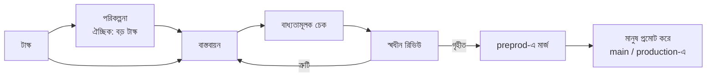

<div align="center">

# Darkfactory

**একটি self-hosted AI সফটওয়্যার ফ্যাক্টরি: এটি কাজের পরিকল্পনা করে, কোড লেখে, বাধ্যতামূলক চেক ও স্বাধীন রিভিউ চালায় এবং শুধুমাত্র `preprod`-এ ডেলিভার করে।**

[](../../LICENSE)
[](../../pyproject.toml)
[](../../compose.yaml)
[](https://fastapi.tiangolo.com)
[](https://www.postgresql.org)

[English](../../README.md) · [Русский](README.ru.md) · [中文](README.zh.md) · [हिन्दी](README.hi.md) · [Español](README.es.md) · [العربية](README.ar.md) · [Français](README.fr.md) · **বাংলা** · [Português](README.pt.md) · [日本語](README.ja.md)

</div>

Darkfactory আপনাকে দেয় একটি অভিন্ন UI ও API, আলাদা করা প্রজেক্টসহ অর্গানাইজেশন, PostgreSQL-ভিত্তিক কিউ এবং প্রতিটি টাস্কের জন্য আলাদা কন্টেইনার। যাচাই করা পরিবর্তন স্বয়ংক্রিয়ভাবে শুধু `preprod`-এ পৌঁছায়। মূল ব্রাঞ্চ ও production আপডেট করেন একজন মানুষ।

## কেন Darkfactory

- 🏭 **Self-hosted।** একটি UI ও API, অর্গানাইজেশন ও আলাদা করা প্রজেক্ট, PostgreSQL কিউ এবং প্রতিটি টাস্কের জন্য নির্দিষ্ট কন্টেইনার।
- 🛡️ **শুধুমাত্র `preprod`-এ ডেলিভারি।** Production ও মূল ব্রাঞ্চ আপডেট করেন মানুষ, ফ্যাক্টরি কখনও নয়।
- ✅ **বাধ্যতামূলক চেক ও স্বাধীন রিভিউ।** চেক ও রিভিউ একটি চূড়ান্ত কমিটের সাথে বাঁধা। চেক কনফিগার না থাকলে স্বয়ংক্রিয় মার্জ বন্ধ থাকে।
- 🔒 **আলাদা করা টাস্ক কন্টেইনার।** Non-root, read-only root filesystem, সীমিত CPU/RAM/PID, নেটওয়ার্ক বন্ধ, Docker socket, PostgreSQL, অন্য প্রজেক্ট বা production secret-এ কোনো অ্যাক্সেস নেই।
- 🔀 **ফলব্যাকসহ সাবস্ক্রিপশন পুল।** ডিফল্টে ডেভেলপমেন্টের জন্য Codex ও রিভিউয়ের জন্য Claude; কোটা বিবেচনা করে অ্যাকাউন্ট ও ইঞ্জিন পরিবর্তন; পেইড API শুধু স্পষ্ট opt-in করলে এবং অর্থের বাজেটসহ।
- 🧠 **Factory Director।** একটি চ্যাট (ওয়েব ও CLI), যা প্রজেক্ট, রোল ও টাস্ক তৈরি করে এবং ব্যবহারকারীর নিজের অনুমতির মধ্যে থেকে আটকে থাকা টাস্কের সমাধান করে।

## টাস্ক পাইপলাইন



ডিফল্টে একটি টাস্ক সরাসরি একজন ডেভেলপারের কাছে যায়, কোনো পরিকল্পনা বা সাবটাস্ক ছাড়াই। ব্লকিং প্রশ্নসহ পরিকল্পনা আপনি উত্তর না দেওয়া পর্যন্ত থেমে থাকে।

## সূচিপত্র

- [দ্রুত শুরু](#দ্রুত-শুরু)
- [আপনার প্রথম প্রজেক্ট](#আপনার-প্রথম-প্রজেক্ট)
- [এক্সিকিউটর সংযোগ](#এক্সিকিউটর-সংযোগ)
- [আইসোলেশন ও ডিপেন্ডেন্সি](#আইসোলেশন-ও-ডিপেন্ডেন্সি)
- [বিদ্যমান প্রজেক্ট ইনিশিয়ালাইজ করা](#বিদ্যমান-প্রজেক্ট-ইনিশিয়ালাইজ-করা)
- [প্রজেক্ট আর্টিফ্যাক্ট](#প্রজেক্ট-আর্টিফ্যাক্ট)
- [রোল, ডেলিগেশন, স্কিল ও MCP](#রোল-ডেলিগেশন-স্কিল-ও-mcp)
- [Factory Director](#factory-director)
- [মানুষের জন্য নোটিফিকেশন](#মানুষের-জন্য-নোটিফিকেশন)
- [সীমা ও ইনসিডেন্ট](#সীমা-ও-ইনসিডেন্ট)
- [বাস্তবায়ন যাচাই](#বাস্তবায়ন-যাচাই)
- [ব্রাউজার UI টেস্টিং](#ব্রাউজার-ui-টেস্টিং)
- [API ও ডেটা](#api-ও-ডেটা)
- [ইন্টারফেসের ভাষা](#ইন্টারফেসের-ভাষা)
- [লাইসেন্স](#লাইসেন্স)

## দ্রুত শুরু

আপনার Docker Compose ও `volume.subpath` সমর্থনসহ Docker Engine লাগবে। macOS-এ Docker Desktop কাজ করে।

> [!IMPORTANT]
> PostgreSQL-এর কোনো ডিফল্ট পাসওয়ার্ড নেই: `.env`-এ `POSTGRES_PASSWORD` না থাকলে Compose চালু হবে না। আগে তৈরি করা কোনো ইনস্টলেশনে পাসওয়ার্ড ছিল `darkfactory-local`: সেটি `.env`-এ রাখুন, তারপর PostgreSQL-এ (`ALTER USER darkfactory PASSWORD …`) এবং `.env`-এ পাসওয়ার্ড বদলে ফেলুন।

নতুন ইনস্টলেশনের জন্য, প্রজেক্ট ডিরেক্টরি থেকে:

```sh
echo "POSTGRES_PASSWORD=$(openssl rand -hex 32)" >> .env
docker compose up -d --build
docker compose exec app cat /data/bootstrap-token
```

[localhost:8080](http://localhost:8080) খুলুন এবং owner token পেস্ট করুন।

- **Owner token নিজে ঠিক করুন।** তৈরি হওয়া ফাইলের বদলে প্রথম চালুর আগে `echo "DARKFACTORY_ADMIN_TOKEN=$(openssl rand -hex 32)" >> .env` চালান।
- **পরে বদলানো।** রিস্টার্টের পর ভ্যারিয়েবলের নতুন মান `.env`-এর আগের token-কে প্রতিস্থাপন করে। ইতিমধ্যে চলমান ইনস্টলেশনে ভ্যারিয়েবলটি `/data/bootstrap-token` থেকে পাওয়া owner-এর সাথে যুক্ত হয়। `.env` থেকে বাতিল করা token পুনরুদ্ধার হয় না: নতুন মান দিন।
- **প্রথম বিল্ড।** এটি Python, Node, PostgreSQL, Codex CLI ও Claude Code ডাউনলোড করে। পরবর্তী চালুতে তৈরি ইমেজ ব্যবহার হয়।

### সার্ভিস

| সার্ভিস | উদ্দেশ্য |
|---|---|
| `app` | UI ও API পরিবেশন করে |
| `worker` | টাস্ক পরিচালনা করে |
| `db` | কিউ সংরক্ষণ করে (PostgreSQL) |
| `executor-image` | অস্থায়ী টাস্ক কন্টেইনারের জন্য ইমেজ তৈরি করে |

Docker socket শুধু বিশ্বস্ত worker-এর কাছে থাকে; টাস্ক এটি পায় না।

### কনফিগারেশন

Compose-এর সেটিংস `.env` থেকে পড়া হয়:

| ভ্যারিয়েবল | অর্থ | ডিফল্ট |
|---|---|---|
| `PORT` | প্রকাশিত পোর্ট | `8080` (`compose.yaml` অনুযায়ী) |
| `BIND_ADDRESS` | যে ঠিকানায় পোর্ট বাইন্ড হয় | `127.0.0.1` |
| `POSTGRES_PASSWORD` | PostgreSQL পাসওয়ার্ড | নেই, আবশ্যিক |
| `GLOBAL_CONCURRENCY` | গ্লোবাল টাস্ক কনকারেন্সি | `4` |
| `EXECUTOR_CPUS` | প্রতিটি টাস্ক কন্টেইনারের CPU সংখ্যা | `4` |
| `DATA_VOLUME` | `data` ভলিউমের নাম | `darkfactory_data` (`compose.yaml` অনুযায়ী) |
| `DARKFACTORY_ADMIN_TOKEN` | আপনার ঠিক করা owner token | `/data/bootstrap-token`-এ তৈরি হয় |
| `DARKFACTORY_PERSONAL_MODE` | ব্যক্তিগত লোকাল পাইলট মোড (দেখুন [এক্সিকিউটর সংযোগ](#এক্সিকিউটর-সংযোগ)) | `0` |
| `DARKFACTORY_PUBLIC_URL` | নোটিফিকেশন লিংকে ব্যবহৃত ফ্যাক্টরির ঠিকানা | `http://127.0.0.1:8080` |
| `DARKFACTORY_DIRECTOR_MODEL_CLAUDE`, `DARKFACTORY_DIRECTOR_MODEL_CODEX` | ওই provider-এর subscription-এ Director চ্যাটের model, যেমন এজেন্টদের চেয়ে হালকা কোনোটি। model সহ প্রজেক্টের Director profile অগ্রাধিকার পায়। Claude variable সেট থাকলে Director আগে Claude subscription চেষ্টা করে | খালি: connection-এর model |

> [!WARNING]
> কর্মীদের অ্যাক্সেসের জন্য অ্যাপ্লিকেশনের সামনে একটি HTTPS reverse proxy বসান। PostgreSQL বাইরে প্রকাশ করা হয় না।

## আপনার প্রথম প্রজেক্ট

1. **"Connect project"** ক্লিক করুন এবং নাম, একটি Git রিপোজিটরি ও প্রয়োজনে একটি অ্যাক্সেস token দিন।
2. স্ট্যান্ডার্ড স্কিলসহ ম্যানেজার, অ্যানালিস্ট, ডেভেলপার ও রিভিউয়ার সাথে সাথে তৈরি হয়ে যায়। রোলগুলো প্রজেক্টের এক্সিকিউটর উত্তরাধিকার সূত্রে পায়: ডেভেলপমেন্টের জন্য Codex ও রিভিউয়ের জন্য Claude। MCP সার্ভার আলাদাভাবে সংযুক্ত করতে হয়।
3. সাবস্ক্রিপশনগুলো অর্গানাইজেশনের শেয়ার্ড পুলে সংযুক্ত করুন। পুল আগে থেকে থাকলে নতুন প্রজেক্ট সেটিই ব্যবহার করে; না থাকলে ফ্যাক্টরি একটি "Shared pool" তৈরি করে। প্রজেক্ট পরে নিজের সেটিংসে নির্দিষ্ট পুল বেছে নিতে পারে।
4. প্রজেক্ট সেটিংসে বাধ্যতামূলক চেক কমান্ড নির্ধারণ করুন। এগুলো ছাড়া স্বয়ংক্রিয় মার্জ বন্ধ থাকে।
5. UI-তে বা API দিয়ে একটি টাস্ক তৈরি করুন। ব্লকিং প্রশ্নসহ পরিকল্পনা আপনি উত্তর না দেওয়া পর্যন্ত থেমে থাকে।

### সমর্থিত রিপোজিটরি

HTTPS Git, SSH এবং `/repos`-এর লোকাল bare রিপোজিটরি সমর্থিত। GitHub ও GitLab (self-hosted ডোমেইনসহ) PR/MR পায়। অন্য যেকোনো Git-এর জন্য ফ্যাক্টরি diff, চেক ও রিভিউসহ একটি অভ্যন্তরীণ পরিবর্তন রেকর্ড তৈরি করে। SSH-এর জন্য একটি নির্দিষ্ট key ও স্পষ্টভাবে দেওয়া `known_hosts` লাগে; হোস্ট key উত্তরাধিকারসূত্রে পাওয়া যায় না।

লোকাল প্রজেক্টের জন্য শেয়ার্ড `repos` ভলিউম ব্যবহার করুন, যা app ও worker-এ `/repos` হিসেবে মাউন্ট করা থাকে। আপনি `docker compose exec worker sh` দিয়ে রিপোজিটরি তৈরি করতে পারেন; [নিচের](#বাস্তবায়ন-যাচাই) টেস্ট দৃশ্যপটে একটি সম্পূর্ণ উদাহরণ আছে। হোস্ট ডিরেক্টরি টাস্ক কন্টেইনারে মাউন্ট করা হয় না।

### মার্জের আচরণ

- কোনো চেক কনফিগার না থাকলে টাস্ক একটি পরিবর্তন রেকর্ড ও `review_required` অবস্থায় শেষ হয়: স্বয়ংক্রিয় মার্জ নিষিদ্ধ।
- চেক ও রিভিউ একটি চূড়ান্ত কমিটের সাথে বাঁধা।
- `preprod`-এর টিপে পরিবর্তন হলে পুনরায় ইন্টিগ্রেশন ও অ্যাক্সেপ্টেন্স শুরু হয়।
- প্রজেক্টের মার্জ ক্রমানুসারে চলে।

### অ্যাক্সেস রোল

| রোল | যা করতে পারে |
|---|---|
| Owner | সেটিংস ও সংযোগ পরিচালনা |
| Operator | টাস্ক পরিচালনা |
| Observer | শুধু পড়া |

সদস্য ও token-এর অনুমতির ছেদ (intersection) কার্যকর হয়; অনুমতি প্রত্যাহার পরবর্তী অনুরোধগুলোতে প্রযোজ্য হয়। নতুন অর্গানাইজেশন নিজের owner এবং একবার দেখানো token পায়। Owner সেটিংসে ("Team access") বা `POST /api/members` দিয়ে সদস্যদের token ইস্যু করেন; `owner` রোলের একাধিক সদস্য থাকতে পারে। নিজের অতিরিক্ত token ইস্যু হয় `POST /api/tokens` দিয়ে এবং বাতিল হয় `DELETE /api/tokens/{id}` দিয়ে।

## এক্সিকিউটর সংযোগ

| সংযোগ | ক্রেডেনশিয়াল ও নোট |
|---|---|
| **Codex for company** | JSON ক্রেডেনশিয়াল `{"auth_method":"siwc","accessToken":"..."}`। App Server-এর জন্য নথিভুক্ত বাহ্যিক OAuth প্রোভাইডার ব্যবহার করে। এই দৃশ্যপটে অ্যাক্সেসসহ একটি Sign in with ChatGPT token লাগে। Token রিনিউ করতে reconnect করুন। |
| **Claude Code** | অনুমোদিত সাবস্ক্রিপশন সংযোগের জন্য `{"oauth_token":"..."}`। আলাদা করা সেশন কেবল নির্বাচিত token পায়; `--bare` ব্যবহার করা হয় না। |
| **API** | HTTPS OpenAI-সামঞ্জস্যপূর্ণ Chat Completions, tool call সহ। মডেল এবং `{"base_url":"https://example.com/v1","api_key":"...","input_usd_per_million":0.0,"output_usd_per_million":0.0}` দিন, প্রকৃত মূল্যসহ। নিজস্ব TLS CA-র জন্য একটি `ca_cert` ফিল্ড আছে। |

### ব্যক্তিগত লোকাল পাইলট

ব্যক্তিগত লোকাল পাইলটের জন্য আপনি ChatGPT-র মাধ্যমে বর্তমান `codex login` ব্যবহার করতে পারেন।

1. লোকাল `.env`-এ `DARKFACTORY_PERSONAL_MODE=1` যোগ করুন।
2. `docker compose up -d --build` চালান।
3. হোস্টে `python3 scripts/connect_personal_codex.py` চালান। স্ক্রিপ্টটি bootstrap token-এর অর্গানাইজেশনে `Personal Codex` পুল ও একটি সংযোগ তৈরি করে।
4. এই পুলটি একটি প্রজেক্টে অ্যাসাইন করুন; আলাদা একটি Codex সেশনও রিভিউ করতে পারে।

গেটওয়ে ছাড়া Codex থেকে ChatGPT-তে যাওয়া প্রতিটি অনুরোধ (backend ও model call, `openai_base_url`) executor-এর ভেতরের একটি loopback relay দিয়ে যায়, যা আসল token জুড়ে দেয়। বর্তমান model-এর জন্য Codex 0.160 বা নতুন লাগে, এবং সেটি ChatGPT backend-এ শুধু HTTPS-এ পৌঁছায়; তাই relay একবারের CA-র সই করা certificate দেয়, যাকে শুধু ওই Codex-ই বিশ্বাস করে (`CODEX_CA_CERTIFICATE`)। শুধু `~/.codex/auth.json` থেকে access token ও অ্যাকাউন্ট ID ইমপোর্ট করা হয়; refresh token ও হোস্ট ডিরেক্টরি কন্টেইনারে পাঠানো হয় না। Token এনক্রিপ্ট করে রাখা হয়। Token মেয়াদোত্তীর্ণ বা বাতিল হলে সংযোগ নিষ্ক্রিয় থাকা অবস্থায় ইমপোর্ট আবার করুন। Personal মোড ডিফল্টে বন্ধ, আর hosted বা বাণিজ্যিক ইনস্টলেশন SIWC ব্যবহার করে। বিল্ট-ইন অথরাইজেশনের পরিধি [অফিসিয়াল App Server ডকুমেন্টেশনে](https://learn.chatgpt.com/docs/app-server#auth-endpoints) বর্ণিত আছে।

আপনার ব্যক্তিগত Codex যদি আগে থেকেই লোকাল সাবস্ক্রিপশন গেটওয়ের মাধ্যমে কাজ করে, তাহলে Docker থেকে পৌঁছানো যায় এমন এর ঠিকানা ও কনফিগার করা মডেল দিন:

```sh
python3 scripts/connect_personal_codex.py --base-url http://host.docker.internal:8787/v1 --model MODEL_NAME
```

এই মোড শুধু লোকাল HTTP ঠিকানা গ্রহণ করে এবং `DARKFACTORY_PERSONAL_MODE=1` দাবি করে। এক্সিকিউটর একটি নির্দিষ্ট টানেল ও ঠিকানার বিদ্যমান allow-list দিয়ে দেওয়া গেটওয়ের সাথে সংযুক্ত হয়; কন্টেইনারের নেটওয়ার্ক `none`-ই থাকে। এই মোড পেইড API চালু করে না।

### পুল ও ইঞ্জিন নির্বাচন

পুল অগ্রাধিকার, মডেল, উপলব্ধ ইঞ্জিন, কনকারেন্সি, সুইচের সংখ্যা এবং কোটা পুনরায় যাচাইয়ের আগের বিরতি নির্ধারণ করে। মূল পছন্দ হলো ডেভেলপমেন্টের জন্য Codex ও রিভিউয়ের জন্য Claude। অ্যাকাউন্ট বদলানো এবং Codex ↔ Claude বদলানো অনুমোদিত; API ডিফল্টে স্বয়ংক্রিয়ভাবে সংযুক্ত হয় না। পেইড ফলব্যাকের জন্য owner স্পষ্টভাবে প্রজেক্ট নীতি চালু করেন এবং টাস্ক একটি অর্থের বাজেট পায়। স্পষ্টভাবে অ্যাসাইন করা API-র জন্যও বাজেট লাগে।

**"+ Subscription"** বোতামটি একটি লিংক ও একবার ব্যবহারযোগ্য ব্রাউজার কোডের মাধ্যমে স্ট্যান্ডার্ড Claude লগইন শুরু করে। Personal মোডে Codex device-auth পাওয়া যায়: লিংক ও কোড একই ফর্মে দেখা যায়। সাইন-ইনের আগে পুল বেছে নিন; নিশ্চিত করার পর অ্যাকাউন্ট স্বয়ংক্রিয়ভাবে যোগ হয়। আপনি ফর্ম বন্ধ করতে পারেন এবং সেটিংস থেকে অসমাপ্ত সাইন-ইন আবার শুরু করতে পারেন। সাইন-ইন সর্বোচ্চ ১৫ মিনিট বৈধ থাকে, বাতিল করা যায় এবং আলাদা কন্টেইনারে চলে। OAuth token কখনও ব্রাউজারে পাঠানো হয় না। মেয়াদোত্তীর্ণ token-এর স্বয়ংক্রিয় রিফ্রেশ বাস্তবায়িত নয়; সাইন-ইন আবার করুন বা reconnect করুন।

| পুলের ডিফল্ট | মান |
|---|---|
| সংরক্ষিত রিজার্ভ | **10%** |
| পর্যবেক্ষণ সতেজ গণ্য হয় | **300 সেকেন্ড** |
| অজানা কোটা | অনুমোদিত |

- সতেজ, জানা কোটা রিজার্ভের নিচে থাকলে সাবস্ক্রিপশন বাদ পড়ে। নির্বাচিত ইঞ্জিনের উপযুক্ত অ্যাকাউন্টগুলোর মধ্যে যেটির নিশ্চিত অবশিষ্ট বেশি, সেটিকে অগ্রাধিকার দেওয়া হয়।
- রিজার্ভ, স্ন্যাপশটের বয়স এবং "known quota required" সেটিং পুল ফর্মে আছে।
- Personal Codex মডেল কল করার আগে সীমা আবার যাচাই করে।
- যে প্রোভাইডারের ডেটা পাওয়া যায় না, তাদের জন্য কঠোর নীতি নিশ্চিত অবশিষ্টের জন্য অপেক্ষা করে।
- কাজ চলার সময় সীমা বদলাতে পারে: কোড সংরক্ষণ করে এবং কনটেক্সট হস্তান্তর করে অন্য অ্যাকাউন্টে কাজ চালিয়ে যাওয়া যায়।

সুইচের সময় কোড ও আর্টিফ্যাক্ট হস্তান্তর করা হয়, অ্যাকাউন্টের অভ্যন্তরীণ সেশন নয়। কোটা ও ব্যস্ততা প্রতিটি সংযোগ অনুযায়ী ট্র্যাক করা হয়, জানা শেয়ার্ড `quota_group`-সহ; একই ক্রেডেনশিয়াল আবার সংযুক্ত করলে নতুন কোটা তৈরি হয় না। অজানা অবশিষ্টকে কখনও সীমাহীন ঘোষণা করা হয় না। অথরাইজেশন ত্রুটিতে reconnect দরকার; কোটা ত্রুটিতে নিয়ন্ত্রণ যাচাই পর্যন্ত অপেক্ষা করতে হয়।

এক্সিকিউটর যখন অবশিষ্ট কোটা ও রিসেটের সময় জানায়, ফ্যাক্টরি সেগুলো সংরক্ষণ করে এবং পর্যবেক্ষণের সময়সহ সংযোগ সেটিংসে দেখায়। এটি সর্বশেষ পাওয়া স্ন্যাপশট, অ্যাকাউন্টের ধারাবাহিক পোলিং নয়। ডেটা না থাকলে "remaining quota unknown" দেখানো হয়। নতুন ক্রেডেনশিয়াল দিয়ে reconnect করলে আগের স্ন্যাপশট মুছে যায়। নিয়ন্ত্রণ চেষ্টার সময় প্রোভাইডারের জানানো রিসেট সময় থেকে আলাদাভাবে দেখানো হয়।

### পুল মুছে ফেলা

পুল সেটিংসে বা `DELETE /api/pools/{id}` দিয়ে মোছা যায়, Director-এর মাধ্যমেও। মোছার অনুমতি পুরো অর্গানাইজেশনের owner-এর আছে। সাবস্ক্রিপশন, অথরাইজেশন এবং অন্য পুলের সদস্যপদ অক্ষুণ্ণ থাকে। পুলটি কোনো প্রজেক্টে অ্যাসাইন করা থাকলে আগে ডেভেলপমেন্ট ও রিভিউয়ের জন্য অন্য একটি পুল বেছে নিন। মোছার আগে অসমাপ্ত সাবস্ক্রিপশন সাইন-ইনও সম্পন্ন বা বাতিল করতে হবে।

### অফিসিয়াল ভিত্তি

[Codex App Server](https://learn.chatgpt.com/docs/app-server), [SIWC external tokens](https://developers.openai.com/siwc/token-sharing-open-source/codex-app-server), [Claude Code headless](https://code.claude.com/docs/en/headless)।

> [!NOTE]
> অ্যাডাপ্টার থাকার অর্থ এই নয় যে সাবস্ক্রিপশন দৃশ্যপটটি কোনো নির্দিষ্ট কোম্পানির জন্য উপলব্ধ: অনুমোদিত সংযোগ দরকার।

## আইসোলেশন ও ডিপেন্ডেন্সি

একটি টাস্ক পায় নিজস্ব ওয়ার্কিং কপি ও ব্রাঞ্চ, একটি non-root কন্টেইনার, read-only root filesystem, সীমিত CPU/RAM/PID এবং একটি অভ্যন্তরীণ ডেডলাইন। এজেন্টের জন্য `.git` write-protected। ভেরিফায়ার ওয়ার্কিং কপি read-only পায়। Docker socket, PostgreSQL, অন্য প্রজেক্ট বা production secret-এ কোনো অ্যাক্সেস নেই।

কন্টেইনারের নেটওয়ার্ক বন্ধ। HTTPS পাওয়া যায় একটি CONNECT proxy-র মাধ্যমে, শুধু নির্বাচিত প্রোভাইডার ও প্রজেক্টের স্পষ্টভাবে অনুমোদিত `host:port` এন্ট্রিতে। চেক ডিফল্টে অফলাইন। টেস্ট secret আলাদাভাবে পাঠানো হয়; proxy যেকোনো হোস্টে অবাধ অ্যাক্সেস খোলে না।

> [!WARNING]
> Production ডিপ্লয়মেন্ট বাস্তবায়িত নয়। ফ্যাক্টরি শুধু `preprod`-এ ডেলিভার করে।

### এক্সিকিউটর ইমেজ ও টেস্ট সেটিংস

ইমেজে Python, Node ও Git আছে। প্রজেক্টের অন্য ডিপেন্ডেন্সি দরকার হলে `darkfactory-executor:local` থেকে নিজের ইমেজ তৈরি করুন, ডিপেন্ডেন্সিগুলো আগেই ইনস্টল করুন এবং প্রজেক্ট সেটিংসে `executor_image` দিন।

- Owner অনুমোদিত টেস্ট এন্ডপয়েন্ট ও `test_env` কনফিগার করেন।
- `test_env`-এর নাম শুধু `TEST_*`, `APP_*` বা `E2E_*` হতে পারে।
- `allowed_hosts`, Git remote এবং PR/MR সার্ভার অবশ্যই fully qualified নাম হতে হবে।
- অভ্যন্তরীণ ঠিকানা (loopback, private network, link-local, CGNAT) তখনই গৃহীত হয় যদি এর সুনির্দিষ্ট `ip:port` `allowed_hosts`-এ তালিকাভুক্ত থাকে।

### টাস্কের সম্পর্ক

টাস্কের সম্পর্ক: `depends_on`, প্যারেন্ট → সাবটাস্ক (`parent`), `related_to` এবং নিশ্চিত `duplicate`। কোড ডিপেন্ডেন্সি `preprod`-এ গৃহীত ফলাফলের জন্য অপেক্ষা করে; আর্টিফ্যাক্ট ডিপেন্ডেন্সি একটি নির্দিষ্ট যাচাইকৃত কমিট গ্রহণ করতে পারে। সাইকেল ও ক্রস-অর্গানাইজেশন সম্পর্ক নিষিদ্ধ। প্যারেন্ট তার বাধ্যতামূলক চাইল্ড টাস্ক এবং নিজের ইন্টিগ্রেশন চেকের জন্য অপেক্ষা করে।

### ডিকম্পোজিশন ও রিভিউ

- ডিফল্টে একটি টাস্ক সরাসরি একজন ডেভেলপারের কাছে যায়, কোনো পরিকল্পনা বা সাবটাস্ক ছাড়াই।
- রিভিউ কাজ ফেরত পাঠায় শুধু ত্রুটি ও অপূর্ণ ক্রাইটেরিয়ার জন্য; উন্নতির প্রস্তাবে `[LATER]` চিহ্ন দেওয়া হয় এবং সেগুলো ব্যাকলগে যায়।
- "Large task" চিহ্নিত টাস্কে প্ল্যানার নিজেই অ্যাক্সেপ্টেন্স ক্রাইটেরিয়া ও ডিপেন্ডেন্সিসহ সর্বোচ্চ আটটি সাবটাস্ক তৈরি করতে পারে।
- স্বাধীন চাইল্ডরা আলাদা ওয়ার্কিং ডিরেক্টরি পায় এবং সমান্তরালে চলতে পারে।
- নেস্টেড স্বয়ংক্রিয় ডিকম্পোজিশন নিষিদ্ধ।
- নিজের বাস্তবায়নের আগে প্যারেন্ট তার চাইল্ডদের গৃহীত কোড সংগ্রহ করে।
- সময়, সংশোধন, সুইচ ও অর্থ পুরো ট্রির জন্য একটিমাত্র বাজেটে সীমিত; চাইল্ড তৈরি করলে সীমা গুণ হয় না। সমান্তরাল রান অবশিষ্ট সময়ের অংশ সংরক্ষণ করে।
- প্যারেন্ট বাতিল করলে তার তৈরি এজেন্টও বাতিল হয়; বাতিল হওয়া চাইল্ড স্বয়ংক্রিয়ভাবে পুনরায় শুরু হয় না।

### ডিপেন্ডেন্সি পরিবর্তন

গৃহীত ডিপেন্ডেন্সি SHA টাস্কে সংরক্ষিত থাকে। SHA বদলে গেলে বা গৃহীত ফলাফল প্রত্যাহার হলে বর্তমান এক্সিকিউটর থামে এবং পুরোনো চেক ও রিভিউ রিসেট হয়। আনব্লক হওয়ার পর টাস্ক ইনপুট সংকলন, বাস্তবায়ন ও অ্যাক্সেপ্টেন্স পুনরাবৃত্তি করে, কার্যকর কোড ও জমা হওয়া কাউন্টার রেখে দিয়ে। মার্জের আগে ডিপেন্ডেন্সি চেক ও Git অপারেশন একটি শেয়ার্ড কন্ট্রোলার লকের অধীনে চলে, তাই ইনপুটের পরিবর্তন এ দুইয়ের মাঝে ঢুকে পড়তে পারে না।

## বিদ্যমান প্রজেক্ট ইনিশিয়ালাইজ করা

প্রজেক্ট যোগ করার সময় **"Initial indexing and Markdown documents"** ডিফল্টে চালু থাকে। ফ্যাক্টরি একটি সাধারণ টাস্ক কিউতে দেয়: প্রথমে এটি ট্র্যাক করা Git ফাইলের একটি মানচিত্র সংরক্ষণ করে, তারপর এক্সিকিউটর রিপোজিটরি অধ্যয়ন করে এবং চারটি ফাইল তৈরি বা সম্প্রসারিত করে:

| ফাইল | বিষয়বস্তু |
|---|---|
| `docs/darkfactory/INDEX.md` | প্রজেক্টের মানচিত্র, এন্ট্রি পয়েন্ট ও মডিউলের উদ্দেশ্য |
| `docs/darkfactory/ARCHITECTURE.md` | কম্পোনেন্ট, ডিপেন্ডেন্সি, ডেটা ও সিস্টেমের সীমানা |
| `docs/darkfactory/DEVELOPMENT.md` | ইনস্টলেশন, চালানো, কনফিগারেশন ও চেক |
| `docs/darkfactory/CONTRACTS.md` | আবিষ্কৃত API, ইভেন্ট ও বাহ্যিক ইন্টিগ্রেশন |

SHA-সহ সোর্স ম্যাপ টাস্ক আর্টিফ্যাক্টেও থাকে: `repository-index.md`। এতে প্রথম ১০০০টি ট্র্যাক করা ফাইল এবং মোট সংখ্যা তালিকাভুক্ত থাকে। এক্সিকিউটরকে সিদ্ধান্ত প্রজেক্টের ফাইল দিয়ে সমর্থন করতে হবে, বিদ্যমান কার্যকর ডকুমেন্টেশন রক্ষা করতে হবে এবং যা অজানা তা চিহ্নিত করতে হবে। এই চারটি ডকুমেন্টের বাইরের পরিবর্তন worker-এর চেকে প্রত্যাখ্যাত হয়।

টাস্কটি প্রজেক্টের সংযোগ, সীমা, চেক ও স্বাধীন রিভিউ ব্যবহার করে। এখনও কোনো সংযোগ না থাকলে সেগুলো সেট আপ হওয়া পর্যন্ত এটি অপেক্ষা করে। ডকুমেন্টগুলো সাধারণ Git পাইপলাইনের মধ্য দিয়ে যায়: বাধ্যতামূলক চেক সফল হলে পরিবর্তন `preprod`-এ মার্জ হয়; চেক কনফিগার না থাকলে ম্যানুয়াল মার্জের জন্য রেখে দেওয়া হয়। রিভিউয়ের পর চারটি ডকুমেন্টই রেজিস্ট্রিতে **ড্রাফট** হিসেবে আসে, উৎস টাস্ক ও যাচাইকৃত কমিটের SHA-সহ। Owner যে সংস্করণগুলো চান সেগুলো স্পষ্টভাবে গ্রহণ করেন; বিদ্যমান গৃহীত সংস্করণ অক্ষুণ্ণ থাকে।

আগে সংযুক্ত করা প্রজেক্টের জন্য **"Project artifacts" → "Index project"** খুলুন। বোতামটি owner-এর জন্য উপলব্ধ এবং ইনিশিয়ালাইজেশন টাস্ক আগে তৈরি হয়ে থাকলে সেটিই খোলে, ডুপ্লিকেট ছাড়া। API দিয়ে প্রজেক্ট তৈরিতে `initialize` গ্রহণ করা হয় (ডিফল্ট `true`); `false` স্বয়ংক্রিয় শুরু বন্ধ করে। বিদ্যমান প্রজেক্টের জন্য: `POST /api/projects/{id}/initialize`।

## প্রজেক্ট আর্টিফ্যাক্ট

**"Project artifacts"** খুলুন এবং requirements, অ্যানালিটিক্স, আর্কিটেকচার, API কন্ট্রাক্ট, রিপোর্ট বা অন্য যেকোনো টেক্সট ডকুমেন্ট যোগ করুন। একটি আর্টিফ্যাক্টের প্রজেক্টের মধ্যে একটি স্থায়ী key, একটি শিরোনাম এবং অপরিবর্তনীয় সংস্করণের ইতিহাস থাকে। কনটেন্ট DB-তে সংরক্ষিত হয়; সম্পাদনা করলে নতুন সংস্করণ তৈরি হয়। এটি একটি আলাদা প্রজেক্ট নলেজ রেজিস্ট্রি, যা টাস্কের ওয়ার্কিং ফাইল (`plan.md`, `diff.patch`, `checks.txt`, `review.txt`, `handoff.md`) ও ব্রাউজার প্রমাণের পরিপূরক।

- Operator ড্রাফট যোগ করেন, owner নির্বাচিত সংস্করণ গ্রহণ করেন বা গ্রহণ প্রত্যাহার করেন, observer পড়েন।
- প্রতিটি আর্টিফ্যাক্টের ঠিক একটি সংস্করণ একসময়ে গৃহীত থাকে।
- ঐচ্ছিকভাবে একটি উৎস টাস্ক দিন: এর একটি বর্তমান কমিট ও স্বাধীন রিভিউ থাকতে হবে। একটি সংস্করণ টাস্ক ID ও SHA সংরক্ষণ করে; উৎসের ফলাফল বা তার ইনপুট বদলে গেলে ডকুমেন্টটি stale হয়ে যায়।
- সাধারণ ডকুমেন্ট ফর্ম বা API দিয়ে প্রকাশ করা হয়; প্রজেক্ট ইনিশিয়ালাইজেশন রিভিউয়ের পর নিজের ডকুমেন্ট স্বয়ংক্রিয়ভাবে যোগ করে।

### টাস্কের ইনপুট হিসেবে আর্টিফ্যাক্ট ব্যবহার

টাস্ক তৈরির সময় গৃহীত সংস্করণ বেছে নিন। থেমে থাকা টাস্কের কার্ডে আপনি একটি ইনপুট যোগ, প্রতিস্থাপন বা মুছতে পারেন। টাস্ক ঠিক নির্বাচিত সংস্করণগুলোর পূর্ণ টেক্সট, তাদের key, নম্বর ও উৎস SHA পায়। ডেলিগেট করা সাবটাস্ক এই সংস্করণগুলো উত্তরাধিকার সূত্রে পায়।

| সীমা | মান |
|---|---|
| প্রতি সংস্করণে অক্ষর | 100,000 |
| প্রতি টাস্কে ইনপুট | সর্বোচ্চ 10 |
| প্রতি টাস্কে মোট অক্ষর | 200,000 |

নতুন সংস্করণ গ্রহণ করলে টাস্কের নির্বাচন স্বয়ংক্রিয়ভাবে বদলায় না: পুরোনো সংস্করণের ব্যবহারকারীরা স্পষ্টভাবে ইনপুট প্রতিস্থাপনের জন্য অপেক্ষা করে। গ্রহণ প্রত্যাহার হলে এবং উৎস stale হলেও এক্সিকিউশন আটকে যায়। ফ্যাক্টরি আগের ইনপুটের চেক ও রিভিউ রিসেট করে, সক্রিয় এক্সিকিউটর থামায় এবং মার্জের আগে ইনপুট আবার যাচাই করে। কার্যকর কোড ও জমা হওয়া কাউন্টার সংরক্ষিত থাকে। আর্টিফ্যাক্ট কার্ডে ইতিহাস, উৎস টাস্ক ও ব্যবহারকারীরা দেখা যায়; আগের সংস্করণ পড়া যায়।

### আর্টিফ্যাক্ট API

| উদ্দেশ্য | রুট |
|---|---|
| আর্টিফ্যাক্ট | `GET/POST /api/projects/{id}/artifacts` |
| সংস্করণ | `POST /api/project-artifacts/{id}/versions`, `GET /api/project-artifacts/{id}/versions/{version_id}` |
| গ্রহণ | `POST …/versions/{version_id}/accept`, `POST /api/project-artifacts/{id}/revoke` |
| টাস্কের ইনপুট | `GET /api/tasks/{id}/artifact-inputs`, `PUT/DELETE /api/tasks/{id}/artifact-inputs/{artifact_id}` |
| টাস্ক তৈরি | `artifact_version_ids` গ্রহণ করে |

অ্যাক্সেস অর্গানাইজেশন, ব্যবহারকারীর প্রজেক্ট ও token scope দিয়ে সীমিত; সাধারণ ডিপেন্ডেন্সির সাথে সাইকেল নিষিদ্ধ। বিদ্যমান টাস্ক না বদলে নতুন টেবিল স্টার্টআপে তৈরি হয়।

## রোল, ডেলিগেশন, স্কিল ও MCP

বাম মেনুতে **"Agents, skills and MCP"** খুলুন এবং একটি প্রজেক্ট বেছে নিন। **"Add ready-made team"** বোতাম প্রজেক্ট এজেন্ট, অ্যানালিস্ট, ডেভেলপার ও রিভিউয়ার ইনস্টল করে। **"Roles"**, **"Skills"** ও **"MCP"** ট্যাবে ক্যাটালগ আছে: বোতাম দিয়ে তৈরি কনফিগারেশন যোগ করুন এবং তালিকা থেকে রোলের সাথে স্কিল ও টুল সংযুক্ত করুন। নির্দেশনা, ইঞ্জিন ও মডেল রোল কার্ডে বদলানো যায়। প্রোফাইল আলাদা আলাদা টাস্কেও অ্যাসাইন করা যায়।

### ডেলিগেশন

পরিকল্পনার সময় প্রজেক্ট এজেন্ট সাবটাস্ক তৈরি করে এবং সেগুলোতে একটি `agent_profile` অ্যাসাইন করে। "বিশ্লেষণ → ডেভেলপমেন্ট" দৃশ্যপটের জন্য `analyst` ও `developer` প্রোফাইল তৈরি করুন: ডেভেলপার সাবটাস্ক `depends_on`-এ বিশ্লেষণের key তালিকাভুক্ত করে। ডেভেলপার শুরু করে `preprod`-এ বিশ্লেষণের যাচাইকৃত মার্জের পর এবং গৃহীত কমিট ও আর্টিফ্যাক্ট পায়। অ্যানালিস্ট ফলাফল রিপোজিটরিতে সংরক্ষণ করে। ডেলিগেশনের অনুমতিসম্পন্ন প্রতিটি এজেন্ট কনফিগার করা গভীরতা ও মোট সংখ্যার মধ্যে আরও সাবটাস্ক তৈরি করতে পারে।

| ডেলিগেশনের ডিফল্ট | মান |
|---|---|
| গভীরতা | 2 |
| প্রতি ট্রিতে সর্বোচ্চ সাবটাস্ক | 16 |
| প্রতি পরিকল্পনায় সরাসরি সাবটাস্ক | 8 |

সময়, সংশোধন ও অর্থের বাজেট পুরো ট্রিতে ভাগ করা হয়।

### ক্যাটালগ

ক্যাটালগে সাতটি স্কিল ও চারটি MCP সার্ভার আছে: ব্রাউজার, প্রজেক্ট ফাইল পড়া/অনুসন্ধান, Git status/diff/log পড়া এবং Jira। প্রথম তিনটি টাস্ক কন্টেইনারের ভেতরে চলে এবং কোনো বাহ্যিক সার্ভার লাগে না।

### Jira MCP

**Jira** MCP (`mcp-atlassian`, এক্সিকিউটর ইমেজে ইনস্টল করা) Jira Server/Data Center বা Cloud-এর issue, JQL অনুসন্ধান, বোর্ড ও স্প্রিন্ট পড়ে। লেখার টুল গেটওয়েতে এবং সার্ভারে নিজেও (`--read-only`) নিষ্ক্রিয়। ক্যাটালগ থেকে যোগ করার পর এর কার্ড খুলে পূরণ করুন:

- **যেসব ঠিকানায় অ্যাক্সেস দরকার:** `jira.example.com:443`। এটি ছাড়া টাস্কের egress সার্ভারকে Jira-তে পৌঁছাতে দেবে না, private ঠিকানাসহ।
- **Secret এনভায়রনমেন্ট:** `JIRA_URL=https://jira.example.com` এবং `JIRA_PERSONAL_TOKEN=<PAT>` (Jira → Profile → Personal Access Tokens)। Jira Cloud-এর জন্য PAT-এর বদলে `JIRA_USERNAME` ও `JIRA_API_TOKEN` ব্যবহার করুন।

তারপর যেসব রোলের দরকার, যেমন অ্যানালিস্ট ও ম্যানেজার, তাদের সাথে `jira` সংযুক্ত করুন। সার্ভিস অ্যাকাউন্টের শুধু প্রাসঙ্গিক প্রজেক্টে পড়ার অনুমতি লাগে।

### কাস্টম MCP

নিজস্ব MCP-র জন্য একটি উন্নত ফর্ম আছে: একটি HTTPS এন্ডপয়েন্ট বা এক্সিকিউটর ইমেজ থেকে একটি stdio কমান্ড, অনুমোদিত টুলের সুনির্দিষ্ট নাম এবং secret হেডার বা এনভায়রনমেন্ট। Secret এনক্রিপ্ট করা থাকে এবং UI/API-তে কখনও ফেরত দেওয়া হয় না। নেটিভ Codex ও Claude একটি লোকাল গেটওয়ের মাধ্যমে টুল পায়, যা তালিকা ফিল্টার করে এবং অনুমোদিত সেটের বাইরের কল নিষিদ্ধ করে। প্ল্যানার ও রিভিউয়ার শুধু সেই সংযোগ গ্রহণ করে যা owner read-safe হিসেবে চিহ্নিত করেছেন; সার্ভিস অ্যাকাউন্টের নিজস্ব অনুমতিও রোলের সাথে মিলতে হবে। পেইড API অ্যাডাপ্টার MCP সমর্থন করে না।

## Factory Director

**"Factory Director"** ডায়ালগ ডানদিকে খোলা থাকে। পুরো ফ্যাক্টরি বা একটি প্রজেক্ট বেছে নিন। ডায়ালগের মাধ্যমে আপনি অর্গানাইজেশন, প্রজেক্ট, পুল, রোল ও স্কিল তৈরি করতে, তৈরি MCP সার্ভার সংযুক্ত করতে, টাস্ক তৈরি করতে এবং উপলব্ধ সেটিংস বদলাতে পারেন। উদাহরণ: "প্রজেক্টে একজন অ্যানালিস্ট ও একজন ডেভেলপার যোগ করো, তাদের ফাইল ও Git পড়ার অ্যাক্সেস দাও"।

- **"New chat"** আলাদা ইতিহাস ও কনটেক্সট শুরু করে। পুরোনো চ্যাট তালিকায় থাকে।
- **"Cancel message"** কিউ থেকে অনুরোধ সরিয়ে দেয় বা সক্রিয় এক্সিকিউটর থামায়। ইতিমধ্যে শুরু হওয়া কাজ শেষ হতে পারে; তাদের লগ সংরক্ষিত থাকে। কন্টেইনার থামার পর সাবস্ক্রিপশন মুক্ত হয়।

Director চলে সংযুক্ত সাবস্ক্রিপশন পুলের **Codex CLI বা Claude CLI**-এর মাধ্যমে। এটি ব্যবহারকারীর মতোই একই API ও অনুমতি ব্যবহার করে: operator owner-এর অধিকার পায় না, এবং একটি প্রজেক্টে অ্যাক্সেস অন্যগুলো খোলে না। Director-এর জন্য পেইড API স্বয়ংক্রিয়ভাবে চালু হয় না। পুল ব্যস্ত থাকলে অনুরোধ কিউতে থাকে। রিস্টার্টের পর ফলাফল অনিশ্চিত হলে কাজ অন্ধভাবে পুনরাবৃত্তি করা হয় না: Director আপনাকে অবস্থা যাচাই করতে বলে।

> [!CAUTION]
> পাসওয়ার্ড, key ও সাইন-ইন কোড সংযোগ ফর্মের মাধ্যমে যোগ করুন। Director একটি সাইন-ইন শুরু করতে ও লিংক দিতে পারে, কিন্তু এটি কখনও token বা device code পায় না। তৈরি করা অর্গানাইজেশনের অ্যাক্সেস আলাদাভাবে এবং ইন্টারফেসের মাধ্যমে একবারই দেওয়া হয়।

### আটকে থাকা টাস্ক

Director সেই টাস্কও সামলায় যা থেমে গিয়ে মানুষের জন্য অপেক্ষা করছে: রিভিউ-সাইকেলের সীমা, ডেভেলপারের প্রশ্ন, বন্ধ নেটওয়ার্ক, মেয়াদোত্তীর্ণ সময়। এটি কোড ও টাস্কের ইতিহাস পড়ে (রিপোজিটরি read-only সংযুক্ত) এবং নিজেই সিদ্ধান্ত নেয়: নির্দেশনাসহ চালিয়ে যাওয়া, পুনরায় রিভিউয়ে ফেরত পাঠানো, একটি ঠিকানা অনুমোদন করা, বাতিল করা। এটি owner-কে ডাকে শুধু অ্যাক্সেস, অর্থ, প্রোডাক্ট সংক্রান্ত পছন্দ ও ধ্বংসাত্মক কাজের জন্য। চিন্তা করার সময় বোর্ডে টাস্কে "Director deciding" দেখায়।

চ্যাটের **"Decisions"** বোতাম প্রজেক্টের জন্য এর সিদ্ধান্তগুলো দেখায়। "Waiting for you" চিহ্নিতগুলোতে আপনার সিদ্ধান্ত দরকার: চ্যাটে Director-কে উত্তর দিন, যেমন "টাস্ক … এর জন্য চালিয়ে যাও, … ব্যবহার করো", এবং এটি নিজেই টাস্ক চালিয়ে যায় বা বাতিল করে।

প্রজেক্ট সেটিংস: "Director resolves stops instead of you" এবং "Director decisions per task tree" (ডিফল্ট 6, ভ্যারিয়েবল `DARKFACTORY_DIRECTOR_LIMIT`)। Director-এর মডেল ও নির্দেশনা "Roles" স্ক্রিনের "Director" রোল দিয়ে নির্ধারিত হয়।

### টার্মিনাল থেকে Director

একই ডায়ালগ টার্মিনাল থেকেও পাওয়া যায়:

```sh
uv sync
uv run darkfactory director --token-file /path/to/api-token "Покажи проекты и текущие задачи"
uv run darkfactory director --token-file /path/to/api-token --project PROJECT_ID
```

বার্তা না দিলে একটি ইন্টারঅ্যাক্টিভ ডায়ালগ খোলে।

| অপশন / ভ্যারিয়েবল | উদ্দেশ্য |
|---|---|
| `--token-file` বা `DARKFACTORY_TOKEN` | API token (ফাইল বা এনভায়রনমেন্ট) |
| `--url` বা `DARKFACTORY_URL` | সার্ভারের ঠিকানা (ডিফল্ট `http://127.0.0.1:8080`) |
| `--project` | নির্দিষ্ট প্রজেক্টে কাজ করা |
| `--timeout` | অপেক্ষার সময়; ডিফল্ট 600 সেকেন্ড |
| `--resume MESSAGE_ID` | পুনরায় না পাঠিয়ে একই অনুরোধের জন্য অপেক্ষা করা; আগের token ও `--project` ব্যবহার করুন |
| `--new-chat` | আলাদা CLI ডায়ালগ শুরু করা |
| `--thread CHAT_ID` | বিদ্যমান চ্যাট চালিয়ে যাওয়া |
| `--cancel MESSAGE_ID` | কমান্ড পুনরায় না পাঠিয়ে একটি বার্তা বাতিল করা |

কমান্ডটি `python -m darkfactory.cli director` হিসেবেও পাওয়া যায়। টার্মিনাল বন্ধ হলে বা অপেক্ষার সময় শেষ হলেও অনুরোধ চলতে থাকে।

## মানুষের জন্য নোটিফিকেশন

সেটিংসে HTTPS webhook ও ঐচ্ছিক প্রাপক `@username` বা `#channel`-সহ একটি Rocket.Chat চ্যানেল যোগ করুন, অথবা bot token ও chat ID-সহ Telegram। Rocket.Chat-এ প্রাপক দিতে হলে incoming webhook-এ চ্যানেল override লাগবে (নিচে দেখুন)। URL আবার না দিয়েই প্রাপক বদলানো যায়। একটি প্রজেক্ট বা পুরো অর্গানাইজেশন বেছে নিন, তারপর ইভেন্ট: প্রশ্ন, স্টপ, ত্রুটি, সীমা, গৃহীত পরিবর্তন ও ইনসিডেন্ট। চ্যানেল সেট আপ করলে নিজে থেকে কোনো বার্তা পাঠানো হয় না। এজেন্টের প্রশ্ন ও পাইপলাইনের স্টপ স্বয়ংক্রিয়ভাবে কিউতে ঢোকে। `{"message":"..."}`-সহ API `POST /api/tasks/{id}/notify` টাস্কের কনফিগার করা চ্যানেলগুলোতে একটি বার্তা পাঠায়।

ডেলিভারি টাস্ক থেকে আলাদাভাবে চলে, পাঁচটি চেষ্টায় এবং পুনঃচেষ্টার মাঝে বিলম্বসহ। Secret আর দেখানো হয় না। পাঠানো ও acknowledgement সংরক্ষণের মাঝে ব্যর্থতা ঘটলে ডুপ্লিকেট বার্তা সম্ভব। প্রশ্নের উত্তর টাস্ক কার্ডে বা সরাসরি চ্যাটে দেওয়া হয়।

### চ্যাট কমান্ড

চ্যানেল সেটিংসে operator রোলের একটি API token দিয়ে চ্যাট কমান্ড চালু করা হয়: কমান্ড এর অনুমতি ও প্রজেক্ট scope-এ চলে, তাই ন্যূনতম প্রয়োজনীয় অনুমতিসহ একটি নির্দিষ্ট token ইস্যু করুন। চ্যানেল owner token গ্রহণ করে না। `allowed_senders` ছাড়া চ্যাটের যেকোনো সদস্য কমান্ড ব্যবহার করতে পারে; `allowed_senders` তালিকা (Telegram `from.id`, Rocket.Chat `user_id`) থাকলে শুধু তালিকাভুক্তরা পারে। প্রেরক টাস্ক ইভেন্টে রেকর্ড হয়।

- `!director text` (বা `/director text`) Director-কে একটি কাজ হস্তান্তর করে, যেমন `!director টাস্কগুলো দেখাও`। প্রাইভেসি মোডসহ Telegram গ্রুপে bot শুধু `/director` দেখতে পায়। Telegram কমান্ডসহ বার্তার উত্তরে জবাব দেয়, Rocket.Chat সেই বার্তার থ্রেডে জবাব দেয়। Director ব্যস্ত থাকলে নতুন কমান্ড প্রত্যাখ্যাত হয়।
- প্রশ্ন বা স্টপ নোটিফিকেশনের উত্তর সেই টেক্সট দিয়ে টাস্ক চালিয়ে যায়, কার্ডের "Continue" বোতামের মতো। Telegram-এ bot-এর বার্তার উত্তর দিন বা মন্তব্যসহ প্রাইভেট চ্যাটে সেটি bot-কে ফরওয়ার্ড করুন। Rocket.Chat-এ নোটিফিকেশনের থ্রেডে উত্তর দিন।
- Telegram `getUpdates`-এর মাধ্যমে long polling করে পড়া হয়, তাই কোনো পাবলিক ঠিকানা লাগে না; bot-এর কোনো webhook থাকা চলবে না। একই bot ভাগ করা চ্যানেলগুলো chat ID অনুযায়ী বার্তা ভাগ করে নেয়।

### Telegram থেকে পরিচালনা

কমান্ড token থাকলে Telegram bot একটি বোতাম মেনু দেয়। `/start` বা `меню` সেটি খোলে। স্ক্রিন একই বার্তায় আপডেট হয়।

- প্রজেক্ট → "Ready to run", "In progress", "Needs attention", "Done" কলামসহ বোর্ড → টাস্ক তালিকা → কার্ড। কার্ডে এজেন্টের প্রশ্ন ও টাস্কের অবস্থা অনুযায়ী বোতাম দেখায়।
- "✍️ Reply" এজেন্টকে একটি উত্তর পাঠায় এবং টাস্ক চালিয়ে যায়। "Reply" ও "Card" বোতাম প্রতিটি টাস্ক নোটিফিকেশনের নিচেও থাকে।
- কিউয়ের ক্রম বদলায় "⏫ Higher" ও "⏬ Lower" বোতাম বা "➡️ Move" → "To start" ও "To end" দিয়ে: এটি টাস্কের অগ্রাধিকার। "Move" একটি টাস্ককে চালানোর জন্য ফেরতও আনে, মার্জ করে বা বাতিল করে; বাতিল করতে নিশ্চিতকরণ চাওয়া হয়।
- "➕ New task": উত্তরের প্রথম লাইন শিরোনাম, পুরো টেক্সট বিবরণ।
- "🧠 Director" Director-কে একটি বার্তা হস্তান্তর করে। bot-এর সাথে প্রাইভেট চ্যাটে যেকোনো সাধারণ টেক্সটও Director-এর কাছে যায় এবং এর বার্তার উত্তর কথোপকথন চালিয়ে যায়।
- সাবস্ক্রিপশন শুধু ওয়েব সেটিংসে সংযুক্ত করা হয়: চ্যাট কোনো সাইন-ইন শুরু করে না।

### Rocket.Chat কমান্ড সেট আপ

"Message sent" ইভেন্টের জন্য, incoming webhook-এর একই রুমে একটি outgoing webhook তৈরি করুন। URL: `https://<factory>/api/chat-commands/rocketchat/<channel id>` (চ্যানেল তালিকায় দেখানো হয়); চ্যানেল সেটিংসে webhook token দিন। ট্রিগার শব্দ ফাঁকা রাখুন এবং bot-এর বার্তা বাদ দেবেন না: ফ্যাক্টরি সেগুলো দিয়ে জানে একটি থ্রেড কোন টাস্কের। Rocket.Chat অজানা slash কমান্ড পাঠায় না, তাই সেখানে কমান্ড শুরু হয় `!` দিয়ে:

- `!director text`: Director-কে একটি কাজ হস্তান্তর।
- `!projects`: প্রজেক্ট এবং বোর্ডের প্রতিটি কলামে টাস্কের সংখ্যা।
- `!waiting`: উত্তর বা merge-এর অপেক্ষায় থাকা টাস্ক।
- `!task <id>`: টাস্ক কার্ড।
- `!help`: কমান্ডের তালিকা।

টাস্ক-নোটিফিকেশনের থ্রেডে সাধারণ লেখা এজেন্টের উত্তর, আর `!task`, `!resume`, `!merge` ও `!cancel` ওই টাস্কের উপর কাজ করে।

Incoming webhook দুটি মোডে কাজ করে, যা তার “Override Destination Channel” সেটিং দিয়ে ঠিক হয়:

- **Override বন্ধ** (Rocket.Chat-এর ডিফল্ট): চ্যানেলের প্রাপক খালি রাখুন। প্রতিটি বার্তা webhook-এর নিজের চ্যানেলে যায়, আর থ্রেডের উত্তরে শুধু থ্রেড ID (`tmid`) থাকে। এখানে Rocket.Chat `roomId` বা `channel`-সহ যেকোনো অনুরোধ প্রত্যাখ্যান করে (`overriding destination channel is disabled for this integration`), তাই override বন্ধ থাকলে প্রাপক দিলে প্রতিটি ডেলিভারি ব্যর্থ হয়। Outgoing webhook incoming webhook-এর একই রুমে রাখুন, নইলে উত্তর থ্রেডের বাইরে পড়বে।
- **Override চালু**: প্রাপক ঠিক করে নোটিফিকেশন কোথায় যাবে, আর কমান্ডের উত্তরে `tmid`-এর পাশে যে রুম থেকে এসেছে তার নাম (`roomId`) থাকে। নোটিফিকেশন webhook-এর নিজের রুমের বাইরে অন্য রুমে গেলে এই মোড ব্যবহার করুন।

ডেলিভারির অবস্থা চ্যানেলের outbox-এ (`notification_deliveries`) থাকে। চ্যাট কমান্ডের উত্তরে Director-এর জবাব তখনই replied গণ্য হয় (`director_dialogues.origin_replied`) যখন Rocket.Chat বা Telegram তা গ্রহণ করে; প্রত্যাখ্যাত জবাব unreplied থাকে এবং provider-এর HTTP status `last_error`-এ লেখা হয়। নোটিফিকেশন Darkfactory নামে Rocket.Chat markdown-এ আসে; `DARKFACTORY_PUBLIC_URL` সেট থাকলে ফ্যাক্টরির লোগো তাদের avatar হয়।

### মার্জ নোটিফিকেশন

`preprod`-এ যাচাইকৃত মার্জের পর চ্যানেলে আসে টাস্ক ও প্রজেক্টের নাম, ডেভেলপারের সংক্ষিপ্ত সারাংশ, SHA এবং গৃহীত কমিটের লিংক। GitHub/GitLab-এর ক্ষেত্রে লিংক কমিট পেজে যায়; লোকাল ও সাধারণ Git-এর ক্ষেত্রে এটি ফ্যাক্টরিতে diff-সহ একটি অথরাইজড কার্ডে যায়। ব্যর্থ চেষ্টায় সমাপ্তির বার্তা পাঠানো হয় না।

কর্মীদের জন্য `.env`-এ `DARKFACTORY_PUBLIC_URL`-এর মাধ্যমে তাদের পৌঁছানো যায় এমন একটি ফ্যাক্টরি ঠিকানা দিন, যেমন `https://factory.company.ru`, তারপর Compose রিস্টার্ট করুন। ডিফল্টে লিংক `http://127.0.0.1:8080` ব্যবহার করে। লিংকে token যোগ করা হয় না; সাইন-ইন লাগতে পারে।

### main-এ প্রমোট করা

একটি শীর্ষ-স্তরের টাস্ক শেষ হলে নোটিফিকেশনে একটি **"Merge to main / reject"** লিংকও থাকে। এটি ফ্যাক্টরির ভেতরের একটি মার্জ প্রস্তাব, লোকাল Git-এর জন্যও উপলব্ধ। এটি গৃহীত কমিট পিন করে এবং বর্তমান `main`-এর বিপরীতে পূর্ণ diff দেখায় (সর্বোচ্চ 100,000 অক্ষর, ছাঁটাই চিহ্নসহ)। Owner এটি মার্জ বা প্রত্যাখ্যান করতে পারেন; GET লিংক নিজে কিছুই বদলায় না। হস্তান্তরে নির্দিষ্ট কমিট পর্যন্ত `preprod`-এর সব পরিবর্তন অন্তর্ভুক্ত, সাবটাস্কসহ। প্রত্যাখ্যান করলে `preprod` থেকে যায়।

> [!NOTE]
> `main`-এ কোনো স্বয়ংক্রিয় হস্তান্তর ও ডিপ্লয়মেন্ট নেই; Director এই সিদ্ধান্ত নিতে পারে না। `main` গৃহীত কমিট থেকে আলাদা হয়ে গেলে আগে ইন্টিগ্রেশন ও পুনরায় চেক দরকার। পুরোনো সম্পন্ন টাস্ক স্বয়ংক্রিয়ভাবে নতুন প্রস্তাব পায় না।

### main থেকে preprod-এ ফিরিয়ে সিঙ্ক

উল্টো দিকটি স্বয়ংক্রিয়: ঘণ্টায় একবার (`DARKFACTORY_MAIN_SYNC_SECONDS`, `0` বন্ধ করে) ফ্যাক্টরি `main`-এর নতুন কমিট `preprod`-এ মার্জ করে, যেমন owner-এর hotfix। `preprod` এগিয়ে না থাকলে এটি সহজভাবে `main`-এর সাথে মিলিয়ে নেয়; নইলে একটি মার্জ কমিট তৈরি হয়। কনফ্লিক্টে "Merge main into preprod: conflict" নামে একটি টাস্ক আসে, মার্জ শুরু অবস্থায় ও ওয়ার্কিং ফোল্ডারে মার্কারসহ; এজেন্ট কনফ্লিক্ট সমাধান করে, তারপর টাস্ক সাধারণ রিভিউ ও চেকের মধ্য দিয়ে যায়।

## সীমা ও ইনসিডেন্ট

### অগ্রাধিকার

টাস্কের চারটি অগ্রাধিকার: critical (`critical`), high (`high`), normal (`normal`, ডিফল্ট) ও low (`low`)। অগ্রাধিকার তৈরির সময় বেছে নেওয়া হয় এবং টাস্ক কার্ডে owner বা operator বদলান; API: `priority` ফিল্ডসহ `PUT /api/tasks/{id}/priority`। Director একই API ব্যবহার করতে পারে।

- `preprod`-এর সংশোধন আগে নেওয়া হয়, তারপর অগ্রাধিকার ও তৈরির সময় অনুযায়ী প্রস্তুত টাস্ক।
- অগ্রাধিকার ডিপেন্ডেন্সি, কোটা ও সীমা অগ্রাহ্য করে না এবং ইতিমধ্যে চলমান কাজ থামায় না।
- সাবটাস্ক তৈরির সময় প্যারেন্টের অগ্রাধিকার উত্তরাধিকার সূত্রে পায়। পুরোনো টাস্ক normal অগ্রাধিকার পায়।

### ডিফল্ট

| সীমা | ডিফল্ট |
|---|---|
| সক্রিয় টাস্ক | 2 |
| সক্রিয় টাস্কের মোট সময় | 60 মিনিট |
| প্রথম বাস্তবায়নের পর সংশোধন চক্র | 3 |

অপেক্ষা সক্রিয় সময় খরচ করে না। রিস্টার্ট, অ্যাকাউন্ট বদল এবং একই ব্যর্থতার পুনরাবৃত্তিতে কাউন্টার সংরক্ষিত থাকে। সীমা স্পর্শ করলে মানুষের স্পষ্ট সিদ্ধান্ত না আসা পর্যন্ত টাস্ক থেমে থাকে। বাতিল টাস্ক স্বয়ংক্রিয়ভাবে পুনরায় শুরু হয় না।

### ইনসিডেন্ট

মার্জের পর, এবং তারপর পর্যায়ক্রমে, worker `preprod` চেক পুনরাবৃত্তি করে। কোনো ভাঙন একটি অগ্রাধিকারপ্রাপ্ত সংশোধন খোলে, প্রজেক্টের নতুন মার্জ এবং এর ভাঙা ফলাফলের ওপর নির্ভরশীল টাস্ক থামিয়ে দেয়। অন্য প্রজেক্ট কাজ চালিয়ে যায়। সংশোধন সাধারণ চেক ও রিভিউয়ের মধ্য দিয়ে যায়। একই রোগনির্ণয়ের পুনরাবৃত্তি আগের সীমাসহ আগের ইনসিডেন্টে ফিরে যায়। আপনি UI/API থেকে আলাদাভাবেও ইনসিডেন্ট রিপোর্ট করতে পারেন। কোনো স্বয়ংক্রিয় রোলব্যাক নেই।

## বাস্তবায়ন যাচাই

বর্তমান ফলাফল ও অবশিষ্ট অ্যাক্সেপ্টেন্স: [VALIDATION.md](../../VALIDATION.md)।

```sh
uv sync --extra dev
uv run pytest -q
uv run ruff check darkfactory tests scripts
node --check darkfactory/static/app.js
docker compose exec -T worker python - < scripts/docker_smoke.py
```

Docker smoke টেস্ট একটি আলাদা অর্গানাইজেশন, দুটি প্রকৃত লোকাল bare Git রিপোজিটরি এবং 13টি টাস্ক (10টি সংশোধন, 3টি ফিচার) তৈরি করে। প্রকৃত PostgreSQL, কিউ, কন্টেইনার, Git, চেক, স্বাধীন রিভিউ সেশন ও মার্জ সবই এতে অংশ নেয়। পেইড মডেলের বদলে একটি আলাদা নির্ধারণবাদী (deterministic) HTTPS ফিক্সচার ব্যবহার হয়। এটি অবকাঠামো যাচাই করে; প্রকৃত মডেলের মান বা ব্যবহারকারীর সাবস্ক্রিপশন কাজ করার প্রমাণ নয়। প্রোডাক্ট API-তে কোনো টেস্ট এক্সিকিউটর নেই।

SSH পরীক্ষা করতে একটি আলাদা টেস্ট OpenSSH সার্ভার তৈরি করুন এবং `SMOKE_SSH` মোড চালু করুন:

```sh
docker build -t darkfactory-smoke-ssh:local - < scripts/ssh-git.Dockerfile
docker compose exec -T -e SMOKE_SSH=1 worker python - < scripts/docker_smoke.py
```

এই মোডে দ্বিতীয় প্রজেক্টটি পুরো পাইপলাইন SSH-এর মাধ্যমে পার করে। ভুল সার্ভার key এবং ভুল ক্লায়েন্ট key-তে প্রত্যাখ্যানও যাচাই করা হয়। টেস্ট সার্ভার কোনো হোস্ট পোর্ট প্রকাশ করে না এবং শেষে মুছে ফেলা হয়, ত্রুটির ক্ষেত্রেও। সফল রানের পর এর প্রজেক্টের পর্যায়ক্রমিক চেক নিষ্ক্রিয় করা হয়; পরিদর্শনের জন্য রিপোজিটরি ও ফলাফল ভলিউমে থেকে যায়।

## ব্রাউজার UI টেস্টিং

এক্সিকিউটর ইমেজে Chromium, Playwright Test ও Playwright MCP আছে। ক্যাটালগ থেকে তৈরি **"Browser UI testing"** স্কিল (`browser-testing`) এবং `project-browser` MCP ডেভেলপারের সাথে যোগ করুন। ব্রাউজার আলাদা করা টাস্ক কন্টেইনারের ভেতরে চলে; লোকাল অ্যাপ্লিকেশনও সেখানেই চালু হয়। UI আছে এমন প্রজেক্টের জন্য প্রজেক্ট চেকে একটি বাধ্যতামূলক Playwright কমান্ড দিন। স্কিল ও MCP এজেন্টকে ইন্টারফেস অন্বেষণে সাহায্য করে; ব্যর্থ হলে মার্জ আটকায় বাধ্যতামূলক চেক।

স্ক্রিনশট, JSON রিপোর্ট ও ট্রেস `/run/evidence`-এ সংরক্ষণ করুন (ভ্যারিয়েবল `DARKFACTORY_EVIDENCE_DIR`)। টাস্ক কার্ডে **"Browser checks"** বোতাম আর্টিফ্যাক্টের তালিকা ও ইমেজ প্রিভিউ খোলে। অন্য ফাইল ডাউনলোড হয়; HTML রিপোর্ট ফ্যাক্টরির ভেতরে এক্সিকিউট করা হয় না। ইতিহাস রান ও রোল অনুযায়ী ভাগ করা। এই ফাইলগুলো বাধ্যতামূলক চেক ও রিভিউয়ের পরিপূরক; শুধু একটি স্ক্রিনশট সঠিকতা প্রমাণ করে না।

### লাইভ ব্রাউজার পাইলট

প্রকৃত ব্রাউজার পাইলট একটি ফর্ম ও মোবাইল লেআউটে বাগসহ আলাদা লোকাল Git প্রজেক্ট তৈরি করে। চেকগুলো প্রথমে ব্যর্থ হতে হবে, তারপর Codex পেজটি ঠিক করে, একটি স্বাধীন সেশন ফলাফল যাচাই করে, এবং গৃহীত preprod আবার আটটি ব্রাউজার দৃশ্যপট পাস করে। স্ক্রিপ্টটি একটি চেকপয়েন্ট সংরক্ষণ করে এবং আবার চালালে একই টাস্ক চালিয়ে যায়:

```sh
docker compose exec -T -e CODEX_CONNECTION_ID=<connection-id> worker python - < scripts/live_browser_smoke.py
```

## API ও ডেটা

স্পেসিফিকেশন [Swagger UI](http://localhost:8080/docs)-তে পাওয়া যায়। সব `/api/*` অনুরোধে `Authorization: Bearer <token>` লাগে।

| প্রধান রিসোর্স |
|---|
| `/api/projects` |
| `/api/projects/{id}/tasks` |
| `/api/tasks/{id}` |
| `/api/pools` |
| `/api/connections` |
| `/api/members` |
| `/api/tokens` |
| `/api/organizations` |

টাস্ক তৈরি `idempotency_key` সমর্থন করে। আর্টিফ্যাক্ট ও ইতিহাস টাস্ক কার্ডে পাওয়া যায়।

### স্টোরেজ ও ব্যাকআপ

স্টেট সংরক্ষিত থাকে নামযুক্ত ভলিউম PostgreSQL, `data` ও `repos`-এ। `data`-তে আছে এনক্রিপ্ট করা সংযোগ, এনক্রিপশন key, Git কপি ও আর্টিফ্যাক্ট।

> [!WARNING]
> PostgreSQL ও দুটি ফাইল ভলিউমেরই সামঞ্জস্যপূর্ণ ব্যাকআপ নিন; key হারালে ক্রেডেনশিয়াল আর পুনরুদ্ধার করা যায় না। Bootstrap token উপরের কমান্ডে দেখা যায়; সদস্য token একবারই ইস্যু হয়, এবং DB-তে শুধু হ্যাশ সংরক্ষিত থাকে।

### আপডেট করা

`docker compose up -d --build` দিয়ে আপডেট করুন। টাস্ককে যেন পুরোনো worker-এর বর্তমান ধাপ শেষ হওয়ার জন্য অপেক্ষা করতে না হয়, তাই `scripts/deploy-worker.sh` দিয়ে worker আপডেট করুন: নতুন worker সাথে সাথে কাজ নেয়, পুরোনোটি যা শুরু করেছে তা শেষ করে থেমে যায়। বর্তমান মাইগ্রেশন অনুপস্থিত কলাম যোগ করে এবং বিদ্যমান ডেটা সংরক্ষণ করে। রোলব্যাক করতে আগের কোড/ইমেজ পুনরুদ্ধার করে সার্ভিস রিস্টার্ট করুন; যোগ হওয়া কলাম থেকে যেতে পারে। নিয়মিত আপডেটে ভলিউম মুছবেন না।

## ইন্টারফেসের ভাষা

ওয়েব UI 10টি ভাষায় আসে: English, 中文, हिन्दी, Español, العربية, Français, বাংলা, Português, Русский, 日本語। এটি ব্রাউজারের ভাষা বেছে নেয় এবং না পেলে English-এ ফিরে যায়। পিকার লগইন কার্ডে ও সাইডবারের ফুটারে আছে। পছন্দ `localStorage` key `df-lang`-এ সংরক্ষিত হয়।

> [!NOTE]
> সার্ভারের তৈরি বার্তা (টাস্ক ইভেন্ট, কারণ) রুশ ভাষায় থেকে যায়।

**কন্ট্রিবিউটরদের জন্য**

- UI স্ট্রিং হলো রুশ সোর্স key, যা `darkfactory/static/*.js`-এ `tr()`-এর ভেতরে মোড়ানো।
- অনুবাদ থাকে `darkfactory/static/locales/<code>.json`-এ।
- `python scripts/i18n_check.py` মোড়ানো হয়নি এমন স্ট্রিং, অনুপস্থিত key এবং প্লেসহোল্ডারের অমিল জানায়।

## লাইসেন্স

Darkfactory [MIT License](../../LICENSE)-এর অধীনে প্রকাশিত।
