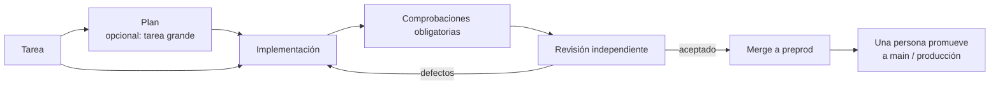

<div align="center">

# Darkfactory

**Una fábrica de software con IA autoalojada: planifica el trabajo, escribe el código, ejecuta comprobaciones obligatorias y una revisión independiente, y entrega únicamente a `preprod`.**

[](../../LICENSE)
[](../../pyproject.toml)
[](../../compose.yaml)
[](https://fastapi.tiangolo.com)
[](https://www.postgresql.org)

[English](../../README.md) · [Русский](README.ru.md) · [中文](README.zh.md) · [हिन्दी](README.hi.md) · **Español** · [العربية](README.ar.md) · [Français](README.fr.md) · [বাংলা](README.bn.md) · [Português](README.pt.md) · [日本語](README.ja.md)

</div>

Darkfactory ofrece una única interfaz y API compartidas, organizaciones con proyectos aislados, una cola respaldada por PostgreSQL y un contenedor independiente para cada tarea. Los cambios verificados llegan automáticamente solo a `preprod`. Una persona actualiza la rama principal y producción.

## Por qué Darkfactory

- 🏭 **Autoalojado.** Una interfaz y una API, organizaciones y proyectos aislados, una cola en PostgreSQL y un contenedor dedicado por tarea.
- 🛡️ **Entrega solo a `preprod`.** Producción y la rama principal las actualiza una persona, nunca la fábrica.
- ✅ **Comprobaciones obligatorias y revisión independiente.** Las comprobaciones y la revisión están ligadas a un único commit final. Sin comprobaciones configuradas, el merge automático queda desactivado.
- 🔒 **Contenedores de tarea aislados.** Sin root, sistema de archivos raíz de solo lectura, CPU/RAM/PIDs limitados, red desactivada, sin acceso al socket de Docker, a PostgreSQL, a otros proyectos ni a secretos de producción.
- 🔀 **Pools de suscripciones con fallback.** Codex para desarrollo y Claude para revisión por defecto; cambio de cuenta y de motor según la cuota disponible; API de pago solo con activación explícita y un presupuesto en dinero.
- 🧠 **Factory Director.** Un chat (web y CLI) que crea proyectos, roles y tareas, y resuelve las tareas detenidas con los permisos del propio usuario.

## Pipeline de tareas



Por defecto, una tarea va directamente a un único desarrollador, sin plan ni subtareas. Un plan con preguntas bloqueantes se detiene hasta que respondas.

## Contenido

- [Inicio rápido](#inicio-rápido)
- [Tu primer proyecto](#tu-primer-proyecto)
- [Conexiones de ejecutores](#conexiones-de-ejecutores)
- [Aislamiento y dependencias](#aislamiento-y-dependencias)
- [Inicializar un proyecto existente](#inicializar-un-proyecto-existente)
- [Artefactos del proyecto](#artefactos-del-proyecto)
- [Roles, delegación, skills y MCP](#roles-delegación-skills-y-mcp)
- [Factory Director](#factory-director)
- [Notificaciones a personas](#notificaciones-a-personas)
- [Límites e incidentes](#límites-e-incidentes)
- [Comprobaciones de la implementación](#comprobaciones-de-la-implementación)
- [Pruebas de UI en el navegador](#pruebas-de-ui-en-el-navegador)
- [Pruebas del stand y despliegues en GitLab](#pruebas-del-stand-y-despliegues-en-gitlab)
- [Programaciones](#programaciones)
- [API y datos](#api-y-datos)
- [Idiomas de la interfaz](#idiomas-de-la-interfaz)
- [Licencia](#licencia)

## Inicio rápido

Necesitas Docker Engine con Docker Compose y compatibilidad con `volume.subpath`. Docker Desktop funciona en macOS.

> [!IMPORTANT]
> No existe una contraseña de PostgreSQL por defecto: sin `POSTGRES_PASSWORD` en `.env`, Compose no arranca. Una instalación creada antes usaba la contraseña `darkfactory-local`: ponla en `.env`, y luego cambia la contraseña en PostgreSQL (`ALTER USER darkfactory PASSWORD …`) y en `.env`.

Para una instalación nueva, desde el directorio del proyecto:

```sh
echo "POSTGRES_PASSWORD=$(openssl rand -hex 32)" >> .env
docker compose up -d --build
docker compose exec app cat /data/bootstrap-token
```

Abre [localhost:8080](http://localhost:8080) y pega el token de propietario.

- **Define tú mismo el token de propietario.** En lugar del archivo generado, ejecuta `echo "DARKFACTORY_ADMIN_TOKEN=$(openssl rand -hex 32)" >> .env` antes del primer arranque.
- **Cambiarlo más adelante.** Tras un reinicio, un nuevo valor de la variable sustituye al token anterior de `.env`. En una instalación ya en marcha, la variable se añade al propietario de `/data/bootstrap-token`. Un token revocado de `.env` no se restaura: define un valor nuevo.
- **Primera compilación.** Descarga Python, Node, PostgreSQL, Codex CLI y Claude Code. Los arranques posteriores usan las imágenes ya construidas.

### Servicios

| Servicio | Función |
|---|---|
| `app` | Sirve la UI y la API |
| `worker` | Gestiona las tareas |
| `db` | Almacena la cola (PostgreSQL) |
| `executor-image` | Construye la imagen de los contenedores temporales de tareas |

El socket de Docker solo está disponible para el worker de confianza; una tarea no lo recibe.

### Configuración

Los ajustes de Compose se leen de `.env`:

| Variable | Significado | Valor por defecto |
|---|---|---|
| `PORT` | Puerto publicado | `8080` (según `compose.yaml`) |
| `BIND_ADDRESS` | Dirección a la que se enlaza el puerto | `127.0.0.1` |
| `POSTGRES_PASSWORD` | Contraseña de PostgreSQL | ninguno, obligatoria |
| `GLOBAL_CONCURRENCY` | Concurrencia global de tareas | `4` |
| `EXECUTOR_CPUS` | CPUs por contenedor de tarea | `4` |
| `DATA_VOLUME` | Nombre del volumen `data` | `darkfactory_data` (según `compose.yaml`) |
| `DARKFACTORY_ADMIN_TOKEN` | Token de propietario elegido por ti | generado en `/data/bootstrap-token` |
| `DARKFACTORY_PERSONAL_MODE` | Modo de piloto local personal (véase [Conexiones de ejecutores](#conexiones-de-ejecutores)) | `0` |
| `DARKFACTORY_PUBLIC_URL` | Dirección de la fábrica usada en los enlaces de las notificaciones | `http://127.0.0.1:8080` |
| `DARKFACTORY_DIRECTOR_MODEL_CLAUDE`, `DARKFACTORY_DIRECTOR_MODEL_CODEX` | Modelo del chat del Director en las suscripciones de ese proveedor, por ejemplo uno más ligero que el de los agentes. Un perfil del Director del proyecto con modelo tiene prioridad. Con la variable de Claude definida, el Director prueba primero las suscripciones de Claude | vacío: el modelo de la conexión |

> [!WARNING]
> Para dar acceso a los empleados, coloca un proxy inverso HTTPS delante de la aplicación. PostgreSQL no se publica al exterior.

## Tu primer proyecto

1. Haz clic en **"Conectar proyecto"** e introduce un nombre, un repositorio Git y, si hace falta, un token de acceso.
2. Aparecen de inmediato un manager, un analista, un desarrollador y un revisor con las skills estándar. Los roles heredan los ejecutores del proyecto: Codex para desarrollo y Claude para revisión. Los servidores MCP se conectan por separado.
3. Conecta las suscripciones al pool compartido de la organización. Si ya existe un pool, el nuevo proyecto lo usa; si no, la fábrica crea un "Pool compartido". Más adelante, los proyectos pueden elegir pools dedicados en su configuración.
4. En la configuración del proyecto, define los comandos de comprobación obligatorios. Sin ellos, el merge automático queda desactivado.
5. Crea una tarea en la UI o a través de la API. Un plan con preguntas bloqueantes se detiene hasta que respondas.

### Repositorios compatibles

Se admiten Git por HTTPS, SSH y repositorios bare locales en `/repos`. GitHub y GitLab, incluidos los dominios autoalojados, reciben PRs/MRs. Para cualquier otro Git, la fábrica crea un registro de cambios interno con el diff, las comprobaciones y la revisión. SSH requiere una clave dedicada y un `known_hosts` definido explícitamente; las claves de host no se heredan.

Para proyectos locales, usa el volumen compartido `repos`, montado en app y worker como `/repos`. Puedes crear un repositorio con `docker compose exec worker sh`; el escenario de pruebas [más abajo](#comprobaciones-de-la-implementación) muestra un ejemplo completo. Los directorios del host no se montan en el contenedor de la tarea.

### Comportamiento del merge

- Cuando no hay comprobaciones configuradas, la tarea termina con un registro de cambios y el estado `review_required`: el merge automático está prohibido.
- Las comprobaciones y la revisión están ligadas a un único commit final.
- Un cambio en la punta de `preprod` provoca una nueva integración y aceptación.
- Los merges de un proyecto se ejecutan de forma secuencial.

### Roles de acceso

| Rol | Puede |
|---|---|
| Owner (propietario) | Gestionar ajustes y conexiones |
| Operator (operador) | Gestionar tareas |
| Observer (observador) | Leer |

Los permisos del miembro y del token se intersecan; la revocación de permisos se aplica a las solicitudes posteriores. Una nueva organización recibe su propio propietario y un token que se muestra una sola vez. El propietario emite tokens de miembro en los ajustes ("Acceso del equipo") o mediante `POST /api/members`; puede haber varios miembros con el rol `owner`. Los tokens adicionales propios se emiten con `POST /api/tokens` y se revocan con `DELETE /api/tokens/{id}`.

## Conexiones de ejecutores

| Conexión | Credenciales y notas |
|---|---|
| **Codex for company** | Credenciales JSON `{"auth_method":"siwc","accessToken":"..."}`. Usa el proveedor OAuth externo documentado para App Server. Requiere un token de Sign in with ChatGPT con acceso a este escenario. Renueva el token mediante una reconexión. |
| **Claude Code** | `{"oauth_token":"..."}` para una conexión de suscripción permitida. La sesión aislada recibe solo el token seleccionado; no se usa `--bare`. |
| **API** | Chat Completions compatible con OpenAI por HTTPS con llamadas a herramientas. Indica el modelo y `{"base_url":"https://example.com/v1","api_key":"...","input_usd_per_million":0.0,"output_usd_per_million":0.0}` con precios reales. Hay un campo `ca_cert` disponible para una CA TLS propia. |

### Piloto local personal

Para un piloto local personal puedes usar el `codex login` actual a través de ChatGPT.

1. Añade `DARKFACTORY_PERSONAL_MODE=1` al `.env` local.
2. Ejecuta `docker compose up -d --build`.
3. En el host, ejecuta `python3 scripts/connect_personal_codex.py`. El script crea el pool `Personal Codex` y una conexión en la organización del token bootstrap.
4. Asigna este pool a un proyecto; una sesión de Codex independiente también puede realizar las revisiones.

Sin pasarela, cada petición de Codex a ChatGPT (el backend y las llamadas al modelo, `openai_base_url`) pasa por un relé loopback en el ejecutor que añade el token real. Los modelos actuales requieren Codex 0.160 o posterior, y este solo llega al backend de ChatGPT por HTTPS, así que el relé sirve un certificado firmado por una CA de un solo uso en la que solo confía ese Codex (`CODEX_CA_CERTIFICATE`). Solo se importan el token de acceso y el ID de cuenta de `~/.codex/auth.json`; el token de refresco y el directorio del host no se pasan a los contenedores. El token se almacena cifrado. Cuando el token caduca o se revoca, repite la importación mientras la conexión esté inactiva. El modo personal está desactivado por defecto, y una instalación alojada o comercial usa SIWC. El alcance de la autorización integrada se describe en la [documentación oficial de App Server](https://learn.chatgpt.com/docs/app-server#auth-endpoints).

Si tu Codex personal ya funciona a través de un gateway local de suscripción, indica su dirección accesible desde Docker y el modelo configurado:

```sh
python3 scripts/connect_personal_codex.py --base-url http://host.docker.internal:8787/v1 --model MODEL_NAME
```

Este modo solo acepta direcciones HTTP locales y requiere `DARKFACTORY_PERSONAL_MODE=1`. Una conexión de Claude recibe la misma clase de pasarela en sus credenciales (`"base_url": "http://host.docker.internal:18788/bili/http://127.0.0.1:8787"` para bili y headroom de agent-stack); su relé reenvía entonces allí en lugar de al proveedor. En Linux, una pasarela que escucha solo en loopback queda expuesta a los contenedores mediante `scripts/systemd/darkfactory-gateway.service` (socat en la dirección del puente Docker); los servicios de agent-stack deben sobrevivir al cierre de sesión (`loginctl enable-linger`). El ejecutor se conecta al gateway indicado mediante un túnel fijo y la lista de direcciones permitidas existente; la red del contenedor sigue siendo `none`. Este modo no activa una API de pago.

### Pools y selección de motor

Los pools definen prioridades, modelos, motores disponibles, concurrencia, el número de cambios y la pausa antes de volver a comprobar la cuota. La elección base es Codex para desarrollo y Claude para revisión. Se permite cambiar de cuenta y alternar Codex ↔ Claude; por defecto, la API no se conecta automáticamente. Para un fallback de pago, el propietario activa explícitamente una política del proyecto y la tarea recibe un presupuesto en dinero. Una API asignada de forma explícita también requiere un presupuesto.

El botón **"+ Suscripción"** inicia el inicio de sesión estándar de Claude mediante un enlace y un código de un solo uso en el navegador. En modo personal está disponible el device-auth de Codex: el enlace y el código aparecen en el mismo formulario. Elige los pools antes de iniciar sesión; tras la confirmación, la cuenta se añade automáticamente. Puedes cerrar el formulario y retomar desde los ajustes un inicio de sesión sin terminar. Un inicio de sesión es válido como máximo 15 minutos, puede cancelarse y se ejecuta en un contenedor independiente. Los tokens OAuth nunca se pasan al navegador. La renovación automática de tokens caducados no está implementada; repite el inicio de sesión o reconecta.

| Valor por defecto del pool | Valor |
|---|---|
| Reserva mantenida | **10%** |
| La observación se considera reciente durante | **300 segundos** |
| Cuota desconocida | permitida |

- Una cuota reciente y conocida por debajo de la reserva excluye la suscripción. Entre las cuentas adecuadas del motor seleccionado se prefiere la que tenga el mayor remanente confirmado.
- La reserva, la antigüedad de la instantánea y el ajuste "se requiere cuota conocida" están en el formulario del pool.
- Personal Codex vuelve a comprobar los límites antes de llamar al modelo.
- Para proveedores sin datos disponibles, la política estricta espera a un remanente confirmado.
- Los límites pueden cambiar mientras se trabaja: guardar el código y traspasar el contexto permite continuar el trabajo con otra cuenta.

En un cambio se traspasan el código y los artefactos, no la sesión interna de la cuenta. La cuota y la ocupación se registran por conexión, incluido un `quota_group` compartido conocido; reconectar las mismas credenciales no crea una cuota nueva. Un remanente desconocido nunca se declara ilimitado. Un error de autorización exige reconectar; un error de cuota exige esperar a la comprobación de control.

Cuando un ejecutor informa de su cuota restante y de la hora de reinicio, la fábrica los guarda y los muestra en los ajustes de la conexión junto con la hora de la observación. Es la última instantánea recibida, no un sondeo continuo de la cuenta. Cuando no hay datos disponibles, se muestra "cuota restante desconocida". Reconectar con credenciales nuevas borra la instantánea anterior. La hora del intento de control se muestra por separado de la hora de reinicio indicada por el proveedor.

### Eliminar pools

Los pools se pueden eliminar en los ajustes o mediante `DELETE /api/pools/{id}`, también a través del Director. La eliminación está disponible para el propietario de toda la organización. Se conservan las suscripciones, la autorización y la pertenencia a otros pools. Si el pool está asignado a un proyecto, elige antes otro pool para desarrollo y revisión. Un inicio de sesión de suscripción sin terminar también debe completarse o cancelarse antes de eliminar.

### Base oficial

[Codex App Server](https://learn.chatgpt.com/docs/app-server), [tokens externos SIWC](https://developers.openai.com/siwc/token-sharing-open-source/codex-app-server), [Claude Code headless](https://code.claude.com/docs/en/headless).

> [!NOTE]
> La existencia de un adaptador no confirma que el escenario de suscripción esté disponible para una empresa concreta: se necesitan conexiones permitidas.

## Aislamiento y dependencias

Una tarea recibe su propia copia de trabajo y rama, un contenedor sin root, un sistema de archivos raíz de solo lectura, CPU/RAM/PIDs limitados y un plazo interno. `.git` está protegido contra escritura para el agente. El verificador recibe la copia de trabajo en solo lectura. No hay acceso al socket de Docker, a PostgreSQL, a otros proyectos ni a secretos de producción.

La red del contenedor está desactivada. HTTPS está disponible a través de un proxy CONNECT solo hacia el proveedor seleccionado y hacia las entradas `host:port` permitidas explícitamente por el proyecto. Las comprobaciones son offline por defecto. Los secretos de prueba se pasan por separado; el proxy no abre acceso arbitrario a hosts.

> [!WARNING]
> La fábrica solo fusiona en `preprod`. Un despliegue se ejecuta únicamente después de que el propietario fusione en `main`, mediante el job de GitLab propio del proyecto ([Pruebas del stand y despliegues en GitLab](#pruebas-del-stand-y-despliegues-en-gitlab)).

### Imagen del ejecutor y ajustes de prueba

La imagen contiene Python, Node y Git. Si un proyecto necesita otras dependencias, construye tu propia imagen a partir de `darkfactory-executor:local`, instala las dependencias de antemano y define `executor_image` en la configuración del proyecto.

- El propietario configura los endpoints de prueba permitidos y `test_env`.
- Los nombres en `test_env` solo pueden ser `TEST_*`, `APP_*` o `E2E_*`.
- `allowed_hosts`, el remoto Git y el servidor de PR/MR deben ser nombres completamente cualificados.
- Una dirección interna (loopback, red privada, link-local, CGNAT) solo se acepta si su `ip:port` exacto figura en `allowed_hosts`.

### Relaciones entre tareas

Relaciones entre tareas: `depends_on`, padre → subtarea (`parent`), `related_to` y `duplicate` confirmado. Una dependencia de código espera a un resultado aceptado en `preprod`; una dependencia de artefacto puede aceptar un commit verificado concreto. Los ciclos y las relaciones entre organizaciones están prohibidos. Un padre espera a sus tareas hijas obligatorias y a su propia comprobación de integración.

### Descomposición y revisión

- Por defecto, una tarea va directamente a un único desarrollador, sin plan ni subtareas.
- La revisión solo devuelve el trabajo por defectos y criterios incumplidos; las mejoras se marcan como `[LATER]` y pasan al backlog.
- Para una tarea marcada como "Tarea grande", el planificador puede crear por sí mismo hasta ocho subtareas con criterios de aceptación y dependencias.
- Los hijos independientes reciben directorios de trabajo separados y pueden ejecutarse en paralelo.
- La descomposición automática anidada está prohibida.
- Antes de su propia implementación, el padre recoge el código aceptado de sus hijos.
- El tiempo, las correcciones, los cambios y el dinero están acotados por un único presupuesto para todo el árbol; crear hijos no multiplica los límites. Las ejecuciones paralelas reservan fracciones del tiempo restante.
- Cancelar un padre cancela los agentes que creó; los hijos cancelados no se reanudan automáticamente.

### Cambios en las dependencias

Los SHA aceptados de las dependencias se guardan en la tarea. Un cambio de SHA o la revocación de un resultado aceptado detiene al ejecutor actual y restablece las comprobaciones y revisiones antiguas. Tras el desbloqueo, la tarea repite el ensamblado de entradas, la implementación y la aceptación, conservando el código de trabajo y los contadores acumulados. Antes del merge, la comprobación de dependencias y la operación de Git se ejecutan bajo un bloqueo compartido del controlador, de modo que un cambio de entrada no puede colarse entre ambas.

## Inicializar un proyecto existente

Al añadir un proyecto, **"Indexación inicial y documentos Markdown"** está activada por defecto. La fábrica encola una tarea normal: primero guarda un mapa de los archivos Git rastreados y después el ejecutor estudia el repositorio y crea o amplía cuatro archivos:

| Archivo | Contenido |
|---|---|
| `docs/darkfactory/INDEX.md` | Mapa del proyecto, puntos de entrada y propósito de los módulos |
| `docs/darkfactory/ARCHITECTURE.md` | Componentes, dependencias, datos y límites del sistema |
| `docs/darkfactory/DEVELOPMENT.md` | Instalación, ejecución, configuración y comprobaciones |
| `docs/darkfactory/CONTRACTS.md` | APIs, eventos e integraciones externas descubiertos |

El mapa de fuentes con SHA también está en los artefactos de la tarea: `repository-index.md`. Enumera los primeros 1000 archivos rastreados y el recuento total. El ejecutor debe respaldar sus conclusiones con archivos del proyecto, conservar la documentación existente que sea útil y marcar lo que se desconoce. La comprobación del worker rechaza los cambios fuera de los cuatro documentos.

La tarea usa las conexiones, los límites, las comprobaciones y la revisión independiente del proyecto. Si aún no hay conexiones, espera a que se configuren. Los documentos pasan por el pipeline Git habitual: con comprobaciones obligatorias superadas, los cambios se fusionan en `preprod`; sin comprobaciones configuradas, se dejan para un merge manual. Tras la revisión, los cuatro documentos aparecen en el registro como **borradores**, con la tarea de origen y el SHA del commit verificado. El propietario acepta explícitamente las versiones que desee; las versiones aceptadas existentes se conservan.

Para un proyecto conectado anteriormente, abre **"Artefactos del proyecto" → "Indexar proyecto"**. El botón está disponible para el propietario y abre la tarea de inicialización existente si ya se creó, sin duplicados. La creación de proyectos por API acepta `initialize` (por defecto `true`); `false` desactiva el arranque automático. Para un proyecto existente: `POST /api/projects/{id}/initialize`.

## Artefactos del proyecto

Abre **"Artefactos del proyecto"** y añade requisitos, analítica, arquitectura, un contrato de API, un informe o cualquier otro documento de texto. Un artefacto tiene una clave estable dentro del proyecto, un título y un historial de versiones inmutables. El contenido se guarda en la BD; editar crea una versión nueva. Es un registro de conocimiento del proyecto independiente que complementa los archivos de trabajo de las tareas (`plan.md`, `diff.patch`, `checks.txt`, `review.txt`, `handoff.md`) y la evidencia del navegador.

- El operador añade borradores, el propietario acepta una versión seleccionada o revoca la aceptación, el observador lee.
- Solo una versión de cada artefacto está aceptada a la vez.
- Opcionalmente indica una tarea de origen: debe tener un commit actual con revisión independiente. Una versión guarda el ID de la tarea y el SHA; un cambio en el resultado de la fuente o en sus entradas deja el documento obsoleto.
- Los documentos normales se publican mediante el formulario o la API; la inicialización del proyecto añade automáticamente sus propios documentos tras la revisión.

### Usar artefactos como entradas de tareas

Al crear una tarea, selecciona versiones aceptadas. En la tarjeta de una tarea detenida puedes añadir, sustituir o quitar una entrada. La tarea recibe el texto completo de exactamente las versiones seleccionadas, sus claves, números y SHA de origen. Las subtareas delegadas heredan esas versiones.

| Límite | Valor |
|---|---|
| Caracteres por versión | 100 000 |
| Entradas por tarea | hasta 10 |
| Caracteres por tarea en total | 200 000 |

Aceptar una versión nueva no cambia automáticamente las selecciones de las tareas: los consumidores de la versión antigua esperan a una sustitución explícita de la entrada. Una aceptación revocada y una fuente obsoleta también bloquean la ejecución. La fábrica restablece las comprobaciones y revisiones de las entradas anteriores, detiene al ejecutor activo y vuelve a verificar las entradas antes del merge. El código de trabajo y los contadores acumulados se conservan. La tarjeta del artefacto muestra el historial, las tareas de origen y los consumidores; las versiones anteriores siguen siendo legibles.

### API de artefactos

| Función | Rutas |
|---|---|
| Artefactos | `GET/POST /api/projects/{id}/artifacts` |
| Versiones | `POST /api/project-artifacts/{id}/versions`, `GET /api/project-artifacts/{id}/versions/{version_id}` |
| Aceptación | `POST …/versions/{version_id}/accept`, `POST /api/project-artifacts/{id}/revoke` |
| Entradas de tarea | `GET /api/tasks/{id}/artifact-inputs`, `PUT/DELETE /api/tasks/{id}/artifact-inputs/{artifact_id}` |
| Creación de tareas | acepta `artifact_version_ids` |

El acceso está limitado por la organización, los proyectos del usuario y el alcance del token; los ciclos con dependencias normales están prohibidos. Las tablas nuevas se crean al arrancar sin modificar las tareas existentes.

## Roles, delegación, skills y MCP

Abre **"Agentes, skills y MCP"** en el menú izquierdo y selecciona un proyecto. El botón **"Añadir equipo preconfigurado"** instala el agente del proyecto, el analista, el desarrollador y el revisor. Las pestañas **"Roles"**, **"Skills"** y **"MCP"** ofrecen catálogos: añade configuraciones preconfiguradas con botones y asocia skills y herramientas a un rol mediante listas. Las instrucciones, el motor y el modelo se pueden cambiar en la tarjeta del rol. Los perfiles también se pueden asignar a una tarea concreta.

### Delegación

Durante la planificación, el agente del proyecto crea subtareas y les asigna un `agent_profile`. Para un escenario de "análisis → desarrollo", crea los perfiles `analyst` y `developer`: la subtarea del desarrollador incluye la clave del análisis en `depends_on`. El desarrollador arranca tras el merge verificado del análisis en `preprod` y recibe el commit y los artefactos aceptados. El analista guarda el resultado en el repositorio. Todo agente con permiso de delegación puede crear más subtareas dentro de la profundidad y el número total configurados.

| Valor por defecto de la delegación | Valor |
|---|---|
| Profundidad | 2 |
| Máximo de subtareas por árbol | 16 |
| Subtareas directas por plan | 8 |

El tiempo, las correcciones y el presupuesto en dinero se comparten en todo el árbol.

### Catálogo

El catálogo contiene siete skills y cuatro servidores MCP: navegador, lectura y búsqueda de archivos del proyecto, lectura de estado/diff/log de Git, y Jira. Los tres primeros se ejecutan dentro del contenedor de la tarea y no necesitan un servidor externo.

### Jira MCP

El MCP de **Jira** (`mcp-atlassian`, instalado en la imagen del ejecutor) lee incidencias de Jira Server/Data Center o Cloud, búsquedas JQL, tableros y sprints. Las herramientas de escritura están desactivadas tanto en el gateway como en el propio servidor (`--read-only`). Tras añadirlo desde el catálogo, abre su tarjeta y rellena:

- **Direcciones que necesitan acceso:** `jira.example.com:443`. Sin esto, el egress de la tarea no permitirá que el servidor llegue a Jira, incluida una dirección privada.
- **Entorno secreto:** `JIRA_URL=https://jira.example.com` y `JIRA_PERSONAL_TOKEN=<PAT>` (Jira → Profile → Personal Access Tokens). Para Jira Cloud usa `JIRA_USERNAME` y `JIRA_API_TOKEN` en lugar de un PAT.

Después asocia `jira` a los roles que lo necesiten, por ejemplo el analista y el manager. La cuenta de servicio solo necesita permiso de lectura sobre los proyectos pertinentes.

### MCP personalizado

Hay un formulario avanzado para tu propio MCP: un endpoint HTTPS o un comando stdio de la imagen del ejecutor, los nombres exactos de las herramientas permitidas y cabeceras o entorno secretos. Los secretos se cifran y nunca se devuelven en la UI/API. Codex y Claude nativos reciben las herramientas a través de un gateway local que filtra la lista y prohíbe las llamadas fuera del conjunto permitido. El planificador y el revisor aceptan solo conexiones que el propietario haya marcado como seguras para lectura; los permisos de la propia cuenta de servicio también deben ajustarse al rol. El adaptador de la API de pago no admite MCP.

## Factory Director

El diálogo **"Factory Director"** está abierto a la derecha. Selecciona toda la fábrica o un único proyecto. A través del diálogo puedes crear organizaciones, proyectos, pools, roles y skills, conectar servidores MCP preconfigurados, crear tareas y cambiar los ajustes disponibles. Por ejemplo: "Añade un analista y un desarrollador al proyecto, dales acceso de lectura a archivos y Git".

- **"Nuevo chat"** inicia un historial y un contexto separados. Los chats antiguos permanecen en la lista.
- **"Cancelar mensaje"** quita una solicitud de la cola o detiene al ejecutor activo. Las acciones ya iniciadas pueden terminar; su registro se conserva. La suscripción se libera cuando el contenedor se detiene.

El Director se ejecuta mediante **Codex CLI o Claude CLI** desde un pool de suscripciones conectado. Usa la misma API y los mismos permisos que el usuario: un operador no obtiene derechos de propietario, y el acceso a un proyecto no abre los demás. Una API de pago no se activa automáticamente para el Director. Cuando el pool está ocupado, la solicitud permanece en la cola. Si el resultado es incierto tras un reinicio, las acciones no se repiten a ciegas: el Director te pide que compruebes el estado.

> [!CAUTION]
> Añade contraseñas, claves y códigos de inicio de sesión mediante los formularios de conexión. El Director puede iniciar un inicio de sesión y entregar un enlace, pero nunca recibe tokens ni códigos de dispositivo. El acceso a una organización creada se emite por separado y una sola vez a través de la interfaz.

### Tareas detenidas

El Director también se ocupa de las tareas que se han detenido y esperan a una persona: el límite del ciclo de revisión, una pregunta del desarrollador, una red cerrada, un tiempo agotado. Lee el código y el historial de la tarea (el repositorio se conecta en solo lectura) y decide por sí mismo: continuar con indicaciones, devolver a nueva revisión, permitir una dirección, cancelar. Solo llama al propietario para asuntos de acceso, dinero, decisiones de producto y acciones destructivas. Mientras reflexiona, la tarea en el tablero muestra "Director decidiendo".

El botón **"Decisiones"** del chat muestra sus decisiones para el proyecto. Las marcadas como "Esperando tu respuesta" necesitan tu decisión: responde al Director en el chat, por ejemplo "para la tarea … continúa, usa …", y él continúa o cancela la tarea por sí mismo.

Ajustes del proyecto: "El Director resuelve las detenciones en tu lugar" y "Decisiones del Director por árbol de tareas" (por defecto 6, variable `DARKFACTORY_DIRECTOR_LIMIT`). El modelo y las instrucciones del Director se definen mediante el rol "Director" en la pantalla "Roles".

### Director desde la terminal

El mismo diálogo está disponible desde la terminal:

```sh
uv sync
uv run darkfactory director --token-file /path/to/api-token "Покажи проекты и текущие задачи"
uv run darkfactory director --token-file /path/to/api-token --project PROJECT_ID
```

Sin mensaje, se abre un diálogo interactivo.

| Opción / variable | Función |
|---|---|
| `--token-file` o `DARKFACTORY_TOKEN` | Token de API (archivo o entorno) |
| `--url` o `DARKFACTORY_URL` | Dirección del servidor (por defecto `http://127.0.0.1:8080`) |
| `--project` | Trabajar con un proyecto concreto |
| `--timeout` | Tiempo de espera; por defecto 600 segundos |
| `--resume MESSAGE_ID` | Esperar la misma solicitud sin reenviarla; usa el token anterior y `--project` |
| `--new-chat` | Iniciar un diálogo de CLI independiente |
| `--thread CHAT_ID` | Continuar un chat existente |
| `--cancel MESSAGE_ID` | Cancelar un mensaje sin reenviar el comando |

El comando también está disponible como `python -m darkfactory.cli director`. Si la terminal se cierra o la espera agota el tiempo, la solicitud sigue ejecutándose.

## Notificaciones a personas

En los ajustes añade un canal de Rocket.Chat con un webhook HTTPS y un destinatario opcional `@username` o `#channel`, o Telegram con un token de bot y un ID de chat. Un destinatario de Rocket.Chat requiere la sustitución del canal en el webhook entrante (ver abajo). El destinatario se puede cambiar sin volver a introducir la URL. Selecciona un proyecto o toda la organización y después los eventos: preguntas, detenciones, errores, límites, cambios aceptados e incidentes. Configurar un canal no envía ningún mensaje por sí mismo. Las preguntas de los agentes y las detenciones del pipeline entran en la cola automáticamente. La API `POST /api/tasks/{id}/notify` con `{"message":"..."}` envía un mensaje a los canales configurados de la tarea.

La entrega se ejecuta por separado de las tareas, con cinco intentos y un retraso entre reintentos. Los secretos no se vuelven a mostrar. Tras un fallo entre el envío y el guardado de la confirmación, es posible un mensaje duplicado. Las respuestas a las preguntas se introducen en la tarjeta de la tarea o directamente en el chat.

### Comandos de chat

Los comandos de chat se activan con un token de API con el rol de operador en los ajustes del canal: los comandos se ejecutan con sus permisos y su alcance de proyecto, así que emite un token dedicado con el mínimo necesario. El canal no acepta un token de propietario. Sin `allowed_senders`, cualquier miembro del chat puede usar comandos; con una lista `allowed_senders` (Telegram `from.id`, Rocket.Chat `user_id`), solo pueden los indicados. El remitente se registra en el evento de la tarea.

- `!director texto` (o `/director texto`) encarga una tarea al Director, por ejemplo `!director muestra las tareas`. En los grupos de Telegram con modo de privacidad, el bot solo ve `/director`. Telegram responde al mensaje con el comando; Rocket.Chat responde en el hilo de ese mensaje. Mientras el Director está ocupado, un comando nuevo se rechaza.
- Una respuesta a una notificación de pregunta o de detención continúa la tarea con ese texto, igual que el botón "Continuar" de la tarjeta. En Telegram, responde al mensaje del bot o reenvíaselo en un chat privado con un comentario. En Rocket.Chat, responde en el hilo de la notificación.
- Telegram se lee mediante long polling con `getUpdates`, por lo que no se necesita una dirección pública; el bot no debe tener un webhook. Los canales que comparten un bot se reparten los mensajes por ID de chat.

### Gestión desde Telegram

Con un token de comandos, el bot de Telegram ofrece un menú de botones. `/start` o `меню` lo abre. Las pantallas se actualizan en el mismo mensaje.

- Proyectos → tablero con las columnas "Listas para ejecutar", "En curso", "Requieren atención", "Hechas" → lista de tareas → tarjeta. La tarjeta muestra la pregunta del agente y botones según el estado de la tarea.
- "✍️ Responder" pasa una respuesta al agente y continúa la tarea. Los botones "Responder" y "Tarjeta" también aparecen bajo cada notificación de tarea.
- El orden de la cola se cambia con los botones "⏫ Subir" y "⏬ Bajar" o "➡️ Mover" → "Al inicio" y "Al final": es la prioridad de la tarea. "Mover" también devuelve una tarea a ejecución, la fusiona o la cancela; la cancelación pide confirmación.
- "➕ Nueva tarea": la primera línea de la respuesta es el título y todo el texto es la descripción.
- "🧠 Director" entrega un mensaje al Director. En un chat privado con el bot, cualquier texto simple también va al Director, y una respuesta a su mensaje continúa la conversación.
- Las suscripciones solo se conectan en los ajustes web: el chat no inicia un inicio de sesión.

### Configurar los comandos de Rocket.Chat

Crea un webhook saliente para el evento "Mensaje enviado" en la misma sala que el entrante. URL: `https://<factory>/api/chat-commands/rocketchat/<channel id>` (se muestra en la lista de canales); define el token del webhook en los ajustes del canal. Deja vacías las palabras de activación y no excluyas los mensajes del bot: la fábrica los usa para saber a qué tarea pertenece un hilo. Rocket.Chat no transmite comandos de barra desconocidos, así que allí los comandos empiezan con `!`:

- `!director texto`: encarga una tarea al Director.
- `!projects`: proyectos y número de tareas en cada columna del tablero.
- `!waiting`: tareas que esperan una respuesta o una fusión.
- `!task <id>`: la tarjeta de la tarea.
- `!help`: la lista de comandos.

En el hilo de una notificación de tarea, el texto normal es la respuesta al agente, y `!task`, `!resume`, `!merge` y `!cancel` actúan sobre esa tarea.

El webhook entrante funciona en dos modos, según su ajuste «Override Destination Channel»:

- **Override desactivado** (el valor por defecto de Rocket.Chat): deja vacío el destinatario del canal. Todos los mensajes van al canal propio del webhook, y las respuestas en el hilo llevan solo el ID del hilo (`tmid`). Rocket.Chat rechaza aquí cualquier petición con `roomId` o `channel` (`overriding destination channel is disabled for this integration`), así que con override desactivado un destinatario hace fallar cada entrega. Pon el webhook saliente en la misma sala que el entrante, o las respuestas quedarán fuera del hilo.
- **Override activado**: el destinatario elige adónde van las notificaciones, y las respuestas a comandos nombran la sala de origen (`roomId`) junto a `tmid`. Usa este modo cuando las notificaciones van a una sala distinta de la del propio webhook.

El estado de entrega está en el outbox del canal (`notification_deliveries`). Una respuesta del Director a un comando del chat cuenta como respondida (`director_dialogues.origin_replied`) solo después de que Rocket.Chat o Telegram la haya aceptado; una respuesta rechazada queda sin responder, con el estado HTTP del proveedor en `last_error`. Las notificaciones llegan como markdown de Rocket.Chat con el nombre Darkfactory; si se define `DARKFACTORY_PUBLIC_URL`, el logo de la fábrica es su avatar.

### Notificaciones de merge

Tras un merge verificado en `preprod`, el canal recibe los nombres de la tarea y del proyecto, un breve resumen del desarrollador, el SHA y un enlace al commit aceptado. Para GitHub/GitLab el enlace lleva a la página del commit; para Git local y genérico lleva a una tarjeta autorizada con el diff en la fábrica. Los intentos fallidos no envían un mensaje de finalización.

Para los empleados, define en `.env` una dirección de la fábrica accesible para ellos mediante `DARKFACTORY_PUBLIC_URL`, por ejemplo `https://factory.company.ru`, y reinicia Compose. Por defecto los enlaces usan `http://127.0.0.1:8080`. No se añaden tokens a los enlaces; puede ser necesario iniciar sesión.

### Promoción a main

Cuando termina una tarea de nivel superior, la notificación también contiene un enlace **"Merge a main / rechazar"**. Es una propuesta de merge dentro de la fábrica, disponible también para Git local. Fija el commit aceptado y muestra el diff completo respecto al `main` actual (hasta 100 000 caracteres, con una marca de truncado). El propietario puede fusionar o rechazar; el enlace GET no cambia nada por sí mismo. La transferencia incluye todos los cambios de `preprod` hasta el commit indicado, incluidas las subtareas. El rechazo conserva `preprod`.

> [!NOTE]
> Por defecto no hay transferencia automática a `main`, y el Director no puede tomar esta decisión; consulta [Promoción automática](#promoción-automática) para activarla. Un proyecto de GitLab con un job de despliegue se despliega tras la fusión del propietario ([más abajo](#pruebas-del-stand-y-despliegues-en-gitlab)). Si `main` ha divergido del commit aceptado, primero hacen falta una integración y nuevas comprobaciones. Las tareas antiguas ya completadas no reciben propuestas nuevas automáticamente.

### Promoción automática

El propietario puede permitir que un proyecto se promueva por sí mismo: define **"Promoción automática de preprod a main tras el periodo de prueba, en horas"** (`auto_promote_hours`, `0` = solo a mano) y añade una [programación](#programaciones) **"Promoción automática de preprod a main"**. Cuando se activa la programación, el `preprod` aceptado más reciente pasa a `main` solo si:

- fue aceptado hace al menos `auto_promote_hours` horas y, desde entonces, no ha habido ningún incidente en preprod;
- la última comprobación de preprod está en buen estado y se cumplen las protecciones habituales de promoción;
- la [comprobación de fugas](#comprobación-de-fugas) no encuentra nada en el diff `main..preprod` ni en sus mensajes de commit.

La promoción queda registrada como decisión de la fábrica en la tarea, y, si está configurado, le sigue el job de despliegue de GitLab. La fila de la programación muestra por qué una ejecución no promovió.

### Comprobación de fugas

`scripts/leak_check.py` está pensado para proyectos que viven en un repositorio público. Como comprobación obligatoria, rechaza un cambio que añada una credencial (claves de GitLab, GitHub, OpenAI/Anthropic, Slack y AWS, claves privadas, JWT, tokens bearer, contraseñas en URLs o asignaciones) o uno de los patrones propios del propietario en las líneas añadidas, los mensajes de commit o los nombres de archivo. Los patrones del propietario (dominios internos, direcciones, inicios de sesión) van en la variable de prueba del proyecto `TEST_LEAK_PATTERNS`, uno por línea o separados por `;`; nunca entran en el repositorio. La fábrica pasa a las comprobaciones el commit base de la tarea como `DARKFACTORY_CHECK_BASE`. La salida indica la regla y la línea, nunca el valor. Un ejemplo deliberado se mantiene con el marcador `leak-check: allow` en su línea.

### Sincronizar main de vuelta a preprod

La dirección inversa es automática: en la [programación](#programaciones) **"Fusionar main en preprod"** del proyecto (una vez por hora de forma predeterminada; `DARKFACTORY_MAIN_SYNC_SECONDS=0` desactiva la sincronización en toda la instalación) la fábrica fusiona en `preprod` los commits nuevos de `main`, por ejemplo los hotfixes del propietario. Si `preprod` no ha avanzado, simplemente se pone al día con `main`; en caso contrario se crea un commit de merge. En caso de conflicto aparece una tarea "Merge main into preprod: conflict" con el merge iniciado y marcadores en la carpeta de trabajo; el agente resuelve el conflicto, tras lo cual la tarea pasa por la revisión y las comprobaciones habituales.

## Límites e incidentes

### Prioridades

Las tareas tienen cuatro prioridades: crítica (`critical`), alta (`high`), normal (`normal`, por defecto) y baja (`low`). La prioridad se elige al crear la tarea y la cambia en su tarjeta el propietario o un operador; API: `PUT /api/tasks/{id}/priority` con el campo `priority`. El Director puede usar la misma API.

- Las correcciones de `preprod` se toman primero, y después las tareas listas por prioridad y hora de creación.
- La prioridad no anula las dependencias, las cuotas ni los límites, y no interrumpe el trabajo que ya está en marcha.
- Las subtareas heredan la prioridad del padre al crearse. Las tareas antiguas reciben prioridad normal.

### Valores por defecto

| Límite | Valor por defecto |
|---|---|
| Tareas activas | 2 |
| Tiempo activo total de las tareas | 60 minutos |
| Ciclos de corrección tras la primera implementación | 3 |

La espera no consume tiempo activo. Un reinicio, un cambio de cuenta y la repetición del mismo fallo conservan los contadores. Un límite detiene la tarea hasta que una persona decida explícitamente. Las tareas canceladas no se reanudan automáticamente.

### Incidentes

Tras un merge, y después periódicamente, el worker repite las comprobaciones de `preprod`. Una rotura abre una corrección prioritaria, detiene los nuevos merges del proyecto y las tareas que dependen de su resultado roto. Los demás proyectos siguen funcionando. La corrección pasa por las comprobaciones y la revisión habituales. La repetición del mismo diagnóstico vuelve al incidente anterior con los límites anteriores. También puedes notificar un incidente por separado desde la UI/API. No hay rollback automático.

## Comprobaciones de la implementación

Resultados actuales y aceptación pendiente: [VALIDATION.md](../../VALIDATION.md).

```sh
uv sync --extra dev
uv run pytest -q
uv run ruff check darkfactory tests scripts
node --check darkfactory/static/app.js
docker compose exec -T worker python - < scripts/docker_smoke.py
```

La prueba de humo de Docker crea una organización independiente, dos repositorios Git bare locales reales y 13 tareas (10 correcciones, 3 funcionalidades). Participan PostgreSQL real, la cola, los contenedores, Git, las comprobaciones, las sesiones de revisión independientes y los merges. En lugar de un modelo de pago se usa un fixture HTTPS determinista independiente. Esto verifica la infraestructura; no es una prueba de la calidad real del modelo ni del funcionamiento de las suscripciones de los usuarios. La API del producto no contiene ningún ejecutor de prueba.

Para probar SSH, construye un servidor OpenSSH de prueba independiente y activa el modo `SMOKE_SSH`:

```sh
docker build -t darkfactory-smoke-ssh:local - < scripts/ssh-git.Dockerfile
docker compose exec -T -e SMOKE_SSH=1 worker python - < scripts/docker_smoke.py
```

En este modo, el segundo proyecto recorre todo el pipeline por SSH. También se verifica el rechazo ante una clave de servidor incorrecta y ante una clave de cliente incorrecta. El servidor de prueba no publica puertos del host y se elimina al terminar, también en caso de error. Tras una ejecución correcta, las comprobaciones periódicas de su proyecto quedan desactivadas; los repositorios y los resultados permanecen en los volúmenes para su inspección.

## Pruebas de UI en el navegador

La imagen del ejecutor incluye Chromium, Playwright Test y Playwright MCP. Añade al desarrollador la skill preconfigurada **"Pruebas de UI en el navegador"** (`browser-testing`) y el MCP `project-browser` del catálogo. El navegador se ejecuta dentro del contenedor aislado de la tarea; la aplicación local también se inicia allí. Para proyectos con UI, define un comando de Playwright obligatorio en las comprobaciones del proyecto. La skill y el MCP ayudan al agente a explorar la interfaz; es la comprobación obligatoria la que bloquea el merge si falla.

Guarda capturas de pantalla, informes JSON y trazas en `/run/evidence` (variable `DARKFACTORY_EVIDENCE_DIR`). En la tarjeta de la tarea, el botón **"Comprobaciones del navegador"** abre la lista de artefactos y una vista previa de imágenes. Los demás archivos se descargan; los informes HTML no se ejecutan dentro de la fábrica. El historial se divide por ejecuciones y roles. Estos archivos complementan las comprobaciones obligatorias y la revisión; una captura de pantalla por sí sola no demuestra la corrección.

### Piloto de navegador en vivo

El piloto real de navegador crea un proyecto Git local independiente con errores en un formulario y en el diseño móvil. Las comprobaciones deben fallar primero; después Codex corrige la página, una sesión independiente verifica el resultado y el preprod aceptado vuelve a superar ocho escenarios de navegador. El script guarda un punto de control y continúa la misma tarea al ejecutarse de nuevo:

```sh
docker compose exec -T -e CODEX_CONNECTION_ID=<connection-id> worker python - < scripts/live_browser_smoke.py
```

## Pruebas del stand y despliegues en GitLab

La fábrica puede probar por sí misma la aplicación desplegada y desplegar `main` a través de GitLab. Ambas funciones se configuran en los ajustes del proyecto.

### Tester del stand

Configura **"Dirección del stand"** con la página que el tester abre primero, por ejemplo el Studio del stand. En **"Otras direcciones del stand"** indica, en formato `host:port`, los demás hosts a los que llama el stand (servidor de autenticación, API). Aquí se permiten direcciones internas: el propietario las elige igual que los hosts permitidos. Coloca las cuentas de prueba en las variables de test (`E2E_USER`, `E2E_PASSWORD`, etc.); el tester las lee de su entorno, y sus valores nunca llegan al prompt ni a la transcripción.

En la [programación](#programaciones) **"Prueba del stand"** del proyecto (cada 4 horas por defecto; se crea al definir la dirección del stand), después de cada despliegue correcto y con el botón **"Probar el stand"**, un agente abre el stand en Chromium (Playwright MCP) y trabaja como un tester manual: inicia sesión, recorre los flujos principales, formularios, ambos viewports, errores de consola y peticiones fallidas. El código de preprod se monta en modo solo lectura para que el agente pueda nombrar los archivos probables. El navegador solo llega a los hosts del stand, a través del proxy de salida de la tarea; los errores de certificado de una CA interna se ignoran para esos orígenes.

Cada defecto que el agente reproduce dos veces se convierte en una tarea de corrección normal, con los pasos, el resultado esperado y el real, y las capturas adjuntas. Como máximo `qa_max_tasks` tareas por ejecución (3 por defecto); los defectos abiertos del stand se pasan a la siguiente ejecución para no reportarlos de nuevo, y se omiten las ejecuciones programadas mientras haya 8 abiertos. El agente solo crea sus propios datos con el prefijo `df-qa-` y nunca cambia usuarios ni ajustes. Tras un despliegue, primero vuelve a comprobar los defectos del stand cuyas correcciones se han publicado: una corrección confirmada se marca en la tarea, y un defecto que sigue reproduciéndose recibe una nueva tarea relacionada.

Notificaciones: `qa_reported` y `qa_not_fixed`. API: `POST /api/projects/{id}/qa` inicia una ejecución ahora. La ejecución usa el pool de escritores del proyecto y dura como máximo `DARKFACTORY_QA_SECONDS` (1800); `DARKFACTORY_STAND_QA=0` desactiva las pruebas del stand en toda la instalación.

### Compilaciones en el stand

Para una plataforma que construye aplicaciones por sí misma (una plataforma low-code con un asistente en su editor), una [programación](#programaciones) **"Compilación de la aplicación en el stand"** convierte al tester en un cliente exigente. Cada ejecución toma la siguiente petición de los **"Pedidos para construir en el stand"** del proyecto (`build_tasks`, una por línea; vacío = el conjunto propio de la fábrica: solicitudes de baja, tickets de soporte, citas con el médico, una tienda con pedidos, una encuesta a empleados) y:

1. inicia sesión en el tenant propio del tester y entrega la petición al constructor de la plataforma palabra por palabra, siguiendo **"Cómo compilar una aplicación en esta plataforma"** (`build_instructions`) del propietario;
2. espera el resultado, publica o previsualiza la aplicación y la usa de principio a fin con cada rol, a 390 y 1440 px;
3. puntúa de 0 a 5 la completitud, la corrección, la usabilidad y la calidad visual, y registra si compiló, cuánto tardó, los errores de compilación y las pruebas fallidas;
4. convierte en tareas de corrección del proyecto de la plataforma como máximo `build_max_tasks` problemas (3 por defecto), cada una con la categoría de su causa raíz: `dsl`, `compiler`, `builder`, `components`, `studio`, `runtime` u `other`. Una tarea pide corregir la plataforma, no la aplicación generada.

La fila de la programación muestra la última compilación, la proporción de compilaciones correctas y las puntuaciones medias de las últimas diez ejecuciones; se conservan las últimas 60 ejecuciones para comparar semana a semana. Las compilaciones y las pruebas del stand comparten un único slot de navegador. `DARKFACTORY_BUILD_SECONDS` (3000) limita una ejecución.

### Despliegues en GitLab

Para un proyecto de GitLab, configura **"Job de despliegue de GitLab"** con el nombre de un job manual del pipeline de `main` (por ejemplo, `deploy`). Un proyecto con MR de GitLab usa el servidor de MR y su token; un proyecto sin MR usa la API junto a su URL Git HTTPS (`https://host/api/v4`) y el token de Git, así que sigue funcionando sin MR. El token necesita el alcance `api` y el permiso para ejecutar ese job, incluido el entorno protegido. Después de que el propietario fusione en `main` (ver [Promoción a main](#promoción-a-main)), la fábrica:

1. encuentra el pipeline del nuevo commit de `main`;
2. espera a que terminen los jobs de la etapa `build`, para que existan las imágenes del commit;
3. ejecuta el job de despliegue y lo sigue;
4. informa del resultado en la tarea promocionada (`deploy_started`, `deploy_succeeded`, `deploy_failed`, con el final del log del job) y en los canales de notificación;
5. tras un despliegue correcto, inicia el tester del stand.

Un fallo en la construcción de la imagen detiene el despliegue sin ejecutar el job. Un job de despliegue ya iniciado desde GitLab se sigue, no se vuelve a iniciar. Mientras se ejecuta un despliegue, una fusión más nueva espera a que termine. El botón **"Desplegar main"** y `POST /api/projects/{id}/deploy` despliegan la punta actual de `main` a petición del propietario. No hay rollback automático; el propio job decide cómo tratar una versión fallida.

## Programaciones

En la página **"Programación"** de un proyecto aparecen sus tareas recurrentes. Cada programación tiene una línea cron (`minute hour day month weekday`, por ejemplo `0 9 * * 1-5`; también funcionan `@hourly`, `@daily`, `@weekly` y `@monthly`), una zona horaria, un interruptor de activación, sus próximas y últimas ejecuciones y el último resultado. Los presets listos para usar rellenan la línea cron. El propietario crea, modifica y elimina programaciones; un operador también puede iniciar una de inmediato con **"Ejecutar ahora"**, sin que cambie su horario habitual.

| Trabajo | Qué hace una ejecución |
|---|---|
| Prueba del stand | pide una ejecución al [tester del stand](#tester-del-stand); se omite mientras haya 8 defectos del stand abiertos |
| Compilación de la aplicación en el stand | pide al [tester del stand](#tester-del-stand) una [compilación en el stand](#compilaciones-en-el-stand) |
| Backlog a tareas | agrupa las notas abiertas del backlog en tareas; si no hay notas nuevas, no pasa nada |
| Fusionar main en preprod | [sincroniza `main` en `preprod`](#sincronizar-main-de-vuelta-a-preprod) |
| Tarea | crea una tarea normal con el título, la petición y la prioridad guardados; se omite mientras siga abierta la tarea de la ejecución anterior |

Un proyecto nuevo recibe una sincronización de main cada hora y una ejecución del backlog cada 4 horas; la programación del tester del stand aparece cuando se define una dirección del stand. Los proyectos conectados antes reciben una sola vez las mismas programaciones a partir de sus antiguos ajustes de intervalo. Tras una caída de la fábrica, las ejecuciones perdidas de una programación se reducen a una. `DARKFACTORY_TIMEZONE` define la zona horaria predeterminada (UTC); el formulario ofrece la del navegador.

API: `GET|POST /api/projects/{id}/schedules`, `PUT|DELETE /api/schedules/{id}`, `POST /api/schedules/{id}/run`.

## API y datos

La especificación está disponible en [Swagger UI](http://localhost:8080/docs). Todas las solicitudes a `/api/*` requieren `Authorization: Bearer <token>`.

| Recursos principales |
|---|
| `/api/projects` |
| `/api/projects/{id}/tasks` |
| `/api/tasks/{id}` |
| `/api/pools` |
| `/api/connections` |
| `/api/members` |
| `/api/tokens` |
| `/api/organizations` |

La creación de tareas admite `idempotency_key`. Los artefactos y el historial están disponibles en la tarjeta de la tarea.

### Almacenamiento y copia de seguridad

El estado se guarda en los volúmenes con nombre de PostgreSQL, `data` y `repos`. `data` contiene las conexiones cifradas, la clave de cifrado, las copias de Git y los artefactos.

> [!WARNING]
> Haz copias de seguridad de PostgreSQL y de ambos volúmenes de archivos de forma consistente; perder la clave deja las credenciales irrecuperables. El token bootstrap se muestra con el comando anterior; los tokens de miembro se emiten una sola vez y en la BD solo se guardan hashes.

### Actualización

Actualiza con `docker compose up -d --build`. Para que las tareas no esperen a que el worker antiguo termine sus pasos actuales, actualiza el worker mediante `scripts/deploy-worker.sh`: el nuevo worker toma trabajo de inmediato, el antiguo termina lo que empezó y se detiene. Las migraciones actuales añaden las columnas que faltan y conservan los datos existentes. Para volver atrás, restaura el código/las imágenes anteriores y reinicia los servicios; las columnas añadidas pueden permanecer. No elimines los volúmenes durante una actualización normal.

### Autoactualización

Un servidor puede seguir `origin/main` por sí mismo. `scripts/self-update.sh` se ejecuta desde un timer de systemd en el host, fuera de los contenedores, así que una versión rota también se revierte:

1. obtiene `origin/main`; si no hay nada nuevo, o un commit que ya falló: se detiene;
2. retiene el trabajo nuevo (`/data/system/hold`), hace fast-forward del checkout, reconstruye la app y el ejecutor, reinicia la app y arranca un worker nuevo mediante `scripts/deploy-worker.sh`;
3. durante hasta 10 minutos espera dos minutos seguidos de una app que responde y un planificador activo (`/data/system/worker-heartbeat`) sin `Scheduler tick failed`;
4. en caso contrario vuelve al commit anterior, reconstruye y reinicia, y recuerda el commit malo hasta que aparezca uno más nuevo.

Las ediciones locales o un `main` reescrito detienen la actualización con un error en lugar de sobrescribirse. El resultado está en `/data/system/self-update.json` y en la página de la fábrica; el log es `/data/system/self-update.log`. Instalación:

```sh
cp scripts/systemd/darkfactory-update.* /etc/systemd/system/
# set WorkingDirectory in darkfactory-update.service to this checkout
systemctl daemon-reload && systemctl enable --now darkfactory-update.timer
```

Junto con la [promoción automática](#promoción-automática), una fábrica que desarrolla su propio repositorio se entrega a sí misma los cambios aceptados.

## Idiomas de la interfaz

La UI web se ofrece en 10 idiomas: English, 中文, हिन्दी, Español, العربية, Français, বাংলা, Português, Русский, 日本語. Detecta el idioma del navegador y recurre al inglés. El selector está en la tarjeta de inicio de sesión y en el pie de la barra lateral. La elección se guarda en la clave `df-lang` de `localStorage`.

> [!NOTE]
> Los mensajes generados por el servidor (eventos de tareas, motivos) siguen en ruso.

**Para contribuidores**

- Las cadenas de la UI son claves fuente en ruso envueltas en `tr()` en `darkfactory/static/*.js`.
- Las traducciones están en `darkfactory/static/locales/<code>.json`.
- `python scripts/i18n_check.py` informa de cadenas sin envolver, claves ausentes y discrepancias de marcadores de posición.

## Licencia

Darkfactory se distribuye bajo la [Licencia MIT](../../LICENSE).
