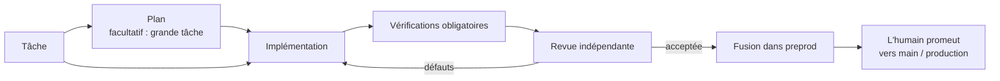

<div align="center">

# Darkfactory

**Une usine logicielle IA auto-hébergée : elle planifie le travail, écrit le code, exécute des vérifications obligatoires et une revue indépendante, et ne livre que vers `preprod`.**

[](../../LICENSE)
[](../../pyproject.toml)
[](../../compose.yaml)
[](https://fastapi.tiangolo.com)
[](https://www.postgresql.org)

[English](../../README.md) · [Русский](README.ru.md) · [中文](README.zh.md) · [हिन्दी](README.hi.md) · [Español](README.es.md) · [العربية](README.ar.md) · **Français** · [বাংলা](README.bn.md) · [Português](README.pt.md) · [日本語](README.ja.md)

</div>

Darkfactory vous offre une interface et une API communes, des organisations avec des projets isolés, une file d'attente adossée à PostgreSQL et un conteneur distinct pour chaque tâche. Les changements vérifiés arrivent automatiquement dans `preprod` uniquement. Un humain met à jour la branche principale et la production.

## Pourquoi Darkfactory

- 🏭 **Auto-hébergée.** Une seule interface et une seule API, des organisations et des projets isolés, une file PostgreSQL et un conteneur dédié par tâche.
- 🛡️ **Ne livre que vers `preprod`.** La production et la branche principale sont mises à jour par un humain, jamais par l'usine.
- ✅ **Vérifications obligatoires et revue indépendante.** Les vérifications et la revue sont liées à un unique commit final. Sans vérifications configurées, la fusion automatique est désactivée.
- 🔒 **Conteneurs de tâche isolés.** Sans privilèges root, système de fichiers racine en lecture seule, CPU/RAM/PID limités, réseau désactivé, aucun accès au socket Docker, à PostgreSQL, aux autres projets ni aux secrets de production.
- 🔀 **Pools d'abonnements avec repli.** Codex pour le développement et Claude pour la revue par défaut ; changement de compte et de moteur selon les quotas ; API payante uniquement sur activation explicite avec un budget monétaire.
- 🧠 **Factory Director.** Un chat (web et CLI) qui crée des projets, des rôles et des tâches, et résout les tâches bloquées dans la limite des permissions de l'utilisateur.

## Pipeline des tâches



Par défaut, une tâche va directement à un seul développeur, sans plan ni sous-tâches. Un plan comportant des questions bloquantes s'arrête jusqu'à ce que vous répondiez.

## Sommaire

- [Démarrage rapide](#démarrage-rapide)
- [Votre premier projet](#votre-premier-projet)
- [Connexions des exécuteurs](#connexions-des-exécuteurs)
- [Isolation et dépendances](#isolation-et-dépendances)
- [Initialiser un projet existant](#initialiser-un-projet-existant)
- [Artefacts du projet](#artefacts-du-projet)
- [Rôles, délégation, compétences et MCP](#rôles-délégation-compétences-et-mcp)
- [Factory Director](#factory-director)
- [Notifications aux humains](#notifications-aux-humains)
- [Limites et incidents](#limites-et-incidents)
- [Vérification de la mise en œuvre](#vérification-de-la-mise-en-œuvre)
- [Tests UI dans le navigateur](#tests-ui-dans-le-navigateur)
- [Tests du stand et déploiements GitLab](#tests-du-stand-et-déploiements-gitlab)
- [Planifications](#planifications)
- [API et données](#api-et-données)
- [Langues disponibles](#langues-disponibles)
- [Licence](#licence)

## Démarrage rapide

Il vous faut Docker Engine avec Docker Compose et la prise en charge de `volume.subpath`. Docker Desktop fonctionne sous macOS.

> [!IMPORTANT]
> Il n'existe aucun mot de passe PostgreSQL par défaut : sans `POSTGRES_PASSWORD` dans `.env`, Compose ne démarre pas. Une installation créée auparavant utilisait le mot de passe `darkfactory-local` : placez-le dans `.env`, puis changez le mot de passe dans PostgreSQL (`ALTER USER darkfactory PASSWORD …`) et dans `.env`.

Pour une nouvelle installation, depuis le répertoire du projet :

```sh
echo "POSTGRES_PASSWORD=$(openssl rand -hex 32)" >> .env
docker compose up -d --build
docker compose exec app cat /data/bootstrap-token
```

Ouvrez [localhost:8080](http://localhost:8080) et collez le jeton du propriétaire.

- **Définir soi-même le jeton du propriétaire.** Au lieu du fichier généré, exécutez `echo "DARKFACTORY_ADMIN_TOKEN=$(openssl rand -hex 32)" >> .env` avant le premier démarrage.
- **Le modifier plus tard.** Après un redémarrage, une nouvelle valeur de la variable remplace le jeton précédent issu de `.env`. Dans une installation déjà en fonctionnement, la variable est ajoutée au propriétaire issu de `/data/bootstrap-token`. Un jeton révoqué issu de `.env` n'est pas restauré : définissez une nouvelle valeur.
- **Première construction.** Elle télécharge Python, Node, PostgreSQL, Codex CLI et Claude Code. Les démarrages suivants utilisent les images déjà construites.

### Services

| Service | Rôle |
|---|---|
| `app` | Sert l'interface et l'API |
| `worker` | Gère les tâches |
| `db` | Stocke la file d'attente (PostgreSQL) |
| `executor-image` | Construit l'image des conteneurs de tâche temporaires |

Le socket Docker n'est accessible qu'au worker de confiance ; une tâche n'y a pas accès.

### Configuration

Les paramètres de Compose sont lus depuis `.env` :

| Variable | Signification | Valeur par défaut |
|---|---|---|
| `PORT` | Port publié | `8080` (selon `compose.yaml`) |
| `BIND_ADDRESS` | Adresse sur laquelle le port est lié | `127.0.0.1` |
| `POSTGRES_PASSWORD` | Mot de passe PostgreSQL | aucune, obligatoire |
| `GLOBAL_CONCURRENCY` | Concurrence globale des tâches | `4` |
| `EXECUTOR_CPUS` | CPU par conteneur de tâche | `4` |
| `DATA_VOLUME` | Nom du volume `data` | `darkfactory_data` (selon `compose.yaml`) |
| `DARKFACTORY_ADMIN_TOKEN` | Jeton du propriétaire choisi par vous | généré dans `/data/bootstrap-token` |
| `DARKFACTORY_PERSONAL_MODE` | Mode pilote local personnel (voir [Connexions des exécuteurs](#connexions-des-exécuteurs)) | `0` |
| `DARKFACTORY_PUBLIC_URL` | Adresse de l'usine utilisée dans les liens de notification | `http://127.0.0.1:8080` |
| `DARKFACTORY_DIRECTOR_MODEL_CLAUDE`, `DARKFACTORY_DIRECTOR_MODEL_CODEX` | Modèle du chat du Director sur les abonnements de ce fournisseur, par exemple plus léger que celui des agents. Un profil Director du projet avec un modèle l'emporte. Si la variable Claude est définie, le Director essaie d'abord les abonnements Claude | vide : le modèle de la connexion |

> [!WARNING]
> Pour l'accès des employés, placez un reverse proxy HTTPS devant l'application. PostgreSQL n'est pas publié à l'extérieur.

## Votre premier projet

1. Cliquez sur **« Connecter un projet »** et saisissez un nom, un dépôt Git et, si nécessaire, un jeton d'accès.
2. Un manager, un analyste, un développeur et un relecteur dotés des compétences standard apparaissent immédiatement. Les rôles héritent des exécuteurs du projet : Codex pour le développement et Claude pour la revue. Les serveurs MCP se connectent séparément.
3. Connectez les abonnements au pool partagé de l'organisation. Si un pool existe déjà, le nouveau projet l'utilise ; sinon l'usine crée un « Pool partagé ». Les projets pourront ensuite choisir des pools dédiés dans leurs paramètres.
4. Dans les paramètres du projet, définissez les commandes de vérification obligatoires. Sans elles, la fusion automatique est désactivée.
5. Créez une tâche dans l'interface ou via l'API. Un plan comportant des questions bloquantes s'arrête jusqu'à ce que vous répondiez.

### Dépôts pris en charge

Sont pris en charge : Git en HTTPS, SSH et les dépôts bare locaux dans `/repos`. GitHub et GitLab, y compris les domaines auto-hébergés, reçoivent des PR/MR. Pour tout autre Git, l'usine crée un enregistrement de changement interne contenant le diff, les vérifications et la revue. SSH exige une clé dédiée et un `known_hosts` défini explicitement ; les clés d'hôte ne sont pas héritées.

Pour les projets locaux, utilisez le volume partagé `repos`, monté dans app et worker sous `/repos`. Vous pouvez créer un dépôt avec `docker compose exec worker sh` ; le scénario de test [ci-dessous](#vérification-de-la-mise-en-œuvre) en donne un exemple complet. Les répertoires de l'hôte ne sont pas montés dans le conteneur de tâche.

### Comportement de la fusion

- Quand aucune vérification n'est configurée, la tâche se termine par un enregistrement de changement et l'état `review_required` : la fusion automatique est interdite.
- Les vérifications et la revue sont liées à un unique commit final.
- Une modification de la pointe de `preprod` déclenche une nouvelle intégration et une nouvelle acceptation.
- Les fusions d'un projet s'exécutent séquentiellement.

### Rôles d'accès

| Rôle | Peut |
|---|---|
| Owner | Gérer les paramètres et les connexions |
| Operator | Gérer les tâches |
| Observer | Lire |

Les permissions du membre et celles du jeton se recoupent ; la révocation de permissions s'applique aux requêtes suivantes. Une nouvelle organisation reçoit son propre propriétaire et un jeton affiché une seule fois. Le propriétaire émet les jetons des membres dans les paramètres (« Accès de l'équipe ») ou via `POST /api/members` ; plusieurs membres peuvent avoir le rôle `owner`. Les jetons supplémentaires personnels s'émettent avec `POST /api/tokens` et se révoquent avec `DELETE /api/tokens/{id}`.

## Connexions des exécuteurs

| Connexion | Identifiants et remarques |
|---|---|
| **Codex for company** | Identifiants JSON `{"auth_method":"siwc","accessToken":"..."}`. Utilise le fournisseur OAuth externe documenté pour App Server. Nécessite un jeton Sign in with ChatGPT ayant accès à ce scénario. Renouvelez le jeton par une reconnexion. |
| **Claude Code** | `{"oauth_token":"..."}` pour une connexion d'abonnement autorisée. La session isolée ne reçoit que le jeton sélectionné ; `--bare` n'est pas utilisé. |
| **API** | Chat Completions compatible OpenAI en HTTPS avec appels d'outils. Indiquez le modèle et `{"base_url":"https://example.com/v1","api_key":"...","input_usd_per_million":0.0,"output_usd_per_million":0.0}` avec les vrais prix. Un champ `ca_cert` est disponible pour une autorité TLS personnalisée. |

### Pilote local personnel

Pour un pilote local personnel, vous pouvez utiliser le `codex login` actuel via ChatGPT.

1. Ajoutez `DARKFACTORY_PERSONAL_MODE=1` au `.env` local.
2. Exécutez `docker compose up -d --build`.
3. Sur l'hôte, exécutez `python3 scripts/connect_personal_codex.py`. Le script crée le pool `Personal Codex` et une connexion dans l'organisation du jeton bootstrap.
4. Affectez ce pool à un projet ; une session Codex distincte peut aussi effectuer les revues.

Sans passerelle, chaque requête de Codex vers ChatGPT (le backend et les appels au modèle, `openai_base_url`) passe par un relais loopback dans l'exécuteur, qui ajoute le vrai jeton. Les modèles actuels exigent Codex 0.160 ou plus récent, et celui-ci n'atteint le backend de ChatGPT qu'en HTTPS ; le relais présente donc un certificat signé par une CA à usage unique, à laquelle seul ce Codex fait confiance (`CODEX_CA_CERTIFICATE`). Seuls le jeton d'accès et l'identifiant de compte de `~/.codex/auth.json` sont importés ; le jeton de rafraîchissement et le répertoire de l'hôte ne sont pas transmis aux conteneurs. Le jeton est stocké chiffré. Après l'expiration ou la révocation du jeton, répétez l'import pendant que la connexion est inactive. Le mode personnel est désactivé par défaut, et une installation hébergée ou commerciale utilise SIWC. Le périmètre de l'autorisation intégrée est décrit dans la [documentation officielle d'App Server](https://learn.chatgpt.com/docs/app-server#auth-endpoints).

Si votre Codex personnel fonctionne déjà via une passerelle d'abonnement locale, indiquez son adresse accessible depuis Docker et le modèle configuré :

```sh
python3 scripts/connect_personal_codex.py --base-url http://host.docker.internal:8787/v1 --model MODEL_NAME
```

Ce mode n'accepte que des adresses HTTP locales et exige `DARKFACTORY_PERSONAL_MODE=1`. L'exécuteur se connecte à la passerelle indiquée via un tunnel fixe et la liste d'adresses autorisées existante ; le réseau du conteneur reste `none`. Ce mode n'active pas d'API payante.

### Pools et choix du moteur

Les pools définissent les priorités, les modèles, les moteurs disponibles, la concurrence, le nombre de basculements et la pause avant une nouvelle vérification du quota. Le choix de base est Codex pour le développement et Claude pour la revue. Le changement de compte et la bascule Codex ↔ Claude sont autorisés ; l'API n'est pas connectée automatiquement par défaut. Pour un repli payant, le propriétaire active explicitement une politique de projet et la tâche reçoit un budget monétaire. Une API affectée explicitement exige aussi un budget.

Le bouton **« + Abonnement »** lance la connexion Claude standard via un lien et un code à usage unique dans le navigateur. En mode personnel, l'authentification d'appareil de Codex est disponible : le lien et le code apparaissent dans le même formulaire. Choisissez les pools avant de vous connecter ; après confirmation, le compte est ajouté automatiquement. Vous pouvez fermer le formulaire et reprendre une connexion inachevée depuis les paramètres. Une connexion est valable 15 minutes au maximum, peut être annulée et s'exécute dans un conteneur distinct. Les jetons OAuth ne sont jamais transmis au navigateur. Le rafraîchissement automatique des jetons expirés n'est pas implémenté ; répétez la connexion ou reconnectez-vous.

| Valeur par défaut du pool | Valeur |
|---|---|
| Réserve conservée | **10 %** |
| Une observation est considérée comme récente pendant | **300 secondes** |
| Quota inconnu | autorisé |

- Un quota récent et connu inférieur à la réserve exclut l'abonnement. Parmi les comptes adaptés du moteur sélectionné, celui dont le reste confirmé est le plus élevé est préféré.
- La réserve, l'âge de l'instantané et le paramètre « quota connu obligatoire » se trouvent dans le formulaire du pool.
- Le Codex personnel revérifie les limites avant d'appeler le modèle.
- Pour les fournisseurs sans données disponibles, la politique stricte attend un reste confirmé.
- Les limites peuvent changer pendant le travail : l'enregistrement du code et la transmission du contexte permettent de poursuivre avec un autre compte.

Lors d'un basculement, le code et les artefacts sont transmis, pas la session interne du compte. Le quota et l'occupation sont suivis par connexion, y compris pour un `quota_group` partagé connu ; reconnecter les mêmes identifiants ne crée pas de nouveau quota. Un reste inconnu n'est jamais déclaré illimité. Une erreur d'autorisation exige une reconnexion ; une erreur de quota exige d'attendre la vérification de contrôle.

Quand un exécuteur indique son quota restant et l'heure de réinitialisation, l'usine les enregistre et les affiche dans les paramètres de la connexion avec l'heure de l'observation. Il s'agit du dernier instantané reçu, pas d'une interrogation continue du compte. En l'absence de données, « quota restant inconnu » s'affiche. Une reconnexion avec de nouveaux identifiants efface l'instantané précédent. L'heure de la tentative de contrôle est affichée séparément de l'heure de réinitialisation indiquée par le fournisseur.

### Suppression des pools

Les pools peuvent être supprimés dans les paramètres ou via `DELETE /api/pools/{id}`, y compris par le Director. La suppression est réservée au propriétaire de toute l'organisation. Les abonnements, l'autorisation et l'appartenance à d'autres pools sont conservés. Si le pool est affecté à un projet, choisissez d'abord un autre pool pour le développement et la revue. Une connexion d'abonnement inachevée doit aussi être terminée ou annulée avant la suppression.

### Base officielle

[Codex App Server](https://learn.chatgpt.com/docs/app-server), [jetons externes SIWC](https://developers.openai.com/siwc/token-sharing-open-source/codex-app-server), [Claude Code headless](https://code.claude.com/docs/en/headless).

> [!NOTE]
> L'existence d'un adaptateur ne confirme pas que le scénario d'abonnement est disponible pour une entreprise donnée : il faut des connexions autorisées.

## Isolation et dépendances

Une tâche reçoit sa propre copie de travail et sa propre branche, un conteneur sans privilèges root, un système de fichiers racine en lecture seule, des CPU/RAM/PID limités et un délai interne. `.git` est protégé en écriture pour l'agent. Le vérificateur reçoit la copie de travail en lecture seule. Il n'y a aucun accès au socket Docker, à PostgreSQL, aux autres projets ni aux secrets de production.

Le réseau du conteneur est désactivé. HTTPS n'est disponible, via un proxy CONNECT, que vers le fournisseur sélectionné et les entrées `host:port` explicitement autorisées du projet. Les vérifications sont hors ligne par défaut. Les secrets de test sont transmis séparément ; le proxy n'ouvre pas d'accès arbitraire à des hôtes.

> [!WARNING]
> L'usine ne fusionne que vers `preprod`. Un déploiement n'est exécuté qu'après la fusion par le propriétaire dans `main`, via le job GitLab propre au projet ([Tests du stand et déploiements GitLab](#tests-du-stand-et-déploiements-gitlab)).

### Image de l'exécuteur et paramètres de test

L'image contient Python, Node et Git. Si un projet a besoin d'autres dépendances, construisez votre propre image à partir de `darkfactory-executor:local`, installez les dépendances à l'avance et définissez `executor_image` dans les paramètres du projet.

- Le propriétaire configure les points de terminaison de test autorisés et `test_env`.
- Les noms dans `test_env` ne peuvent être que `TEST_*`, `APP_*` ou `E2E_*`.
- `allowed_hosts`, le remote Git et le serveur PR/MR doivent être des noms pleinement qualifiés.
- Une adresse interne (loopback, réseau privé, link-local, CGNAT) n'est acceptée que si son `ip:port` exact figure dans `allowed_hosts`.

### Relations entre tâches

Relations entre tâches : `depends_on`, parent → sous-tâche (`parent`), `related_to` et `duplicate` confirmé. Une dépendance de code attend un résultat accepté dans `preprod` ; une dépendance d'artefact peut accepter un commit vérifié précis. Les cycles et les relations entre organisations sont interdits. Un parent attend ses tâches enfants obligatoires et sa propre vérification d'intégration.

### Décomposition et revue

- Par défaut, une tâche va directement à un seul développeur, sans plan ni sous-tâches.
- La revue ne renvoie le travail que pour des défauts et des critères non satisfaits ; les améliorations sont marquées `[LATER]` et vont au backlog.
- Pour une tâche marquée « Grande tâche », le planificateur peut lui-même créer jusqu'à huit sous-tâches avec critères d'acceptation et dépendances.
- Les enfants indépendants reçoivent des répertoires de travail distincts et peuvent s'exécuter en parallèle.
- La décomposition automatique imbriquée est interdite.
- Avant sa propre implémentation, le parent rassemble le code accepté de ses enfants.
- Le temps, les corrections, les basculements et l'argent sont bornés par un budget unique pour tout l'arbre ; la création d'enfants ne multiplie pas les limites. Les exécutions parallèles se réservent des parts du temps restant.
- L'annulation d'un parent annule les agents qu'il a créés ; les enfants annulés ne sont pas relancés automatiquement.

### Modifications des dépendances

Les SHA acceptés des dépendances sont stockés dans la tâche. Un changement de SHA ou la révocation d'un résultat accepté arrête l'exécuteur en cours et réinitialise les anciennes vérifications et revues. Après le déblocage, la tâche répète l'assemblage des entrées, l'implémentation et l'acceptation, en conservant le code de travail et les compteurs cumulés. Avant la fusion, la vérification des dépendances et l'opération Git s'exécutent sous un verrou de contrôleur commun, de sorte qu'une modification des entrées ne puisse pas s'intercaler entre les deux.

## Initialiser un projet existant

Lorsque vous ajoutez un projet, **« Indexation initiale et documents Markdown »** est activée par défaut. L'usine met en file une tâche ordinaire : elle enregistre d'abord une carte des fichiers Git suivis, puis l'exécuteur étudie le dépôt et crée ou complète quatre fichiers :

| Fichier | Contenu |
|---|---|
| `docs/darkfactory/INDEX.md` | Carte du projet, points d'entrée et rôle des modules |
| `docs/darkfactory/ARCHITECTURE.md` | Composants, dépendances, données et frontières du système |
| `docs/darkfactory/DEVELOPMENT.md` | Installation, exécution, configuration et vérifications |
| `docs/darkfactory/CONTRACTS.md` | API, événements et intégrations externes découverts |

La carte des sources avec les SHA figure aussi dans les artefacts de la tâche : `repository-index.md`. Elle liste les 1000 premiers fichiers suivis et leur nombre total. L'exécuteur doit étayer ses conclusions par des fichiers du projet, conserver la documentation existante utile et signaler ce qui est inconnu. Les modifications en dehors de ces quatre documents sont rejetées par la vérification du worker.

La tâche utilise les connexions, les limites, les vérifications et la revue indépendante du projet. S'il n'y a pas encore de connexions, elle attend leur configuration. Les documents suivent le pipeline Git habituel : si les vérifications obligatoires réussissent, les changements sont fusionnés dans `preprod` ; sans vérifications configurées, ils sont laissés à une fusion manuelle. Après la revue, les quatre documents apparaissent dans le registre comme **brouillons**, avec la tâche source et le SHA du commit vérifié. Le propriétaire accepte explicitement les versions qu'il souhaite ; les versions déjà acceptées sont conservées.

Pour un projet connecté auparavant, ouvrez **« Artefacts du projet » → « Indexer le projet »**. Le bouton est disponible pour le propriétaire et ouvre la tâche d'initialisation existante si elle a déjà été créée, sans doublons. La création de projet via l'API accepte `initialize` (par défaut `true`) ; `false` désactive le démarrage automatique. Pour un projet existant : `POST /api/projects/{id}/initialize`.

## Artefacts du projet

Ouvrez **« Artefacts du projet »** et ajoutez des exigences, des analyses, une architecture, un contrat d'API, un rapport ou tout autre document texte. Un artefact possède une clé stable au sein du projet, un titre et un historique de versions immuables. Le contenu est stocké en base ; une modification crée une nouvelle version. C'est un registre de connaissances du projet distinct, qui complète les fichiers de travail des tâches (`plan.md`, `diff.patch`, `checks.txt`, `review.txt`, `handoff.md`) et les preuves du navigateur.

- L'opérateur ajoute des brouillons, le propriétaire accepte une version choisie ou révoque l'acceptation, l'observateur lit.
- Une seule version de chaque artefact est acceptée à la fois.
- Vous pouvez indiquer une tâche source : elle doit avoir un commit courant avec une revue indépendante. Une version stocke l'identifiant de la tâche et le SHA ; une modification du résultat de la source ou de ses entrées rend le document obsolète.
- Les documents ordinaires sont publiés via le formulaire ou l'API ; l'initialisation du projet ajoute automatiquement ses propres documents après la revue.

### Utiliser les artefacts comme entrées de tâche

Lors de la création d'une tâche, sélectionnez les versions acceptées. Dans la fiche d'une tâche arrêtée, vous pouvez ajouter, remplacer ou retirer une entrée. La tâche reçoit le texte intégral des versions sélectionnées, leurs clés, leurs numéros et les SHA des sources. Les sous-tâches déléguées héritent de ces versions.

| Limite | Valeur |
|---|---|
| Caractères par version | 100 000 |
| Entrées par tâche | jusqu'à 10 |
| Caractères par tâche au total | 200 000 |

L'acceptation d'une nouvelle version ne modifie pas automatiquement les sélections des tâches : les consommateurs de l'ancienne version attendent un remplacement explicite de l'entrée. Une acceptation révoquée et une source obsolète bloquent aussi l'exécution. L'usine réinitialise les vérifications et les revues des entrées précédentes, arrête l'exécuteur actif et revérifie les entrées avant la fusion. Le code de travail et les compteurs cumulés sont conservés. La fiche de l'artefact affiche l'historique, les tâches sources et les consommateurs ; les versions antérieures restent lisibles.

### API des artefacts

| Objet | Routes |
|---|---|
| Artefacts | `GET/POST /api/projects/{id}/artifacts` |
| Versions | `POST /api/project-artifacts/{id}/versions`, `GET /api/project-artifacts/{id}/versions/{version_id}` |
| Acceptation | `POST …/versions/{version_id}/accept`, `POST /api/project-artifacts/{id}/revoke` |
| Entrées de tâche | `GET /api/tasks/{id}/artifact-inputs`, `PUT/DELETE /api/tasks/{id}/artifact-inputs/{artifact_id}` |
| Création de tâche | accepte `artifact_version_ids` |

L'accès est limité par l'organisation, les projets de l'utilisateur et la portée du jeton ; les cycles avec les dépendances ordinaires sont interdits. Les nouvelles tables sont créées au démarrage sans modifier les tâches existantes.

## Rôles, délégation, compétences et MCP

Ouvrez **« Agents, compétences et MCP »** dans le menu de gauche et sélectionnez un projet. Le bouton **« Ajouter une équipe prête à l'emploi »** installe l'agent de projet, l'analyste, le développeur et le relecteur. Les onglets **« Rôles »**, **« Compétences »** et **« MCP »** proposent des catalogues : ajoutez des configurations prêtes à l'emploi avec des boutons et rattachez des compétences et des outils à un rôle via des listes. Les instructions, le moteur et le modèle peuvent être modifiés dans la fiche du rôle. Des profils peuvent aussi être affectés à une tâche individuelle.

### Délégation

Pendant la planification, l'agent de projet crée des sous-tâches et leur affecte un `agent_profile`. Pour un scénario « analyse → développement », créez les profils `analyst` et `developer` : la sous-tâche du développeur indique la clé de l'analyse dans `depends_on`. Le développeur démarre après la fusion vérifiée de l'analyse dans `preprod` et reçoit le commit accepté et les artefacts. L'analyste enregistre le résultat dans le dépôt. Tout agent autorisé à déléguer peut créer d'autres sous-tâches dans les limites de la profondeur et du nombre total configurés.

| Valeur par défaut de la délégation | Valeur |
|---|---|
| Profondeur | 2 |
| Maximum de sous-tâches par arbre | 16 |
| Sous-tâches directes par plan | 8 |

Le temps, les corrections et le budget monétaire sont partagés dans tout l'arbre.

### Catalogue

Le catalogue contient sept compétences et quatre serveurs MCP : navigateur, lecture/recherche de fichiers du projet, lecture de l'état/du diff/du log Git, et Jira. Les trois premiers s'exécutent à l'intérieur du conteneur de tâche et n'ont besoin d'aucun serveur externe.

### Jira MCP

Le MCP **Jira** (`mcp-atlassian`, installé dans l'image de l'exécuteur) lit les tickets Jira Server/Data Center ou Cloud, la recherche JQL, les tableaux et les sprints. Les outils d'écriture sont désactivés à la fois dans la passerelle et dans le serveur lui-même (`--read-only`). Après l'avoir ajouté depuis le catalogue, ouvrez sa fiche et renseignez :

- **Adresses nécessitant un accès :** `jira.example.com:443`. Sans cela, la sortie réseau de la tâche ne permettra pas au serveur d'atteindre Jira, y compris une adresse privée.
- **Environnement secret :** `JIRA_URL=https://jira.example.com` et `JIRA_PERSONAL_TOKEN=<PAT>` (Jira → Profil → Personal Access Tokens). Pour Jira Cloud, utilisez `JIRA_USERNAME` et `JIRA_API_TOKEN` à la place d'un PAT.

Rattachez ensuite `jira` aux rôles qui en ont besoin, par exemple l'analyste et le manager. Le compte de service n'a besoin que de la permission de lecture sur les projets concernés.

### MCP personnalisé

Un formulaire avancé est disponible pour votre propre MCP : un point de terminaison HTTPS ou une commande stdio issue de l'image de l'exécuteur, les noms exacts des outils autorisés, et des en-têtes ou un environnement secrets. Les secrets sont chiffrés et jamais renvoyés dans l'interface ni l'API. Codex et Claude natifs reçoivent les outils via une passerelle locale qui filtre la liste et interdit les appels hors de l'ensemble autorisé. Le planificateur et le relecteur n'acceptent que les connexions marquées par le propriétaire comme sûres en lecture ; les permissions du compte de service doivent aussi correspondre au rôle. L'adaptateur d'API payante ne prend pas en charge MCP.

## Factory Director

La fenêtre de dialogue **« Factory Director »** est ouverte à droite. Sélectionnez toute l'usine ou un seul projet. Via ce dialogue, vous pouvez créer des organisations, des projets, des pools, des rôles et des compétences, connecter des serveurs MCP prêts à l'emploi, créer des tâches et modifier les paramètres disponibles. Par exemple : « Ajoute un analyste et un développeur au projet, donne-leur l'accès en lecture aux fichiers et à Git ».

- **« Nouveau chat »** démarre un historique et un contexte distincts. Les anciens chats restent dans la liste.
- **« Annuler le message »** retire une demande de la file ou arrête l'exécuteur actif. Les actions déjà lancées peuvent se terminer ; leur journal est conservé. L'abonnement est libéré après l'arrêt du conteneur.

Le Director fonctionne via **Codex CLI ou Claude CLI** à partir d'un pool d'abonnements connecté. Il utilise la même API et les mêmes permissions que l'utilisateur : un opérateur n'obtient pas les droits de propriétaire, et l'accès à un projet n'ouvre pas les autres. Une API payante n'est pas activée automatiquement pour le Director. Lorsque le pool est occupé, la demande reste dans la file. Si l'issue est incertaine après un redémarrage, les actions ne sont pas répétées aveuglément : le Director vous demande de vérifier l'état.

> [!CAUTION]
> Ajoutez les mots de passe, les clés et les codes de connexion via les formulaires de connexion. Le Director peut lancer une connexion et fournir un lien, mais il ne reçoit jamais de jetons ni de codes d'appareil. L'accès à une organisation créée est délivré séparément et une seule fois via l'interface.

### Tâches bloquées

Le Director gère aussi les tâches arrêtées qui attendent un humain : limite de cycles de revue, question d'un développeur, réseau fermé, délai expiré. Il lit le code et l'historique de la tâche (le dépôt est connecté en lecture seule) et décide lui-même : continuer avec des consignes, renvoyer en nouvelle revue, autoriser une adresse, annuler. Il ne sollicite le propriétaire que pour les accès, l'argent, les choix de produit et les actions destructrices. Pendant sa réflexion, la tâche sur le tableau affiche « Le Director décide ».

Le bouton **« Décisions »** du chat affiche ses décisions pour le projet. Celles marquées « En attente de vous » nécessitent votre décision : répondez au Director dans le chat, par exemple « pour la tâche … continue, utilise … », et il poursuit ou annule la tâche lui-même.

Paramètres du projet : « Le Director résout les arrêts à votre place » et « Décisions du Director par arbre de tâches » (6 par défaut, variable `DARKFACTORY_DIRECTOR_LIMIT`). Le modèle et les instructions du Director se définissent via le rôle « Director » sur l'écran « Rôles ».

### Director depuis le terminal

Le même dialogue est disponible depuis le terminal :

```sh
uv sync
uv run darkfactory director --token-file /path/to/api-token "Покажи проекты и текущие задачи"
uv run darkfactory director --token-file /path/to/api-token --project PROJECT_ID
```

Sans message, un dialogue interactif s'ouvre.

| Option / variable | Rôle |
|---|---|
| `--token-file` ou `DARKFACTORY_TOKEN` | Jeton d'API (fichier ou environnement) |
| `--url` ou `DARKFACTORY_URL` | Adresse du serveur (par défaut `http://127.0.0.1:8080`) |
| `--project` | Travailler avec un projet précis |
| `--timeout` | Durée d'attente ; 600 secondes par défaut |
| `--resume MESSAGE_ID` | Attendre la même demande sans la renvoyer ; utilisez le jeton précédent et `--project` |
| `--new-chat` | Démarrer un dialogue CLI distinct |
| `--thread CHAT_ID` | Poursuivre un chat existant |
| `--cancel MESSAGE_ID` | Annuler un message sans renvoyer la commande |

La commande est aussi disponible via `python -m darkfactory.cli director`. Si le terminal est fermé ou si l'attente expire, la demande continue de s'exécuter.

## Notifications aux humains

Dans les paramètres, ajoutez un canal Rocket.Chat avec un webhook HTTPS et un destinataire facultatif `@username` ou `#channel`, ou Telegram avec un jeton de bot et un identifiant de chat. Un destinataire Rocket.Chat exige le remplacement du canal dans le webhook entrant (voir ci-dessous). Le destinataire peut être modifié sans ressaisir l'URL. Sélectionnez un projet ou toute l'organisation, puis les événements : questions, arrêts, erreurs, limites, changements acceptés et incidents. La configuration d'un canal n'envoie aucun message par elle-même. Les questions des agents et les arrêts du pipeline entrent automatiquement dans la file. L'API `POST /api/tasks/{id}/notify` avec `{"message":"..."}` envoie un message aux canaux configurés de la tâche.

L'envoi s'exécute séparément des tâches, avec cinq tentatives et un délai entre les essais. Les secrets ne sont plus affichés. Après un échec survenu entre l'envoi et l'enregistrement de l'accusé de réception, un message en double est possible. Les réponses aux questions se saisissent dans la fiche de la tâche ou directement dans le chat.

### Commandes de chat

Les commandes de chat s'activent avec un jeton d'API de rôle operator dans les paramètres du canal : les commandes s'exécutent avec ses permissions et sa portée de projet ; émettez donc un jeton dédié au minimum nécessaire. Le canal n'accepte pas de jeton de propriétaire. Sans `allowed_senders`, tout membre du chat peut utiliser les commandes ; avec une liste `allowed_senders` (Telegram `from.id`, Rocket.Chat `user_id`), seuls les expéditeurs listés le peuvent. L'expéditeur est consigné dans l'événement de la tâche.

- `!director texte` (ou `/director texte`) confie une mission au Director, par exemple `!director affiche les tâches`. Dans les groupes Telegram avec mode confidentialité, le bot ne voit que `/director`. Telegram répond au message contenant la commande, Rocket.Chat répond dans le fil de ce message. Tant que le Director est occupé, une nouvelle commande est refusée.
- Une réponse à une notification de question ou d'arrêt poursuit la tâche avec ce texte, comme le bouton « Continuer » de la fiche. Dans Telegram, répondez au message du bot ou transférez-le au bot dans un chat privé avec un commentaire. Dans Rocket.Chat, répondez dans le fil de la notification.
- Telegram est lu par long polling via `getUpdates`, aucune adresse publique n'est donc nécessaire ; le bot ne doit pas avoir de webhook. Les canaux partageant un même bot répartissent les messages par identifiant de chat.

### Gestion depuis Telegram

Avec un jeton de commande, le bot Telegram propose un menu à boutons. `/start` ou `меню` l'ouvre. Les écrans sont mis à jour dans le même message.

- Projets → tableau avec les colonnes « Prêt à lancer », « En cours », « Nécessite une attention », « Terminé » → liste des tâches → fiche. La fiche affiche la question de l'agent et des boutons selon l'état de la tâche.
- « ✍️ Répondre » transmet une réponse à l'agent et poursuit la tâche. Les boutons « Répondre » et « Fiche » figurent aussi sous chaque notification de tâche.
- L'ordre de la file se modifie avec les boutons « ⏫ Plus haut » et « ⏬ Plus bas » ou « ➡️ Déplacer » → « Au début » et « À la fin » : c'est la priorité de la tâche. « Déplacer » permet aussi de relancer une tâche, de la fusionner ou de l'annuler ; l'annulation demande une confirmation.
- « ➕ Nouvelle tâche » : la première ligne de la réponse est le titre, l'ensemble du texte est la description.
- « 🧠 Director » transmet un message au Director. Dans un chat privé avec le bot, tout texte simple va aussi au Director, et une réponse à son message poursuit la conversation.
- Les abonnements ne se connectent que dans les paramètres web : le chat ne lance pas de connexion.

### Configuration des commandes Rocket.Chat

Créez un webhook sortant pour l'événement « Message envoyé » dans le même salon que le webhook entrant. URL : `https://<factory>/api/chat-commands/rocketchat/<channel id>` (affichée dans la liste des canaux) ; définissez le jeton du webhook dans les paramètres du canal. Laissez les mots déclencheurs vides et n'excluez pas les messages du bot : l'usine s'en sert pour savoir à quelle tâche appartient un fil. Rocket.Chat ne transmet pas les slash commandes inconnues ; les commandes y commencent donc par `!` :

- `!director texte` : confie une mission au Director.
- `!projects` : les projets et le nombre de tâches dans chaque colonne du tableau.
- `!waiting` : les tâches en attente d'une réponse ou d'une fusion.
- `!task <id>` : la fiche de la tâche.
- `!help` : la liste des commandes.

Dans le fil d'une notification de tâche, un texte simple est la réponse à l'agent, et `!task`, `!resume`, `!merge` et `!cancel` agissent sur cette tâche.

Le webhook entrant fonctionne en deux modes, selon son réglage « Override Destination Channel » :

- **Override désactivé** (valeur par défaut de Rocket.Chat) : laissez vide le destinataire du canal. Tous les messages vont au canal propre du webhook, et les réponses dans le fil ne portent que l'ID du fil (`tmid`). Rocket.Chat refuse ici toute requête avec `roomId` ou `channel` (`overriding destination channel is disabled for this integration`) ; avec override désactivé, un destinataire fait donc échouer chaque envoi. Placez le webhook sortant dans le même salon que le webhook entrant, sinon les réponses atterrissent hors du fil.
- **Override activé** : le destinataire choisit où vont les notifications, et les réponses aux commandes nomment le salon d'origine (`roomId`) à côté de `tmid`. Utilisez ce mode lorsque les notifications vont vers un salon autre que celui du webhook.

L'état d'envoi se trouve dans l'outbox du canal (`notification_deliveries`). Une réponse du Director à une commande du chat compte comme envoyée (`director_dialogues.origin_replied`) seulement après acceptation par Rocket.Chat ou Telegram ; une réponse refusée reste non envoyée, avec le statut HTTP du fournisseur dans `last_error`. Les notifications arrivent en markdown Rocket.Chat sous le nom Darkfactory ; si `DARKFACTORY_PUBLIC_URL` est défini, le logo de l'usine sert d'avatar.

### Notifications de fusion

Après une fusion vérifiée dans `preprod`, le canal reçoit les noms de la tâche et du projet, un bref résumé du développeur, le SHA et un lien vers le commit accepté. Pour GitHub/GitLab, le lien mène à la page du commit ; pour Git local et générique, il mène à une fiche autorisée avec le diff dans l'usine. Les tentatives infructueuses n'envoient pas de message de fin.

Pour les employés, définissez une adresse de l'usine qui leur est accessible via `DARKFACTORY_PUBLIC_URL` dans `.env`, par exemple `https://factory.company.ru`, puis redémarrez Compose. Par défaut, les liens utilisent `http://127.0.0.1:8080`. Les jetons ne sont pas ajoutés aux liens ; une connexion peut être requise.

### Promotion vers main

Lorsqu'une tâche de premier niveau se termine, la notification contient aussi un lien **« Fusionner dans main / rejeter »**. Il s'agit d'une proposition de fusion interne à l'usine, disponible aussi pour Git local. Elle épingle le commit accepté et affiche le diff complet par rapport au `main` actuel (jusqu'à 100 000 caractères, avec une marque de troncature). Le propriétaire peut la fusionner ou la rejeter ; le lien GET ne modifie rien par lui-même. Le transfert inclut toutes les modifications de `preprod` jusqu'au commit indiqué, sous-tâches comprises. Un rejet conserve `preprod`.

> [!NOTE]
> Il n'existe aucun transfert automatique vers `main` ni déploiement ; le Director ne peut pas prendre cette décision. Un projet GitLab doté d'un job de déploiement se déploie après la fusion du propriétaire ([voir plus bas](#tests-du-stand-et-déploiements-gitlab)). Si `main` a divergé du commit accepté, une intégration et de nouvelles vérifications sont d'abord nécessaires. Les anciennes tâches terminées ne reçoivent pas automatiquement de nouvelles propositions.

### Resynchronisation de main vers preprod

Le sens inverse est automatique : selon la [planification](#planifications) « Fusionner main dans preprod » du projet (une fois par heure par défaut ; `DARKFACTORY_MAIN_SYNC_SECONDS=0` désactive la synchronisation pour toute l'installation), l'usine fusionne les nouveaux commits de `main` dans `preprod`, par exemple les correctifs urgents du propriétaire. Si `preprod` n'a pas avancé, elle se contente de rattraper `main` ; sinon un commit de fusion est créé. En cas de conflit, une tâche « Merge main into preprod: conflict » apparaît avec la fusion démarrée et les marqueurs dans le dossier de travail ; l'agent résout le conflit, puis la tâche suit la revue et les vérifications habituelles.

## Limites et incidents

### Priorités

Les tâches ont quatre priorités : critique (`critical`), haute (`high`), normale (`normal`, par défaut) et basse (`low`). La priorité se choisit à la création et se modifie dans la fiche de la tâche par le propriétaire ou un opérateur ; API : `PUT /api/tasks/{id}/priority` avec le champ `priority`. Le Director peut utiliser la même API.

- Les correctifs de `preprod` sont pris en premier, puis les tâches prêtes par priorité et par date de création.
- La priorité ne prévaut pas sur les dépendances, les quotas et les limites et n'interrompt pas un travail déjà en cours.
- Les sous-tâches héritent de la priorité du parent à la création. Les anciennes tâches reçoivent la priorité normale.

### Valeurs par défaut

| Limite | Valeur par défaut |
|---|---|
| Tâches actives | 2 |
| Temps actif total des tâches | 60 minutes |
| Cycles de correction après la première implémentation | 3 |

L'attente ne consomme pas de temps actif. Un redémarrage, un changement de compte et la répétition du même échec conservent les compteurs. Une limite arrête la tâche jusqu'à une décision humaine explicite. Les tâches annulées ne sont pas relancées automatiquement.

### Incidents

Après une fusion, puis périodiquement, le worker répète les vérifications de `preprod`. Une panne ouvre un correctif prioritaire, arrête les nouvelles fusions du projet et les tâches qui dépendent de son résultat défaillant. Les autres projets continuent de fonctionner. Le correctif passe par les vérifications et la revue habituelles. La répétition du même diagnostic renvoie à l'incident antérieur avec les limites antérieures. Vous pouvez aussi signaler un incident séparément depuis l'interface ou l'API. Il n'y a pas de retour arrière automatique.

## Vérification de la mise en œuvre

Résultats actuels et acceptation restante : [VALIDATION.md](../../VALIDATION.md).

```sh
uv sync --extra dev
uv run pytest -q
uv run ruff check darkfactory tests scripts
node --check darkfactory/static/app.js
docker compose exec -T worker python - < scripts/docker_smoke.py
```

Le smoke test Docker crée une organisation distincte, deux vrais dépôts Git bare locaux et 13 tâches (10 correctifs, 3 fonctionnalités). PostgreSQL réel, la file, les conteneurs, Git, les vérifications, les sessions de revue indépendantes et les fusions y participent tous. À la place d'un modèle payant, une fixture HTTPS déterministe distincte est utilisée. Cela vérifie l'infrastructure ; ce n'est pas une preuve de la qualité réelle des modèles ni du bon fonctionnement des abonnements des utilisateurs. L'API du produit ne contient aucun exécuteur de test.

Pour tester SSH, construisez un serveur OpenSSH de test distinct et activez le mode `SMOKE_SSH` :

```sh
docker build -t darkfactory-smoke-ssh:local - < scripts/ssh-git.Dockerfile
docker compose exec -T -e SMOKE_SSH=1 worker python - < scripts/docker_smoke.py
```

Dans ce mode, le deuxième projet traverse tout le pipeline via SSH. Le refus en cas de mauvaise clé de serveur et de mauvaise clé client est aussi vérifié. Le serveur de test ne publie aucun port d'hôte et est supprimé à la fin, y compris en cas d'erreur. Après une exécution réussie, les vérifications périodiques de son projet sont désactivées ; les dépôts et les résultats restent dans les volumes pour inspection.

## Tests UI dans le navigateur

L'image de l'exécuteur inclut Chromium, Playwright Test et Playwright MCP. Ajoutez au développeur la compétence prête à l'emploi **« Tests UI dans le navigateur »** (`browser-testing`) et le MCP `project-browser` du catalogue. Le navigateur s'exécute dans le conteneur de tâche isolé ; l'application locale y démarre aussi. Pour les projets avec une interface, définissez une commande Playwright obligatoire dans les vérifications du projet. La compétence et le MCP aident l'agent à explorer l'interface ; c'est la vérification obligatoire qui bloque la fusion en cas d'échec.

Enregistrez les captures d'écran, les rapports JSON et les traces dans `/run/evidence` (variable `DARKFACTORY_EVIDENCE_DIR`). Dans la fiche de la tâche, le bouton **« Vérifications navigateur »** ouvre la liste des artefacts et un aperçu des images. Les autres fichiers sont téléchargés ; les rapports HTML ne sont pas exécutés dans l'usine. L'historique est réparti par exécutions et par rôles. Ces fichiers complètent les vérifications obligatoires et la revue ; une capture d'écran seule ne prouve pas la justesse.

### Pilote navigateur réel

Le pilote navigateur réel crée un projet Git local distinct contenant des bugs dans un formulaire et dans la mise en page mobile. Les vérifications doivent d'abord échouer, puis Codex corrige la page, une session indépendante vérifie le résultat, et la preprod acceptée repasse huit scénarios de navigateur. Le script enregistre un point de contrôle et poursuit la même tâche lorsqu'il est relancé :

```sh
docker compose exec -T -e CODEX_CONNECTION_ID=<connection-id> worker python - < scripts/live_browser_smoke.py
```

## Tests du stand et déploiements GitLab

L'usine peut tester elle-même l'application déployée et déployer `main` via GitLab. Ces deux fonctions se configurent dans les paramètres du projet.

### Testeur du stand

Renseignez **« Adresse du stand »** avec la page que le testeur ouvre en premier, par exemple le Studio du stand. Listez dans **« Autres adresses du stand »** les autres hôtes appelés par le stand (serveur d'authentification, API), au format `host:port`. Les adresses internes sont autorisées ici : le propriétaire les choisit comme les hôtes autorisés. Placez les comptes de test dans les variables de test (`E2E_USER`, `E2E_PASSWORD`, etc.) ; le testeur les lit depuis son environnement, et leurs valeurs n'atteignent jamais le prompt ni la transcription.

Selon la [planification](#planifications) **« Test du stand »** du projet (toutes les 4 heures par défaut, créée lorsque l'adresse du stand est définie), après chaque déploiement réussi et sur le bouton **« Tester le stand »**, un agent ouvre le stand dans Chromium (Playwright MCP) et travaille comme un testeur manuel : il se connecte, parcourt les parcours principaux, les formulaires, les deux viewports, les erreurs de console et les requêtes échouées. Le code de preprod est monté en lecture seule afin que l'agent puisse nommer les fichiers probables. Le navigateur n'atteint que les hôtes du stand, via le proxy de sortie de la tâche ; les erreurs de certificat d'une CA interne sont ignorées pour ces origines.

Chaque défaut que l'agent a reproduit deux fois devient une tâche de correction ordinaire, avec les étapes, le résultat attendu et le résultat réel, et les captures d'écran jointes. Au maximum `qa_max_tasks` tâches par exécution (3 par défaut) ; les bogues ouverts du stand sont transmis à l'exécution suivante pour ne pas être signalés de nouveau, et les exécutions planifiées sont ignorées tant que 8 d'entre eux sont ouverts. L'agent ne crée que ses propres données, avec le préfixe `df-qa-`, et ne modifie jamais les utilisateurs ni les paramètres. Après un déploiement, il revérifie d'abord les bogues du stand dont les corrections ont été livrées : une correction confirmée est marquée sur la tâche, et un bogue qui se reproduit encore reçoit une nouvelle tâche liée.

Notifications : `qa_reported` et `qa_not_fixed`. API : `POST /api/projects/{id}/qa` lance une exécution immédiatement. L'exécution utilise le pool d'écrivains du projet et dure au plus `DARKFACTORY_QA_SECONDS` (1800) ; `DARKFACTORY_STAND_QA=0` désactive les tests du stand pour toute l'installation.

### Déploiements GitLab

Pour un projet GitLab, renseignez **« Job de déploiement GitLab »** avec le nom d'un job manuel du pipeline de `main` (par exemple `deploy`). Un projet avec des MR GitLab utilise le serveur de MR et son jeton ; un projet sans MR utilise l'API à côté de son URL Git HTTPS (`https://host/api/v4`) et le jeton Git, il continue donc de fonctionner sans MR. Le jeton a besoin de la portée `api` et du droit d'exécuter ce job, y compris sur un environnement protégé. Après la fusion par le propriétaire dans `main` (voir [Promotion vers main](#promotion-vers-main)), l'usine :

1. trouve le pipeline du nouveau commit de `main` ;
2. attend la fin des jobs de l'étape `build`, pour que les images du commit existent ;
3. lance le job de déploiement et le suit ;
4. signale le résultat sur la tâche promue (`deploy_started`, `deploy_succeeded`, `deploy_failed`, avec la fin du journal du job) et dans les canaux de notification ;
5. après un déploiement réussi, démarre le testeur du stand.

Un échec de construction d'image arrête le déploiement sans lancer le job. Un job de déploiement déjà démarré depuis GitLab est suivi, sans être relancé. Pendant qu'un déploiement s'exécute, une fusion plus récente attend qu'il se termine. Le bouton **« Déployer main »** et `POST /api/projects/{id}/deploy` déploient la pointe actuelle de `main` à la demande du propriétaire. Il n'existe pas de restauration automatique ; c'est le job lui-même qui décide comment traiter une version en échec.

## Planifications

La page **« Planification »** d'un projet liste ses tâches récurrentes. Chaque planification comporte une ligne cron (`minute hour day month weekday`, par exemple `0 9 * * 1-5` ; `@hourly`, `@daily`, `@weekly` et `@monthly` fonctionnent aussi), un fuseau horaire, un interrupteur marche/arrêt, ses prochaines et dernières exécutions et le dernier résultat. Des préréglages prêts à l'emploi remplissent la ligne cron. Le propriétaire crée, modifie et supprime les planifications ; un opérateur peut aussi en lancer une immédiatement avec **« Lancer maintenant »**, sans modifier son horaire habituel.

| Travail | Ce que fait une exécution |
|---|---|
| Test du stand | demande une exécution au [testeur du stand](#testeur-du-stand) ; ignorée tant que 8 bogues du stand sont ouverts |
| Backlog en tâches | regroupe les notes ouvertes du backlog en tâches ; sans nouvelle note, rien ne se passe |
| Fusionner main dans preprod | [synchronise `main` dans `preprod`](#resynchronisation-de-main-vers-preprod) |
| Tâche | crée une tâche ordinaire avec le titre, la demande et la priorité enregistrés ; ignorée tant que la tâche de l'exécution précédente est ouverte |

Un nouveau projet reçoit une synchronisation de main chaque heure et une exécution du backlog toutes les 4 heures ; la planification du testeur du stand apparaît lorsqu'une adresse de stand est définie. Les projets connectés plus tôt reçoivent une seule fois les mêmes planifications à partir de leurs anciens réglages d'intervalle. Après une panne de l'usine, les exécutions manquées d'une planification sont regroupées en une seule. `DARKFACTORY_TIMEZONE` définit le fuseau horaire par défaut (UTC) ; le formulaire propose celui du navigateur.

API : `GET|POST /api/projects/{id}/schedules`, `PUT|DELETE /api/schedules/{id}`, `POST /api/schedules/{id}/run`.

## API et données

La spécification est disponible dans [Swagger UI](http://localhost:8080/docs). Toutes les requêtes `/api/*` exigent `Authorization: Bearer <token>`.

| Ressources principales |
|---|
| `/api/projects` |
| `/api/projects/{id}/tasks` |
| `/api/tasks/{id}` |
| `/api/pools` |
| `/api/connections` |
| `/api/members` |
| `/api/tokens` |
| `/api/organizations` |

La création de tâche prend en charge `idempotency_key`. Les artefacts et l'historique sont disponibles dans la fiche de la tâche.

### Stockage et sauvegarde

L'état est stocké dans les volumes nommés PostgreSQL, `data` et `repos`. `data` contient les connexions chiffrées, la clé de chiffrement, les copies Git et les artefacts.

> [!WARNING]
> Sauvegardez PostgreSQL et les deux volumes de fichiers de manière cohérente ; la perte de la clé rend les identifiants irrécupérables. Le jeton bootstrap est affiché par la commande ci-dessus ; les jetons des membres sont émis une seule fois, et seuls les hachages sont stockés en base.

### Mise à jour

Mettez à jour avec `docker compose up -d --build`. Pour que les tâches n'attendent pas que l'ancien worker termine ses étapes en cours, mettez à jour le worker via `scripts/deploy-worker.sh` : le nouveau worker prend le travail immédiatement, l'ancien termine ce qu'il a commencé puis s'arrête. Les migrations actuelles ajoutent les colonnes manquantes et conservent les données existantes. Pour revenir en arrière, restaurez le code et les images précédents et redémarrez les services ; les colonnes ajoutées peuvent rester. Ne supprimez pas les volumes lors d'une mise à jour ordinaire.

## Langues disponibles

L'interface web est disponible en 10 langues : English, 中文, हिन्दी, Español, العربية, Français, বাংলা, Português, Русский, 日本語. Elle choisit la langue du navigateur et se replie sur l'anglais. Le sélecteur se trouve sur la carte de connexion et dans le pied de la barre latérale. Le choix est stocké dans la clé `localStorage` `df-lang`.

> [!NOTE]
> Les messages générés par le serveur (événements des tâches, motifs) restent en russe.

**Pour les contributeurs**

- Les chaînes de l'interface sont des clés sources en russe enveloppées dans `tr()` dans `darkfactory/static/*.js`.
- Les traductions se trouvent dans `darkfactory/static/locales/<code>.json`.
- `python scripts/i18n_check.py` signale les chaînes non enveloppées, les clés manquantes et les divergences de variables de substitution.

## Licence

Darkfactory est publié sous [licence MIT](../../LICENSE).
