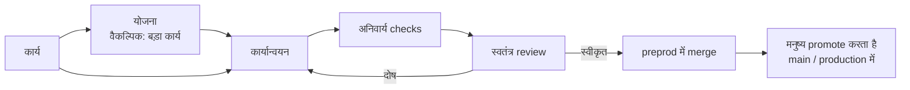

<div align="center">

# Darkfactory

**एक self-hosted AI software factory: यह काम की योजना बनाती है, कोड लिखती है, अनिवार्य checks और स्वतंत्र review चलाती है, और केवल `preprod` तक ही पहुँचाती है।**

[](../../LICENSE)
[](../../pyproject.toml)
[](../../compose.yaml)
[](https://fastapi.tiangolo.com)
[](https://www.postgresql.org)

[English](../../README.md) · [Русский](README.ru.md) · [中文](README.zh.md) · **हिन्दी** · [Español](README.es.md) · [العربية](README.ar.md) · [Français](README.fr.md) · [বাংলা](README.bn.md) · [Português](README.pt.md) · [日本語](README.ja.md)

</div>

Darkfactory आपको एक साझा UI और API, अलग-थलग projects वाले organizations, PostgreSQL पर आधारित queue और हर task के लिए एक अलग container देती है। सत्यापित बदलाव अपने-आप केवल `preprod` में पहुँचते हैं। main branch और production को मनुष्य अपडेट करता है।

## Darkfactory क्यों

- 🏭 **Self-hosted।** एक UI और API, organizations और अलग-थलग projects, PostgreSQL queue और हर task के लिए समर्पित container।
- 🛡️ **केवल `preprod` तक पहुँचाती है।** Production और main branch को मनुष्य अपडेट करता है, factory कभी नहीं।
- ✅ **अनिवार्य checks और स्वतंत्र review।** Checks और review एक ही अंतिम commit से बँधे होते हैं। checks कॉन्फ़िगर न हों तो automatic merge बंद रहता है।
- 🔒 **अलग-थलग task containers।** Non-root, read-only root filesystem, सीमित CPU/RAM/PIDs, नेटवर्क बंद, Docker socket, PostgreSQL, अन्य projects या production secrets तक कोई पहुँच नहीं।
- 🔀 **Fallback वाले subscription pools।** डिफ़ॉल्ट रूप से development के लिए Codex और review के लिए Claude; quota का ध्यान रखते हुए account और engine की अदला-बदली; paid API केवल स्पष्ट opt-in और धन-बजट के साथ।
- 🧠 **Factory Director।** एक chat (वेब और CLI) जो projects, roles और tasks बनाता है और अटके हुए tasks को उपयोगकर्ता की अपनी अनुमतियों के दायरे में सुलझाता है।

## Task pipeline



डिफ़ॉल्ट रूप से कोई task सीधे एक ही developer के पास जाता है, बिना योजना और बिना subtasks के। अवरोधक प्रश्नों वाली योजना आपके उत्तर तक रुकी रहती है।

## विषय-सूची

- [त्वरित शुरुआत](#त्वरित-शुरुआत)
- [आपका पहला project](#आपका-पहला-project)
- [Executor कनेक्शन](#executor-कनेक्शन)
- [आइसोलेशन और dependencies](#आइसोलेशन-और-dependencies)
- [मौजूदा project को initialize करना](#मौजूदा-project-को-initialize-करना)
- [Project artifacts](#project-artifacts)
- [Roles, delegation, skills और MCP](#roles-delegation-skills-और-mcp)
- [Factory Director](#factory-director)
- [मनुष्यों को सूचनाएँ](#मनुष्यों-को-सूचनाएँ)
- [सीमाएँ और incidents](#सीमाएँ-और-incidents)
- [कार्यान्वयन की जाँच](#कार्यान्वयन-की-जाँच)
- [Browser UI testing](#browser-ui-testing)
- [API और डेटा](#api-और-डेटा)
- [इंटरफ़ेस की भाषाएँ](#इंटरफ़ेस-की-भाषाएँ)
- [लाइसेंस](#लाइसेंस)

## त्वरित शुरुआत

आपको `volume.subpath` सपोर्ट वाला Docker Engine और Docker Compose चाहिए। macOS पर Docker Desktop चलता है।

> [!IMPORTANT]
> PostgreSQL का कोई डिफ़ॉल्ट पासवर्ड नहीं है: `.env` में `POSTGRES_PASSWORD` के बिना Compose शुरू नहीं होगा। पहले बनी किसी installation में पासवर्ड `darkfactory-local` था: उसे `.env` में डालें, फिर PostgreSQL (`ALTER USER darkfactory PASSWORD …`) और `.env` दोनों में पासवर्ड बदलें।

नई installation के लिए, project directory से:

```sh
echo "POSTGRES_PASSWORD=$(openssl rand -hex 32)" >> .env
docker compose up -d --build
docker compose exec app cat /data/bootstrap-token
```

[localhost:8080](http://localhost:8080) खोलें और owner token पेस्ट करें।

- **Owner token खुद तय करें।** बनी-बनाई फ़ाइल की जगह, पहली बार शुरू करने से पहले `echo "DARKFACTORY_ADMIN_TOKEN=$(openssl rand -hex 32)" >> .env` चलाएँ।
- **बाद में बदलना।** Restart के बाद, वेरिएबल का नया मान `.env` वाले पिछले token की जगह ले लेता है। पहले से चल रही installation में यह वेरिएबल `/data/bootstrap-token` वाले owner में जोड़ा जाता है। `.env` से revoke किया गया token बहाल नहीं होता: नया मान सेट करें।
- **पहला build।** यह Python, Node, PostgreSQL, Codex CLI और Claude Code डाउनलोड करता है। बाद की शुरुआतें बने हुए images इस्तेमाल करती हैं।

### Services

| Service | उद्देश्य |
|---|---|
| `app` | UI और API परोसती है |
| `worker` | tasks का प्रबंधन करता है |
| `db` | queue संग्रहीत करता है (PostgreSQL) |
| `executor-image` | अस्थायी task containers के लिए image बनाता है |

Docker socket केवल भरोसेमंद worker को उपलब्ध है; task को वह नहीं मिलता।

### कॉन्फ़िगरेशन

Compose की सेटिंग्स `.env` से पढ़ी जाती हैं:

| वेरिएबल | अर्थ | डिफ़ॉल्ट |
|---|---|---|
| `PORT` | Publish किया गया port | `8080` (`compose.yaml` के अनुसार) |
| `BIND_ADDRESS` | वह address जिससे port bind होता है | `127.0.0.1` |
| `POSTGRES_PASSWORD` | PostgreSQL का पासवर्ड | कोई नहीं, अनिवार्य |
| `GLOBAL_CONCURRENCY` | वैश्विक task concurrency | `4` |
| `EXECUTOR_CPUS` | प्रति task container CPUs | `4` |
| `DATA_VOLUME` | `data` volume का नाम | `darkfactory_data` (`compose.yaml` के अनुसार) |
| `DARKFACTORY_ADMIN_TOKEN` | आपका चुना हुआ owner token | `/data/bootstrap-token` में generate होता है |
| `DARKFACTORY_PERSONAL_MODE` | निजी स्थानीय pilot मोड (देखें [Executor कनेक्शन](#executor-कनेक्शन)) | `0` |
| `DARKFACTORY_PUBLIC_URL` | सूचनाओं के links में इस्तेमाल होने वाला factory का address | `http://127.0.0.1:8080` |

> [!WARNING]
> कर्मचारियों की पहुँच के लिए application के आगे HTTPS reverse proxy लगाएँ। PostgreSQL बाहर publish नहीं किया जाता।

## आपका पहला project

1. **"Connect project"** पर क्लिक करें और नाम, Git repository और ज़रूरत हो तो access token दर्ज करें।
2. मानक skills वाले manager, analyst, developer और reviewer तुरंत दिखाई देते हैं। Roles project के executors विरासत में लेते हैं: development के लिए Codex और review के लिए Claude। MCP servers अलग से जोड़े जाते हैं।
3. Subscriptions को organization के साझा pool से जोड़ें। यदि pool पहले से है, तो नया project उसी का उपयोग करता है; नहीं तो factory "Shared pool" बना देती है। बाद में projects अपनी सेटिंग्स में समर्पित pools चुन सकते हैं।
4. Project सेटिंग्स में अनिवार्य check commands परिभाषित करें। इनके बिना automatic merge बंद रहता है।
5. UI में या API के माध्यम से task बनाएँ। अवरोधक प्रश्नों वाली योजना आपके उत्तर तक रुकी रहती है।

### समर्थित repositories

HTTPS Git, SSH और `/repos` में स्थित स्थानीय bare repositories समर्थित हैं। GitHub और GitLab, self-hosted domains सहित, के लिए PRs/MRs बनते हैं। किसी भी अन्य Git के लिए factory diff, checks और review के साथ एक आंतरिक change record बनाती है। SSH के लिए समर्पित key और स्पष्ट रूप से सेट किया गया `known_hosts` चाहिए; host keys विरासत में नहीं मिलतीं।

स्थानीय projects के लिए साझा `repos` volume इस्तेमाल करें, जो app और worker में `/repos` के रूप में mount होता है। आप `docker compose exec worker sh` से repository बना सकते हैं; test scenario [नीचे](#कार्यान्वयन-की-जाँच) पूरा उदाहरण दिखाता है। Host directories task container में mount नहीं की जातीं।

### Merge का व्यवहार

- जब कोई checks कॉन्फ़िगर नहीं होते, task change record और `review_required` स्थिति पर समाप्त होता है: automatic merge वर्जित है।
- Checks और review एक ही अंतिम commit से बँधे होते हैं।
- `preprod` के सिरे में बदलाव दोबारा integration और acceptance शुरू करता है।
- Project के merges क्रमवार चलते हैं।

### Access roles

| Role | क्या कर सकता है |
|---|---|
| Owner | सेटिंग्स और कनेक्शन प्रबंधित करना |
| Operator | tasks प्रबंधित करना |
| Observer | पढ़ना |

Member और token की अनुमतियों का सर्वनिष्ठ (intersection) लागू होता है; अनुमतियाँ रद्द करना आगे के अनुरोधों पर लागू होता है। नए organization को अपना owner और एक बार दिखाया जाने वाला token मिलता है। Owner सेटिंग्स ("Team access") में या `POST /api/members` के माध्यम से member tokens जारी करता है; `owner` role वाले कई members हो सकते हैं। आपके अपने अतिरिक्त tokens `POST /api/tokens` से जारी होते हैं और `DELETE /api/tokens/{id}` से revoke किए जाते हैं।

## Executor कनेक्शन

| कनेक्शन | Credentials और टिप्पणियाँ |
|---|---|
| **Codex for company** | JSON credentials `{"auth_method":"siwc","accessToken":"..."}`। App Server के लिए दस्तावेज़ीकृत बाहरी OAuth provider इस्तेमाल करता है। इस scenario तक पहुँच वाला Sign in with ChatGPT token चाहिए। Token को reconnect के ज़रिए refresh करें। |
| **Claude Code** | अनुमत subscription कनेक्शन के लिए `{"oauth_token":"..."}`। अलग-थलग session को केवल चुना हुआ token मिलता है; `--bare` इस्तेमाल नहीं होता। |
| **API** | HTTPS OpenAI-compatible Chat Completions, tool calls के साथ। Model और `{"base_url":"https://example.com/v1","api_key":"...","input_usd_per_million":0.0,"output_usd_per_million":0.0}` वास्तविक कीमतों के साथ दें। कस्टम TLS CA के लिए `ca_cert` फ़ील्ड उपलब्ध है। |

### निजी स्थानीय pilot

निजी स्थानीय pilot के लिए आप ChatGPT के ज़रिए मौजूदा `codex login` इस्तेमाल कर सकते हैं।

1. स्थानीय `.env` में `DARKFACTORY_PERSONAL_MODE=1` जोड़ें।
2. `docker compose up -d --build` चलाएँ।
3. Host पर `python3 scripts/connect_personal_codex.py` चलाएँ। Script bootstrap token वाले organization में `Personal Codex` pool और एक कनेक्शन बनाती है।
4. इस pool को किसी project को सौंपें; अलग Codex session भी reviews कर सकता है।

`~/.codex/auth.json` से केवल access token और account ID आयात किए जाते हैं; refresh token और host directory containers में नहीं भेजे जाते। Token एन्क्रिप्टेड रूप में संग्रहीत होता है। Token की अवधि समाप्त होने या revoke होने पर, कनेक्शन के idle रहते आयात दोहराएँ। Personal mode डिफ़ॉल्ट रूप से बंद है, और hosted या commercial installation SIWC इस्तेमाल करती है। अंतर्निहित authorization का दायरा [आधिकारिक App Server दस्तावेज़ीकरण](https://learn.chatgpt.com/docs/app-server#auth-endpoints) में वर्णित है।

यदि आपका personal Codex पहले से किसी स्थानीय subscription gateway से चलता है, तो उसका Docker से पहुँचने योग्य address और कॉन्फ़िगर किया गया model दें:

```sh
python3 scripts/connect_personal_codex.py --base-url http://host.docker.internal:8787/v1 --model MODEL_NAME
```

यह मोड केवल स्थानीय HTTP addresses स्वीकार करता है और इसके लिए `DARKFACTORY_PERSONAL_MODE=1` ज़रूरी है। Executor दिए गए gateway से एक निश्चित tunnel और addresses की मौजूदा allow-list के ज़रिए जुड़ता है; container का नेटवर्क `none` ही रहता है। यह मोड paid API को सक्षम नहीं करता।

### Pools और engine का चयन

Pools प्राथमिकताएँ, models, उपलब्ध engines, concurrency, switches की संख्या और quota दोबारा जाँचने से पहले का विराम तय करते हैं। आधारभूत चयन है: development के लिए Codex और review के लिए Claude। Accounts बदलना और Codex ↔ Claude बदलना अनुमत है; API डिफ़ॉल्ट रूप से अपने-आप नहीं जुड़ता। Paid fallback के लिए owner स्पष्ट रूप से project policy सक्षम करता है और task को धन-बजट मिलता है। स्पष्ट रूप से सौंपे गए API के लिए भी बजट ज़रूरी है।

**"+ Subscription"** बटन link और एक-बार वाले browser code के ज़रिए मानक Claude login शुरू करता है। Personal mode में Codex device-auth उपलब्ध है: link और code उसी फ़ॉर्म में दिखते हैं। Sign in करने से पहले pools चुनें; पुष्टि के बाद account अपने-आप जुड़ जाता है। आप फ़ॉर्म बंद कर सकते हैं और अधूरा sign-in सेटिंग्स से जारी रख सकते हैं। Sign-in अधिकतम 15 मिनट तक मान्य रहता है, रद्द किया जा सकता है, और अलग container में चलता है। OAuth tokens कभी browser को नहीं दिए जाते। समाप्त हो चुके tokens का automatic refresh लागू नहीं है; sign-in दोहराएँ या reconnect करें।

| Pool का डिफ़ॉल्ट | मान |
|---|---|
| सुरक्षित रखा गया reserve | **10%** |
| Observation ताज़ा मानी जाती है | **300 सेकंड** तक |
| अज्ञात quota | अनुमत |

- ताज़ा, ज्ञात quota यदि reserve से कम हो तो subscription बाहर हो जाता है। चुने हुए engine के उपयुक्त accounts में से, जिसका पुष्ट शेष अधिक हो, उसे प्राथमिकता मिलती है।
- Reserve, snapshot की आयु और "ज्ञात quota आवश्यक" सेटिंग्स pool फ़ॉर्म में हैं।
- Personal Codex model को कॉल करने से पहले सीमाएँ दोबारा जाँचता है।
- जिन providers का डेटा उपलब्ध नहीं है, उनके लिए strict policy पुष्ट शेष की प्रतीक्षा करती है।
- काम चलते समय सीमाएँ बदल सकती हैं: कोड सहेजकर और context सौंपकर काम को दूसरे account से जारी रखा जा सकता है।

Switch होने पर कोड और artifacts सौंपे जाते हैं, account का आंतरिक session नहीं। Quota और occupancy प्रति कनेक्शन ट्रैक होते हैं, जिनमें ज्ञात साझा `quota_group` भी शामिल है; उन्हीं credentials से दोबारा जुड़ने पर नई quota नहीं बनती। अज्ञात शेष को कभी असीमित घोषित नहीं किया जाता। Authorization error के लिए reconnect चाहिए; quota error के लिए नियंत्रण जाँच तक प्रतीक्षा करनी होती है।

जब कोई executor अपनी शेष quota और reset का समय बताता है, factory उन्हें संग्रहीत करती है और observation के समय के साथ कनेक्शन सेटिंग्स में दिखाती है। यह आख़िरी प्राप्त snapshot है, account की निरंतर polling नहीं। डेटा उपलब्ध न होने पर "remaining quota unknown" दिखाया जाता है। नए credentials से दोबारा जुड़ने पर पिछला snapshot साफ़ हो जाता है। नियंत्रण प्रयास का समय provider द्वारा बताए गए reset समय से अलग दिखाया जाता है।

### Pools हटाना

Pools को सेटिंग्स में या `DELETE /api/pools/{id}` से हटाया जा सकता है, Director के माध्यम से भी। हटाना पूरे organization के owner को उपलब्ध है। Subscriptions, authorization और अन्य pools की सदस्यता सुरक्षित रहती हैं। यदि pool किसी project को सौंपा गया है, तो पहले development और review के लिए कोई दूसरा pool चुनें। अधूरे subscription sign-in को भी हटाने से पहले पूरा या रद्द करना होगा।

### आधिकारिक आधार

[Codex App Server](https://learn.chatgpt.com/docs/app-server), [SIWC external tokens](https://developers.openai.com/siwc/token-sharing-open-source/codex-app-server), [Claude Code headless](https://code.claude.com/docs/en/headless)।

> [!NOTE]
> Adapter का होना यह पुष्टि नहीं करता कि subscription scenario किसी विशेष कंपनी के लिए उपलब्ध है: आपको अनुमत कनेक्शन चाहिए।

## आइसोलेशन और dependencies

Task को अपनी working copy और branch, non-root container, read-only root filesystem, सीमित CPU/RAM/PIDs और आंतरिक deadline मिलती है। `.git` agent के लिए write-protected है। Verifier को working copy केवल-पढ़ने योग्य रूप में मिलती है। Docker socket, PostgreSQL, अन्य projects या production secrets तक कोई पहुँच नहीं है।

Container का नेटवर्क बंद है। HTTPS केवल चुने हुए provider और project की स्पष्ट रूप से अनुमत `host:port` प्रविष्टियों तक CONNECT proxy के ज़रिए उपलब्ध है। Checks डिफ़ॉल्ट रूप से offline चलते हैं। Test secrets अलग से दिए जाते हैं; proxy मनमाने host तक पहुँच नहीं खोलता।

> [!WARNING]
> Production deployment लागू नहीं है। Factory केवल `preprod` तक पहुँचाती है।

### Executor image और test सेटिंग्स

Image में Python, Node और Git हैं। यदि project को अन्य dependencies चाहिए, तो `darkfactory-executor:local` से अपना image बनाएँ, dependencies पहले से install करें और project सेटिंग्स में `executor_image` सेट करें।

- Owner अनुमत test endpoints और `test_env` कॉन्फ़िगर करता है।
- `test_env` में नाम केवल `TEST_*`, `APP_*` या `E2E_*` हो सकते हैं।
- `allowed_hosts`, Git remote और PR/MR server पूर्ण रूप से योग्य (fully qualified) नाम होने चाहिए।
- आंतरिक address (loopback, private network, link-local, CGNAT) तभी स्वीकार होता है जब उसका सटीक `ip:port` `allowed_hosts` में सूचीबद्ध हो।

### Task संबंध

Task संबंध: `depends_on`, parent → subtask (`parent`), `related_to`, और पुष्ट `duplicate`। कोड dependency `preprod` में स्वीकृत परिणाम की प्रतीक्षा करती है; artifact dependency किसी विशिष्ट सत्यापित commit को स्वीकार कर सकती है। Cycles और cross-organization संबंध वर्जित हैं। Parent अपने अनिवार्य child tasks और अपनी integration check की प्रतीक्षा करता है।

### Decomposition और review

- डिफ़ॉल्ट रूप से कोई task सीधे एक ही developer के पास जाता है, बिना योजना और बिना subtasks के।
- Review काम को केवल दोषों और अपूर्ण मानदंडों के लिए लौटाता है; सुधार-सुझावों को `[LATER]` चिह्नित किया जाता है और वे backlog में जाते हैं।
- "Large task" चिह्नित task के लिए planner स्वयं acceptance criteria और dependencies के साथ आठ तक subtasks बना सकता है।
- स्वतंत्र children को अलग working directories मिलती हैं और वे समानांतर चल सकते हैं।
- नेस्टेड automatic decomposition वर्जित है।
- अपने कार्यान्वयन से पहले parent अपने children का स्वीकृत कोड इकट्ठा करता है।
- समय, fixes, switches और धन पूरे tree के एक ही बजट से सीमित हैं; children बनाने से सीमाएँ गुणित नहीं होतीं। समानांतर runs शेष समय के हिस्से आरक्षित करते हैं।
- Parent रद्द करने पर उसके बनाए agents रद्द हो जाते हैं; रद्द किए गए children अपने-आप फिर शुरू नहीं होते।

### Dependency में बदलाव

स्वीकृत dependency SHAs task में संग्रहीत होते हैं। SHA बदलने या स्वीकृत परिणाम के revoke होने पर मौजूदा executor रुक जाता है और पुराने checks और reviews रीसेट हो जाते हैं। अनब्लॉक होने के बाद task इनपुट assembly, कार्यान्वयन और acceptance दोहराता है, कार्यशील कोड और संचित counters को बनाए रखते हुए। Merge से पहले dependency check और Git operation साझा controller lock के अंतर्गत चलते हैं, इसलिए इनपुट का बदलाव उनके बीच नहीं घुस सकता।

## मौजूदा project को initialize करना

Project जोड़ते समय **"Initial indexing and Markdown documents"** डिफ़ॉल्ट रूप से चालू होता है। Factory एक सामान्य task queue में डालती है: पहले यह tracked Git files का नक्शा सहेजती है, फिर executor repository का अध्ययन करता है और चार फ़ाइलें बनाता या बढ़ाता है:

| फ़ाइल | सामग्री |
|---|---|
| `docs/darkfactory/INDEX.md` | Project का नक्शा, entry points और modules के उद्देश्य |
| `docs/darkfactory/ARCHITECTURE.md` | Components, dependencies, डेटा और सिस्टम की सीमाएँ |
| `docs/darkfactory/DEVELOPMENT.md` | Installation, चलाना, कॉन्फ़िगरेशन और checks |
| `docs/darkfactory/CONTRACTS.md` | खोजे गए APIs, events और बाहरी integrations |

SHAs वाला source map task artifacts में भी है: `repository-index.md`। इसमें पहली 1000 tracked files और कुल संख्या सूचीबद्ध होती है। Executor को अपने निष्कर्ष project की फ़ाइलों से पुष्ट करने होंगे, उपयोगी मौजूदा दस्तावेज़ीकरण सुरक्षित रखना होगा और जो अज्ञात है उसे चिह्नित करना होगा। चार दस्तावेज़ों के बाहर के बदलाव worker की जाँच अस्वीकार कर देती है।

Task project के कनेक्शनों, सीमाओं, checks और स्वतंत्र review का उपयोग करता है। यदि अभी कोई कनेक्शन नहीं है, तो वह उनके सेट होने की प्रतीक्षा करता है। दस्तावेज़ सामान्य Git pipeline से गुज़रते हैं: अनिवार्य checks सफल होने पर बदलाव `preprod` में merge हो जाते हैं; checks कॉन्फ़िगर न हों तो उन्हें मैन्युअल merge के लिए छोड़ दिया जाता है। Review के बाद चारों दस्तावेज़ registry में **drafts** के रूप में दिखते हैं, स्रोत task और सत्यापित commit के SHA के साथ। Owner अपनी पसंद के संस्करण स्पष्ट रूप से स्वीकार करता है; मौजूदा स्वीकृत संस्करण सुरक्षित रहते हैं।

पहले जोड़े गए project के लिए **"Project artifacts" → "Index project"** खोलें। यह बटन owner को उपलब्ध है और, यदि initialization task पहले ही बन चुका हो, तो उसी को खोलता है, duplicates के बिना। API से project बनाना `initialize` स्वीकार करता है (डिफ़ॉल्ट `true`); `false` automatic शुरुआत बंद कर देता है। मौजूदा project के लिए: `POST /api/projects/{id}/initialize`।

## Project artifacts

**"Project artifacts"** खोलें और requirements, analytics, architecture, API contract, रिपोर्ट या कोई भी अन्य टेक्स्ट दस्तावेज़ जोड़ें। Artifact की project के भीतर एक स्थिर key, एक शीर्षक और अपरिवर्तनीय संस्करणों का इतिहास होता है। सामग्री DB में संग्रहीत होती है; संपादन नया संस्करण बनाता है। यह एक अलग project knowledge registry है जो task की working files (`plan.md`, `diff.patch`, `checks.txt`, `review.txt`, `handoff.md`) और browser evidence की पूरक है।

- Operator drafts जोड़ता है, owner चुना हुआ संस्करण स्वीकार करता है या स्वीकृति रद्द करता है, observer पढ़ता है।
- एक समय में प्रत्येक artifact का ठीक एक संस्करण स्वीकृत रहता है।
- वैकल्पिक रूप से स्रोत task बताएँ: उसके पास स्वतंत्र review वाला वर्तमान commit होना चाहिए। संस्करण task ID और SHA संग्रहीत करता है; स्रोत के परिणाम या उसके इनपुट में बदलाव दस्तावेज़ को stale बना देता है।
- सामान्य दस्तावेज़ फ़ॉर्म या API से publish होते हैं; project initialization अपने दस्तावेज़ review के बाद अपने-आप जोड़ता है।

### Artifacts को task इनपुट के रूप में इस्तेमाल करना

Task बनाते समय स्वीकृत संस्करण चुनें। रुके हुए task के card में आप इनपुट जोड़ सकते हैं, बदल सकते हैं या हटा सकते हैं। Task को ठीक चुने हुए संस्करणों का पूरा टेक्स्ट, उनकी keys, क्रमांक और स्रोत SHAs मिलते हैं। सौंपे गए subtasks ये संस्करण विरासत में लेते हैं।

| सीमा | मान |
|---|---|
| प्रति संस्करण अक्षर | 100,000 |
| प्रति task इनपुट | 10 तक |
| प्रति task कुल अक्षर | 200,000 |

नया संस्करण स्वीकार करने से tasks के चयन अपने-आप नहीं बदलते: पुराने संस्करण के उपभोक्ता इनपुट के स्पष्ट प्रतिस्थापन की प्रतीक्षा करते हैं। रद्द की गई स्वीकृति और stale स्रोत भी निष्पादन रोकते हैं। Factory पिछले इनपुट के checks और reviews रीसेट करती है, सक्रिय executor को रोकती है और merge से पहले इनपुट दोबारा सत्यापित करती है। कार्यशील कोड और संचित counters सुरक्षित रहते हैं। Artifact का card इतिहास, स्रोत tasks और उपभोक्ता दिखाता है; पुराने संस्करण पढ़े जा सकते हैं।

### Artifact API

| उद्देश्य | Routes |
|---|---|
| Artifacts | `GET/POST /api/projects/{id}/artifacts` |
| संस्करण | `POST /api/project-artifacts/{id}/versions`, `GET /api/project-artifacts/{id}/versions/{version_id}` |
| स्वीकृति | `POST …/versions/{version_id}/accept`, `POST /api/project-artifacts/{id}/revoke` |
| Task इनपुट | `GET /api/tasks/{id}/artifact-inputs`, `PUT/DELETE /api/tasks/{id}/artifact-inputs/{artifact_id}` |
| Task बनाना | `artifact_version_ids` स्वीकार करता है |

पहुँच organization, उपयोगकर्ता के projects और token के scope से सीमित है; सामान्य dependencies के साथ cycles वर्जित हैं। नई tables शुरू होते समय बनती हैं, मौजूदा tasks को बदले बिना।

## Roles, delegation, skills और MCP

बाएँ मेनू में **"Agents, skills and MCP"** खोलें और project चुनें। **"Add ready-made team"** बटन project agent, analyst, developer और reviewer install करता है। **"Roles"**, **"Skills"** और **"MCP"** टैब catalogs देते हैं: बटनों से तैयार कॉन्फ़िगरेशन जोड़ें और सूचियों के ज़रिए role से skills और tools जोड़ें। Role के card में instructions, engine और model बदले जा सकते हैं। Profiles किसी अलग task को भी सौंपे जा सकते हैं।

### Delegation

योजना बनाते समय project agent subtasks बनाता है और उन्हें `agent_profile` सौंपता है। "analysis → development" scenario के लिए `analyst` और `developer` profiles बनाएँ: developer subtask `depends_on` में analysis की key सूचीबद्ध करता है। Developer तब शुरू होता है जब analysis `preprod` में सत्यापित रूप से merge हो चुका हो, और उसे स्वीकृत commit और artifacts मिलते हैं। Analyst परिणाम repository में सहेजता है। Delegation की अनुमति वाला हर agent कॉन्फ़िगर की गई गहराई और कुल संख्या के भीतर आगे और subtasks बना सकता है।

| Delegation का डिफ़ॉल्ट | मान |
|---|---|
| गहराई | 2 |
| प्रति tree अधिकतम subtasks | 16 |
| प्रति योजना सीधे subtasks | 8 |

समय, fixes और धन-बजट पूरे tree में साझा हैं।

### Catalog

Catalog में सात skills और चार MCP servers हैं: browser, project की फ़ाइलें पढ़ना/खोजना, Git status/diff/log पढ़ना, और Jira। पहले तीन task container के भीतर चलते हैं और उन्हें किसी बाहरी server की ज़रूरत नहीं होती।

### Jira MCP

**Jira** MCP (`mcp-atlassian`, executor image में installed) Jira Server/Data Center या Cloud के issues, JQL search, boards और sprints पढ़ता है। Write tools gateway और server दोनों में बंद हैं (`--read-only`)। Catalog से जोड़ने के बाद उसका card खोलें और भरें:

- **जिन addresses तक पहुँच चाहिए:** `jira.example.com:443`। इसके बिना task का egress server को Jira तक, private address सहित, पहुँचने नहीं देगा।
- **Secret environment:** `JIRA_URL=https://jira.example.com` और `JIRA_PERSONAL_TOKEN=<PAT>` (Jira → Profile → Personal Access Tokens)। Jira Cloud के लिए PAT की जगह `JIRA_USERNAME` और `JIRA_API_TOKEN` इस्तेमाल करें।

फिर `jira` को उन roles से जोड़ें जिन्हें इसकी ज़रूरत है, उदाहरण के लिए analyst और manager। Service account को केवल संबंधित projects की read अनुमति चाहिए।

### Custom MCP

अपने MCP के लिए उन्नत फ़ॉर्म उपलब्ध है: HTTPS endpoint या executor image का stdio command, अनुमत tools के सटीक नाम, और secret headers या environment। Secrets एन्क्रिप्टेड रहते हैं और UI/API में कभी वापस नहीं दिखाए जाते। Native Codex और Claude को tools एक स्थानीय gateway से मिलते हैं जो सूची को फ़िल्टर करता है और अनुमत सेट के बाहर की calls वर्जित करता है। Planner और reviewer केवल वही कनेक्शन स्वीकार करते हैं जिन्हें owner ने read-safe चिह्नित किया हो; service account की अपनी अनुमतियाँ भी role से मेल खानी चाहिए। Paid API adapter MCP का समर्थन नहीं करता।

## Factory Director

**"Factory Director"** संवाद दाईं ओर खुला रहता है। पूरी factory या कोई एक project चुनें। इस संवाद के ज़रिए आप organizations, projects, pools, roles और skills बना सकते हैं, तैयार MCP servers जोड़ सकते हैं, tasks बना सकते हैं और उपलब्ध सेटिंग्स बदल सकते हैं। उदाहरण के लिए: "project में analyst और developer जोड़ो, उन्हें files और Git पढ़ने की पहुँच दो"।

- **"New chat"** अलग इतिहास और context शुरू करता है। पुराने chats सूची में रहते हैं।
- **"Cancel message"** अनुरोध को queue से हटाता है या सक्रिय executor को रोकता है। जो actions शुरू हो चुके हैं वे पूरे हो सकते हैं; उनका log सुरक्षित रहता है। Container रुकने के बाद subscription मुक्त हो जाता है।

Director जुड़े हुए subscription pool के **Codex CLI या Claude CLI** से चलता है। यह उपयोगकर्ता जैसे ही API और अनुमतियाँ इस्तेमाल करता है: operator को owner के अधिकार नहीं मिलते, और एक project की पहुँच दूसरों को नहीं खोलती। Director के लिए paid API अपने-आप सक्षम नहीं होता। Pool व्यस्त हो तो अनुरोध queue में रहता है। Restart के बाद परिणाम अनिश्चित हो तो actions आँख मूँदकर दोहराए नहीं जाते: Director आपसे स्थिति जाँचने को कहता है।

> [!CAUTION]
> पासवर्ड, keys और sign-in codes कनेक्शन फ़ॉर्म के ज़रिए जोड़ें। Director sign-in शुरू कर सकता है और link दे सकता है, पर उसे tokens या device codes कभी नहीं मिलते। बनाए गए organization की पहुँच अलग से और केवल एक बार इंटरफ़ेस के माध्यम से जारी होती है।

### अटके हुए tasks

Director उन tasks को भी सँभालता है जो रुक गए हैं और मनुष्य की प्रतीक्षा में हैं: review-चक्र की सीमा, developer का प्रश्न, बंद नेटवर्क, समाप्त हुआ समय। यह कोड और task का इतिहास पढ़ता है (repository केवल-पढ़ने के लिए जुड़ी होती है) और खुद निर्णय लेता है: मार्गदर्शन के साथ जारी रखना, दोबारा review के लिए लौटाना, address की अनुमति देना, रद्द करना। यह owner को केवल पहुँच, धन, product संबंधी चुनावों और विनाशकारी actions के लिए बुलाता है। जब तक वह सोच रहा होता है, board पर task "Director deciding" दिखाता है।

Chat में **"Decisions"** बटन project के लिए उसके निर्णय दिखाता है। जिन पर "Waiting for you" लिखा है उनमें आपके निर्णय की ज़रूरत है: chat में Director को उत्तर दें, उदाहरण के लिए "task … के लिए जारी रखो, … इस्तेमाल करो", और वह task को खुद जारी रखेगा या रद्द करेगा।

Project सेटिंग्स: "Director resolves stops instead of you" और "Director decisions per task tree" (डिफ़ॉल्ट 6, वेरिएबल `DARKFACTORY_DIRECTOR_LIMIT`)। Director का model और instructions "Roles" स्क्रीन पर "Director" role से तय होते हैं।

### Terminal से Director

वही संवाद terminal से भी उपलब्ध है:

```sh
uv sync
uv run darkfactory director --token-file /path/to/api-token "Покажи проекты и текущие задачи"
uv run darkfactory director --token-file /path/to/api-token --project PROJECT_ID
```

संदेश के बिना interactive संवाद खुलता है।

| Option / वेरिएबल | उद्देश्य |
|---|---|
| `--token-file` या `DARKFACTORY_TOKEN` | API token (फ़ाइल या environment) |
| `--url` या `DARKFACTORY_URL` | Server का address (डिफ़ॉल्ट `http://127.0.0.1:8080`) |
| `--project` | किसी विशिष्ट project के साथ काम करना |
| `--timeout` | प्रतीक्षा समय; डिफ़ॉल्ट 600 सेकंड |
| `--resume MESSAGE_ID` | दोबारा भेजे बिना उसी अनुरोध की प्रतीक्षा करना; पिछला token और `--project` इस्तेमाल करें |
| `--new-chat` | अलग CLI संवाद शुरू करना |
| `--thread CHAT_ID` | मौजूदा chat जारी रखना |
| `--cancel MESSAGE_ID` | command दोबारा भेजे बिना संदेश रद्द करना |

यह command `python -m darkfactory.cli director` के रूप में भी उपलब्ध है। यदि terminal बंद हो जाए या प्रतीक्षा का समय समाप्त हो जाए, तो अनुरोध चलता रहता है।

## मनुष्यों को सूचनाएँ

सेटिंग्स में HTTPS webhook और प्राप्तकर्ता `@username` या `#channel` के साथ Rocket.Chat channel जोड़ें, या bot token और chat ID के साथ Telegram। Rocket.Chat के लिए incoming webhook में channel override की अनुमति दें। प्राप्तकर्ता को URL दोबारा दर्ज किए बिना बदला जा सकता है। कोई project या पूरा organization चुनें, फिर events: प्रश्न, रुकावटें, errors, सीमाएँ, स्वीकृत बदलाव और incidents। Channel सेट करने से अपने-आप कोई संदेश नहीं जाता। Agents के प्रश्न और pipeline की रुकावटें अपने-आप queue में आ जाती हैं। API `POST /api/tasks/{id}/notify`, `{"message":"..."}` के साथ, task के कॉन्फ़िगर किए गए channels को संदेश भेजता है।

Delivery tasks से अलग चलती है, पाँच प्रयासों और पुनः प्रयासों के बीच विलंब के साथ। Secrets दोबारा नहीं दिखाए जाते। भेजने और acknowledgement सहेजने के बीच विफलता के बाद duplicate संदेश संभव है। प्रश्नों के उत्तर task card में या सीधे chat में दिए जाते हैं।

### Chat commands

Chat commands channel सेटिंग्स में operator role वाले API token से सक्षम होते हैं: commands उसकी अनुमतियों और project scope के साथ चलते हैं, इसलिए न्यूनतम आवश्यक अनुमतियों वाला समर्पित token जारी करें। Channel owner token स्वीकार नहीं करता। `allowed_senders` के बिना chat का कोई भी सदस्य commands इस्तेमाल कर सकता है; `allowed_senders` सूची (Telegram `from.id`, Rocket.Chat `user_id`) होने पर केवल सूचीबद्ध लोग कर सकते हैं। भेजने वाला task event में दर्ज होता है।

- `director text` (या `/director text`) Director को कार्य सौंपता है। Privacy mode वाले Telegram groups में bot केवल `/director` देखता है। Telegram command वाले संदेश का उत्तर देता है, Rocket.Chat उस संदेश के thread में उत्तर देता है। Director के व्यस्त रहने पर नया command अस्वीकार कर दिया जाता है।
- प्रश्न या रुकावट की सूचना का उत्तर उसी टेक्स्ट के साथ task को जारी रखता है, जैसे card में "Continue" बटन। Telegram में bot के संदेश का उत्तर दें या bot के साथ private chat में टिप्पणी सहित उसे forward करें। Rocket.Chat में सूचना के thread में उत्तर दें।
- Telegram को `getUpdates` के ज़रिए long polling से पढ़ा जाता है, इसलिए सार्वजनिक address की ज़रूरत नहीं; bot पर webhook नहीं होना चाहिए। एक ही bot साझा करने वाले channels संदेशों को chat ID के आधार पर बाँटते हैं।

### Telegram से प्रबंधन

Command token के साथ Telegram bot बटनों वाला मेनू देता है। `/start` या `меню` इसे खोलता है। स्क्रीन उसी संदेश में अपडेट होती हैं।

- Projects → "Ready to run", "In progress", "Needs attention", "Done" कॉलमों वाला board → task सूची → card। Card में agent का प्रश्न और task की स्थिति के अनुसार बटन दिखते हैं।
- "✍️ Reply" agent को उत्तर पहुँचाता है और task जारी रखता है। "Reply" और "Card" बटन हर task सूचना के नीचे भी होते हैं।
- Queue का क्रम "⏫ Higher" और "⏬ Lower" बटनों या "➡️ Move" → "To start" और "To end" से बदलता है: यही task की प्राथमिकता है। "Move" task को दोबारा चलाने के लिए लौटाता है, उसे merge करता है या रद्द करता है; रद्द करने से पहले पुष्टि पूछी जाती है।
- "➕ New task": उत्तर की पहली पंक्ति शीर्षक होती है, पूरा टेक्स्ट विवरण।
- "🧠 Director" संदेश Director को सौंपता है। Bot के साथ private chat में कोई भी सादा टेक्स्ट भी Director के पास जाता है, और उसके संदेश का उत्तर बातचीत जारी रखता है।
- Subscriptions केवल वेब सेटिंग्स में जोड़े जाते हैं: chat sign-in शुरू नहीं करता।

### Rocket.Chat commands सेट करना

Incoming वाले के ही room में "Message sent" event के लिए एक outgoing webhook बनाएँ। URL: `https://<factory>/api/chat-commands/rocketchat/<channel id>` (channel सूची में दिखाया जाता है); channel सेटिंग्स में webhook token सेट करें। Bot के संदेशों को बाहर न रखें: factory उनसे पहचानती है कि thread किस task का है। Rocket.Chat अज्ञात `/director` आगे नहीं भेजता, इसलिए `director text` लिखें।

### Merge सूचनाएँ

`preprod` में सत्यापित merge के बाद channel को task और project के नाम, developer का संक्षिप्त सारांश, SHA और स्वीकृत commit का link मिलता है। GitHub/GitLab के लिए link commit पेज पर जाता है; स्थानीय और सामान्य Git के लिए यह factory में diff वाले authorized card पर जाता है। असफल प्रयास पूर्णता का संदेश नहीं भेजते।

कर्मचारियों के लिए `.env` में `DARKFACTORY_PUBLIC_URL` के ज़रिए उनके लिए पहुँच योग्य factory address सेट करें, उदाहरण के लिए `https://factory.company.ru`, फिर Compose restart करें। डिफ़ॉल्ट रूप से links `http://127.0.0.1:8080` इस्तेमाल करते हैं। Links में tokens नहीं जोड़े जाते; sign-in ज़रूरी हो सकता है।

### main में promote करना

जब कोई शीर्ष-स्तरीय task पूरा होता है, तो सूचना में **"Merge to main / reject"** link भी होता है। यह factory के भीतर merge का प्रस्ताव है, स्थानीय Git के लिए भी उपलब्ध। यह स्वीकृत commit को pin करता है और मौजूदा `main` के विरुद्ध पूरा diff दिखाता है (100,000 अक्षरों तक, कटाव-चिह्न के साथ)। Owner इसे merge या अस्वीकार कर सकता है; GET link अपने-आप कुछ नहीं बदलता। स्थानांतरण में बताए गए commit तक `preprod` के सभी बदलाव शामिल होते हैं, subtasks सहित। अस्वीकार करने पर `preprod` जैसा है वैसा रहता है।

> [!NOTE]
> `main` में कोई automatic स्थानांतरण और कोई deployment नहीं है; Director यह निर्णय नहीं ले सकता। यदि `main` स्वीकृत commit से अलग हो गया है, तो पहले integration और दोबारा checks चाहिए। पुराने पूरे हुए tasks को नए प्रस्ताव अपने-आप नहीं मिलते।

### main को वापस preprod में sync करना

उल्टी दिशा automatic है: घंटे में एक बार (`DARKFACTORY_MAIN_SYNC_SECONDS`, `0` इसे बंद करता है) factory `main` के नए commits को `preprod` में merge करती है, उदाहरण के लिए owner के hotfixes। यदि `preprod` आगे नहीं बढ़ा है, तो वह बस `main` तक पहुँच जाता है; अन्यथा merge commit बनता है। Conflict होने पर "Merge main into preprod: conflict" नाम का task दिखता है, जिसमें merge शुरू हुआ रहता है और working folder में markers होते हैं; agent conflict सुलझाता है, जिसके बाद task सामान्य review और checks से गुज़रता है।

## सीमाएँ और incidents

### प्राथमिकताएँ

Tasks की चार प्राथमिकताएँ हैं: critical (`critical`), high (`high`), normal (`normal`, डिफ़ॉल्ट) और low (`low`)। प्राथमिकता बनाते समय चुनी जाती है और task card में owner या operator बदलता है; API: `PUT /api/tasks/{id}/priority`, `priority` फ़ील्ड के साथ। Director वही API इस्तेमाल कर सकता है।

- पहले `preprod` के fixes उठाए जाते हैं, फिर तैयार tasks प्राथमिकता और बनने के समय के अनुसार।
- प्राथमिकता dependencies, quotas और सीमाओं को नहीं लाँघती और पहले से चल रहे काम को नहीं रोकती।
- Subtasks बनते समय parent की प्राथमिकता विरासत में लेते हैं। पुराने tasks को normal प्राथमिकता मिलती है।

### डिफ़ॉल्ट मान

| सीमा | डिफ़ॉल्ट |
|---|---|
| सक्रिय tasks | 2 |
| सक्रिय task का कुल समय | 60 मिनट |
| पहले कार्यान्वयन के बाद fix चक्र | 3 |

प्रतीक्षा सक्रिय समय नहीं खाती। Restart, account की अदला-बदली और उसी विफलता की पुनरावृत्ति counters को सुरक्षित रखती हैं। सीमा task को मनुष्य के स्पष्ट निर्णय तक रोक देती है। रद्द किए गए tasks अपने-आप फिर शुरू नहीं होते।

### Incidents

Merge के बाद, और फिर समय-समय पर, worker `preprod` के checks दोहराता है। कोई गड़बड़ी प्राथमिकता वाला fix खोलती है, project के नए merges और उन tasks को रोक देती है जो उसके टूटे हुए परिणाम पर निर्भर हैं। अन्य projects काम करते रहते हैं। Fix सामान्य checks और review से गुज़रता है। उसी निदान की पुनरावृत्ति पुरानी सीमाओं के साथ पहले वाले incident पर लौटती है। आप UI/API से incident अलग से भी रिपोर्ट कर सकते हैं। कोई automatic rollback नहीं है।

## कार्यान्वयन की जाँच

मौजूदा परिणाम और शेष acceptance: [VALIDATION.md](../../VALIDATION.md)।

```sh
uv sync --extra dev
uv run pytest -q
uv run ruff check darkfactory tests scripts
node --check darkfactory/static/app.js
docker compose exec -T worker python - < scripts/docker_smoke.py
```

Docker smoke test एक अलग organization, दो वास्तविक स्थानीय bare Git repositories और 13 tasks (10 fixes, 3 features) बनाता है। असली PostgreSQL, queue, containers, Git, checks, स्वतंत्र review sessions और merges सब इसमें हिस्सा लेते हैं। Paid model की जगह अलग deterministic HTTPS fixture इस्तेमाल होता है। यह infrastructure को सत्यापित करता है; यह model की वास्तविक गुणवत्ता या उपयोगकर्ताओं के subscriptions के काम करने का प्रमाण नहीं है। Product API में कोई test executor नहीं है।

SSH जाँचने के लिए अलग test OpenSSH server बनाएँ और `SMOKE_SSH` मोड चालू करें:

```sh
docker build -t darkfactory-smoke-ssh:local - < scripts/ssh-git.Dockerfile
docker compose exec -T -e SMOKE_SSH=1 worker python - < scripts/docker_smoke.py
```

इस मोड में दूसरा project पूरी pipeline SSH पर पार करता है। गलत server key और गलत client key पर इनकार की भी जाँच होती है। Test server कोई host ports publish नहीं करता और समाप्ति पर, error की स्थिति में भी, हटा दिया जाता है। सफल run के बाद उसके project की आवधिक जाँचें बंद कर दी जाती हैं; repositories और परिणाम निरीक्षण के लिए volumes में रहते हैं।

## Browser UI testing

Executor image में Chromium, Playwright Test और Playwright MCP शामिल हैं। Catalog से तैयार **"Browser UI testing"** skill (`browser-testing`) और `project-browser` MCP को developer में जोड़ें। Browser अलग-थलग task container के भीतर चलता है; स्थानीय application भी वहीं शुरू होता है। UI वाले projects के लिए project checks में अनिवार्य Playwright command सेट करें। Skill और MCP agent को इंटरफ़ेस खोजने में मदद करते हैं; विफलता पर merge को वही अनिवार्य check रोकता है।

Screenshots, JSON reports और traces को `/run/evidence` (वेरिएबल `DARKFACTORY_EVIDENCE_DIR`) में सहेजें। Task card में **"Browser checks"** बटन artifacts की सूची और image preview खोलता है। अन्य फ़ाइलें डाउनलोड होती हैं; HTML reports factory के भीतर चलाई नहीं जातीं। इतिहास runs और roles के अनुसार बँटा होता है। ये फ़ाइलें अनिवार्य checks और review की पूरक हैं; अकेला screenshot सही होने का प्रमाण नहीं है।

### Live browser pilot

असली browser pilot एक अलग स्थानीय Git project बनाता है जिसमें फ़ॉर्म और mobile layout में bugs हैं। Checks को पहले विफल होना चाहिए, फिर Codex पेज ठीक करता है, स्वतंत्र session परिणाम सत्यापित करता है, और स्वीकृत preprod आठ browser scenarios फिर से पास करता है। Script checkpoint सहेजती है और दोबारा चलाने पर उसी task को जारी रखती है:

```sh
docker compose exec -T -e CODEX_CONNECTION_ID=<connection-id> worker python - < scripts/live_browser_smoke.py
```

## API और डेटा

विनिर्देश [Swagger UI](http://localhost:8080/docs) में उपलब्ध है। सभी `/api/*` अनुरोधों के लिए `Authorization: Bearer <token>` ज़रूरी है।

| मुख्य resources |
|---|
| `/api/projects` |
| `/api/projects/{id}/tasks` |
| `/api/tasks/{id}` |
| `/api/pools` |
| `/api/connections` |
| `/api/members` |
| `/api/tokens` |
| `/api/organizations` |

Task बनाना `idempotency_key` का समर्थन करता है। Artifacts और इतिहास task card में उपलब्ध हैं।

### संग्रहण और backup

State नामित volumes PostgreSQL, `data` और `repos` में संग्रहीत होती है। `data` में एन्क्रिप्टेड कनेक्शन, एन्क्रिप्शन key, Git प्रतियाँ और artifacts रहते हैं।

> [!WARNING]
> PostgreSQL और दोनों file volumes का एक-साथ संगत backup लें; key खो देने पर credentials पुनः प्राप्त नहीं हो सकते। Bootstrap token ऊपर वाले command से दिखता है; member tokens एक बार जारी होते हैं, और DB में केवल hashes संग्रहीत होते हैं।

### अपडेट करना

`docker compose up -d --build` से अपडेट करें। ताकि tasks को पुराने worker के मौजूदा चरण पूरे करने की प्रतीक्षा न करनी पड़े, worker को `scripts/deploy-worker.sh` से अपडेट करें: नया worker तुरंत काम उठा लेता है, पुराना जो शुरू कर चुका है उसे पूरा करके रुक जाता है। मौजूदा migrations छूटे हुए columns जोड़ते हैं और मौजूदा डेटा सुरक्षित रखते हैं। Rollback के लिए पिछला कोड/images बहाल करें और services restart करें; जोड़े गए columns रह सकते हैं। सामान्य अपडेट में volumes न हटाएँ।

## इंटरफ़ेस की भाषाएँ

वेब UI 10 भाषाओं में उपलब्ध है: English, 中文, हिन्दी, Español, العربية, Français, বাংলা, Português, Русский, 日本語। यह browser की भाषा चुनता है और English पर लौट आता है। Picker login card और sidebar footer में है। चुनाव `localStorage` की key `df-lang` में संग्रहीत होता है।

> [!NOTE]
> Server द्वारा generate किए गए संदेश (task events, कारण) रूसी में ही रहते हैं।

**योगदानकर्ताओं के लिए**

- UI strings रूसी स्रोत keys हैं जो `darkfactory/static/*.js` में `tr()` में लिपटी होती हैं।
- अनुवाद `darkfactory/static/locales/<code>.json` में रहते हैं।
- `python scripts/i18n_check.py` बिना लिपटे strings, छूटी keys और placeholder की असंगतियाँ रिपोर्ट करता है।

## लाइसेंस

Darkfactory [MIT License](../../LICENSE) के अंतर्गत जारी की गई है।
