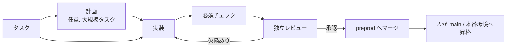

<div align="center">

# Darkfactory

**セルフホスト型のAIソフトウェアファクトリー。作業を計画し、コードを書き、必須チェックと独立レビューを実行し、`preprod` にのみリリースします。**

[](../../LICENSE)
[](../../pyproject.toml)
[](../../compose.yaml)
[](https://fastapi.tiangolo.com)
[](https://www.postgresql.org)

[English](../../README.md) · [Русский](README.ru.md) · [中文](README.zh.md) · [हिन्दी](README.hi.md) · [Español](README.es.md) · [العربية](README.ar.md) · [Français](README.fr.md) · [বাংলা](README.bn.md) · [Português](README.pt.md) · **日本語**

</div>

Darkfactory は、共有のUIとAPI、プロジェクトが分離された組織、PostgreSQLベースのキュー、そしてタスクごとの専用コンテナを提供します。検証済みの変更は自動的に `preprod` にのみ反映されます。メインブランチと本番環境の更新は人が行います。

## Darkfactory の特長

- 🏭 **セルフホスト。** 1つのUIとAPI、組織と分離されたプロジェクト、PostgreSQLキュー、タスクごとの専用コンテナを備えます。
- 🛡️ **リリース先は `preprod` のみ。** 本番環境とメインブランチはファクトリーではなく人が更新します。
- ✅ **必須チェックと独立レビュー。** チェックとレビューは1つの最終コミットに紐づきます。チェックが設定されていない場合、自動マージは無効です。
- 🔒 **分離されたタスクコンテナ。** 非rootユーザー、読み取り専用のルートファイルシステム、CPU/RAM/PIDの制限、ネットワーク無効、Dockerソケット・PostgreSQL・他のプロジェクト・本番シークレットへのアクセスなし。
- 🔀 **フォールバック付きのサブスクリプションプール。** 既定では開発にCodex、レビューにClaudeを使用します。クォータを考慮してアカウントとエンジンを切り替えます。有料APIは、金額の予算を設定した明示的なオプトインの場合にのみ使用します。
- 🧠 **Factory Director。** プロジェクト、ロール、タスクを作成し、停止したタスクをユーザー自身の権限の範囲内で解決するチャット（WebとCLI）です。

## タスクパイプライン



既定では、タスクは計画もサブタスクもなく、単一の開発者に直接渡されます。ブロッキングとなる質問を含む計画は、あなたが回答するまで停止します。

## 目次

- [クイックスタート](#クイックスタート)
- [最初のプロジェクト](#最初のプロジェクト)
- [エグゼキューター接続](#エグゼキューター接続)
- [分離と依存関係](#分離と依存関係)
- [既存プロジェクトの初期化](#既存プロジェクトの初期化)
- [プロジェクトアーティファクト](#プロジェクトアーティファクト)
- [ロール、委任、スキル、MCP](#ロール委任スキルmcp)
- [Factory Director](#factory-director)
- [人への通知](#人への通知)
- [制限とインシデント](#制限とインシデント)
- [実装チェック](#実装チェック)
- [ブラウザUIテスト](#ブラウザuiテスト)
- [テスト環境テストとGitLabデプロイ](#テスト環境テストとgitlabデプロイ)
- [スケジュール](#スケジュール)
- [APIとデータ](#apiとデータ)
- [インターフェース言語](#インターフェース言語)
- [ライセンス](#ライセンス)

## クイックスタート

`volume.subpath` をサポートするDocker Compose付きのDocker Engineが必要です。macOSではDocker Desktopが使えます。

> [!IMPORTANT]
> PostgreSQLのデフォルトパスワードはありません。`.env` に `POSTGRES_PASSWORD` がないと、Composeは起動しません。以前に作成したインストールではパスワード `darkfactory-local` が使われていました。これを `.env` に記載したうえで、PostgreSQL（`ALTER USER darkfactory PASSWORD …`）と `.env` の両方でパスワードを変更してください。

新規インストールの場合は、プロジェクトのディレクトリで次を実行します。

```sh
echo "POSTGRES_PASSWORD=$(openssl rand -hex 32)" >> .env
docker compose up -d --build
docker compose exec app cat /data/bootstrap-token
```

[localhost:8080](http://localhost:8080) を開き、オーナートークンを貼り付けます。

- **オーナートークンを自分で設定する。** 生成されるファイルの代わりに、最初の起動前に `echo "DARKFACTORY_ADMIN_TOKEN=$(openssl rand -hex 32)" >> .env` を実行します。
- **後から変更する。** 再起動後、変数の新しい値が `.env` の以前のトークンを置き換えます。すでに稼働中のインストールでは、この変数は `/data/bootstrap-token` のオーナーに追加されます。失効した `.env` のトークンは復活しません。新しい値を設定してください。
- **初回ビルド。** Python、Node、PostgreSQL、Codex CLI、Claude Code をダウンロードします。2回目以降の起動ではビルド済みのイメージを使用します。

### サービス

| サービス | 役割 |
|---|---|
| `app` | UIとAPIを提供します |
| `worker` | タスクを管理します |
| `db` | キューを保存します（PostgreSQL） |
| `executor-image` | 一時的なタスクコンテナ用のイメージをビルドします |

Dockerソケットを利用できるのは信頼されたワーカーのみで、タスクには渡されません。

### 設定

Composeの設定は `.env` から読み込まれます。

| 変数 | 意味 | デフォルト |
|---|---|---|
| `PORT` | 公開するポート | `8080`（`compose.yaml` の値） |
| `BIND_ADDRESS` | ポートをバインドするアドレス | `127.0.0.1` |
| `POSTGRES_PASSWORD` | PostgreSQLのパスワード | なし（必須） |
| `GLOBAL_CONCURRENCY` | タスクのグローバル同時実行数 | `4` |
| `EXECUTOR_CPUS` | タスクコンテナあたりのCPU数 | `4` |
| `DATA_VOLUME` | `data` ボリュームの名前 | `darkfactory_data`（`compose.yaml` の値） |
| `DARKFACTORY_ADMIN_TOKEN` | ご自身で決めるオーナートークン | `/data/bootstrap-token` に生成 |
| `DARKFACTORY_PERSONAL_MODE` | 個人用ローカルパイロットモード（[エグゼキューター接続](#エグゼキューター接続)を参照） | `0` |
| `DARKFACTORY_PUBLIC_URL` | 通知リンクに使うファクトリーのアドレス | `http://127.0.0.1:8080` |
| `DARKFACTORY_DIRECTOR_MODEL_CLAUDE`、`DARKFACTORY_DIRECTOR_MODEL_CODEX` | そのプロバイダーのサブスクリプション上でのDirectorチャットのモデル。例：エージェントより軽量なもの。モデルを指定したプロジェクトのDirectorプロファイルが優先されます。Claude用の変数を設定すると、DirectorはまずClaudeサブスクリプションを試します | 空：接続のモデル |

> [!WARNING]
> 従業員にアクセスさせる場合は、アプリケーションの前段にHTTPSのリバースプロキシを置いてください。PostgreSQLは外部に公開されません。

## 最初のプロジェクト

1. **「プロジェクトを接続」** をクリックし、名前、Gitリポジトリ、必要に応じてアクセストークンを入力します。
2. 標準スキルを持つマネージャー、アナリスト、開発者、レビュアーがすぐに作成されます。ロールはプロジェクトのエグゼキューターを継承します。開発はCodex、レビューはClaudeです。MCPサーバーは別途接続します。
3. サブスクリプションを組織の共有プールに接続します。プールがすでにある場合、新しいプロジェクトはそれを使用します。ない場合は、ファクトリーが「共有プール」を作成します。プロジェクトは後から設定で専用プールを選択できます。
4. プロジェクト設定で、必須のチェックコマンドを定義します。定義しない場合、自動マージは無効です。
5. UIまたはAPIからタスクを作成します。ブロッキングとなる質問を含む計画は、あなたが回答するまで停止します。

### 対応リポジトリ

HTTPSのGit、SSH、および `/repos` 内のローカルbareリポジトリに対応しています。GitHubとGitLab（セルフホストのドメインを含む）ではPR/MRが作成されます。それ以外のGitでは、ファクトリーがdiff、チェック、レビューを含む内部の変更レコードを作成します。SSHには専用の鍵と、明示的に設定した `known_hosts` が必要です。ホスト鍵は継承されません。

ローカルプロジェクトには、appとworkerに `/repos` としてマウントされる共有 `repos` ボリュームを使用します。リポジトリは `docker compose exec worker sh` で作成できます。完全な例は[後述](#実装チェック)のテストシナリオにあります。ホストのディレクトリはタスクコンテナにマウントされません。

### マージの動作

- チェックが設定されていない場合、タスクは変更レコードと `review_required` 状態で終了します。自動マージは禁止されています。
- チェックとレビューは1つの最終コミットに紐づきます。
- `preprod` の先頭が変わると、再統合と再受け入れが行われます。
- プロジェクトのマージは順番に実行されます。

### アクセスロール

| ロール | できること |
|---|---|
| Owner | 設定と接続を管理する |
| Operator | タスクを管理する |
| Observer | 閲覧する |

メンバーの権限とトークンの権限は積集合になります。権限の取り消しは以降のリクエストに適用されます。新しい組織には専用のオーナーと、一度だけ表示されるトークンが作成されます。オーナーは設定（「チームアクセス」）または `POST /api/members` でメンバートークンを発行します。`owner` ロールのメンバーは複数にできます。自分用の追加トークンは `POST /api/tokens` で発行し、`DELETE /api/tokens/{id}` で失効させます。

## エグゼキューター接続

| 接続 | 認証情報と注意事項 |
|---|---|
| **Codex for company** | JSON形式の認証情報 `{"auth_method":"siwc","accessToken":"..."}`。App Server向けの文書化された外部OAuthプロバイダーを使用します。このシナリオへのアクセス権を持つSign in with ChatGPTトークンが必要です。トークンの更新は再接続で行います。 |
| **Claude Code** | 許可されたサブスクリプション接続用の `{"oauth_token":"..."}`。分離されたセッションには選択したトークンのみが渡されます。`--bare` は使用しません。 |
| **API** | ツール呼び出しに対応した、HTTPSのOpenAI互換Chat Completions。モデルと `{"base_url":"https://example.com/v1","api_key":"...","input_usd_per_million":0.0,"output_usd_per_million":0.0}` を実際の価格で指定します。独自のTLS CAには `ca_cert` フィールドを使えます。 |

### 個人用ローカルパイロット

個人用のローカルパイロットでは、ChatGPT経由の現在の `codex login` を利用できます。

1. ローカルの `.env` に `DARKFACTORY_PERSONAL_MODE=1` を追加します。
2. `docker compose up -d --build` を実行します。
3. ホストで `python3 scripts/connect_personal_codex.py` を実行します。スクリプトは、ブートストラップトークンの組織に `Personal Codex` プールと接続を作成します。
4. このプールをプロジェクトに割り当てます。別のCodexセッションでレビューを行うこともできます。

ゲートウェイがない場合、CodexからChatGPTへのすべてのリクエスト（バックエンドとモデル呼び出し、`openai_base_url`）は、エグゼキューター内のloopbackリレーを経由し、リレーが本物のトークンを付けます。現行モデルにはCodex 0.160以降が必要で、CodexはChatGPTバックエンドにHTTPSでのみ接続するため、リレーは使い捨てのCAが署名した証明書を提示し、そのCAを信頼するのはこのCodexだけです（`CODEX_CA_CERTIFICATE`）。`~/.codex/auth.json` からインポートされるのはアクセストークンとアカウントIDのみです。リフレッシュトークンとホストのディレクトリはコンテナに渡されません。トークンは暗号化して保存されます。トークンの期限切れや失効後は、接続がアイドル状態のときにインポートをやり直してください。個人モードはデフォルトでオフです。ホスト型や商用のインストールではSIWCを使用します。組み込み認可の範囲は[公式のApp Serverドキュメント](https://learn.chatgpt.com/docs/app-server#auth-endpoints)に記載されています。

個人用Codexがすでにローカルのサブスクリプションゲートウェイ経由で動作している場合は、Dockerから到達できるそのアドレスと設定済みのモデルを渡します。

```sh
python3 scripts/connect_personal_codex.py --base-url http://host.docker.internal:8787/v1 --model MODEL_NAME
```

このモードはローカルのHTTPアドレスのみを受け付け、`DARKFACTORY_PERSONAL_MODE=1` が必要です。エグゼキューターは、固定トンネルと既存のアドレス許可リストを通じて指定のゲートウェイに接続します。コンテナのネットワークは `none` のままです。このモードで有料APIが有効になることはありません。

### プールとエンジンの選択

プールは、優先度、モデル、利用可能なエンジン、同時実行数、切り替え回数、クォータを再確認するまでの待機時間を定義します。基本の選択は、開発にCodex、レビューにClaudeです。アカウントの切り替えと、Codex ↔ Claude の切り替えは許可されています。APIは既定では自動的に接続されません。有料のフォールバックでは、オーナーがプロジェクトポリシーを明示的に有効にし、タスクに金額の予算を設定します。明示的に割り当てたAPIにも予算が必要です。

**「+ サブスクリプション」** ボタンを押すと、リンクと1回限りのブラウザコードによる標準のClaudeログインが始まります。個人モードでは、Codexのデバイス認証が利用でき、リンクとコードが同じフォームに表示されます。サインインの前にプールを選択してください。確認後、アカウントは自動的に追加されます。フォームを閉じても、未完了のサインインは設定から再開できます。サインインの有効期間は最大15分で、キャンセルでき、別のコンテナで実行されます。OAuthトークンがブラウザに渡されることはありません。期限切れトークンの自動更新は実装されていません。サインインをやり直すか、再接続してください。

| プールのデフォルト | 値 |
|---|---|
| 確保する予備 | **10%** |
| 観測を最新とみなす期間 | **300秒** |
| 不明なクォータ | 許可 |

- 最新で既知のクォータが予備を下回っている場合、そのサブスクリプションは除外されます。選択したエンジンの適格なアカウントのうち、確認済みの残量が多いものが優先されます。
- 予備、スナップショットの経過時間、「既知のクォータを必須とする」の設定は、プールのフォームにあります。
- 個人用Codexは、モデルを呼び出す前に制限を再確認します。
- 利用可能なデータがないプロバイダーでは、厳格なポリシーにより確認済みの残量が得られるまで待機します。
- 作業中に制限が変わることがあります。コードを保存してコンテキストを引き継ぐことで、別のアカウントで作業を続行できます。

切り替え時に引き継がれるのはコードと成果物であり、アカウント内部のセッションではありません。クォータと使用状況は接続ごとに追跡されます。既知の共有 `quota_group` も含まれます。同じ認証情報で再接続しても、新しいクォータは作られません。不明な残量が無制限と見なされることはありません。認可エラーには再接続が必要で、クォータエラーには確認チェックまでの待機が必要です。

エグゼキューターが残りクォータとリセット時刻を報告すると、ファクトリーはそれらを保存し、観測時刻とともに接続設定に表示します。これは最後に受け取ったスナップショットであり、アカウントの継続的なポーリングではありません。データがない場合は「残りクォータ不明」と表示されます。新しい認証情報で再接続すると、以前のスナップショットは消去されます。確認を試行した時刻は、プロバイダーが報告したリセット時刻とは別に表示されます。

### プールの削除

プールは、設定画面または `DELETE /api/pools/{id}`（Director経由も含む）で削除できます。削除できるのは組織全体のオーナーです。サブスクリプション、認可、他のプールへの所属は保持されます。プールがプロジェクトに割り当てられている場合は、先に開発とレビュー用に別のプールを選択してください。未完了のサブスクリプションのサインインも、削除前に完了またはキャンセルする必要があります。

### 公式の根拠

[Codex App Server](https://learn.chatgpt.com/docs/app-server)、[SIWC external tokens](https://developers.openai.com/siwc/token-sharing-open-source/codex-app-server)、[Claude Code headless](https://code.claude.com/docs/en/headless)。

> [!NOTE]
> アダプターが存在することは、そのサブスクリプションのシナリオが特定の企業で利用できることを意味しません。許可された接続が必要です。

## 分離と依存関係

タスクには、専用の作業コピーとブランチ、非rootのコンテナ、読み取り専用のルートファイルシステム、CPU/RAM/PIDの制限、内部のデッドラインが与えられます。`.git` はエージェントに対して書き込み保護されます。検証者には作業コピーが読み取り専用で渡されます。Dockerソケット、PostgreSQL、他のプロジェクト、本番シークレットにはアクセスできません。

コンテナのネットワークは無効です。HTTPSは、選択したプロバイダーと、プロジェクトで明示的に許可された `host:port` のみに対して、CONNECTプロキシ経由で利用できます。チェックは既定でオフラインです。テスト用のシークレットは別に渡されます。プロキシが任意のホストへのアクセスを開放することはありません。

> [!WARNING]
> ファクトリーは `preprod` にのみマージします。デプロイは、オーナーが `main` にマージした後に、プロジェクト独自のGitLabジョブで実行されます（[テスト環境テストとGitLabデプロイ](#テスト環境テストとgitlabデプロイ)）。

### エグゼキューターイメージとテスト設定

イメージにはPython、Node、Gitが含まれます。プロジェクトで他の依存関係が必要な場合は、`darkfactory-executor:local` から独自のイメージをビルドし、依存関係を事前にインストールして、プロジェクト設定で `executor_image` を指定します。

- 許可するテストエンドポイントと `test_env` はオーナーが設定します。
- `test_env` の名前は `TEST_*`、`APP_*`、`E2E_*` のみです。
- `allowed_hosts`、Gitのリモート、PR/MRサーバーは完全修飾名でなければなりません。
- 内部アドレス（ループバック、プライベートネットワーク、リンクローカル、CGNAT）は、正確な `ip:port` が `allowed_hosts` に記載されている場合にのみ受け付けられます。

### タスクの関係

タスクの関係は、`depends_on`、親 → サブタスク（`parent`）、`related_to`、確認済みの `duplicate` です。コードの依存関係は、`preprod` で受け入れられた結果を待ちます。成果物の依存関係では、検証済みの特定のコミットを受け入れることもできます。循環と組織をまたぐ関係は禁止されています。親は、必須の子タスクと自身の統合チェックを待ちます。

### 分割とレビュー

- 既定では、タスクは計画もサブタスクもなく、単一の開発者に直接渡されます。
- レビューが作業を差し戻すのは、欠陥と未達の基準がある場合のみです。改善案には `[LATER]` が付けられ、バックログに入ります。
- 「大規模タスク」とマークされたタスクでは、プランナー自身が、受け入れ基準と依存関係を持つ最大8件のサブタスクを作成できます。
- 独立した子タスクには別々の作業ディレクトリが与えられ、並列に実行できます。
- 入れ子の自動分割は禁止されています。
- 親は、自身の実装の前に、子タスクの受け入れ済みコードを集約します。
- 時間、修正、切り替え、金額は、ツリー全体で単一の予算に制限されます。子タスクを作成しても上限は増えません。並列実行では、残り時間の取り分を予約します。
- 親をキャンセルすると、親が作成したエージェントもキャンセルされます。キャンセルされた子タスクは自動的には再開されません。

### 依存関係の変更

受け入れ済みの依存関係のSHAはタスクに保存されます。SHAの変更や受け入れ済み結果の取り消しが起きると、現在のエグゼキューターが停止し、古いチェックとレビューがリセットされます。ブロックが解除されると、タスクは入力の再構築、実装、受け入れをやり直します。その際、作業中のコードと蓄積されたカウンターは保持されます。マージの前に、依存関係チェックとGit操作は共有のコントローラーロックの下で実行されるため、その間に入力が変わることはありません。

## 既存プロジェクトの初期化

プロジェクトを追加する際、**「初期インデックス作成とMarkdownドキュメント」** は既定でオンです。ファクトリーは通常のタスクをキューに入れます。まず追跡対象のGitファイルのマップを保存し、その後エグゼキューターがリポジトリを調査して、次の4つのファイルを作成または拡張します。

| ファイル | 内容 |
|---|---|
| `docs/darkfactory/INDEX.md` | プロジェクトマップ、エントリーポイント、モジュールの目的 |
| `docs/darkfactory/ARCHITECTURE.md` | コンポーネント、依存関係、データ、システム境界 |
| `docs/darkfactory/DEVELOPMENT.md` | インストール、実行、設定、チェック |
| `docs/darkfactory/CONTRACTS.md` | 検出されたAPI、イベント、外部連携 |

SHA付きのソースマップは、タスクの成果物 `repository-index.md` にもあります。ここには、追跡対象の最初の1000ファイルと総数が記載されます。エグゼキューターは、結論をプロジェクトのファイルで裏付け、既存の有用なドキュメントを保持し、不明な点を明記する必要があります。4つのドキュメント以外への変更は、ワーカーのチェックで却下されます。

このタスクは、プロジェクトの接続、制限、チェック、独立レビューを使用します。接続がまだない場合は、設定されるまで待機します。ドキュメントは通常のGitパイプラインを通ります。必須チェックに成功すると、変更は `preprod` にマージされます。チェックが設定されていない場合は、手動マージのために残されます。レビュー後、4つのドキュメントはすべてレジストリに **ドラフト** として、元のタスクと検証済みコミットのSHAとともに登録されます。オーナーが、受け入れたいバージョンを明示的に承認します。すでに受け入れ済みのバージョンは保持されます。

以前に接続したプロジェクトでは、**「プロジェクトアーティファクト」→「プロジェクトをインデックス化」** を開きます。このボタンはオーナーが利用でき、初期化タスクがすでに作成されている場合は重複させずにそれを開きます。APIでのプロジェクト作成は `initialize`（デフォルト `true`）を受け付け、`false` にすると自動開始が無効になります。既存のプロジェクトには `POST /api/projects/{id}/initialize` を使用します。

## プロジェクトアーティファクト

**「プロジェクトアーティファクト」** を開き、要件、分析、アーキテクチャ、APIコントラクト、レポート、その他のテキストドキュメントを追加します。アーティファクトには、プロジェクト内で安定したキー、タイトル、不変のバージョン履歴があります。内容はDBに保存され、編集すると新しいバージョンが作られます。これは、タスクの作業ファイル（`plan.md`、`diff.patch`、`checks.txt`、`review.txt`、`handoff.md`）やブラウザの証跡を補完する、プロジェクト知識の独立したレジストリです。

- Operatorがドラフトを追加し、Ownerが選択したバージョンを承認または承認を取り消し、Observerが閲覧します。
- 各アーティファクトで同時に受け入れられるバージョンは、ちょうど1つです。
- 必要に応じて、元のタスクを指定します。そのタスクには、独立レビュー済みの現在のコミットが必要です。バージョンにはタスクIDとSHAが保存されます。元の結果や入力が変わると、ドキュメントは古い（stale）状態になります。
- 通常のドキュメントはフォームまたはAPIで公開します。プロジェクトの初期化では、レビュー後に専用のドキュメントが自動的に追加されます。

### アーティファクトをタスクの入力として使う

タスクの作成時に、受け入れ済みのバージョンを選択します。停止中のタスクのカードでは、入力の追加、置き換え、削除ができます。タスクは、選択したバージョンの全文、キー、番号、元のSHAを正確に受け取ります。委任されたサブタスクはこれらのバージョンを継承します。

| 制限 | 値 |
|---|---|
| 1バージョンあたりの文字数 | 100,000 |
| タスクあたりの入力数 | 最大10 |
| タスクあたりの合計文字数 | 200,000 |

新しいバージョンを受け入れても、タスクの選択は自動的には変わりません。古いバージョンを使うタスクは、入力が明示的に置き換えられるまで待機します。承認の取り消しや、元のタスクが古くなった場合も、実行をブロックします。ファクトリーは、以前の入力に対するチェックとレビューをリセットし、実行中のエグゼキューターを停止して、マージ前に入力を再検証します。作業中のコードと蓄積されたカウンターは保持されます。アーティファクトのカードには、履歴、元のタスク、利用者が表示されます。以前のバージョンも引き続き閲覧できます。

### アーティファクトAPI

| 用途 | ルート |
|---|---|
| アーティファクト | `GET/POST /api/projects/{id}/artifacts` |
| バージョン | `POST /api/project-artifacts/{id}/versions`、`GET /api/project-artifacts/{id}/versions/{version_id}` |
| 承認 | `POST …/versions/{version_id}/accept`、`POST /api/project-artifacts/{id}/revoke` |
| タスクの入力 | `GET /api/tasks/{id}/artifact-inputs`、`PUT/DELETE /api/tasks/{id}/artifact-inputs/{artifact_id}` |
| タスクの作成 | `artifact_version_ids` を受け付けます |

アクセスは、組織、ユーザーのプロジェクト、トークンのスコープによって制限されます。通常の依存関係との循環は禁止されています。新しいテーブルは起動時に作成され、既存のタスクは変更されません。

## ロール、委任、スキル、MCP

左メニューの **「エージェント、スキル、MCP」** を開き、プロジェクトを選択します。**「既製のチームを追加」** ボタンで、プロジェクトエージェント、アナリスト、開発者、レビュアーがインストールされます。**「ロール」**、**「スキル」**、**「MCP」** の各タブにはカタログがあります。ボタンで既製の構成を追加し、リストからロールにスキルとツールを割り当てます。指示、エンジン、モデルはロールのカードで変更できます。プロファイルを個々のタスクに割り当てることもできます。

### 委任

計画中に、プロジェクトエージェントはサブタスクを作成し、`agent_profile` を割り当てます。「分析 → 開発」のシナリオでは、`analyst` と `developer` のプロファイルを作成します。開発者のサブタスクは、`depends_on` に分析のキーを指定します。開発者は、分析が検証済みで `preprod` にマージされた後に開始し、受け入れ済みのコミットと成果物を受け取ります。アナリストは結果をリポジトリに保存します。委任権限を持つすべてのエージェントは、設定された深さと総数の範囲内で、さらにサブタスクを作成できます。

| 委任のデフォルト | 値 |
|---|---|
| 深さ | 2 |
| ツリーあたりの最大サブタスク数 | 16 |
| 計画あたりの直接のサブタスク数 | 8 |

時間、修正、金額の予算はツリー全体で共有されます。

### カタログ

カタログには、7つのスキルと4つのMCPサーバーが含まれます。ブラウザ、プロジェクトファイルの読み取り・検索、Gitのstatus/diff/log読み取り、Jiraです。最初の3つはタスクコンテナ内で動作し、外部サーバーは不要です。

### Jira MCP

**Jira** MCP（`mcp-atlassian`、エグゼキューターイメージにインストール済み）は、Jira Server/Data CenterまたはCloudのissue、JQL検索、ボード、スプリントを読み取ります。書き込みツールは、ゲートウェイとサーバー自体（`--read-only`）の両方で無効になっています。カタログから追加した後、そのカードを開いて次を入力します。

- **アクセスが必要なアドレス:** `jira.example.com:443`。これがないと、タスクのエグレスがプライベートアドレスを含むJiraへサーバーを到達させません。
- **シークレット環境変数:** `JIRA_URL=https://jira.example.com` と `JIRA_PERSONAL_TOKEN=<PAT>`（Jira → Profile → Personal Access Tokens）。Jira Cloudでは、PATの代わりに `JIRA_USERNAME` と `JIRA_API_TOKEN` を使用します。

その後、`jira` を必要なロール（たとえばアナリストやマネージャー）に割り当てます。サービスアカウントに必要なのは、対象プロジェクトの読み取り権限のみです。

### カスタムMCP

独自のMCP向けに、詳細フォームが用意されています。HTTPSエンドポイントまたはエグゼキューターイメージ内のstdioコマンド、許可するツールの正確な名前、シークレットのヘッダーや環境変数を指定します。シークレットは暗号化され、UI/APIで返されることはありません。ネイティブのCodexとClaudeは、一覧をフィルタリングし、許可セット外の呼び出しを禁止するローカルゲートウェイ経由でツールを受け取ります。プランナーとレビュアーが受け付けるのは、オーナーが読み取り安全（read-safe）とマークした接続のみです。サービスアカウント自体の権限もロールに合っている必要があります。有料APIアダプターはMCPをサポートしません。

## Factory Director

右側に **「Factory Director」** ダイアログが開いています。ファクトリー全体または個別のプロジェクトを選択します。このダイアログから、組織、プロジェクト、プール、ロール、スキルの作成、既製のMCPサーバーの接続、タスクの作成、利用可能な設定の変更ができます。例: 「プロジェクトにアナリストと開発者を追加して、ファイルとGitの読み取りアクセスを与えて」。

- **「新しいチャット」** は、別の履歴とコンテキストを開始します。古いチャットは一覧に残ります。
- **「メッセージをキャンセル」** は、リクエストをキューから削除するか、実行中のエグゼキューターを停止します。すでに開始されたアクションは完了することがあり、そのログは保持されます。サブスクリプションは、コンテナの停止後に解放されます。

Directorは、接続済みのサブスクリプションプールの **Codex CLIまたはClaude CLI** を通じて動作します。ユーザーと同じAPIと権限を使用します。Operatorがオーナー権限を得ることはなく、1つのプロジェクトへのアクセスが他のプロジェクトを開くこともありません。有料APIはDirectorに対して自動的には有効になりません。プールが使用中の場合、リクエストはキューに残ります。再起動後に結果が不確かな場合、アクションは無条件には繰り返されません。Directorは、状態の確認をあなたに依頼します。

> [!CAUTION]
> パスワード、キー、サインインコードは、接続フォームから追加してください。Directorはサインインを開始してリンクを提示できますが、トークンやデバイスコードを受け取ることはありません。作成された組織へのアクセスは、インターフェースを通じて別途、一度だけ発行されます。

### 停止したタスク

Directorは、停止して人の対応を待っているタスクも扱います。レビューサイクルの上限、開発者の質問、閉じたネットワーク、時間切れなどです。コードとタスクの履歴を読み（リポジトリは読み取り専用で接続されます）、自分で判断します。指示を添えて続行する、再レビューに戻す、アドレスを許可する、キャンセルする、のいずれかです。オーナーに連絡するのは、アクセス、金銭、製品上の選択、破壊的なアクションの場合のみです。判断中は、ボード上のタスクに「Directorが判断中」と表示されます。

チャットの **「判断」** ボタンには、プロジェクトに対するDirectorの判断が表示されます。「あなたの対応待ち」とマークされたものは、あなたの判断が必要です。チャットでDirectorに返信してください。たとえば「タスク … は続行して、… を使って」と伝えると、Directorが自分でタスクを続行またはキャンセルします。

プロジェクト設定: 「Directorが人の代わりに停止を解決する」と「タスクツリーあたりのDirectorの判断回数」（デフォルト6、変数 `DARKFACTORY_DIRECTOR_LIMIT`）。Directorのモデルと指示は、「ロール」画面の「Director」ロールで設定します。

### ターミナルからのDirector

同じダイアログをターミナルから利用できます。

```sh
uv sync
uv run darkfactory director --token-file /path/to/api-token "Покажи проекты и текущие задачи"
uv run darkfactory director --token-file /path/to/api-token --project PROJECT_ID
```

メッセージを省略すると、対話型のダイアログが開きます。

| オプション / 変数 | 用途 |
|---|---|
| `--token-file` または `DARKFACTORY_TOKEN` | APIトークン（ファイルまたは環境変数） |
| `--url` または `DARKFACTORY_URL` | サーバーアドレス（デフォルト `http://127.0.0.1:8080`） |
| `--project` | 特定のプロジェクトで作業する |
| `--timeout` | 待機時間。デフォルトは600秒 |
| `--resume MESSAGE_ID` | 再送せずに同じリクエストを待つ。前回のトークンと `--project` を使用する |
| `--new-chat` | 別のCLIダイアログを開始する |
| `--thread CHAT_ID` | 既存のチャットを続ける |
| `--cancel MESSAGE_ID` | コマンドを再送せずにメッセージをキャンセルする |

このコマンドは `python -m darkfactory.cli director` でも利用できます。ターミナルを閉じたり待機がタイムアウトしたりしても、リクエストは実行され続けます。

## 人への通知

設定で、HTTPSのwebhookと任意の受信者 `@username` または `#channel` を指定したRocket.Chatチャンネル、あるいはボットトークンとチャットIDを指定したTelegramを追加します。Rocket.Chatの受信者には、受信webhookでのチャンネル上書きが必要です（下記参照）。受信者は、URLを再入力せずに変更できます。プロジェクトまたは組織全体を選択し、続いてイベント（質問、停止、エラー、制限、受け入れられた変更、インシデント）を選択します。チャンネルを設定しただけでは、メッセージは送信されません。エージェントの質問とパイプラインの停止は、自動的にキューに入ります。`{"message":"..."}` を指定したAPI `POST /api/tasks/{id}/notify` は、タスクに設定されたチャンネルにメッセージを送信します。

配信はタスクとは別に、5回の試行と再試行の間の遅延付きで実行されます。シークレットは再表示されません。送信から確認応答の保存までの間に障害が起きた場合、メッセージが重複する可能性があります。質問への回答は、タスクカードまたはチャットで直接入力します。

### チャットコマンド

チャットコマンドは、チャンネル設定でOperatorロールのAPIトークンを指定すると有効になります。コマンドはそのトークンの権限とプロジェクトスコープで実行されるため、必要最小限の権限を持つ専用トークンを発行してください。チャンネルはオーナートークンを受け付けません。`allowed_senders` がない場合は、チャットのどのメンバーでもコマンドを使えます。`allowed_senders` のリスト（Telegramの `from.id`、Rocket.Chatの `user_id`）がある場合は、リストにある送信者だけが使えます。送信者はタスクのイベントに記録されます。

- `!director テキスト`（または `/director テキスト`）で、Directorに依頼を渡します。例：`!director タスクを表示`。プライバシーモードのTelegramグループでは、ボットには `/director` のみが見えます。Telegramではコマンドを含むメッセージに返信し、Rocket.Chatではそのメッセージのスレッドで返信します。Directorが処理中の間は、新しいコマンドは拒否されます。
- 質問または停止通知への返信は、カードの「続行」ボタンと同様に、そのテキストでタスクを続行させます。Telegramでは、ボットのメッセージに返信するか、ボットとのプライベートチャットでコメントを付けて転送します。Rocket.Chatでは、通知のスレッドで返信します。
- Telegramは `getUpdates` のロングポーリングで読み取られるため、公開アドレスは不要です。ボットにはwebhookを設定しないでください。1つのボットを共有するチャンネルは、チャットIDでメッセージを振り分けます。

### Telegramからの管理

コマンドトークンがあると、Telegramボットはボタンメニューを提供します。`/start` または `меню` で開きます。画面は同じメッセージ内で更新されます。

- プロジェクト → 「実行可能」「進行中」「要対応」「完了」の列があるボード → タスク一覧 → カード。カードには、エージェントの質問と、タスクの状態に応じたボタンが表示されます。
- 「✍️ 返信」は、エージェントに回答を渡してタスクを続行します。「返信」と「カード」ボタンは、すべてのタスク通知の下にもあります。
- キューの順序は「⏫ 上げる」「⏬ 下げる」ボタン、または「➡️ 移動」→「先頭へ」「末尾へ」で変更します。これはタスクの優先度です。「移動」では、タスクの実行への復帰、マージ、キャンセルもできます。キャンセルには確認が求められます。
- 「➕ 新しいタスク」: 返信の1行目がタイトル、全文が説明になります。
- 「🧠 Director」は、メッセージをDirectorに渡します。ボットとのプライベートチャットでは、通常のテキストもすべてDirectorに送られ、そのメッセージへの返信で会話が続きます。
- サブスクリプションの接続はWeb設定でのみ行います。チャットからサインインを開始することはありません。

### Rocket.Chatコマンドの設定

受信webhookと同じルームに、「メッセージ送信」イベントの送信webhookを作成します。URL: `https://<factory>/api/chat-commands/rocketchat/<channel id>`（チャンネル一覧に表示されます）。webhookトークンはチャンネル設定で指定します。トリガーワードは空のままにし、ボット自身のメッセージを除外しないでください。ファクトリーは、スレッドがどのタスクに属するかを知るためにそれらを使用します。Rocket.Chatは未知のスラッシュコマンドを渡さないため、そこではコマンドを `!` で始めます：

- `!director テキスト`：Directorに依頼を渡します。
- `!projects`：プロジェクトと、ボードの各列のタスク数。
- `!waiting`：回答またはマージを待っているタスク。
- `!task <id>`：タスクのカード。
- `!help`：コマンド一覧。

タスク通知のスレッドでは、通常のテキストがエージェントへの回答になり、`!task`、`!resume`、`!merge`、`!cancel` はそのタスクに作用します。

受信webhookは、「Override Destination Channel」の設定によって2つのモードで動作します。

- **Override オフ**（Rocket.Chatの既定）：チャンネルの受信者は空のままにします。すべてのメッセージはwebhook自身のチャンネルに届き、スレッドでの回答にはスレッドID（`tmid`）だけが付きます。ここではRocket.Chatが `roomId` や `channel` を含むリクエストを拒否する（`overriding destination channel is disabled for this integration`）ため、overrideがオフのときに受信者を設定すると、すべての配信が失敗します。送信webhookは受信webhookと同じルームに置いてください。そうしないと、回答がスレッドの外に届きます。
- **Override オン**：受信者が通知の送信先を決め、コマンドへの回答は `tmid` に加えて元のルーム（`roomId`）を指定します。通知をwebhook自身のルーム以外に送るときは、このモードを使ってください。

配信状態はチャンネルのoutbox（`notification_deliveries`）にあります。チャットコマンドへのDirectorの回答は、Rocket.ChatまたはTelegramが受理した後にのみ返信済み（`director_dialogues.origin_replied`）になります。拒否された回答は未返信のままで、プロバイダーのHTTPステータスが `last_error` に残ります。通知は Darkfactory の名前で Rocket.Chat のmarkdownとして届きます。`DARKFACTORY_PUBLIC_URL` が設定されていれば、ファクトリーのロゴがアバターになります。

### マージ通知

`preprod` への検証済みマージの後、チャンネルには、タスク名とプロジェクト名、開発者の短い要約、SHA、受け入れられたコミットへのリンクが届きます。GitHub/GitLabの場合、リンクはコミットページに移動します。ローカルや汎用のGitの場合は、ファクトリー内の、diff付きの認可済みカードに移動します。失敗した試行では、完了メッセージは送信されません。

従業員向けには、`.env` の `DARKFACTORY_PUBLIC_URL` に、彼らが到達できるファクトリーのアドレス（例: `https://factory.company.ru`）を設定し、Composeを再起動します。既定では、リンクは `http://127.0.0.1:8080` を使用します。トークンはリンクに追加されないため、サインインが必要になる場合があります。

### main への昇格

最上位のタスクが完了すると、通知には **「mainへマージ / 却下」** のリンクも含まれます。これはファクトリー内部のマージ提案で、ローカルGitでも利用できます。受け入れられたコミットを固定し、現在の `main` との完全なdiffを表示します（最大100,000文字、切り詰めの表示付き）。オーナーはマージまたは却下できます。GETリンク自体は何も変更しません。転送には、サブタスクを含め、指定したコミットまでの `preprod` のすべての変更が含まれます。却下すると、`preprod` はそのまま維持されます。

> [!NOTE]
> `main` への自動転送もデプロイもありません。Directorがこの判断を行うことはできません。デプロイジョブを持つGitLabプロジェクトは、オーナーのマージ後にデプロイされます（[下記](#テスト環境テストとgitlabデプロイ)）。`main` が受け入れられたコミットから分岐している場合は、先に統合と再チェックが必要です。完了済みの古いタスクに、新しい提案が自動的に作られることはありません。

### main の preprod への同期

逆方向は自動です。プロジェクトの **「main を preprod にマージ」** [スケジュール](#スケジュール)（デフォルトでは1時間ごと。`DARKFACTORY_MAIN_SYNC_SECONDS=0` でインストール全体の同期を無効にします）により、ファクトリーは `main` の新しいコミット（たとえばオーナーのホットフィックス）を `preprod` にマージします。`preprod` が先に進んでいない場合は単に `main` に追いつき、そうでない場合はマージコミットが作成されます。コンフリクトが発生すると、マージが開始されマーカーが作業フォルダに残った状態で、「Merge main into preprod: conflict」というタスクが作られます。エージェントがコンフリクトを解決すると、その後、タスクは通常のレビューとチェックを通ります。

## 制限とインシデント

### 優先度

タスクには4つの優先度があります。critical（`critical`）、high（`high`）、normal（`normal`、デフォルト）、low（`low`）です。優先度は作成時に選択し、オーナーまたはOperatorがタスクカードで変更します。API: `priority` フィールドを指定した `PUT /api/tasks/{id}/priority`。Directorも同じAPIを使えます。

- `preprod` の修正が最初に取り上げられ、その後、準備ができたタスクが優先度と作成時刻の順に処理されます。
- 優先度は、依存関係、クォータ、制限を上書きせず、すでに実行中の作業を中断することもありません。
- サブタスクは、作成時に親の優先度を継承します。古いタスクはnormalの優先度になります。

### デフォルト

| 制限 | デフォルト |
|---|---|
| アクティブなタスク | 2 |
| アクティブなタスク時間の合計 | 60分 |
| 最初の実装後の修正サイクル | 3 |

待機はアクティブ時間を消費しません。再起動、アカウントの切り替え、同じ障害の繰り返しでも、カウンターは保持されます。制限に達すると、人が明示的に判断するまでタスクは停止します。キャンセルされたタスクは自動的には再開されません。

### インシデント

マージの後、そしてその後は定期的に、ワーカーが `preprod` のチェックを繰り返します。不具合が見つかると、優先度の高い修正が開かれ、そのプロジェクトの新しいマージと、壊れた結果に依存するタスクが停止します。他のプロジェクトは動作し続けます。修正は通常のチェックとレビューを通ります。同じ診断が繰り返された場合は、以前の制限とともに以前のインシデントに戻ります。UI/APIから、インシデントを別途報告することもできます。自動ロールバックはありません。

## 実装チェック

現在の結果と残りの受け入れ項目: [VALIDATION.md](../../VALIDATION.md)。

```sh
uv sync --extra dev
uv run pytest -q
uv run ruff check darkfactory tests scripts
node --check darkfactory/static/app.js
docker compose exec -T worker python - < scripts/docker_smoke.py
```

Dockerスモークテストは、別の組織、実際のローカルbare Gitリポジトリ2つ、13個のタスク（修正10、機能3）を作成します。実際のPostgreSQL、キュー、コンテナ、Git、チェック、独立したレビューセッション、マージのすべてが関与します。有料モデルの代わりに、別の決定的なHTTPSフィクスチャを使用します。これはインフラの検証であり、実際のモデル品質やユーザーのサブスクリプションが動作することの証明ではありません。製品のAPIにテスト用のエグゼキューターは含まれていません。

SSHをテストするには、別のテスト用OpenSSHサーバーをビルドし、`SMOKE_SSH` モードを有効にします。

```sh
docker build -t darkfactory-smoke-ssh:local - < scripts/ssh-git.Dockerfile
docker compose exec -T -e SMOKE_SSH=1 worker python - < scripts/docker_smoke.py
```

このモードでは、2番目のプロジェクトがSSH経由でパイプライン全体を通過します。誤ったサーバー鍵と誤ったクライアント鍵に対する拒否も検証されます。テスト用サーバーはホストのポートを公開せず、エラー時を含め、完了時に削除されます。実行に成功した後は、そのプロジェクトの定期チェックが無効になります。リポジトリと結果は、確認用にボリュームに残ります。

## ブラウザUIテスト

エグゼキューターイメージには、Chromium、Playwright Test、Playwright MCPが含まれています。既製の **「ブラウザUIテスト」** スキル（`browser-testing`）と `project-browser` MCPをカタログから開発者に追加します。ブラウザは分離されたタスクコンテナ内で動作し、ローカルアプリケーションもそこで起動します。UIを持つプロジェクトでは、プロジェクトのチェックに必須のPlaywrightコマンドを設定してください。スキルとMCPはエージェントがインターフェースを調べる助けになります。失敗時にマージをブロックするのは、必須チェックです。

スクリーンショット、JSONレポート、トレースは `/run/evidence`（変数 `DARKFACTORY_EVIDENCE_DIR`）に保存します。タスクカードの **「ブラウザチェック」** ボタンで、成果物の一覧と画像プレビューが開きます。その他のファイルはダウンロードされ、HTMLレポートはファクトリー内では実行されません。履歴は実行とロールごとに分かれています。これらのファイルは必須チェックとレビューを補完するものであり、スクリーンショットだけで正しさを証明することはできません。

### ライブブラウザパイロット

実際のブラウザパイロットでは、フォームとモバイルレイアウトにバグを含む、別のローカルGitプロジェクトを作成します。チェックはまず失敗する必要があり、その後Codexがページを修正し、独立したセッションが結果を検証し、受け入れられたpreprodが8つのブラウザシナリオを再び通過します。スクリプトはチェックポイントを保存し、再実行すると同じタスクを続行します。

```sh
docker compose exec -T -e CODEX_CONNECTION_ID=<connection-id> worker python - < scripts/live_browser_smoke.py
```

## テスト環境テストとGitLabデプロイ

ファクトリーは、デプロイされたアプリケーションを自分でテストし、GitLab経由で `main` をデプロイできます。どちらもプロジェクト設定で行います。

### テスター

**「テスト環境のアドレス」** には、テスターが最初に開くページ（例: テスト環境のStudio）を指定します。**「その他のテスト環境アドレス」** には、テスト環境が呼び出す他のホスト（サインインサーバー、API）を `host:port` 形式で1行ずつ記載します。内部アドレスも使用できます。オーナーは許可ホストと同じように選択します。テストアカウントはテスト用変数（`E2E_USER`、`E2E_PASSWORD` など）に入れます。テスターは環境からこれらを読み取り、その値がプロンプトやトランスクリプトに出ることはありません。

プロジェクトの **「テスト環境のテスト」** [スケジュール](#スケジュール)（デフォルトでは4時間ごと。テスト環境のアドレスを設定すると作成されます）、デプロイが成功するたび、そして **「テスト環境をテスト」** ボタンを押すと、エージェントがChromium（Playwright MCP）でテスト環境を開き、手動テスターと同じように作業します。サインインし、主要な操作フロー、フォーム、2つのビューポート、コンソールエラー、失敗したリクエストを確認します。エージェントが問題の可能性があるファイルを特定できるよう、preprodのコードは読み取り専用でマウントされます。ブラウザーはタスクのegressプロキシを経由して、テスト環境のホストにのみアクセスします。それらのオリジンについては、社内CAの証明書エラーは無視されます。

エージェントが2回再現した不具合は、手順、期待結果と実際の結果、スクリーンショットを添付した通常の修正タスクになります。1回の実行で作成されるタスクは最大 `qa_max_tasks` 件です（デフォルトは3）。未解決のテスト環境の不具合は、再度報告されないよう次の実行に引き継がれます。未解決が8件あるとスケジュールされた実行はスキップされます。エージェントが作成するのは `df-qa-` プレフィックス付きの自分のデータのみで、ユーザーや設定は変更しません。デプロイ後、エージェントはまず修正がリリースされたテスト環境の不具合を再確認します。修正が確認されたものはタスクに記録され、まだ再現する不具合には新しい関連タスクが作られます。

通知は `qa_reported` と `qa_not_fixed` です。API の `POST /api/projects/{id}/qa` は今すぐ実行を開始します。実行はプロジェクトのライターのプールを使用し、最長で `DARKFACTORY_QA_SECONDS`（1800）秒です。`DARKFACTORY_STAND_QA=0` を設定すると、インストール全体でテスト環境テストが無効になります。

### GitLabデプロイ

GitLabプロジェクトでは、**「GitLabデプロイジョブ」** に `main` パイプラインの手動ジョブ名を指定します（例: `deploy`）。GitLabのMRを使うプロジェクトはMRサーバーとそのトークンを使い、MRを使わないプロジェクトはHTTPSのGit URLの隣にあるAPI（`https://host/api/v4`）とGitトークンを使うため、MRなしでも動作し続けます。トークンには `api` スコープと、保護された環境を含むそのジョブの実行権限が必要です。オーナーが `main` にマージした後（[main への昇格](#main-への昇格)を参照）、ファクトリーは次の処理を行います。

1. 新しい `main` のコミットのパイプラインを見つける。
2. コミットのイメージが存在するよう、`build` ステージのジョブの完了を待つ。
3. デプロイジョブを実行し、その進行を追跡する。
4. 昇格したタスクと通知チャンネルに結果を報告する（`deploy_started`、`deploy_succeeded`、`deploy_failed`、ジョブログの末尾を含む）。
5. デプロイが成功したら、テスターを起動する。

イメージのビルドが失敗すると、ジョブを実行せずにデプロイを停止します。GitLabからすでに開始されているデプロイジョブは再開始せず、追跡します。1つのデプロイの実行中に新しいマージがあると、それが終わるまで待機します。**「main をデプロイ」** ボタンと `POST /api/projects/{id}/deploy` は、オーナーの要求に応じて現在の `main` の先端をデプロイします。自動ロールバックはありません。失敗したリリースをどう扱うかは、ジョブ自体が決めます。

## スケジュール

プロジェクトの **「スケジュール」** ページには、定期実行ジョブが一覧表示されます。各スケジュールには、cron 行（`minute hour day month weekday`、例: `0 9 * * 1-5`。`@hourly`、`@daily`、`@weekly`、`@monthly` も使えます）、タイムゾーン、オン／オフの切り替え、次回と前回の実行時刻、直近の結果があります。用意されたプリセットで cron 行を埋められます。オーナーはスケジュールの作成、変更、削除を行えます。オペレーターは **「今すぐ実行」** でスケジュールをすぐに開始することもでき、通常の実行時刻は変わりません。

| ジョブ | 実行時の動作 |
|---|---|
| テスト環境のテスト | [テスター](#テスター)に実行を依頼します。テスト環境の不具合が8件未解決の間はスキップされます |
| バックログをタスクに | 未処理のバックログメモをタスクにまとめます。新しいメモがなければ何もしません |
| main を preprod にマージ | [`main` を `preprod` に同期します](#main-の-preprod-への同期) |
| タスク | 保存されたタイトル、依頼内容、優先度で通常のタスクを作成します。前回の実行で作成したタスクがまだ開いている間はスキップされます |

新しいプロジェクトには毎時の main 同期と、4時間ごとのバックログ実行が設定されます。テスト環境のテストのスケジュールは、テスト環境のアドレスを設定すると表示されます。以前に接続されたプロジェクトは、古い間隔の設定から同じスケジュールを一度だけ受け取ります。ファクトリーが停止した後、スケジュールの取りこぼした実行は1回にまとめられます。`DARKFACTORY_TIMEZONE` はデフォルトのタイムゾーン（UTC）を設定します。フォームにはブラウザーのタイムゾーンが表示されます。

API: `GET|POST /api/projects/{id}/schedules`, `PUT|DELETE /api/schedules/{id}`, `POST /api/schedules/{id}/run`.

## APIとデータ

仕様は[Swagger UI](http://localhost:8080/docs)で確認できます。すべての `/api/*` リクエストには `Authorization: Bearer <token>` が必要です。

| 主なリソース |
|---|
| `/api/projects` |
| `/api/projects/{id}/tasks` |
| `/api/tasks/{id}` |
| `/api/pools` |
| `/api/connections` |
| `/api/members` |
| `/api/tokens` |
| `/api/organizations` |

タスクの作成は `idempotency_key` に対応しています。成果物と履歴はタスクカードで確認できます。

### ストレージとバックアップ

状態は、名前付きボリュームのPostgreSQL、`data`、`repos` に保存されます。`data` には、暗号化された接続、暗号鍵、Gitコピー、成果物が入っています。

> [!WARNING]
> PostgreSQLと両方のファイルボリュームは、整合性を保ってバックアップしてください。鍵を失うと、認証情報は復元できなくなります。ブートストラップトークンは上記のコマンドで表示されます。メンバートークンは一度だけ発行され、DBにはハッシュのみが保存されます。

### アップデート

アップデートは `docker compose up -d --build` で行います。タスクが古いワーカーの現在のステップの完了を待たないように、ワーカーは `scripts/deploy-worker.sh` で更新してください。新しいワーカーがすぐに作業を引き受け、古いワーカーは開始済みの作業を終えて停止します。現在のマイグレーションは、不足しているカラムを追加し、既存のデータを保持します。ロールバックするには、以前のコード/イメージを復元してサービスを再起動します。追加されたカラムは残してかまいません。通常のアップデートでは、ボリュームを削除しないでください。

## インターフェース言語

WebUIは10言語で提供されています。English、中文、हिन्दी、Español、العربية、Français、বাংলা、Português、Русский、日本語です。ブラウザの言語が選択され、対応していない場合は英語にフォールバックします。言語の選択は、ログインカードとサイドバーのフッターにあります。選択内容は `localStorage` のキー `df-lang` に保存されます。

> [!NOTE]
> サーバーが生成するメッセージ（タスクイベント、理由）は、ロシア語のままです。

**コントリビューター向け**

- UI文字列は、`darkfactory/static/*.js` 内で `tr()` に包まれたロシア語のソースキーです。
- 翻訳は `darkfactory/static/locales/<code>.json` にあります。
- `python scripts/i18n_check.py` は、`tr()` で包まれていない文字列、不足しているキー、プレースホルダーの不一致を報告します。

## ライセンス

Darkfactory は [MIT License](../../LICENSE) の下で公開されています。
