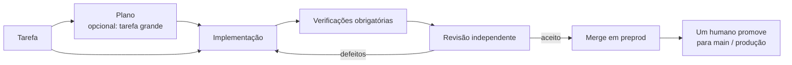

<div align="center">

# Darkfactory

**Uma fábrica de software com IA, auto-hospedada: planeja o trabalho, escreve o código, executa verificações obrigatórias e uma revisão independente, e entrega somente em `preprod`.**

[](../../LICENSE)
[](../../pyproject.toml)
[](../../compose.yaml)
[](https://fastapi.tiangolo.com)
[](https://www.postgresql.org)

[English](../../README.md) · [Русский](README.ru.md) · [中文](README.zh.md) · [हिन्दी](README.hi.md) · [Español](README.es.md) · [العربية](README.ar.md) · [Français](README.fr.md) · [বাংলা](README.bn.md) · **Português** · [日本語](README.ja.md)

</div>

O Darkfactory oferece uma UI e uma API compartilhadas, organizações com projetos isolados, uma fila baseada em PostgreSQL e um contêiner separado para cada tarefa. As alterações verificadas chegam automaticamente apenas a `preprod`. Um humano atualiza a branch principal e a produção.

## Por que o Darkfactory

- 🏭 **Auto-hospedado.** Uma UI e uma API, organizações e projetos isolados, uma fila PostgreSQL e um contêiner dedicado por tarefa.
- 🛡️ **Entrega somente em `preprod`.** A produção e a branch principal são atualizadas por um humano, nunca pela fábrica.
- ✅ **Verificações obrigatórias e revisão independente.** Verificações e revisão ficam vinculadas a um único commit final. Sem verificações configuradas, o merge automático fica desativado.
- 🔒 **Contêineres de tarefa isolados.** Sem root, sistema de arquivos raiz somente leitura, CPU/RAM/PIDs limitados, rede desativada, sem acesso ao socket do Docker, ao PostgreSQL, a outros projetos ou a segredos de produção.
- 🔀 **Pools de assinaturas com fallback.** Codex para desenvolvimento e Claude para revisão por padrão; troca de contas e de engines com atenção à cota; API paga somente com opt-in explícito e um orçamento em dinheiro.
- 🧠 **Factory Director.** Um chat (web e CLI) que cria projetos, papéis e tarefas e resolve tarefas paradas dentro das permissões do próprio usuário.

## Pipeline de tarefas



Por padrão, a tarefa vai direto para um único desenvolvedor, sem plano e sem subtarefas. Um plano com perguntas bloqueantes fica parado até você responder.

## Sumário

- [Início rápido](#início-rápido)
- [Seu primeiro projeto](#seu-primeiro-projeto)
- [Conexões de executores](#conexões-de-executores)
- [Isolamento e dependências](#isolamento-e-dependências)
- [Inicialização de um projeto existente](#inicialização-de-um-projeto-existente)
- [Artefatos do projeto](#artefatos-do-projeto)
- [Papéis, delegação, skills e MCP](#papéis-delegação-skills-e-mcp)
- [Factory Director](#factory-director)
- [Notificações para humanos](#notificações-para-humanos)
- [Limites e incidentes](#limites-e-incidentes)
- [Verificações da implementação](#verificações-da-implementação)
- [Testes de UI no navegador](#testes-de-ui-no-navegador)
- [Testes do stand e deploys no GitLab](#testes-do-stand-e-deploys-no-gitlab)
- [Agendamentos](#agendamentos)
- [API e dados](#api-e-dados)
- [Idiomas da interface](#idiomas-da-interface)
- [Licença](#licença)

## Início rápido

Você precisa do Docker Engine com Docker Compose e suporte a `volume.subpath`. O Docker Desktop funciona no macOS.

> [!IMPORTANT]
> Não há senha padrão do PostgreSQL: sem `POSTGRES_PASSWORD` no `.env`, o Compose não inicia. Uma instalação criada anteriormente usava a senha `darkfactory-local`: coloque-a no `.env`, depois altere a senha no PostgreSQL (`ALTER USER darkfactory PASSWORD …`) e no `.env`.

Para uma instalação nova, a partir do diretório do projeto:

```sh
echo "POSTGRES_PASSWORD=$(openssl rand -hex 32)" >> .env
docker compose up -d --build
docker compose exec app cat /data/bootstrap-token
```

Abra [localhost:8080](http://localhost:8080) e cole o token de proprietário.

- **Defina você mesmo o token de proprietário.** Em vez do arquivo gerado, execute `echo "DARKFACTORY_ADMIN_TOKEN=$(openssl rand -hex 32)" >> .env` antes da primeira inicialização.
- **Alterações posteriores.** Após uma reinicialização, um novo valor da variável substitui o token anterior vindo do `.env`. Em uma instalação já em execução, a variável é adicionada ao proprietário de `/data/bootstrap-token`. Um token revogado do `.env` não é restaurado: defina um novo valor.
- **Primeiro build.** Baixa Python, Node, PostgreSQL, Codex CLI e Claude Code. As inicializações seguintes usam as imagens já construídas.

### Serviços

| Serviço | Finalidade |
|---|---|
| `app` | Serve a UI e a API |
| `worker` | Gerencia as tarefas |
| `db` | Armazena a fila (PostgreSQL) |
| `executor-image` | Constrói a imagem dos contêineres temporários de tarefa |

O socket do Docker fica disponível somente para o worker confiável; a tarefa não o recebe.

### Configuração

As configurações do Compose são lidas do `.env`:

| Variável | Significado | Padrão |
|---|---|---|
| `PORT` | Porta publicada | `8080` (conforme `compose.yaml`) |
| `BIND_ADDRESS` | Endereço ao qual a porta se vincula | `127.0.0.1` |
| `POSTGRES_PASSWORD` | Senha do PostgreSQL | nenhum, obrigatória |
| `GLOBAL_CONCURRENCY` | Concorrência global de tarefas | `4` |
| `EXECUTOR_CPUS` | CPUs por contêiner de tarefa | `4` |
| `DATA_VOLUME` | Nome do volume `data` | `darkfactory_data` (conforme `compose.yaml`) |
| `DARKFACTORY_ADMIN_TOKEN` | Token de proprietário escolhido por você | gerado em `/data/bootstrap-token` |
| `DARKFACTORY_PERSONAL_MODE` | Modo de piloto local pessoal (veja [Conexões de executores](#conexões-de-executores)) | `0` |
| `DARKFACTORY_PUBLIC_URL` | Endereço da fábrica usado nos links de notificação | `http://127.0.0.1:8080` |
| `DARKFACTORY_DIRECTOR_MODEL_CLAUDE`, `DARKFACTORY_DIRECTOR_MODEL_CODEX` | Modelo do chat do Director nas assinaturas desse provedor, por exemplo um mais leve que o dos agentes. Um perfil do Director do projeto com modelo tem prioridade. Com a variável do Claude definida, o Director tenta primeiro as assinaturas do Claude | vazio: o modelo da conexão |

> [!WARNING]
> Para o acesso dos funcionários, coloque um proxy reverso HTTPS na frente da aplicação. O PostgreSQL não é publicado externamente.

## Seu primeiro projeto

1. Clique em **"Conectar projeto"** e informe um nome, um repositório Git e, se necessário, um token de acesso.
2. Um gerente, um analista, um desenvolvedor e um revisor com as skills padrão aparecem imediatamente. Os papéis herdam os executores do projeto: Codex para desenvolvimento e Claude para revisão. Os servidores MCP são conectados separadamente.
3. Conecte as assinaturas ao pool compartilhado da organização. Se já existir um pool, o novo projeto o utiliza; caso contrário, a fábrica cria um "Pool compartilhado". Depois, os projetos podem escolher pools dedicados nas configurações.
4. Nas configurações do projeto, defina os comandos de verificação obrigatórios. Sem eles, o merge automático fica desativado.
5. Crie uma tarefa na UI ou pela API. Um plano com perguntas bloqueantes fica parado até você responder.

### Repositórios compatíveis

São compatíveis Git via HTTPS, SSH e repositórios bare locais em `/repos`. GitHub e GitLab, inclusive com domínios auto-hospedados, recebem PRs/MRs. Para qualquer outro Git, a fábrica cria um registro de alteração interno com o diff, as verificações e a revisão. O SSH exige uma chave dedicada e um `known_hosts` definido explicitamente; as chaves de host não são herdadas.

Para projetos locais, use o volume compartilhado `repos`, montado no app e no worker como `/repos`. Você pode criar um repositório com `docker compose exec worker sh`; o cenário de teste [abaixo](#verificações-da-implementação) mostra um exemplo completo. Diretórios do host não são montados no contêiner da tarefa.

### Comportamento do merge

- Quando nenhuma verificação está configurada, a tarefa termina com um registro de alteração e o estado `review_required`: o merge automático é proibido.
- Verificações e revisão ficam vinculadas a um único commit final.
- Uma mudança na ponta de `preprod` dispara nova integração e nova aceitação.
- Os merges de um projeto são executados em sequência.

### Papéis de acesso

| Papel | Pode |
|---|---|
| Proprietário | Gerenciar configurações e conexões |
| Operador | Gerenciar tarefas |
| Observador | Ler |

As permissões do membro e do token se intersectam; a revogação de permissões vale para as requisições seguintes. Uma nova organização recebe seu próprio proprietário e um token exibido uma única vez. O proprietário emite tokens de membros nas configurações ("Acesso da equipe") ou por `POST /api/members`; pode haver vários membros com o papel `owner`. Tokens adicionais próprios são emitidos com `POST /api/tokens` e revogados com `DELETE /api/tokens/{id}`.

## Conexões de executores

| Conexão | Credenciais e observações |
|---|---|
| **Codex for company** | Credenciais JSON `{"auth_method":"siwc","accessToken":"..."}`. Usa o provedor OAuth externo documentado do App Server. Requer um token Sign in with ChatGPT com acesso a este cenário. Renove o token reconectando. |
| **Claude Code** | `{"oauth_token":"..."}` para uma conexão de assinatura permitida. A sessão isolada recebe apenas o token selecionado; `--bare` não é usado. |
| **API** | Chat Completions compatível com OpenAI via HTTPS, com chamadas de ferramentas. Informe o modelo e `{"base_url":"https://example.com/v1","api_key":"...","input_usd_per_million":0.0,"output_usd_per_million":0.0}` com preços reais. Há um campo `ca_cert` para uma CA TLS própria. |

### Piloto local pessoal

Para um piloto local pessoal, você pode usar o `codex login` atual via ChatGPT.

1. Adicione `DARKFACTORY_PERSONAL_MODE=1` ao `.env` local.
2. Execute `docker compose up -d --build`.
3. No host, execute `python3 scripts/connect_personal_codex.py`. O script cria o pool `Personal Codex` e uma conexão na organização do token de bootstrap.
4. Atribua esse pool a um projeto; uma sessão Codex separada também pode realizar as revisões.

Sem gateway, toda requisição do Codex ao ChatGPT (o backend e as chamadas ao modelo, `openai_base_url`) passa por um relay loopback no executor, que adiciona o token real. Os modelos atuais exigem o Codex 0.160 ou posterior, que só alcança o backend do ChatGPT por HTTPS; por isso o relay serve um certificado assinado por uma CA descartável, em que só esse Codex confia (`CODEX_CA_CERTIFICATE`). Somente o token de acesso e o ID da conta de `~/.codex/auth.json` são importados; o token de atualização e o diretório do host não são passados aos contêineres. O token é armazenado criptografado. Depois que o token expirar ou for revogado, repita a importação enquanto a conexão estiver ociosa. O modo pessoal vem desativado por padrão, e uma instalação hospedada ou comercial usa SIWC. O escopo da autorização integrada está descrito na [documentação oficial do App Server](https://learn.chatgpt.com/docs/app-server#auth-endpoints).

Se o seu Codex pessoal já funciona por meio de um gateway local de assinatura, informe o endereço acessível pelo Docker e o modelo configurado:

```sh
python3 scripts/connect_personal_codex.py --base-url http://host.docker.internal:8787/v1 --model MODEL_NAME
```

Este modo aceita apenas endereços HTTP locais e exige `DARKFACTORY_PERSONAL_MODE=1`. Uma conexão do Claude recebe o mesmo tipo de gateway em suas credenciais (`"base_url": "http://host.docker.internal:18788/bili/http://127.0.0.1:8787"` para o bili e o headroom do agent-stack); o relay dela então encaminha para lá, e não para o provedor. No Linux, um gateway que escuta apenas no loopback é exposto aos contêineres por `scripts/systemd/darkfactory-gateway.service` (socat no endereço da bridge do Docker); os serviços do agent-stack devem sobreviver ao logout (`loginctl enable-linger`). O executor se conecta ao gateway indicado por um túnel fixo e pela lista de endereços permitidos existente; a rede do contêiner continua `none`. Este modo não ativa uma API paga.

### Pools e seleção de engine

Os pools definem prioridades, modelos, engines disponíveis, concorrência, o número de trocas e a pausa antes de verificar a cota novamente. A escolha de base é Codex para desenvolvimento e Claude para revisão. A troca de contas e a troca Codex ↔ Claude são permitidas; a API não é conectada automaticamente por padrão. Para um fallback pago, o proprietário ativa explicitamente uma política do projeto e a tarefa recebe um orçamento em dinheiro. Uma API atribuída explicitamente também exige um orçamento.

O botão **"+ Assinatura"** inicia o login padrão do Claude por meio de um link e de um código único no navegador. No modo pessoal, o device-auth do Codex está disponível: o link e o código aparecem no mesmo formulário. Escolha os pools antes de entrar; após a confirmação, a conta é adicionada automaticamente. Você pode fechar o formulário e retomar um login não concluído a partir das configurações. Um login é válido por no máximo 15 minutos, pode ser cancelado e é executado em um contêiner separado. Tokens OAuth nunca são repassados ao navegador. A renovação automática de tokens expirados não está implementada; repita o login ou reconecte.

| Padrão do pool | Valor |
|---|---|
| Reserva mantida | **10%** |
| A observação é considerada recente por | **300 segundos** |
| Cota desconhecida | permitida |

- Uma cota recente e conhecida abaixo da reserva exclui a assinatura. Entre as contas adequadas do engine selecionado, tem preferência a que tiver o maior saldo confirmado.
- A reserva, a idade do snapshot e a opção "cota conhecida obrigatória" estão no formulário do pool.
- O Codex pessoal verifica os limites novamente antes de chamar o modelo.
- Para provedores sem dados disponíveis, a política estrita aguarda um saldo confirmado.
- Os limites podem mudar durante o trabalho: salvar o código e repassar o contexto permite que o trabalho continue com outra conta.

Em uma troca, são repassados o código e os artefatos, não a sessão interna da conta. A cota e a ocupação são acompanhadas por conexão, inclusive por um `quota_group` compartilhado conhecido; reconectar as mesmas credenciais não cria uma nova cota. Um saldo desconhecido nunca é declarado ilimitado. Um erro de autorização exige reconexão; um erro de cota exige aguardar a verificação de controle.

Quando um executor informa a cota restante e o horário de redefinição, a fábrica os armazena e os exibe nas configurações da conexão junto com o horário da observação. Este é o último snapshot recebido, não uma consulta contínua à conta. Quando não há dados disponíveis, é exibido "cota restante desconhecida". Reconectar com novas credenciais apaga o snapshot anterior. O horário da tentativa de controle é exibido separadamente do horário de redefinição informado pelo provedor.

### Exclusão de pools

Os pools podem ser excluídos nas configurações ou por `DELETE /api/pools/{id}`, inclusive pelo Director. A exclusão está disponível para o proprietário de toda a organização. As assinaturas, a autorização e a participação em outros pools são preservadas. Se o pool estiver atribuído a um projeto, selecione primeiro outro pool para desenvolvimento e revisão. Um login de assinatura não concluído também deve ser finalizado ou cancelado antes da exclusão.

### Base oficial

[Codex App Server](https://learn.chatgpt.com/docs/app-server), [tokens externos SIWC](https://developers.openai.com/siwc/token-sharing-open-source/codex-app-server), [Claude Code headless](https://code.claude.com/docs/en/headless).

> [!NOTE]
> A existência de um adaptador não confirma que o cenário de assinatura esteja disponível para uma empresa específica: são necessárias conexões permitidas.

## Isolamento e dependências

Uma tarefa recebe sua própria cópia de trabalho e branch, um contêiner sem root, um sistema de arquivos raiz somente leitura, CPU/RAM/PIDs limitados e um prazo interno. O `.git` é protegido contra escrita para o agente. O verificador recebe a cópia de trabalho somente para leitura. Não há acesso ao socket do Docker, ao PostgreSQL, a outros projetos ou a segredos de produção.

A rede do contêiner é desativada. O HTTPS fica disponível por meio de um proxy CONNECT apenas para o provedor selecionado e para as entradas `host:port` explicitamente permitidas do projeto. As verificações são offline por padrão. Os segredos de teste são passados separadamente; o proxy não abre acesso arbitrário ao host.

> [!WARNING]
> A fábrica mescla somente em `preprod`. Um deploy só roda depois que o dono faz merge em `main`, pelo job do GitLab próprio do projeto ([Testes do stand e deploys no GitLab](#testes-do-stand-e-deploys-no-gitlab)).

### Imagem do executor e configurações de teste

A imagem contém Python, Node e Git. Se um projeto precisar de outras dependências, construa sua própria imagem a partir de `darkfactory-executor:local`, instale as dependências antecipadamente e defina `executor_image` nas configurações do projeto.

- O proprietário configura os endpoints de teste permitidos e o `test_env`.
- Os nomes em `test_env` são apenas `TEST_*`, `APP_*` ou `E2E_*`.
- `allowed_hosts`, o remoto Git e o servidor de PR/MR devem ser nomes totalmente qualificados.
- Um endereço interno (loopback, rede privada, link-local, CGNAT) só é aceito se o seu `ip:port` exato estiver listado em `allowed_hosts`.

### Relações entre tarefas

Relações entre tarefas: `depends_on`, pai → subtarefa (`parent`), `related_to` e `duplicate` confirmado. Uma dependência de código aguarda um resultado aceito em `preprod`; uma dependência de artefato pode aceitar um commit verificado específico. Ciclos e relações entre organizações são proibidos. Um pai aguarda suas tarefas filhas obrigatórias e sua própria verificação de integração.

### Decomposição e revisão

- Por padrão, a tarefa vai direto para um único desenvolvedor, sem plano e sem subtarefas.
- A revisão devolve o trabalho apenas por defeitos e critérios não atendidos; as melhorias são marcadas com `[LATER]` e vão para o backlog.
- Para uma tarefa marcada como "Tarefa grande", o planejador pode criar por conta própria até oito subtarefas com critérios de aceitação e dependências.
- Filhas independentes recebem diretórios de trabalho separados e podem ser executadas em paralelo.
- A decomposição automática aninhada é proibida.
- Antes da sua própria implementação, o pai reúne o código aceito de suas filhas.
- Tempo, correções, trocas e dinheiro são limitados por um único orçamento para toda a árvore; criar filhas não multiplica os limites. As execuções paralelas reservam parcelas do tempo restante.
- Cancelar um pai cancela os agentes que ele criou; as filhas canceladas não são retomadas automaticamente.

### Mudanças de dependências

Os SHAs aceitos das dependências são armazenados na tarefa. Uma mudança de SHA ou a revogação de um resultado aceito interrompe o executor atual e redefine as verificações e revisões antigas. Após o desbloqueio, a tarefa repete a montagem das entradas, a implementação e a aceitação, mantendo o código de trabalho e os contadores acumulados. Antes do merge, a verificação de dependências e a operação Git são executadas sob um bloqueio compartilhado do controlador, de modo que uma mudança de entrada não possa se infiltrar entre elas.

## Inicialização de um projeto existente

Ao adicionar um projeto, **"Indexação inicial e documentos Markdown"** vem ativada por padrão. A fábrica enfileira uma tarefa comum: primeiro salva um mapa dos arquivos Git rastreados; depois o executor estuda o repositório e cria ou amplia quatro arquivos:

| Arquivo | Conteúdo |
|---|---|
| `docs/darkfactory/INDEX.md` | Mapa do projeto, pontos de entrada e finalidade dos módulos |
| `docs/darkfactory/ARCHITECTURE.md` | Componentes, dependências, dados e limites do sistema |
| `docs/darkfactory/DEVELOPMENT.md` | Instalação, execução, configuração e verificações |
| `docs/darkfactory/CONTRACTS.md` | APIs, eventos e integrações externas descobertos |

O mapa de origem com SHAs também está nos artefatos da tarefa: `repository-index.md`. Ele lista os primeiros 1000 arquivos rastreados e a contagem total. O executor deve fundamentar as conclusões em arquivos do projeto, preservar a documentação existente útil e marcar o que é desconhecido. Alterações fora dos quatro documentos são rejeitadas pela verificação do worker.

A tarefa usa as conexões, os limites, as verificações e a revisão independente do projeto. Se ainda não houver conexões, ela aguarda a configuração. Os documentos passam pelo pipeline Git normal: com as verificações obrigatórias bem-sucedidas, as alterações são mescladas em `preprod`; sem verificações configuradas, ficam para merge manual. Após a revisão, os quatro documentos aparecem no registro como **rascunhos**, com a tarefa de origem e o SHA do commit verificado. O proprietário aceita explicitamente as versões que deseja; as versões aceitas existentes são preservadas.

Para um projeto conectado anteriormente, abra **"Artefatos do projeto" → "Indexar projeto"**. O botão está disponível para o proprietário e abre a tarefa de inicialização existente, caso já tenha sido criada, sem duplicatas. A criação de projeto pela API aceita `initialize` (padrão `true`); `false` desativa o início automático. Para um projeto existente: `POST /api/projects/{id}/initialize`.

## Artefatos do projeto

Abra **"Artefatos do projeto"** e adicione requisitos, análises, arquitetura, um contrato de API, um relatório ou qualquer outro documento de texto. Um artefato tem uma chave estável dentro do projeto, um título e um histórico de versões imutáveis. O conteúdo é armazenado no banco; editar cria uma nova versão. Este é um registro separado de conhecimento do projeto que complementa os arquivos de trabalho das tarefas (`plan.md`, `diff.patch`, `checks.txt`, `review.txt`, `handoff.md`) e as evidências do navegador.

- O operador adiciona rascunhos, o proprietário aceita uma versão selecionada ou revoga a aceitação, o observador lê.
- Exatamente uma versão de cada artefato é aceita por vez.
- Opcionalmente, indique uma tarefa de origem: ela deve ter um commit atual com revisão independente. Uma versão armazena o ID da tarefa e o SHA; uma mudança no resultado da origem ou em suas entradas torna o documento obsoleto.
- Documentos comuns são publicados pelo formulário ou pela API; a inicialização do projeto adiciona seus próprios documentos automaticamente após a revisão.

### Uso de artefatos como entradas de tarefas

Ao criar uma tarefa, selecione versões aceitas. No cartão de uma tarefa parada, você pode adicionar, substituir ou remover uma entrada. A tarefa recebe o texto completo exatamente das versões selecionadas, suas chaves, números e SHAs de origem. As subtarefas delegadas herdam essas versões.

| Limite | Valor |
|---|---|
| Caracteres por versão | 100.000 |
| Entradas por tarefa | até 10 |
| Caracteres por tarefa no total | 200.000 |

Aceitar uma nova versão não altera automaticamente as seleções das tarefas: os consumidores da versão antiga aguardam uma substituição explícita da entrada. Uma aceitação revogada e uma origem obsoleta também bloqueiam a execução. A fábrica redefine as verificações e revisões das entradas anteriores, interrompe o executor ativo e verifica novamente as entradas antes do merge. O código de trabalho e os contadores acumulados são preservados. O cartão do artefato mostra o histórico, as tarefas de origem e os consumidores; as versões anteriores continuam legíveis.

### API de artefatos

| Finalidade | Rotas |
|---|---|
| Artefatos | `GET/POST /api/projects/{id}/artifacts` |
| Versões | `POST /api/project-artifacts/{id}/versions`, `GET /api/project-artifacts/{id}/versions/{version_id}` |
| Aceitação | `POST …/versions/{version_id}/accept`, `POST /api/project-artifacts/{id}/revoke` |
| Entradas da tarefa | `GET /api/tasks/{id}/artifact-inputs`, `PUT/DELETE /api/tasks/{id}/artifact-inputs/{artifact_id}` |
| Criação de tarefa | aceita `artifact_version_ids` |

O acesso é limitado por organização, pelos projetos do usuário e pelo escopo do token; ciclos com dependências comuns são proibidos. As novas tabelas são criadas na inicialização, sem alterar as tarefas existentes.

## Papéis, delegação, skills e MCP

Abra **"Agentes, skills e MCP"** no menu à esquerda e selecione um projeto. O botão **"Adicionar equipe pronta"** instala o agente do projeto, o analista, o desenvolvedor e o revisor. As abas **"Papéis"**, **"Skills"** e **"MCP"** oferecem catálogos: adicione configurações prontas com botões e vincule skills e ferramentas a um papel por meio de listas. Instruções, engine e modelo podem ser alterados no cartão do papel. Os perfis também podem ser atribuídos a uma tarefa individual.

### Delegação

Durante o planejamento, o agente do projeto cria subtarefas e atribui a elas um `agent_profile`. Para um cenário "análise → desenvolvimento", crie os perfis `analyst` e `developer`: a subtarefa do desenvolvedor lista a chave da análise em `depends_on`. O desenvolvedor começa após o merge verificado da análise em `preprod` e recebe o commit e os artefatos aceitos. O analista salva o resultado no repositório. Todo agente com permissão de delegação pode criar novas subtarefas dentro da profundidade e da contagem total configuradas.

| Padrão de delegação | Valor |
|---|---|
| Profundidade | 2 |
| Máximo de subtarefas por árvore | 16 |
| Subtarefas diretas por plano | 8 |

Tempo, correções e o orçamento em dinheiro são compartilhados por toda a árvore.

### Catálogo

O catálogo contém sete skills e quatro servidores MCP: navegador, leitura/busca de arquivos do projeto, leitura de status/diff/log do Git e Jira. Os três primeiros são executados dentro do contêiner da tarefa e não precisam de servidor externo.

### Jira MCP

O MCP **Jira** (`mcp-atlassian`, instalado na imagem do executor) lê issues do Jira Server/Data Center ou Cloud, buscas JQL, boards e sprints. As ferramentas de escrita são desativadas tanto no gateway quanto no próprio servidor (`--read-only`). Depois de adicioná-lo pelo catálogo, abra o cartão dele e preencha:

- **Endereços que precisam de acesso:** `jira.example.com:443`. Sem isso, o egress da tarefa não permitirá que o servidor alcance o Jira, inclusive em um endereço privado.
- **Ambiente secreto:** `JIRA_URL=https://jira.example.com` e `JIRA_PERSONAL_TOKEN=<PAT>` (Jira → Profile → Personal Access Tokens). Para o Jira Cloud, use `JIRA_USERNAME` e `JIRA_API_TOKEN` no lugar do PAT.

Depois, vincule o `jira` aos papéis que precisam dele, por exemplo o analista e o gerente. A conta de serviço precisa apenas de permissão de leitura nos projetos relevantes.

### MCP personalizado

Há um formulário avançado para o seu próprio MCP: um endpoint HTTPS ou um comando stdio da imagem do executor, os nomes exatos das ferramentas permitidas e cabeçalhos ou ambiente secretos. Os segredos são criptografados e nunca retornam na UI/API. O Codex e o Claude nativos recebem as ferramentas por meio de um gateway local que filtra a lista e proíbe chamadas fora do conjunto permitido. O planejador e o revisor aceitam apenas conexões marcadas pelo proprietário como seguras para leitura; as permissões da própria conta de serviço também devem corresponder ao papel. O adaptador da API paga não oferece suporte a MCP.

## Factory Director

O diálogo **"Factory Director"** fica aberto à direita. Selecione a fábrica inteira ou um único projeto. Por meio do diálogo, você pode criar organizações, projetos, pools, papéis e skills, conectar servidores MCP prontos, criar tarefas e alterar as configurações disponíveis. Por exemplo: "Adicione um analista e um desenvolvedor ao projeto, dê a eles acesso de leitura a arquivos e ao Git".

- **"Novo chat"** inicia um histórico e um contexto separados. Os chats antigos permanecem na lista.
- **"Cancelar mensagem"** remove uma requisição da fila ou interrompe o executor ativo. As ações já iniciadas podem terminar; o log delas é preservado. A assinatura é liberada depois que o contêiner para.

O Director é executado por meio do **Codex CLI ou do Claude CLI** a partir de um pool de assinaturas conectado. Ele usa a mesma API e as mesmas permissões do usuário: um operador não ganha direitos de proprietário, e o acesso a um projeto não abre os demais. Uma API paga não é ativada automaticamente para o Director. Quando o pool está ocupado, a requisição fica na fila. Se o resultado for incerto após uma reinicialização, as ações não são repetidas às cegas: o Director pede que você verifique o estado.

> [!CAUTION]
> Adicione senhas, chaves e códigos de login pelos formulários de conexão. O Director pode iniciar um login e fornecer um link, mas nunca recebe tokens nem códigos de dispositivo. O acesso a uma organização criada é emitido separadamente e uma única vez pela interface.

### Tarefas paradas

O Director também trata tarefas que pararam e aguardam um humano: o limite de ciclos de revisão, uma pergunta do desenvolvedor, rede fechada, tempo expirado. Ele lê o código e o histórico da tarefa (o repositório é conectado somente para leitura) e decide por conta própria: continuar com orientações, devolver para nova revisão, permitir um endereço, cancelar. Ele só aciona o proprietário para acesso, dinheiro, escolhas de produto e ações destrutivas. Enquanto ele pensa, a tarefa no quadro mostra "Director decidindo".

O botão **"Decisões"** no chat mostra as decisões dele para o projeto. As marcadas como "Aguardando você" precisam da sua decisão: responda ao Director no chat, por exemplo "na tarefa …, continue, use …", e ele continua ou cancela a tarefa por conta própria.

Configurações do projeto: "O Director resolve as paradas no seu lugar" e "Decisões do Director por árvore de tarefas" (padrão 6, variável `DARKFACTORY_DIRECTOR_LIMIT`). O modelo e as instruções do Director são definidos pelo papel "Director" na tela "Papéis".

### Director pelo terminal

O mesmo diálogo está disponível pelo terminal:

```sh
uv sync
uv run darkfactory director --token-file /path/to/api-token "Покажи проекты и текущие задачи"
uv run darkfactory director --token-file /path/to/api-token --project PROJECT_ID
```

Sem uma mensagem, abre-se um diálogo interativo.

| Opção / variável | Finalidade |
|---|---|
| `--token-file` ou `DARKFACTORY_TOKEN` | Token da API (arquivo ou ambiente) |
| `--url` ou `DARKFACTORY_URL` | Endereço do servidor (padrão `http://127.0.0.1:8080`) |
| `--project` | Trabalhar com um projeto específico |
| `--timeout` | Tempo de espera; padrão 600 segundos |
| `--resume MESSAGE_ID` | Aguardar a mesma requisição sem reenviar; use o token anterior e `--project` |
| `--new-chat` | Iniciar um diálogo de CLI separado |
| `--thread CHAT_ID` | Continuar um chat existente |
| `--cancel MESSAGE_ID` | Cancelar uma mensagem sem reenviar o comando |

O comando também está disponível como `python -m darkfactory.cli director`. Se o terminal for fechado ou a espera expirar, a requisição continua em execução.

## Notificações para humanos

Nas configurações, adicione um canal Rocket.Chat com um webhook HTTPS e um destinatário opcional `@username` ou `#channel`, ou o Telegram com um token de bot e um ID de chat. Um destinatário do Rocket.Chat exige a substituição do canal no webhook de entrada (veja abaixo). O destinatário pode ser alterado sem informar a URL novamente. Selecione um projeto ou toda a organização e, em seguida, os eventos: perguntas, paradas, erros, limites, alterações aceitas e incidentes. Configurar um canal não envia nenhuma mensagem por si só. As perguntas dos agentes e as paradas do pipeline entram na fila automaticamente. A API `POST /api/tasks/{id}/notify` com `{"message":"..."}` envia uma mensagem aos canais configurados da tarefa.

A entrega é executada separadamente das tarefas, com cinco tentativas e um intervalo entre as repetições. Os segredos não são exibidos novamente. Após uma falha entre o envio e a gravação da confirmação, é possível haver uma mensagem duplicada. As respostas às perguntas são informadas no cartão da tarefa ou diretamente no chat.

### Comandos de chat

Os comandos de chat são habilitados por um token de API com o papel de operador nas configurações do canal: os comandos são executados com as permissões e o escopo de projeto desse token, portanto emita um token dedicado com o mínimo necessário. O canal não aceita um token de proprietário. Sem `allowed_senders`, qualquer membro do chat pode usar comandos; com uma lista `allowed_senders` (`from.id` do Telegram, `user_id` do Rocket.Chat), apenas os listados podem. O remetente é registrado no evento da tarefa.

- `!director texto` (ou `/director texto`) entrega uma atribuição ao Director, por exemplo `!director mostra as tarefas`. Em grupos do Telegram com modo de privacidade, o bot vê apenas `/director`. O Telegram responde à mensagem com o comando; o Rocket.Chat responde na thread dessa mensagem. Enquanto o Director está ocupado, um novo comando é recusado.
- Uma resposta a uma notificação de pergunta ou de parada continua a tarefa com esse texto, como o botão "Continuar" no cartão. No Telegram, responda à mensagem do bot ou encaminhe-a ao bot em um chat privado com um comentário. No Rocket.Chat, responda na thread da notificação.
- O Telegram é lido por long polling via `getUpdates`, portanto não é necessário um endereço público; o bot não deve ter um webhook. Canais que compartilham um mesmo bot dividem as mensagens por ID de chat.

### Gerenciamento pelo Telegram

Com um token de comando, o bot do Telegram oferece um menu de botões. `/start` ou `меню` o abre. As telas são atualizadas na mesma mensagem.

- Projetos → quadro com as colunas "Pronto para executar", "Em andamento", "Requer atenção", "Concluído" → lista de tarefas → cartão. O cartão mostra a pergunta do agente e botões conforme o estado da tarefa.
- "✍️ Responder" passa uma resposta ao agente e continua a tarefa. Os botões "Responder" e "Cartão" também aparecem sob cada notificação de tarefa.
- A ordem da fila muda com os botões "⏫ Mais alta" e "⏬ Mais baixa" ou "➡️ Mover" → "Para o início" e "Para o fim": esta é a prioridade da tarefa. "Mover" também devolve uma tarefa para execução, faz o merge dela ou a cancela; o cancelamento pede confirmação.
- "➕ Nova tarefa": a primeira linha da resposta é o título, o texto inteiro é a descrição.
- "🧠 Director" entrega uma mensagem ao Director. Em um chat privado com o bot, qualquer texto simples também vai para o Director, e uma resposta à mensagem dele continua a conversa.
- As assinaturas são conectadas apenas nas configurações web: o chat não inicia um login.

### Configuração dos comandos do Rocket.Chat

Crie um webhook de saída para o evento "Mensagem enviada" na mesma sala do webhook de entrada. URL: `https://<factory>/api/chat-commands/rocketchat/<channel id>` (exibida na lista de canais); defina o token do webhook nas configurações do canal. Deixe as palavras de gatilho vazias e não exclua as mensagens do bot: a fábrica as usa para descobrir a qual tarefa uma thread pertence. O Rocket.Chat não repassa barras desconhecidas, então os comandos lá começam com `!`:

- `!director texto`: entrega uma atribuição ao Director.
- `!projects`: projetos e o número de tarefas em cada coluna do quadro.
- `!waiting`: tarefas que aguardam uma resposta ou um merge.
- `!task <id>`: o cartão da tarefa.
- `!help`: a lista de comandos.

Na thread da notificação de uma tarefa, texto comum é a resposta ao agente, e `!task`, `!resume`, `!merge` e `!cancel` agem sobre essa tarefa.

O webhook de entrada funciona em dois modos, conforme a configuração «Override Destination Channel»:

- **Override desativado** (o padrão do Rocket.Chat): deixe vazio o destinatário do canal. Todas as mensagens vão para o canal do próprio webhook, e as respostas na thread levam só o ID da thread (`tmid`). O Rocket.Chat recusa aqui qualquer requisição com `roomId` ou `channel` (`overriding destination channel is disabled for this integration`); com override desativado, portanto, um destinatário faz toda entrega falhar. Coloque o webhook de saída na mesma sala que o de entrada, ou as respostas ficarão fora da thread.
- **Override ativado**: o destinatário escolhe para onde vão as notificações, e as respostas a comandos informam a sala de origem (`roomId`) junto com `tmid`. Use este modo quando as notificações vão para uma sala diferente da do próprio webhook.

O estado da entrega fica no outbox do canal (`notification_deliveries`). Uma resposta do Director a um comando do chat conta como respondida (`director_dialogues.origin_replied`) só depois de o Rocket.Chat ou o Telegram a aceitar; uma resposta recusada continua sem resposta, com o status HTTP do provedor em `last_error`. As notificações chegam como markdown do Rocket.Chat sob o nome Darkfactory; com `DARKFACTORY_PUBLIC_URL` definido, o logo da fábrica é o avatar.

### Notificações de merge

Após um merge verificado em `preprod`, o canal recebe os nomes da tarefa e do projeto, um resumo curto do desenvolvedor, o SHA e um link para o commit aceito. Para GitHub/GitLab, o link leva à página do commit; para Git local e genérico, leva a um cartão autorizado com o diff na fábrica. Tentativas malsucedidas não enviam mensagem de conclusão.

Para os funcionários, defina um endereço da fábrica acessível a eles por meio de `DARKFACTORY_PUBLIC_URL` no `.env`, por exemplo `https://factory.company.ru`, e reinicie o Compose. Por padrão, os links usam `http://127.0.0.1:8080`. Tokens não são adicionados aos links; pode ser necessário fazer login.

### Promoção para main

Quando uma tarefa de nível superior é concluída, a notificação também contém um link **"Merge em main / rejeitar"**. É uma proposta de merge dentro da fábrica, disponível também para Git local. Ela fixa o commit aceito e mostra o diff completo em relação ao `main` atual (até 100.000 caracteres, com uma marca de truncamento). O proprietário pode fazer o merge ou rejeitar; o link GET não altera nada por si só. A transferência inclui todas as alterações de `preprod` até o commit indicado, inclusive as subtarefas. A rejeição mantém o `preprod`.

> [!NOTE]
> Por padrão, não há transferência automática para `main`, e o Director não pode tomar essa decisão; veja [Promoção automática](#promoção-automática) para a opção. Um projeto do GitLab com job de deploy é implantado após o merge feito pelo dono ([veja abaixo](#testes-do-stand-e-deploys-no-gitlab)). Se o `main` divergiu do commit aceito, são necessárias antes uma integração e novas verificações. Tarefas antigas já concluídas não recebem novas propostas automaticamente.

### Promoção automática

O proprietário pode permitir que um projeto se promova sozinho: defina **"Promoção automática de preprod para main após o período de validação, em horas"** (`auto_promote_hours`, `0` = somente manualmente) e adicione um [agendamento](#agendamentos) **"Promoção automática de preprod para main"**. Quando o agendamento dispara, o commit aceito mais recente de `preprod` vai para `main` somente se:

- ele foi aceito há pelo menos `auto_promote_hours` horas e nenhum incidente em preprod ocorreu desde então;
- a última verificação de preprod está saudável e as proteções habituais de promoção são atendidas;
- a [verificação de vazamentos](#verificação-de-vazamentos) não encontra nada no diff `main..preprod` nem nas mensagens de commit.

A promoção fica registrada como decisão da fábrica na tarefa, e um job de deploy do GitLab, se configurado, a segue. A linha do agendamento mostra o motivo de uma execução não ter promovido.

### Verificação de vazamentos

`scripts/leak_check.py` é destinado a projetos que ficam em um repositório público. Como verificação obrigatória, ele reprova uma alteração que adiciona uma credencial (chaves do GitLab, GitHub, OpenAI/Anthropic, Slack e AWS, chaves privadas, JWTs, tokens bearer, senhas em URLs ou atribuições) ou um dos padrões do proprietário às linhas adicionadas, às mensagens de commit ou aos nomes de arquivos. Os padrões do proprietário (domínios internos, endereços, logins) vão para a variável de teste `TEST_LEAK_PATTERNS` do projeto, uma por linha ou separados por `;`; eles nunca entram no repositório. A fábrica passa às verificações o commit base da tarefa como `DARKFACTORY_CHECK_BASE`. A saída informa a regra e a linha, nunca o valor. Um exemplo deliberado permanece com o marcador `leak-check: allow` na sua linha.

### Sincronização de main de volta para preprod

A direção inversa é automática: no [agendamento](#agendamentos) do projeto **"Mesclar main no preprod"** (uma vez por hora por padrão; `DARKFACTORY_MAIN_SYNC_SECONDS=0` desativa a sincronização para toda a instalação), a fábrica mescla os novos commits do `main` em `preprod`, por exemplo os hotfixes do proprietário. Se o `preprod` não avançou, ele simplesmente alcança o `main`; caso contrário, um commit de merge é criado. Em caso de conflito, surge uma tarefa "Merge main into preprod: conflict" com o merge iniciado e os marcadores na pasta de trabalho; o agente resolve o conflito, e depois disso a tarefa passa pela revisão e pelas verificações normais.

## Limites e incidentes

### Prioridades

As tarefas têm quatro prioridades: crítica (`critical`), alta (`high`), normal (`normal`, padrão) e baixa (`low`). A prioridade é escolhida na criação e alterada no cartão da tarefa pelo proprietário ou por um operador; API: `PUT /api/tasks/{id}/priority` com o campo `priority`. O Director pode usar a mesma API.

- As correções de `preprod` são escolhidas primeiro; depois, as tarefas prontas por prioridade e horário de criação.
- A prioridade não se sobrepõe a dependências, cotas e limites e não interrompe o trabalho já em execução.
- As subtarefas herdam a prioridade do pai na criação. As tarefas antigas recebem prioridade normal.

### Padrões

| Limite | Padrão |
|---|---|
| Tarefas ativas | 2 |
| Tempo ativo total das tarefas | 60 minutos |
| Ciclos de correção após a primeira implementação | 3 |

A espera não consome tempo ativo. Uma reinicialização, uma troca de conta e a repetição da mesma falha preservam os contadores. Um limite interrompe a tarefa até uma decisão humana explícita. As tarefas canceladas não são retomadas automaticamente.

### Incidentes

Após um merge, e depois periodicamente, o worker repete as verificações de `preprod`. Uma quebra abre uma correção prioritária, interrompe novos merges do projeto e as tarefas que dependem do resultado quebrado. Os demais projetos continuam funcionando. A correção passa pelas verificações e pela revisão normais. A repetição do mesmo diagnóstico retorna ao incidente anterior, com os limites anteriores. Você também pode registrar um incidente separadamente pela UI/API. Não há rollback automático.

## Verificações da implementação

Resultados atuais e a aceitação restante: [VALIDATION.md](../../VALIDATION.md).

```sh
uv sync --extra dev
uv run pytest -q
uv run ruff check darkfactory tests scripts
node --check darkfactory/static/app.js
docker compose exec -T worker python - < scripts/docker_smoke.py
```

O teste de fumaça do Docker cria uma organização separada, dois repositórios Git bare locais reais e 13 tarefas (10 correções, 3 funcionalidades). PostgreSQL real, a fila, contêineres, Git, verificações, sessões de revisão independentes e merges participam todos. Em vez de um modelo pago, usa-se uma fixture HTTPS determinística separada. Isso verifica a infraestrutura; não é prova da qualidade real do modelo nem do funcionamento das assinaturas dos usuários. A API do produto não contém nenhum executor de teste.

Para testar o SSH, construa um servidor OpenSSH de teste separado e ative o modo `SMOKE_SSH`:

```sh
docker build -t darkfactory-smoke-ssh:local - < scripts/ssh-git.Dockerfile
docker compose exec -T -e SMOKE_SSH=1 worker python - < scripts/docker_smoke.py
```

Neste modo, o segundo projeto percorre todo o pipeline via SSH. A recusa diante de uma chave de servidor incorreta e de uma chave de cliente incorreta também é verificada. O servidor de teste não publica portas no host e é removido ao final, inclusive em caso de erro. Após uma execução bem-sucedida, as verificações periódicas do projeto dele são desativadas; os repositórios e os resultados permanecem nos volumes para inspeção.

## Testes de UI no navegador

A imagem do executor inclui Chromium, Playwright Test e Playwright MCP. Adicione ao desenvolvedor a skill pronta **"Testes de UI no navegador"** (`browser-testing`) e o MCP `project-browser` do catálogo. O navegador é executado dentro do contêiner isolado da tarefa; a aplicação local também é iniciada ali. Para projetos com UI, defina um comando Playwright obrigatório nas verificações do projeto. A skill e o MCP ajudam o agente a explorar a interface; é a verificação obrigatória que bloqueia o merge em caso de falha.

Salve capturas de tela, relatórios JSON e traces em `/run/evidence` (variável `DARKFACTORY_EVIDENCE_DIR`). No cartão da tarefa, o botão **"Verificações do navegador"** abre a lista de artefatos e uma pré-visualização de imagens. Os demais arquivos são baixados; os relatórios HTML não são executados dentro da fábrica. O histórico é dividido por execuções e papéis. Esses arquivos complementam as verificações obrigatórias e a revisão; uma captura de tela isolada não prova a correção.

### Piloto de navegador ao vivo

O piloto de navegador real cria um projeto Git local separado com bugs em um formulário e no layout mobile. As verificações devem falhar primeiro; depois o Codex corrige a página, uma sessão independente verifica o resultado e o preprod aceito passa novamente por oito cenários de navegador. O script salva um checkpoint e continua a mesma tarefa quando executado de novo:

```sh
docker compose exec -T -e CODEX_CONNECTION_ID=<connection-id> worker python - < scripts/live_browser_smoke.py
```

## Testes do stand e deploys no GitLab

A fábrica pode testar por conta própria a aplicação implantada e fazer o deploy do `main` pelo GitLab. Ambos são configurados nas definições do projeto.

### Testador do stand

Em **"Endereço do stand"**, informe a página que o testador abre primeiro, por exemplo o Studio do stand. Em **"Outros endereços do stand"**, liste no formato `host:port`, um por linha, os demais hosts que o stand chama (servidor de autenticação, API). Endereços internos são permitidos aqui: o dono os escolhe da mesma forma que escolhe hosts permitidos. Coloque as contas de teste nas variáveis de teste (`E2E_USER`, `E2E_PASSWORD` etc.); o testador as lê do próprio ambiente, e os valores nunca chegam ao prompt nem à transcrição.

No [agendamento](#agendamentos) **"Teste do stand"** do projeto (a cada 4 horas por padrão; criado quando o endereço do stand é definido), após cada deploy bem-sucedido e ao clicar em **"Testar o stand"**, um agente abre o stand no Chromium (Playwright MCP) e atua como um testador manual: faz login, percorre os fluxos principais, formulários, as duas viewports, erros do console e requisições com falha. O código do preprod é montado somente para leitura, para que o agente possa apontar os arquivos prováveis. O navegador só alcança os hosts do stand, pelo proxy de saída da tarefa; erros de certificado de uma CA interna são ignorados para essas origens.

Cada defeito que o agente reproduz duas vezes vira uma tarefa de correção comum, com os passos, o resultado esperado e o obtido, e as capturas de tela anexadas. No máximo `qa_max_tasks` tarefas por execução (3 por padrão); bugs abertos do stand são passados à execução seguinte para não serem reportados de novo, e as execuções agendadas são ignoradas enquanto houver 8 deles abertos. O agente cria apenas os próprios dados, com o prefixo `df-qa-`, e nunca altera usuários ou configurações. Depois de um deploy, ele primeiro reverifica os bugs do stand cujas correções foram publicadas: uma correção confirmada é marcada na tarefa, e um bug que ainda se reproduz recebe uma nova tarefa relacionada.

Notificações: `qa_reported` e `qa_not_fixed`. API: `POST /api/projects/{id}/qa` inicia uma execução agora. A execução usa o pool de escritores do projeto e dura no máximo `DARKFACTORY_QA_SECONDS` (1800); `DARKFACTORY_STAND_QA=0` desativa os testes do stand em toda a instalação.

### Montagem de app no stand

Para uma plataforma que monta apps por conta própria (uma plataforma low-code com assistente no editor), um [agendamento](#agendamentos) **"Montagem do app no stand"** transforma o testador em um cliente exigente. Cada execução pega o próximo pedido de **"Pedidos para montar no stand"** (`build_tasks`, um por linha; vazio = o conjunto próprio da fábrica: pedidos de folga, chamados de suporte, consultas médicas, uma loja com pedidos, uma pesquisa com funcionários) e:

1. entra no tenant próprio do testador e entrega o pedido ao builder da plataforma palavra por palavra, seguindo **"Como montar um app nesta plataforma"** (`build_instructions`) do proprietário;
2. aguarda o resultado, publica ou visualiza o app e o usa de ponta a ponta em todos os papéis, em 390 e 1440 px;
3. avalia completude, correção, usabilidade e qualidade visual de 0 a 5 e registra se montou, quanto tempo levou, os erros de compilação e os testes que falharam;
4. transforma no máximo `build_max_tasks` problemas (3 por padrão) em tarefas de correção do projeto da plataforma, cada uma com a categoria da causa raiz: `dsl`, `compiler`, `builder`, `components`, `studio`, `runtime` ou `other`. Uma tarefa pede a correção da plataforma, não a do app gerado.

A linha do agendamento mostra a última montagem, a fração montada e as notas médias das últimas dez execuções; as últimas 60 execuções são mantidas para comparação semana a semana. Montagens e testes do stand compartilham um único slot de navegador. `DARKFACTORY_BUILD_SECONDS` (3000) limita uma execução.

### Deploys no GitLab

Para um projeto do GitLab, informe em **"Job de deploy do GitLab"** o nome de um job manual do pipeline de `main` (por exemplo, `deploy`). Um projeto com MRs do GitLab usa o servidor de MR e o token dele; um projeto sem MRs usa a API ao lado da sua URL Git HTTPS (`https://host/api/v4`) e o token do Git, então continua funcionando sem MRs. O token precisa do escopo `api` e da permissão para executar esse job, inclusive em um ambiente protegido. Depois que o dono faz merge em `main` (veja [Promoção para main](#promoção-para-main)), a fábrica:

1. encontra o pipeline do novo commit de `main`;
2. aguarda os jobs do estágio `build` terminarem, para que as imagens do commit existam;
3. executa o job de deploy e acompanha a execução;
4. informa o resultado na tarefa promovida (`deploy_started`, `deploy_succeeded`, `deploy_failed`, com o fim do log do job) e nos canais de notificação;
5. após um deploy bem-sucedido, inicia o testador do stand.

Uma falha na construção da imagem interrompe o deploy sem executar o job. Um job de deploy já iniciado pelo GitLab é acompanhado, não iniciado de novo. Enquanto um deploy roda, um merge mais recente aguarda até ele terminar. O botão **"Fazer deploy da main"** e `POST /api/projects/{id}/deploy` implantam a ponta atual de `main` a pedido do dono. Não há rollback automático; o próprio job decide como tratar uma versão com falha.

## Agendamentos

A página **"Agendamento"** de um projeto lista seus trabalhos recorrentes. Cada agendamento tem uma linha cron (`minute hour day month weekday`, por exemplo `0 9 * * 1-5`; `@hourly`, `@daily`, `@weekly` e `@monthly` também funcionam), um fuso horário, um interruptor liga/desliga, a próxima e a última execução e o último resultado. Predefinições prontas preenchem a linha cron. O proprietário cria, altera e exclui agendamentos; um operador também pode iniciar um deles imediatamente com **"Executar agora"**, o que não altera o horário regular.

| Trabalho | O que uma execução faz |
|---|---|
| Teste do stand | pede uma execução ao [testador do stand](#testador-do-stand); é ignorado enquanto houver 8 bugs do stand abertos |
| Montagem do app no stand | pede ao testador uma [montagem no stand](#montagem-de-app-no-stand) |
| Backlog em tarefas | agrupa as notas abertas do backlog em tarefas; sem notas novas, nada acontece |
| Mesclar main no preprod | [sincroniza o `main` no `preprod`](#sincronização-de-main-de-volta-para-preprod) |
| Tarefa | cria uma tarefa comum com o título, o pedido e a prioridade salvos; é ignorada enquanto a tarefa da execução anterior estiver aberta |

Um projeto novo recebe uma sincronização do main a cada hora e uma execução do backlog a cada 4 horas; o agendamento do testador do stand aparece quando um endereço do stand é definido. Projetos conectados antes recebem, uma única vez, os mesmos agendamentos a partir das antigas configurações de intervalo. Depois de uma queda da fábrica, as execuções perdidas de um agendamento se reduzem a uma. `DARKFACTORY_TIMEZONE` define o fuso horário padrão (UTC); o formulário oferece o do navegador.

API: `GET|POST /api/projects/{id}/schedules`, `PUT|DELETE /api/schedules/{id}`, `POST /api/schedules/{id}/run`.

## API e dados

A especificação está disponível no [Swagger UI](http://localhost:8080/docs). Todas as requisições `/api/*` exigem `Authorization: Bearer <token>`.

| Principais recursos |
|---|
| `/api/projects` |
| `/api/projects/{id}/tasks` |
| `/api/tasks/{id}` |
| `/api/pools` |
| `/api/connections` |
| `/api/members` |
| `/api/tokens` |
| `/api/organizations` |

A criação de tarefas oferece suporte a `idempotency_key`. Os artefatos e o histórico estão disponíveis no cartão da tarefa.

### Armazenamento e backup

O estado é armazenado nos volumes nomeados do PostgreSQL, `data` e `repos`. O `data` guarda as conexões criptografadas, a chave de criptografia, as cópias Git e os artefatos.

> [!WARNING]
> Faça backup do PostgreSQL e dos dois volumes de arquivos de forma consistente; perder a chave torna as credenciais irrecuperáveis. O token de bootstrap é exibido pelo comando acima; os tokens de membros são emitidos uma única vez, e apenas os hashes ficam armazenados no banco.

### Atualização

Atualize com `docker compose up -d --build`. Para que as tarefas não esperem o worker antigo terminar suas etapas atuais, atualize o worker por meio de `scripts/deploy-worker.sh`: o novo worker assume o trabalho imediatamente, e o antigo termina o que iniciou e para. As migrações atuais adicionam colunas ausentes e preservam os dados existentes. Para fazer rollback, restaure o código/as imagens anteriores e reinicie os serviços; as colunas adicionadas podem permanecer. Não exclua os volumes durante uma atualização normal.

### Autoatualização

Um servidor pode acompanhar `origin/main` por conta própria. `scripts/self-update.sh` roda a partir de um timer do systemd no host, fora dos contêineres, para que uma versão quebrada ainda seja revertida:

1. busca `origin/main`; nada novo, ou um commit que já falhou: para;
2. segura novos trabalhos (`/data/system/hold`), faz fast-forward do checkout, reconstrói o app e o executor, reinicia o app e inicia um novo worker por meio de `scripts/deploy-worker.sh`;
3. por até 10 minutos, aguarda dois minutos seguidos de um app respondendo e de um agendador em funcionamento (`/data/system/worker-heartbeat`) sem `Scheduler tick failed`;
4. caso contrário, volta ao commit anterior, reconstrói e reinicia, e lembra do commit ruim até que um mais novo apareça.

Alterações locais ou um `main` reescrito interrompem a atualização com erro, em vez de serem sobrescritos. O resultado fica em `/data/system/self-update.json` e na página da fábrica; o log é `/data/system/self-update.log`. Instalação:

```sh
cp scripts/systemd/darkfactory-update.* /etc/systemd/system/
# set WorkingDirectory in darkfactory-update.service to this checkout
systemctl daemon-reload && systemctl enable --now darkfactory-update.timer
```

Junto com a [promoção automática](#promoção-automática), uma fábrica que desenvolve o próprio repositório entrega sozinha as alterações aceitas a si mesma.

## Idiomas da interface

A UI web é fornecida em 10 idiomas: English, 中文, हिन्दी, Español, العربية, Français, বাংলা, Português, Русский, 日本語. Ela escolhe o idioma do navegador e recorre ao inglês. O seletor fica no cartão de login e no rodapé da barra lateral. A escolha é armazenada na chave `df-lang` do `localStorage`.

> [!NOTE]
> As mensagens geradas pelo servidor (eventos de tarefas, motivos) permanecem em russo.

**Para colaboradores**

- As strings da UI são chaves-fonte em russo envolvidas em `tr()` em `darkfactory/static/*.js`.
- As traduções ficam em `darkfactory/static/locales/<code>.json`.
- `python scripts/i18n_check.py` reporta strings não envolvidas, chaves ausentes e divergências de placeholders.

## Licença

O Darkfactory é distribuído sob a [Licença MIT](../../LICENSE).
