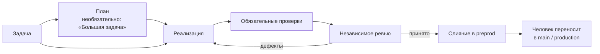

<div align="center">

# Darkfactory

**Self-hosted AI-фабрика разработки: планирует работу, пишет код, запускает обязательные проверки и независимое ревью, а выкладывает только в `preprod`.**

[](../../LICENSE)
[](../../pyproject.toml)
[](../../compose.yaml)
[](https://fastapi.tiangolo.com)
[](https://www.postgresql.org)

[English](../../README.md) · **Русский** · [中文](README.zh.md) · [हिन्दी](README.hi.md) · [Español](README.es.md) · [العربية](README.ar.md) · [Français](README.fr.md) · [বাংলা](README.bn.md) · [Português](README.pt.md) · [日本語](README.ja.md)

</div>

Darkfactory даёт общий интерфейс и API, организации и изолированные проекты, очередь PostgreSQL и отдельный контейнер для каждой задачи. Проверенные изменения автоматически попадают только в `preprod`. Основную ветку и production обновляет человек.

## Почему Darkfactory

- 🏭 **Self-hosted.** Общий интерфейс и API, организации и изолированные проекты, очередь PostgreSQL и отдельный контейнер на каждую задачу.
- 🛡️ **Выкладка только в `preprod`.** Production и основную ветку обновляет человек, а не фабрика.
- ✅ **Обязательные проверки и независимое ревью.** Проверки и ревью привязаны к одному итоговому коммиту. Без настроенных проверок автослияние выключено.
- 🔒 **Изолированные контейнеры задач.** Non-root, read-only root filesystem, ограниченные CPU/RAM/PID, сеть отключена, нет доступа к Docker socket, PostgreSQL, другим проектам и production-секретам.
- 🔀 **Пулы подписок с переключением.** По умолчанию Codex для разработки и Claude для ревью; переключение аккаунтов и движков с учётом квот; платный API только по явному разрешению и с денежным бюджетом.
- 🧠 **Директор фабрики.** Диалог (веб и CLI), который создаёт проекты, роли и задачи и разбирает остановившиеся задачи в рамках прав пользователя.

## Конвейер задачи



По умолчанию задача сразу идёт к одному разработчику, без плана и подзадач. План с блокирующими вопросами остановится до твоего ответа.

## Содержание

- [Запуск](#запуск)
- [Первый проект](#первый-проект)
- [Подключения исполнителей](#подключения-исполнителей)
- [Изоляция и зависимости](#изоляция-и-зависимости)
- [Первичная инициализация существующего проекта](#первичная-инициализация-существующего-проекта)
- [Артефакты проекта](#артефакты-проекта)
- [Роли, делегирование, скиллы и MCP](#роли-делегирование-скиллы-и-mcp)
- [Директор фабрики](#директор-фабрики)
- [Уведомления человеку](#уведомления-человеку)
- [Лимиты и инциденты](#лимиты-и-инциденты)
- [Проверки реализации](#проверки-реализации)
- [Проверка интерфейсов в браузере](#проверка-интерфейсов-в-браузере)
- [API и данные](#api-и-данные)
- [Языки интерфейса](#языки-интерфейса)
- [Лицензия](#лицензия)

## Запуск

Нужен Docker Engine с Docker Compose и поддержкой `volume.subpath`. На macOS подходит Docker Desktop.

> [!IMPORTANT]
> Пароля PostgreSQL по умолчанию нет: без `POSTGRES_PASSWORD` в `.env` Compose не запустится. Установка, созданная раньше, использовала пароль `darkfactory-local`: укажи его в `.env`, затем смени пароль в PostgreSQL (`ALTER USER darkfactory PASSWORD …`) и в `.env`.

Для новой установки из каталога проекта:

```sh
echo "POSTGRES_PASSWORD=$(openssl rand -hex 32)" >> .env
docker compose up -d --build
docker compose exec app cat /data/bootstrap-token
```

Открой [localhost:8080](http://localhost:8080) и вставь токен владельца.

- **Свой токен владельца.** Вместо сгенерированного файла выполни `echo "DARKFACTORY_ADMIN_TOKEN=$(openssl rand -hex 32)" >> .env` до первого запуска.
- **Смена позже.** Новое значение переменной после перезапуска заменяет прежний токен из `.env`. В уже работающей установке переменная добавляется владельцу из `/data/bootstrap-token`. Отозванный токен из `.env` не восстанавливается: задай новое значение.
- **Первичная сборка.** Скачивает Python, Node, PostgreSQL, Codex CLI и Claude Code. Последующие запуски используют собранные образы.

### Сервисы

| Сервис | Назначение |
|---|---|
| `app` | Обслуживает UI/API |
| `worker` | Управляет задачами |
| `db` | Хранит очередь (PostgreSQL) |
| `executor-image` | Собирает образ для временных контейнеров задач |

Docker socket доступен только доверенному worker; задача его не получает.

### Настройки

Настройки Compose задаются через `.env`:

| Переменная | Назначение | По умолчанию |
|---|---|---|
| `PORT` | Публикуемый порт | `8080` (по `compose.yaml`) |
| `BIND_ADDRESS` | Адрес привязки порта | `127.0.0.1` |
| `POSTGRES_PASSWORD` | Пароль PostgreSQL | нет, обязателен |
| `GLOBAL_CONCURRENCY` | Общая параллельность задач | `4` |
| `EXECUTOR_CPUS` | CPU на контейнер задачи | `4` |
| `DATA_VOLUME` | Имя тома `data` | `darkfactory_data` (по `compose.yaml`) |
| `DARKFACTORY_ADMIN_TOKEN` | Токен владельца, заданный самостоятельно | генерируется в `/data/bootstrap-token` |
| `DARKFACTORY_PERSONAL_MODE` | Личный локальный пилот (см. [Подключения исполнителей](#подключения-исполнителей)) | `0` |
| `DARKFACTORY_PUBLIC_URL` | Адрес фабрики в ссылках уведомлений | `http://127.0.0.1:8080` |

> [!WARNING]
> Для доступа сотрудников поставь HTTPS reverse proxy перед приложением. PostgreSQL наружу не публикуется.

## Первый проект

1. Нажми «Подключить проект»: укажи название, Git-репозиторий и при необходимости токен доступа.
2. Менеджер, аналитик, разработчик и ревьюер со стандартными скиллами появятся сразу. Роли наследуют исполнителей проекта: Codex для разработки и Claude для ревью. MCP подключаются отдельно.
3. Подписки подключай в общий пул организации. Если пул уже есть, новый проект использует его; иначе фабрика создаёт «Общий пул». Проекты могут позже выбрать отдельные пулы в настройках.
4. В настройках проекта задай обязательные команды проверок. Без них автоматическое слияние выключено.
5. Создай задачу в UI или через API. План с блокирующими вопросами остановится до твоего ответа.

### Поддерживаемые репозитории

Поддерживаются HTTPS Git, SSH и локальные bare-репозитории в `/repos`. GitHub/GitLab, включая свои домены, получают PR/MR. Для остальных Git создаётся внутренняя запись изменений с diff, проверками и ревью. SSH требует отдельный ключ и явно заданный `known_hosts`; ключи хоста не наследуются.

Для локальных проектов используй общий том `repos`, смонтированный в app и worker как `/repos`. Создать репозиторий можно через `docker compose exec worker sh`; тестовый сценарий [ниже](#проверки-реализации) показывает полный пример. Каталоги хоста в контейнер задачи не монтируются.

### Поведение слияния

- При отсутствии команд проверок задача заканчивается записью изменений и состоянием `review_required`: автослияние запрещено.
- Проверки и ревью привязаны к одному итоговому коммиту.
- Изменение вершины `preprod` запускает повторную интеграцию и приёмку.
- Слияния проекта идут последовательно.

### Роли доступа

| Роль | Может |
|---|---|
| Владелец | Управлять настройками и подключениями |
| Оператор | Управлять задачами |
| Наблюдатель | Читать |

Права участника и токена пересекаются; отзыв прав применяется к последующим запросам. Новая организация получает отдельного владельца и одноразово показанный токен. Владелец выпускает токены участникам в настройках («Доступ к команде») или через `POST /api/members`; участников с ролью `owner` может быть несколько. Свои дополнительные токены выпускает `POST /api/tokens`, отзывает `DELETE /api/tokens/{id}`.

## Подключения исполнителей

| Подключение | Credentials и примечания |
|---|---|
| **Codex для компании** | JSON credentials `{"auth_method":"siwc","accessToken":"..."}`. Используется документированный внешний OAuth provider для App Server. Нужен токен Sign in with ChatGPT с доступом к этому сценарию. Обновление токена выполняется через reconnect. |
| **Claude Code** | `{"oauth_token":"..."}` для разрешённого подписочного подключения. Изолированная сессия получает только выбранный токен; `--bare` не используется. |
| **API** | HTTPS OpenAI-compatible Chat Completions с tool calls. Укажи модель и `{"base_url":"https://example.com/v1","api_key":"...","input_usd_per_million":0.0,"output_usd_per_million":0.0}` с действительными ценами. Для собственного TLS CA доступно поле `ca_cert`. |

### Личный локальный пилот

Для личного локального пилота можно использовать текущий вход `codex login` через ChatGPT.

1. Добавь `DARKFACTORY_PERSONAL_MODE=1` в локальный `.env`.
2. Выполни `docker compose up -d --build`.
3. Запусти на хосте `python3 scripts/connect_personal_codex.py`. Скрипт создаст пул `Personal Codex` и подключение в организации bootstrap-токена.
4. Назначь этот пул проекту; отдельная сессия Codex может также выполнять ревью.

Импортируется только access token и ID аккаунта из `~/.codex/auth.json`; refresh token и каталог хоста в контейнеры не передаются. Токен хранится зашифрованно. После истечения или отзыва токена повтори импорт при свободном подключении. По умолчанию личный режим выключен, а размещаемая или коммерческая установка использует SIWC. Область использования встроенной авторизации описана в [официальной документации App Server](https://learn.chatgpt.com/docs/app-server#auth-endpoints).

Если личный Codex уже работает через локальный шлюз подписки, передай его адрес, доступный из Docker, и настроенную модель:

```sh
python3 scripts/connect_personal_codex.py --base-url http://host.docker.internal:8787/v1 --model ИМЯ_МОДЕЛИ
```

Этот режим принимает только локальные HTTP-адреса и требует `DARKFACTORY_PERSONAL_MODE=1`. Исполнитель подключается к указанному шлюзу через фиксированный туннель и прежний список разрешённых адресов; сеть контейнера остаётся `none`. Платный API этим режимом не включается.

### Пулы и выбор движка

Пулы задают приоритеты, модели, доступные движки, параллельность, число переключений и паузу повторной проверки квоты. Базовый выбор — Codex для разработки и Claude для ревью. Переключение аккаунта и Codex ↔ Claude разрешено; API по умолчанию автоматически не подключается. Для платного fallback владелец явно включает политику проекта, а задача получает денежный бюджет. Явно назначенный API также требует бюджета.

Кнопка **«+ Подписка»** запускает штатный вход Claude через ссылку и одноразовый браузерный код. В персональном режиме доступен Codex device-auth: ссылка и код появляются в той же форме. Выбери пулы перед входом; после подтверждения аккаунт добавится автоматически. Можно закрыть форму и продолжить незавершённый вход из настроек. Вход действует не более 15 минут, поддерживает отмену и выполняется в отдельном контейнере. OAuth-токены не передаются браузеру. Автоматическое обновление истёкших токенов не реализовано; повтори вход или reconnect.

| Значение пула по умолчанию | Величина |
|---|---|
| Сохраняемый резерв | **10%** |
| Наблюдение считается свежим | **300 секунд** |
| Неизвестная квота | допускается |

- Свежая известная квота ниже резерва исключает подписку; среди подходящих аккаунтов выбранного движка преимущество имеет больший подтверждённый остаток.
- Настройки резерва, срока снимка и обязательной известной квоты доступны в форме пула.
- Персональный Codex перепроверяет лимиты перед обращением к модели.
- У провайдеров без доступных данных строгая политика ждёт подтверждённого остатка.
- Лимиты могут измениться во время работы: сохранение кода и передача контекста позволяют продолжить с другим аккаунтом.

При переключении передаются код и артефакты, а не внутренняя сессия аккаунта. Квоты и занятость учитываются по подключению, включая известную общую группу `quota_group`; повторное подключение тех же credentials не создаёт новую квоту. Неизвестный остаток не объявляется безлимитным. Ошибка авторизации требует reconnect, квота — ожидания контрольной проверки.

Если исполнитель сообщает остаток квоты и время сброса, фабрика сохраняет их и показывает в настройках подключений вместе со временем наблюдения. Это последний полученный снимок, а не непрерывный опрос аккаунта. При отсутствии данных отображается «остаток квоты неизвестен». Переподключение с новыми credentials очищает прежний снимок. Время контрольной попытки показывается отдельно от сообщённого провайдером времени сброса.

### Удаление пулов

Пулы можно удалить в настройках или через `DELETE /api/pools/{id}`, в том числе через директора. Удаление доступно владельцу всей организации. Подписки, авторизация и членство в других пулах сохраняются. Если пул назначен проекту, сначала выбери другой пул для разработки и ревью. Незавершённый вход в подписку также нужно завершить или отменить перед удалением.

### Официальные основания

[Codex App Server](https://learn.chatgpt.com/docs/app-server), [внешние токены SIWC](https://developers.openai.com/siwc/token-sharing-open-source/codex-app-server), [Claude Code headless](https://code.claude.com/docs/en/headless).

> [!NOTE]
> Наличие адаптера не подтверждает доступность подписочного сценария для конкретной компании: нужны разрешённые подключения.

## Изоляция и зависимости

Задача получает отдельную рабочую копию и ветку, non-root контейнер, read-only root filesystem, ограниченные CPU/RAM/PID и внутренний дедлайн. `.git` защищён от записи агента. Проверяющий получает рабочую копию только для чтения. Доступа к Docker socket, PostgreSQL, другим проектам и production-секретам нет.

Сеть контейнера отключена. HTTPS доступен через CONNECT proxy только к выбранному провайдеру и явно разрешённым `host:port` проекта. Проверки по умолчанию офлайн. Тестовые секреты передаются отдельно; proxy не открывает произвольный доступ к хосту.

> [!WARNING]
> Production deployment не реализован. Фабрика доставляет изменения только в `preprod`.

### Образ исполнителя и тестовые настройки

Образ содержит Python, Node и Git. Если проекту нужны другие зависимости, собери свой образ от `darkfactory-executor:local`, установи зависимости заранее и укажи `executor_image` в настройках проекта.

- Разрешённые тестовые endpoints и `test_env` настраивает владелец.
- Имена в `test_env` — только `TEST_*`, `APP_*` или `E2E_*`.
- Адреса `allowed_hosts`, Git remote и сервер PR/MR должны быть полными именами.
- Внутренний адрес (loopback, частная сеть, link-local, CGNAT) проходит, только если его точный `ip:port` указан в `allowed_hosts`.

### Связи задач

Связи задач: `depends_on`, родитель → подзадача (`parent`), `related_to`, подтверждённый `duplicate`. Кодовая зависимость ждёт принятого результата в `preprod`; артефактная может принять конкретный проверенный коммит. Циклы и межорганизационные связи запрещены. Родитель ждёт обязательные дочерние задачи и собственную интеграционную проверку.

### Разбиение и ревью

- По умолчанию задача сразу идёт к одному разработчику, без плана и подзадач.
- Ревью возвращает на доработку только за дефекты и невыполненные критерии; улучшения помечаются `[LATER]` и попадают в бэклог.
- Для задачи, помеченной «Большая задача», планировщик может сам создать до восьми подзадач с критериями приёмки и зависимостями.
- Независимые дети получают отдельные рабочие каталоги и могут выполняться параллельно.
- Вложенное автоматическое разбиение запрещено.
- Перед собственной реализацией родитель собирает принятый код детей.
- Время, исправления, переключения и деньги ограничены общим бюджетом дерева; создание детей не умножает лимиты. Параллельные запуски резервируют доли оставшегося времени.
- Отмена родителя отменяет созданных им агентов; отменённые дети не возобновляются автоматически.

### Изменение зависимостей

Принятые SHA зависимостей сохраняются в задаче. Смена SHA или отзыв принятого результата останавливает текущего исполнителя и сбрасывает старые проверки и ревью. После разблокировки задача повторяет сборку входов, реализацию и приёмку, сохраняя рабочий код и накопленные счётчики. Перед слиянием проверка зависимостей и Git-операция выполняются под общим контроллерным замком, чтобы изменение входов не проскочило между ними.

## Первичная инициализация существующего проекта

При добавлении проекта по умолчанию включена **«Первичная индексация и Markdown-документы»**. Фабрика ставит обычную задачу в очередь: сначала сохраняет карту отслеживаемых Git-файлов, затем исполнитель изучает репозиторий и создаёт или дополняет четыре файла:

| Файл | Содержание |
|---|---|
| `docs/darkfactory/INDEX.md` | Карта проекта, точки входа и назначение модулей |
| `docs/darkfactory/ARCHITECTURE.md` | Компоненты, зависимости, данные и границы системы |
| `docs/darkfactory/DEVELOPMENT.md` | Установка, запуск, конфигурация и проверки |
| `docs/darkfactory/CONTRACTS.md` | Найденные API, события и внешние интеграции |

Исходная карта с SHA находится также в артефактах задачи: `repository-index.md`. В ней перечислены первые 1000 отслеживаемых файлов и полное количество. Исполнитель должен подтверждать выводы файлами проекта, сохранять полезную существующую документацию и отмечать неизвестное. Изменения вне четырёх документов запрещены проверкой worker.

Задача использует подключения, лимиты, проверки и независимое ревью проекта. Если подключений ещё нет, она ждёт их настройки. Документы проходят обычный Git-конвейер: при наличии успешных обязательных проверок изменения сливаются в `preprod`; без настроенных проверок остаются на ручное слияние. После ревью все четыре документа появляются в реестре как **черновики**, с задачей-источником и SHA проверенного коммита. Владелец принимает нужные версии явно; существующие принятые версии сохраняются.

Для ранее подключённого проекта открой **«Артефакты проекта» → «Индексировать проект»**. Кнопка доступна владельцу и открывает существующую задачу инициализации, если она уже создана, без дублей. Создание проекта через API принимает `initialize` (по умолчанию `true`); `false` отключает автоматический запуск. Для существующего проекта: `POST /api/projects/{id}/initialize`.

## Артефакты проекта

Открой **«Артефакты проекта»** и добавь требования, аналитику, архитектуру, контракт API, отчёт или другой текстовый документ. У артефакта постоянный ключ в пределах проекта, название и история неизменяемых версий. Содержимое хранится в БД; редактирование создаёт новую версию. Это отдельный реестр знаний проекта, который дополняет рабочие файлы задач (`plan.md`, `diff.patch`, `checks.txt`, `review.txt`, `handoff.md`) и браузерные доказательства.

- Оператор добавляет черновики, владелец принимает выбранную версию или отзывает приёмку, наблюдатель читает.
- Одновременно принята одна версия каждого артефакта.
- При желании укажи задачу-источник: она должна иметь актуальный коммит с независимым ревью. Версия сохраняет ID задачи и SHA; смена результата источника или его входов делает документ устаревшим.
- Обычные документы публикуются через форму или API; инициализация проекта автоматически добавляет свои документы после ревью.

### Артефакты как входы задачи

При создании задачи выбери принятые версии. В карточке остановленной задачи можно добавить, заменить или убрать вход. Задача получает полный текст именно выбранных версий, их ключи, номера и SHA источников. Делегированные подзадачи наследуют эти версии.

| Лимит | Значение |
|---|---|
| Символов в версии | 100 000 |
| Входов на задачу | до 10 |
| Символов суммарно на задачу | 200 000 |

Принятие новой версии не меняет выбор задач автоматически: потребители старой версии ждут явной замены входа. Отзыв приёмки и устаревший источник также блокируют выполнение. Фабрика сбрасывает проверки и ревью прежних входов, останавливает активного исполнителя и проверяет входы повторно перед слиянием. Рабочий код и накопленные счётчики сохраняются. Карточка артефакта показывает историю, задачи-источники и потребителей; прежние версии остаются доступны для чтения.

### API артефактов

| Назначение | Маршруты |
|---|---|
| Артефакты | `GET/POST /api/projects/{id}/artifacts` |
| Версии | `POST /api/project-artifacts/{id}/versions`, `GET /api/project-artifacts/{id}/versions/{version_id}` |
| Приёмка | `POST …/versions/{version_id}/accept`, `POST /api/project-artifacts/{id}/revoke` |
| Входы задачи | `GET /api/tasks/{id}/artifact-inputs`, `PUT/DELETE /api/tasks/{id}/artifact-inputs/{artifact_id}` |
| Создание задачи | принимает `artifact_version_ids` |

Доступ ограничен организацией, проектами пользователя и областью токена; циклы с обычными зависимостями запрещены. Новые таблицы создаются при старте без изменения существующих задач.

## Роли, делегирование, скиллы и MCP

Открой **«Агенты, скиллы и MCP»** в левом меню и выбери проект. Кнопка **«Добавить готовую команду»** устанавливает проектного агента, аналитика, разработчика и ревьюера. Во вкладках **«Роли»**, **«Скиллы»** и **«MCP»** доступны каталоги: добавляй готовые настройки кнопками, подключай скиллы и инструменты к роли через списки. Инструкции, движок и модель можно изменить в карточке роли. Профили также можно назначить отдельной задаче.

### Делегирование

Проектный агент при планировании создаёт подзадачи и назначает им `agent_profile`. Для сценария «анализ → разработка» создай профили `analyst` и `developer`: подзадача разработчика указывает ключ анализа в `depends_on`. Разработчик начнёт работу после проверенного слияния анализа в `preprod` и получит принятый коммит и артефакты. Аналитик сохраняет результат в репозитории. Каждый агент с разрешением делегирования может создавать следующие подзадачи в пределах настроенной глубины и общего количества.

| Значение делегирования по умолчанию | Величина |
|---|---|
| Глубина | 2 |
| Максимум подзадач дерева | 16 |
| Прямых подзадач одного плана | 8 |

Время, исправления и денежный бюджет общие для дерева.

### Каталог

Каталог содержит семь скиллов и четыре MCP: браузер, чтение/поиск файлов проекта, чтение Git status/diff/log и Jira. Первые три работают внутри контейнера задачи и не требуют внешнего сервера.

### MCP Jira

MCP **Jira** (`mcp-atlassian`, установлен в образе исполнителя) читает задачи, JQL-поиск, доски и спринты Jira Server/Data Center или Cloud; инструменты записи выключены и в шлюзе, и в самом сервере (`--read-only`). После добавления из каталога открой его карточку и заполни:

- **Адреса, к которым нужен доступ:** `jira.example.com:443`. Без этого egress задачи не пустит сервер к Jira, в том числе на частный адрес.
- **Секретное окружение:** `JIRA_URL=https://jira.example.com` и `JIRA_PERSONAL_TOKEN=<PAT>` (Jira → Профиль → Personal Access Tokens). Для Jira Cloud вместо PAT — `JIRA_USERNAME` и `JIRA_API_TOKEN`.

Затем подключи `jira` к нужным ролям, например к аналитику и менеджеру. Токену хватит прав сервисного аккаунта на чтение нужных проектов.

### Свой MCP

Для своего MCP доступна расширенная форма: HTTPS endpoint либо команда stdio из образа исполнителя, точные имена разрешённых инструментов и секретные заголовки или окружение. Секреты зашифрованы и не возвращаются в UI/API. Native Codex и Claude получают инструменты через локальный шлюз, который фильтрует список и запрещает вызовы вне разрешённого набора. Планировщик и ревьюер принимают только подключения, помеченные владельцем как доступные для чтения; права самого сервисного аккаунта также должны соответствовать роли. Платный API-адаптер MCP не поддерживает.

## Директор фабрики

Справа открыт диалог **«Директор фабрики»**. Выбери всю фабрику или отдельный проект. Через диалог можно создавать организации, проекты, пулы, роли, скиллы, подключать готовые MCP, ставить задачи и менять доступные настройки. Например: «Добавь проекту аналитика и разработчика, подключи им чтение файлов и Git».

- **«Новый чат»** начинает отдельную историю и контекст. Старые чаты остаются в списке.
- **«Отменить сообщение»** снимает запрос из очереди или останавливает активный исполнитель. Уже начатые действия могут завершиться; их журнал сохраняется. Подписка освобождается после остановки контейнера.

Директор выполняется через **Codex CLI или Claude CLI** из подключённого пула подписок. Он использует те же API и права, что пользователь: оператор не получает права владельца, а доступ к одному проекту не открывает остальные. Платный API для директора автоматически не включается. При занятом пуле запрос остаётся в очереди. При неопределённом результате после перезапуска действия не повторяются вслепую: директор просит проверить состояние.

> [!CAUTION]
> Пароли, ключи и коды входа добавляй через формы подключений. Директор может начать вход и дать ссылку, но не получает токены или device codes. Доступ к созданной организации выдаётся отдельно и однократно через интерфейс.

### Остановки задач

Директор же разбирает задачи, которые остановились и ждут человека: лимит циклов ревью, вопрос разработчика, закрытая сеть, истёкшее время. Он читает код и историю задачи (репозиторий подключён только на чтение) и решает сам: продолжить с указанием, вернуть на повторное ревью, разрешить адрес, отменить. Владельца он зовёт только для доступов, денег, продуктового выбора и разрушительных действий. Пока он думает, задача на доске показывает «Решает директор».

Кнопка **«Решения»** в чате показывает его решения по проекту. Помеченные «Ждёт тебя» нужно решить тебе: ответь директору в чате, например «по задаче … продолжай, используй …», и он сам продолжит или отменит задачу.

В настройках проекта: «Директор решает остановки вместо тебя» и «Решений директора на дерево задач» (по умолчанию 6, переменная `DARKFACTORY_DIRECTOR_LIMIT`). Модель и инструкции директора задаются ролью «Директор» на экране «Роли».

### Директор из терминала

Тот же диалог доступен из терминала:

```sh
uv sync
uv run darkfactory director --token-file /path/to/api-token "Покажи проекты и текущие задачи"
uv run darkfactory director --token-file /path/to/api-token --project PROJECT_ID
```

Без сообщения открывается интерактивный диалог.

| Параметр / переменная | Назначение |
|---|---|
| `--token-file` или `DARKFACTORY_TOKEN` | API-токен (файл или окружение) |
| `--url` или `DARKFACTORY_URL` | Адрес сервера (по умолчанию `http://127.0.0.1:8080`) |
| `--project` | Работа с конкретным проектом |
| `--timeout` | Время ожидания; по умолчанию 600 секунд |
| `--resume MESSAGE_ID` | Ждать тот же запрос без повторной отправки; используй прежние токен и `--project` |
| `--new-chat` | Начать отдельный диалог CLI |
| `--thread CHAT_ID` | Продолжить существующий чат |
| `--cancel MESSAGE_ID` | Отменить сообщение без повторной отправки команды |

Команда также доступна как `python -m darkfactory.cli director`. Если терминал закрыт или ожидание истекло, запрос продолжает работу.

## Уведомления человеку

В настройках добавь канал Rocket.Chat с HTTPS webhook и получателем `@username` или `#channel` либо Telegram с bot token и chat ID. Для Rocket.Chat разреши смену канала во входящем вебхуке. Получателя можно менять без повторного ввода URL. Выбери проект или всю организацию, затем события: вопросы, остановки, ошибки, лимиты, принятие изменений и инциденты. Настройка канала сама сообщений не отправляет. Вопросы агента и остановки конвейера попадают в очередь автоматически. API `POST /api/tasks/{id}/notify` с `{"message":"..."}` позволяет отправить сообщение по настроенным каналам задачи.

Доставка выполняется отдельно от задач, с пятью попытками и задержкой между повторами. Секреты не показываются повторно. После сбоя между отправкой и сохранением подтверждения возможно повторное сообщение. Ответы на вопросы вводятся в карточке задачи или прямо в чате.

### Команды из чата

Команды из чата включает API-токен с ролью оператора в настройках канала: команды выполняются с его правами и областью проектов, поэтому выдай отдельный токен с нужным минимумом. Токен владельца канал не принимает. Без `allowed_senders` командами может пользоваться любой участник чата; со списком `allowed_senders` (Telegram `from.id`, Rocket.Chat `user_id`) — только перечисленные. Отправитель записывается в событие задачи.

- `!director текст` (в Telegram — `/director текст`) передаёт поручение директору, например `!director покажи задачи`. В группах Telegram с privacy mode бот видит только `/director`. Telegram отвечает на сообщение с командой, Rocket.Chat — в треде этого сообщения. Пока директор занят, новая команда получает отказ.
- Ответ на уведомление о вопросе или остановке продолжает задачу с этим текстом, как кнопка «Продолжить» в карточке. В Telegram ответь на сообщение бота или перешли его боту в личный чат с комментарием. В Rocket.Chat ответь в треде уведомления.
- Telegram читается long polling через `getUpdates`, поэтому публичный адрес не нужен; у бота не должно быть webhook. Каналы с одним ботом делят сообщения по chat ID.

### Управление из Telegram

С токеном команд бот Telegram даёт кнопочное меню. `/start` или `меню` открывает его. Экраны обновляются в том же сообщении.

- Проекты → доска с колонками «К запуску», «В работе», «Нужно внимание», «Завершены» → список задач → карточка. В карточке — вопрос агента и кнопки по состоянию задачи.
- «✍️ Ответить» передаёт агенту ответ и продолжает задачу. Кнопки «Ответить» и «Карточка» есть и под каждым уведомлением о задаче.
- Порядок в очереди меняется кнопками «⏫ Выше» и «⏬ Ниже» или «➡️ Переместить» → «В начало» и «В конец»: это приоритет задачи. «Переместить» также возвращает задачу к запуску, сливает её или отменяет; отмена спрашивает подтверждение.
- «➕ Новая задача»: первая строка ответа — название, весь текст — описание.
- «🧠 Директор» передаёт сообщение директору. В личном чате с ботом любой обычный текст тоже идёт директору, ответ на его сообщение продолжает разговор.
- Подписки подключаются только в веб-настройках: чат вход не начинает.

### Настройка команд Rocket.Chat

Создай исходящий вебхук на событие «Сообщение отправлено» в той же комнате, что и входящий. URL: `https://<фабрика>/api/chat-commands/rocketchat/<id канала>` (показан в списке каналов), токен вебхука укажи в настройках канала. Слова-триггеры оставь пустыми, сообщения бота не исключай: по ним фабрика узнаёт, к какой задаче относится тред. Rocket.Chat не пропускает неизвестные слэш-команды, поэтому команды там начинаются с `!`:

- `!director текст` — поручение директору.
- `!projects` — проекты и число задач в каждой колонке доски.
- `!waiting` — задачи, которые ждут ответа или слияния.
- `!task <id>` — карточка задачи.
- `!help` — список команд.

В треде уведомления о задаче обычный текст — ответ агенту, а `!task`, `!resume`, `!merge` и `!cancel` действуют на эту задачу. Уведомления приходят в разметке Rocket.Chat от имени Darkfactory; если задан `DARKFACTORY_PUBLIC_URL`, аватаром служит логотип фабрики.

### Уведомления о слиянии

После проверенного слияния в `preprod` канал получает название задачи и проекта, короткий итог разработчика, SHA и ссылку на принятый коммит. Для GitHub/GitLab ссылка ведёт на страницу коммита; для локального и обычного Git — на авторизованную карточку с diff в фабрике. Неуспешные попытки не отправляют сообщение о выполнении.

Для сотрудников задай доступный им адрес фабрики через `DARKFACTORY_PUBLIC_URL` в `.env`, например `https://factory.company.ru`, затем перезапусти Compose. По умолчанию ссылки используют `http://127.0.0.1:8080`. Токены в ссылки не добавляются; при необходимости потребуется вход.

### Перенос в main

После завершения верхнеуровневой задачи уведомление также содержит ссылку **«Влить в main / отклонить»**. Это предложение слияния внутри фабрики, доступное и для локального Git. Оно фиксирует принятый коммит и показывает полный diff относительно текущей `main` (до 100 000 символов, с отметкой об обрезании). Владелец может влить его или отклонить; GET-ссылка сама ничего не меняет. В перенос входят все изменения `preprod` до указанного коммита, включая подзадачи. Отклонение сохраняет `preprod`.

> [!NOTE]
> Автопереноса в `main` и развёртывания нет; директор не может принять это решение. Если `main` разошлась с принятым коммитом, сначала нужна интеграция и повторные проверки. Старые завершённые задачи автоматически не получают новые предложения.

### Синхронизация main обратно в preprod

Обратное направление автоматическое: раз в час (`DARKFACTORY_MAIN_SYNC_SECONDS`, `0` выключает) фабрика вливает новые коммиты `main` в `preprod` — например, хотфиксы владельца. Если `preprod` не ушла вперёд, она просто догоняет `main`; иначе создаётся merge-коммит. При конфликте появляется задача «Влить main в preprod: конфликт» с начатым слиянием и маркерами в рабочей папке; агент разрешает конфликт, после чего задача проходит обычные ревью и проверки.

## Лимиты и инциденты

### Приоритеты

У задач четыре приоритета: критический (`critical`), высокий (`high`), обычный (`normal`, по умолчанию) и низкий (`low`). Приоритет выбирается при создании и меняется в карточке задачи владельцем или оператором; API: `PUT /api/tasks/{id}/priority` с полем `priority`. Директор может использовать тот же API.

- Сначала выбираются исправления `preprod`, затем готовые задачи по приоритету и времени создания.
- Приоритет не отменяет зависимости, квоты и лимиты и не прерывает уже запущенную работу.
- Подзадачи наследуют приоритет родителя при создании. Старые задачи получают обычный приоритет.

### Значения по умолчанию

| Лимит | По умолчанию |
|---|---|
| Активные задачи | 2 |
| Суммарное активное время задачи | 60 минут |
| Циклы исправлений после первой реализации | 3 |

Ожидания не расходуют активное время. Перезапуск, смена аккаунта и повтор той же поломки сохраняют счётчики. Лимит останавливает задачу до явного решения человека. Отменённые задачи не возобновляются автоматически.

### Инциденты

После слияния и затем периодически worker повторяет проверки `preprod`. Поломка открывает приоритетное исправление, останавливает новые слияния проекта и задачи, зависящие от его сломанного результата. Остальные проекты продолжают работу. Исправление проходит обычные проверки и ревью. Повтор совпадающей диагностики возвращается к прежнему инциденту с прежними лимитами. Отдельно можно сообщить об инциденте из UI/API. Автоматического отката нет.

## Проверки реализации

Текущие результаты и оставшаяся приёмка: [VALIDATION.md](../../VALIDATION.md).

```sh
uv sync --extra dev
uv run pytest -q
uv run ruff check darkfactory tests scripts
node --check darkfactory/static/app.js
docker compose exec -T worker python - < scripts/docker_smoke.py
```

Docker smoke создаёт отдельную организацию, два настоящих локальных bare Git-репозитория и 13 задач (10 исправлений, 3 функции). Проходят настоящие PostgreSQL, очередь, контейнеры, Git, проверки, независимые сессии ревью и слияния. Вместо платной модели используется отдельный детерминированный HTTPS fixture. Это проверка инфраструктуры, а не доказательство качества реальных моделей или работы пользовательских подписок. Продуктовый API не содержит тестового исполнителя.

Для проверки SSH собери отдельный тестовый OpenSSH-сервер и включи режим `SMOKE_SSH`:

```sh
docker build -t darkfactory-smoke-ssh:local - < scripts/ssh-git.Dockerfile
docker compose exec -T -e SMOKE_SSH=1 worker python - < scripts/docker_smoke.py
```

В этом режиме второй проект проходит весь конвейер через SSH. Дополнительно проверяется отказ при неверном ключе сервера и неверном ключе клиента. Тестовый сервер не публикует порты хоста и удаляется при завершении, включая ошибку. После успешного прогона периодические проверки его проекта отключаются; репозитории и результаты остаются в томах для просмотра.

## Проверка интерфейсов в браузере

В образе исполнителя установлены Chromium, Playwright Test и Playwright MCP. Добавь разработчику готовый скилл **«Проверка интерфейса в браузере»** (`browser-testing`) и MCP `project-browser` из каталога. Браузер работает внутри изолированного контейнера задачи; локальное приложение запускается там же. Для проектов с UI задай обязательную команду Playwright в проверках проекта. Скилл и MCP помогают агенту исследовать интерфейс; именно обязательная проверка блокирует слияние при ошибке.

Сохраняй скриншоты, JSON-отчёты и trace в `/run/evidence` (переменная `DARKFACTORY_EVIDENCE_DIR`). В карточке задачи кнопка **«Браузерные проверки»** открывает список артефактов и предпросмотр изображений. Остальные файлы скачиваются; HTML-отчёты не исполняются внутри фабрики. История разделена по запускам и ролям. Эти файлы дополняют обязательные проверки и ревью; скриншот сам по себе не подтверждает корректность.

### Живой браузерный пилот

Реальный браузерный пилот создаёт отдельный локальный Git-проект с ошибками в форме и мобильной вёрстке. Проверки должны сначала упасть, затем Codex исправляет страницу, независимая сессия проверяет результат, а принятый preprod повторно проходит восемь браузерных сценариев. Скрипт сохраняет checkpoint и продолжает ту же задачу при повторном запуске:

```sh
docker compose exec -T -e CODEX_CONNECTION_ID=<id-подключения> worker python - < scripts/live_browser_smoke.py
```

## API и данные

Спецификация доступна в [Swagger UI](http://localhost:8080/docs). Все `/api/*` запросы требуют `Authorization: Bearer <token>`.

| Главные ресурсы |
|---|
| `/api/projects` |
| `/api/projects/{id}/tasks` |
| `/api/tasks/{id}` |
| `/api/pools` |
| `/api/connections` |
| `/api/members` |
| `/api/tokens` |
| `/api/organizations` |

Создание задачи поддерживает `idempotency_key`. Артефакты и история доступны в карточке задачи.

### Хранение и резервные копии

Состояние хранится в именованных томах PostgreSQL, `data` и `repos`. В `data` находятся зашифрованные подключения, ключ шифрования, Git-копии и артефакты.

> [!WARNING]
> Резервируй PostgreSQL и оба файловых тома согласованно; потеря ключа делает credentials невосстановимыми. Bootstrap-токен показывается командой выше; токены участников выдаются один раз, в БД хранятся только хеши.

### Обновление

Обновление: `docker compose up -d --build`. Чтобы задачи не ждали, пока старый worker доделает текущие шаги, обновляй worker через `scripts/deploy-worker.sh`: новый worker сразу берёт работу, старый доделывает начатое и останавливается. Текущие миграции добавляют недостающие столбцы и сохраняют существующие данные. Для отката верни предыдущий код/образы и перезапусти сервисы: добавленные столбцы можно оставить. Не удаляй тома при обычном обновлении.

## Языки интерфейса

Веб-интерфейс поставляется на 10 языках: English, 中文, हिन्दी, Español, العربية, Français, বাংলা, Português, Русский, 日本語. Он выбирает язык браузера, а при отсутствии перевода использует English. Переключатель находится на карточке входа и в нижней части боковой панели. Выбор хранится в `localStorage` под ключом `df-lang`.

> [!NOTE]
> Сообщения, которые формирует сервер (события задач, причины), остаются на русском.

**Для контрибьюторов**

- Строки интерфейса — русские исходные ключи, обёрнутые в `tr()` в `darkfactory/static/*.js`.
- Переводы лежат в `darkfactory/static/locales/<code>.json`.
- `python scripts/i18n_check.py` сообщает о необёрнутых строках, отсутствующих ключах и несовпадении плейсхолдеров.

## Лицензия

Darkfactory распространяется по [лицензии MIT](../../LICENSE).
