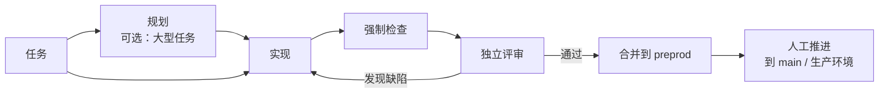

<div align="center">

# Darkfactory

**自托管的 AI 软件工厂：规划工作、编写代码、运行强制检查和独立评审，并且只交付到 `preprod`。**

[](../../LICENSE)
[](../../pyproject.toml)
[](../../compose.yaml)
[](https://fastapi.tiangolo.com)
[](https://www.postgresql.org)

[English](../../README.md) · [Русский](README.ru.md) · **中文** · [हिन्दी](README.hi.md) · [Español](README.es.md) · [العربية](README.ar.md) · [Français](README.fr.md) · [বাংলা](README.bn.md) · [Português](README.pt.md) · [日本語](README.ja.md)

</div>

Darkfactory 提供统一的 UI 和 API、拥有隔离项目的组织、基于 PostgreSQL 的队列，以及为每个任务单独启动的容器。经过验证的变更只会自动合并到 `preprod`。主分支和生产环境由人工更新。

## 为什么选择 Darkfactory

- 🏭 **自托管。** 一套 UI 和 API、组织与隔离的项目、PostgreSQL 队列，以及每个任务专属的容器。
- 🛡️ **只交付到 `preprod`。** 生产环境和主分支由人工更新，工厂从不触碰。
- ✅ **强制检查与独立评审。** 检查和评审都绑定到同一个最终提交。未配置检查时，自动合并处于关闭状态。
- 🔒 **隔离的任务容器。** 非 root 用户、只读根文件系统、限制 CPU/内存/PID、网络禁用，无法访问 Docker socket、PostgreSQL、其他项目或生产密钥。
- 🔀 **带回退的订阅池。** 默认由 Codex 负责开发、Claude 负责评审；支持感知配额的账号和引擎切换；仅在明确启用并设置金额预算后才使用付费 API。
- 🧠 **Factory Director。** 一个对话入口（Web 和 CLI），可创建项目、角色和任务，并在用户自身权限范围内处理停滞的任务。

## 任务流水线



默认情况下，任务直接交给单个开发者，没有规划也没有子任务。带有阻塞性问题的规划会暂停，直到你回答。

## 目录

- [快速开始](#快速开始)
- [第一个项目](#第一个项目)
- [执行器连接](#执行器连接)
- [隔离与依赖](#隔离与依赖)
- [初始化现有项目](#初始化现有项目)
- [项目工件](#项目工件)
- [角色、委派、技能与 MCP](#角色委派技能与-mcp)
- [Factory Director](#factory-director)
- [人工通知](#人工通知)
- [限制与事件](#限制与事件)
- [实现验证](#实现验证)
- [浏览器 UI 测试](#浏览器-ui-测试)
- [测试环境与 GitLab 部署](#测试环境与-gitlab-部署)
- [计划任务](#计划任务)
- [API 与数据](#api-与数据)
- [界面语言](#界面语言)
- [许可证](#许可证)

## 快速开始

你需要安装带 Docker Compose 的 Docker Engine，并且支持 `volume.subpath`。在 macOS 上可以使用 Docker Desktop。

> [!IMPORTANT]
> PostgreSQL 没有默认密码：如果 `.env` 中没有 `POSTGRES_PASSWORD`，Compose 将无法启动。更早创建的安装使用的密码是 `darkfactory-local`：请把它写入 `.env`，然后在 PostgreSQL（`ALTER USER darkfactory PASSWORD …`）和 `.env` 中修改密码。

全新安装时，在项目目录中执行：

```sh
echo "POSTGRES_PASSWORD=$(openssl rand -hex 32)" >> .env
docker compose up -d --build
docker compose exec app cat /data/bootstrap-token
```

打开 [localhost:8080](http://localhost:8080) 并粘贴 owner 令牌。

- **自行设置 owner 令牌。** 如果不想使用生成的文件，请在首次启动前运行 `echo "DARKFACTORY_ADMIN_TOKEN=$(openssl rand -hex 32)" >> .env`。
- **之后修改。** 重启后，该变量的新值会替换 `.env` 中之前的令牌。在已运行的安装中，该变量会被添加到来自 `/data/bootstrap-token` 的 owner 上。已被吊销的 `.env` 令牌不会恢复：请设置新值。
- **首次构建。** 会下载 Python、Node、PostgreSQL、Codex CLI 和 Claude Code。之后的启动使用已构建的镜像。

### 服务

| 服务 | 用途 |
|---|---|
| `app` | 提供 UI 和 API |
| `worker` | 管理任务 |
| `db` | 存储队列（PostgreSQL） |
| `executor-image` | 构建临时任务容器所用的镜像 |

Docker socket 只对受信任的 worker 开放；任务拿不到它。

### 配置

Compose 的设置从 `.env` 读取：

| 变量 | 含义 | 默认值 |
|---|---|---|
| `PORT` | 对外发布的端口 | `8080`（按 `compose.yaml`） |
| `BIND_ADDRESS` | 端口绑定的地址 | `127.0.0.1` |
| `POSTGRES_PASSWORD` | PostgreSQL 密码 | 无，必填 |
| `GLOBAL_CONCURRENCY` | 全局任务并发数 | `4` |
| `EXECUTOR_CPUS` | 每个任务容器的 CPU 数 | `4` |
| `DATA_VOLUME` | `data` 卷的名称 | `darkfactory_data`（按 `compose.yaml`） |
| `DARKFACTORY_ADMIN_TOKEN` | 你自行选择的 owner 令牌 | 生成到 `/data/bootstrap-token` |
| `DARKFACTORY_PERSONAL_MODE` | 个人本地试用模式（见[执行器连接](#执行器连接)） | `0` |
| `DARKFACTORY_PUBLIC_URL` | 通知链接中使用的工厂地址 | `http://127.0.0.1:8080` |
| `DARKFACTORY_DIRECTOR_MODEL_CLAUDE`、`DARKFACTORY_DIRECTOR_MODEL_CODEX` | 在对应提供方的订阅上用于 Director 聊天的模型，例如比智能体所用更轻量的模型。项目中带模型的 Director 配置优先。设置 Claude 变量后，Director 会先尝试 Claude 订阅 | 空：使用连接的模型 |

> [!WARNING]
> 如需让员工访问，请在应用前放置 HTTPS 反向代理。PostgreSQL 不对外发布。

## 第一个项目

1. 点击 **“连接项目”**，输入名称、Git 仓库，必要时输入访问令牌。
2. 带有标准技能的经理、分析师、开发者和评审者会立即出现。角色继承项目的执行器：Codex 负责开发，Claude 负责评审。MCP 服务器需单独连接。
3. 将订阅连接到组织的共享池。如果已有池，新项目会使用它；否则工厂会创建一个“共享池”。项目之后可以在设置中选择专用池。
4. 在项目设置中定义强制检查命令。没有这些命令时，自动合并处于关闭状态。
5. 在 UI 中或通过 API 创建任务。带有阻塞性问题的规划会暂停，直到你回答。

### 支持的仓库

支持 HTTPS Git、SSH，以及 `/repos` 中的本地 bare 仓库。GitHub 和 GitLab（包括自托管域名）会生成 PR/MR。对于任何其他 Git，工厂会创建内部变更记录，其中包含 diff、检查结果和评审。SSH 需要专用密钥和显式设置的 `known_hosts`；不会继承主机密钥。

本地项目请使用共享的 `repos` 卷，它以 `/repos` 挂载到 app 和 worker。你可以通过 `docker compose exec worker sh` 创建仓库；[下文](#实现验证)的测试场景给出了完整示例。主机目录不会挂载到任务容器中。

### 合并行为

- 未配置检查时，任务以变更记录和 `review_required` 状态结束：禁止自动合并。
- 检查和评审都绑定到同一个最终提交。
- `preprod` 顶端发生变化会触发重新集成和验收。
- 项目的合并按顺序执行。

### 访问角色

| 角色 | 权限 |
|---|---|
| Owner | 管理设置和连接 |
| Operator | 管理任务 |
| Observer | 只读 |

成员权限与令牌权限取交集；撤销权限会作用于后续的请求。新组织会获得自己的 owner 和一次性显示的令牌。Owner 在设置（“团队访问”）中或通过 `POST /api/members` 签发成员令牌；可以有多个角色为 `owner` 的成员。你自己的额外令牌通过 `POST /api/tokens` 签发，并通过 `DELETE /api/tokens/{id}` 吊销。

## 执行器连接

| 连接 | 凭据与说明 |
|---|---|
| **Codex for company** | JSON 凭据 `{"auth_method":"siwc","accessToken":"..."}`。使用 App Server 文档中说明的外部 OAuth 提供方。需要具备该场景访问权限的 Sign in with ChatGPT 令牌。通过重新连接来刷新令牌。 |
| **Claude Code** | 用于受许可订阅连接的 `{"oauth_token":"..."}`。隔离的会话只会收到所选的令牌；不使用 `--bare`。 |
| **API** | 支持工具调用的 HTTPS OpenAI 兼容 Chat Completions。指定模型和 `{"base_url":"https://example.com/v1","api_key":"...","input_usd_per_million":0.0,"output_usd_per_million":0.0}`，并填入真实价格。自定义 TLS CA 可使用 `ca_cert` 字段。 |

### 个人本地试用

个人本地试用可以使用当前通过 ChatGPT 完成的 `codex login`。

1. 在本地 `.env` 中添加 `DARKFACTORY_PERSONAL_MODE=1`。
2. 运行 `docker compose up -d --build`。
3. 在主机上运行 `python3 scripts/connect_personal_codex.py`。脚本会在 bootstrap 令牌所属的组织中创建 `Personal Codex` 池和一个连接。
4. 将该池分配给项目；另一个独立的 Codex 会话也可以执行评审。

没有网关时，Codex 发往 ChatGPT 的每个请求（后端和模型调用，`openai_base_url`）都经过执行器中的 loopback 中继，由它补上真实令牌。当前模型需要 Codex 0.160 或更高版本，而它只通过 HTTPS 访问 ChatGPT 后端，因此中继提供由一次性 CA 签发的证书，只有该 Codex 信任这个 CA（`CODEX_CA_CERTIFICATE`）。只会导入 `~/.codex/auth.json` 中的访问令牌和账号 ID；刷新令牌和主机目录不会传入容器。令牌以加密方式存储。令牌过期或被吊销后，请在连接空闲时重新导入。个人模式默认关闭，托管或商业安装使用 SIWC。内置授权的范围见[官方 App Server 文档](https://learn.chatgpt.com/docs/app-server#auth-endpoints)。

如果你的个人 Codex 已经通过本地订阅网关工作，请传入 Docker 可访问的网关地址和已配置的模型：

```sh
python3 scripts/connect_personal_codex.py --base-url http://host.docker.internal:8787/v1 --model MODEL_NAME
```

此模式只接受本地 HTTP 地址，并且需要 `DARKFACTORY_PERSONAL_MODE=1`。执行器通过固定隧道和现有的地址白名单连接到指定网关；容器网络保持为 `none`。此模式不会启用付费 API。

### 池与引擎选择

池定义优先级、模型、可用引擎、并发数、切换次数，以及重新检查配额前的暂停时间。基线选择是 Codex 负责开发、Claude 负责评审。允许切换账号，也允许在 Codex ↔ Claude 之间切换；默认不会自动连接 API。对于付费回退，owner 需要显式启用项目策略，任务才会获得金额预算。显式分配的 API 同样需要预算。

**“+ 订阅”** 按钮会通过链接和一次性浏览器验证码启动标准的 Claude 登录。在个人模式下可使用 Codex device-auth：链接和验证码显示在同一个表单中。请在登录前选择池；确认后账号会自动添加。你可以关闭表单，并在设置中恢复未完成的登录。登录最长有效 15 分钟，可以取消，并在单独的容器中运行。OAuth 令牌绝不会传给浏览器。尚未实现过期令牌的自动刷新；请重新登录或重新连接。

| 池默认值 | 取值 |
|---|---|
| 保留余量 | **10%** |
| 观测数据视为有效的时长 | **300 秒** |
| 未知配额 | 允许 |

- 新鲜且已知的配额低于保留余量时，该订阅会被排除。在所选引擎的合适账号中，优先选择已确认剩余量更大的账号。
- 保留余量、快照时效和“需要已知配额”的设置位于池表单中。
- 个人 Codex 在调用模型前会重新检查限额。
- 对于没有可用数据的提供方，严格策略会等待已确认的剩余量。
- 限额可能在工作过程中变化：保存代码并移交上下文后，工作可以用另一个账号继续。

切换时移交的是代码和工件，而不是账号的内部会话。配额和占用按连接统计，包括已知的共享 `quota_group`；用相同凭据重新连接不会产生新的配额。未知的剩余量绝不会被当作无限。授权错误需要重新连接；配额错误需要等待控制检查。

当执行器报告其剩余配额和重置时间时，工厂会保存这些数据，并连同观测时间一起显示在连接设置中。这是最后一次收到的快照，而不是对账号的持续轮询。没有数据时会显示“剩余配额未知”。使用新凭据重新连接会清除之前的快照。控制尝试的时间与提供方报告的重置时间分开显示。

### 删除池

可以在设置中或通过 `DELETE /api/pools/{id}` 删除池，包括通过 Director 删除。删除权限属于整个组织的 owner。订阅、授权以及在其他池中的成员关系都会保留。如果该池已分配给项目，请先为开发和评审选择另一个池。未完成的订阅登录也必须先完成或取消，才能删除。

### 官方依据

[Codex App Server](https://learn.chatgpt.com/docs/app-server)、[SIWC external tokens](https://developers.openai.com/siwc/token-sharing-open-source/codex-app-server)、[Claude Code headless](https://code.claude.com/docs/en/headless)。

> [!NOTE]
> 存在适配器并不能证明订阅场景对某家公司可用：你需要获得许可的连接。

## 隔离与依赖

每个任务都有自己的工作副本和分支、非 root 容器、只读根文件系统、受限的 CPU/内存/PID 以及内部截止时间。`.git` 对智能体是写保护的。验证器获得的是只读工作副本。任务无法访问 Docker socket、PostgreSQL、其他项目或生产密钥。

容器网络处于禁用状态。HTTPS 通过 CONNECT 代理提供，只能访问所选提供方和项目明确允许的 `host:port` 条目。检查默认离线运行。测试密钥单独传递；代理不会开放对任意主机的访问。

> [!WARNING]
> 工厂只合并到 `preprod`。只有在所有者合并到 `main` 之后，才会通过项目自己的 GitLab 任务执行部署（[测试环境与 GitLab 部署](#测试环境与-gitlab-部署)）。

### 执行器镜像与测试设置

镜像包含 Python、Node 和 Git。如果项目需要其他依赖，请基于 `darkfactory-executor:local` 构建你自己的镜像，提前安装依赖，并在项目设置中设置 `executor_image`。

- Owner 配置允许的测试端点和 `test_env`。
- `test_env` 中的名称只能是 `TEST_*`、`APP_*` 或 `E2E_*`。
- `allowed_hosts`、Git 远程仓库和 PR/MR 服务器必须使用完全限定名称。
- 内部地址（回环、私有网络、链路本地、CGNAT）只有在其精确的 `ip:port` 列在 `allowed_hosts` 中时才会被接受。

### 任务关系

任务关系包括：`depends_on`、父任务 → 子任务（`parent`）、`related_to`，以及已确认的 `duplicate`。代码依赖会等待 `preprod` 中已验收的结果；工件依赖可以接受某个特定的已验证提交。禁止循环和跨组织关系。父任务会等待其强制子任务和自己的集成检查。

### 拆解与评审

- 默认情况下，任务直接交给单个开发者，没有规划也没有子任务。
- 评审只因缺陷和未满足的标准而退回工作；改进建议会标记为 `[LATER]` 并进入待办列表。
- 对于标记为“大型任务”的任务，规划者可以自行创建最多八个带验收标准和依赖关系的子任务。
- 相互独立的子任务获得各自的工作目录，可以并行运行。
- 禁止嵌套的自动拆解。
- 父任务在自己实现之前，会先收集其子任务已验收的代码。
- 时间、修复次数、切换次数和金额由整棵任务树共享同一个预算；创建子任务不会让限额成倍增加。并行运行会预留剩余时间的份额。
- 取消父任务会取消它创建的智能体；已取消的子任务不会自动恢复。

### 依赖变更

已验收的依赖 SHA 保存在任务中。SHA 变更或已验收结果被吊销，会停止当前执行器并重置旧的检查和评审。解除阻塞后，任务会重新执行输入组装、实现和验收，同时保留已有的工作代码和累计的计数器。合并之前，依赖检查和 Git 操作在共享的控制器锁下运行，因此输入变更不会在两者之间插入。

## 初始化现有项目

添加项目时，**“初始索引和 Markdown 文档”** 默认开启。工厂会排入一个常规任务：先保存受跟踪 Git 文件的地图，然后执行器研究仓库，并创建或扩充四个文件：

| 文件 | 内容 |
|---|---|
| `docs/darkfactory/INDEX.md` | 项目地图、入口点和各模块的用途 |
| `docs/darkfactory/ARCHITECTURE.md` | 组件、依赖、数据和系统边界 |
| `docs/darkfactory/DEVELOPMENT.md` | 安装、运行、配置和检查 |
| `docs/darkfactory/CONTRACTS.md` | 已发现的 API、事件和外部集成 |

带有 SHA 的源码地图也在任务工件中：`repository-index.md`。它列出前 1000 个受跟踪文件以及完整数量。执行器必须用项目文件来支撑结论，保留有用的现有文档，并标出未知内容。对这四个文档之外的文件的更改会被 worker 检查拒绝。

该任务使用项目的连接、限制、检查和独立评审。如果还没有连接，它会等待连接配置完成。这些文档走常规 Git 流水线：强制检查成功时，变更合并到 `preprod`；未配置检查时，则留待手动合并。评审之后，四个文档都会以**草稿**形式出现在注册表中，并附带来源任务和已验证提交的 SHA。Owner 显式接受他们想要的版本；已有的已接受版本会保留。

对于之前已连接的项目，请打开 **“项目工件” → “为项目建立索引”**。该按钮对 owner 可用；如果初始化任务已经创建，它会打开现有任务，不会产生重复。通过 API 创建项目时接受 `initialize`（默认 `true`）；`false` 会禁用自动启动。对已有项目：`POST /api/projects/{id}/initialize`。

## 项目工件

打开 **“项目工件”**，添加需求、分析、架构、API 契约、报告或任何其他文本文档。工件在项目内有稳定的键、标题和不可变版本的历史。内容存储在数据库中；编辑会创建新版本。这是一个独立的项目知识注册表，对任务的工作文件（`plan.md`、`diff.patch`、`checks.txt`、`review.txt`、`handoff.md`）和浏览器证据形成补充。

- Operator 添加草稿，owner 接受所选版本或撤销接受，observer 只读。
- 每个工件同一时间有且仅有一个版本处于已接受状态。
- 可以选择指定来源任务：它必须有当前提交并经过独立评审。版本会保存任务 ID 和 SHA；来源的结果或其输入发生变化，会使文档过期。
- 常规文档通过表单或 API 发布；项目初始化会在评审之后自动添加它自己的文档。

### 将工件用作任务输入

创建任务时，选择已接受的版本。在已停止任务的卡片中，可以添加、替换或移除输入。任务会收到所选版本的完整文本、它们的键、编号和来源 SHA。委派的子任务继承这些版本。

| 限制 | 取值 |
|---|---|
| 每个版本的字符数 | 100,000 |
| 每个任务的输入数 | 最多 10 个 |
| 每个任务的字符总数 | 200,000 |

接受新版本不会自动更改任务的选择：旧版本的使用者会等待显式的输入替换。被撤销的接受和过期的来源同样会阻止执行。工厂会重置之前输入对应的检查和评审，停止活动的执行器，并在合并前重新验证输入。工作代码和累计的计数器会保留。工件卡片显示历史、来源任务和使用者；早期版本仍然可读。

### 工件 API

| 用途 | 路由 |
|---|---|
| 工件 | `GET/POST /api/projects/{id}/artifacts` |
| 版本 | `POST /api/project-artifacts/{id}/versions`、`GET /api/project-artifacts/{id}/versions/{version_id}` |
| 接受 | `POST …/versions/{version_id}/accept`、`POST /api/project-artifacts/{id}/revoke` |
| 任务输入 | `GET /api/tasks/{id}/artifact-inputs`、`PUT/DELETE /api/tasks/{id}/artifact-inputs/{artifact_id}` |
| 创建任务 | 接受 `artifact_version_ids` |

访问受组织、用户的项目和令牌范围限制；禁止与常规依赖形成循环。新表在启动时创建，不会改动现有任务。

## 角色、委派、技能与 MCP

在左侧菜单中打开 **“智能体、技能与 MCP”** 并选择一个项目。**“添加现成团队”** 按钮会安装项目智能体、分析师、开发者和评审者。**“角色”**、**“技能”** 和 **“MCP”** 标签页提供目录：用按钮添加现成的配置，并通过列表为角色关联技能和工具。可以在角色卡片中修改指令、引擎和模型。配置档案也可以分配给单个任务。

### 委派

规划期间，项目智能体会创建子任务，并为它们分配 `agent_profile`。对于“分析 → 开发”的场景，请创建 `analyst` 和 `developer` 配置档案：开发者子任务在 `depends_on` 中列出分析任务的键。开发者在分析结果经验证后合并到 `preprod` 之后启动，并获得已接受的提交和工件。分析师把结果保存到仓库中。每个拥有委派权限的智能体都可以在配置的深度和总数范围内继续创建子任务。

| 委派默认值 | 取值 |
|---|---|
| 深度 | 2 |
| 每棵树的最大子任务数 | 16 |
| 每个规划的直接子任务数 | 8 |

时间、修复次数和金额预算由整棵树共享。

### 目录

目录包含七个技能和四个 MCP 服务器：浏览器、项目文件读取/搜索、Git status/diff/log 读取，以及 Jira。前三个在任务容器内运行，不需要外部服务器。

### Jira MCP

**Jira** MCP（`mcp-atlassian`，安装在执行器镜像中）可读取 Jira Server/Data Center 或 Cloud 的工单、JQL 搜索、看板和冲刺。写入工具在网关和服务器自身（`--read-only`）中都已禁用。从目录添加后，打开它的卡片并填写：

- **需要访问的地址：** `jira.example.com:443`。没有这一项，任务的出站网络不会让服务器访问 Jira，包括私有地址。
- **密钥环境变量：** `JIRA_URL=https://jira.example.com` 和 `JIRA_PERSONAL_TOKEN=<PAT>`（Jira → Profile → Personal Access Tokens）。对于 Jira Cloud，请改用 `JIRA_USERNAME` 和 `JIRA_API_TOKEN`，而不是 PAT。

然后把 `jira` 关联到需要它的角色，例如分析师和经理。服务账号只需要相关项目的读取权限。

### 自定义 MCP

自带 MCP 提供高级表单：HTTPS 端点或执行器镜像中的 stdio 命令、允许使用的工具的确切名称，以及密钥请求头或环境变量。密钥会加密，绝不会通过 UI/API 返回。原生的 Codex 和 Claude 通过本地网关获得工具，网关会过滤列表，并禁止调用允许集合之外的工具。规划者和评审者只接受 owner 标记为读安全的连接；服务账号自身的权限也必须与角色相符。付费 API 适配器不支持 MCP。

## Factory Director

右侧打开的是 **“Factory Director”** 对话。可以选择整个工厂或单个项目。通过该对话可以创建组织、项目、池、角色和技能，连接现成的 MCP 服务器，创建任务，并更改可用的设置。例如：“给项目添加一个分析师和一个开发者，让他们拥有文件和 Git 的读取权限”。

- **“新对话”** 会开启独立的历史和上下文。旧对话保留在列表中。
- **“取消消息”** 会把请求从队列中移除，或停止活动的执行器。已经开始的操作可能会完成；其日志会保留。订阅会在容器停止后释放。

Director 通过已连接订阅池中的 **Codex CLI 或 Claude CLI** 运行。它使用与用户相同的 API 和权限：operator 不会获得 owner 权限，对一个项目的访问也不会打开其他项目。付费 API 不会自动为 Director 启用。池繁忙时，请求会留在队列中。如果重启后结果不确定，不会盲目重复操作：Director 会请你检查状态。

> [!CAUTION]
> 请通过连接表单添加密码、密钥和登录验证码。Director 可以发起登录并给出链接，但它永远不会收到令牌或设备码。对已创建组织的访问权限会通过界面单独且仅一次地发放。

### 停滞的任务

Director 还会处理已停止并等待人工的任务：评审循环达到上限、开发者的提问、网络被关闭、时间到期。它会读取代码和任务历史（仓库以只读方式连接），并自行决定：按指导继续、退回重新评审、放行某个地址、取消。只有在涉及访问权限、金额、产品选择和破坏性操作时，它才会呼叫 owner。在它思考期间，看板上的任务显示“Director 决策中”。

聊天中的 **“决策”** 按钮会显示它为该项目做出的决策。标记为“等你处理”的需要你来决定：在聊天中回复 Director，例如“任务 … 继续，使用 …”，它会自行继续或取消该任务。

项目设置：“由 Director 代替你处理停止”和“每棵任务树的 Director 决策数”（默认 6，变量 `DARKFACTORY_DIRECTOR_LIMIT`）。Director 的模型和指令由“角色”界面中的“Director”角色设置。

### 通过终端使用 Director

同样的对话也可以在终端中使用：

```sh
uv sync
uv run darkfactory director --token-file /path/to/api-token "Покажи проекты и текущие задачи"
uv run darkfactory director --token-file /path/to/api-token --project PROJECT_ID
```

不带消息时，会打开交互式对话。

| 选项 / 变量 | 用途 |
|---|---|
| `--token-file` 或 `DARKFACTORY_TOKEN` | API 令牌（文件或环境变量） |
| `--url` 或 `DARKFACTORY_URL` | 服务器地址（默认 `http://127.0.0.1:8080`） |
| `--project` | 在指定项目上工作 |
| `--timeout` | 等待时间；默认 600 秒 |
| `--resume MESSAGE_ID` | 等待同一个请求而不重新发送；使用之前的令牌和 `--project` |
| `--new-chat` | 开启独立的 CLI 对话 |
| `--thread CHAT_ID` | 继续已有的对话 |
| `--cancel MESSAGE_ID` | 取消消息而不重新发送命令 |

该命令也可以通过 `python -m darkfactory.cli director` 使用。如果终端关闭或等待超时，请求会继续运行。

## 人工通知

在设置中添加 Rocket.Chat 渠道（需要 HTTPS webhook 和可选的接收者 `@username` 或 `#channel`），或添加 Telegram（需要机器人令牌和聊天 ID）。Rocket.Chat 的接收者需要在 incoming webhook 中允许覆盖渠道（见下文）。更改接收者时无需重新输入 URL。选择一个项目或整个组织，然后选择事件：提问、停止、错误、限额、已接受的变更和事件。仅仅设置渠道不会发送任何消息。智能体的提问和流水线的停止会自动进入队列。API `POST /api/tasks/{id}/notify` 配合 `{"message":"..."}` 会向任务已配置的渠道发送消息。

投递与任务分开运行，最多尝试五次，重试之间有延迟。密钥不会再次显示。如果在发送和保存确认之间发生故障，可能会出现重复消息。对提问的回答在任务卡片中或直接在聊天中输入。

### 聊天命令

聊天命令通过渠道设置中具有 operator 角色的 API 令牌启用：命令以该令牌的权限和项目范围执行，因此请签发一个权限最小的专用令牌。渠道不接受 owner 令牌。未设置 `allowed_senders` 时，任何聊天成员都可以使用命令；设置了 `allowed_senders` 列表（Telegram `from.id`、Rocket.Chat `user_id`）后，只有列表中的人可以。发送者会记录在任务事件中。

- `!director text`（或 `/director text`）把任务交给 Director，例如 `!director 显示任务`。在开启隐私模式的 Telegram 群组中，机器人只能看到 `/director`。Telegram 会回复带有命令的那条消息，Rocket.Chat 在该消息的线程中回复。Director 忙碌时，新命令会被拒绝。
- 对提问或停止通知的回复会用这段文本继续任务，就像卡片中的“继续”按钮。在 Telegram 中，请回复机器人的消息，或在与机器人的私聊中附加评论后转发给它。在 Rocket.Chat 中，请在通知的线程中回复。
- Telegram 通过 `getUpdates` 以长轮询方式读取，因此不需要公网地址；机器人不能设置 webhook。共用同一个机器人的渠道按聊天 ID 分流消息。

### 通过 Telegram 管理

有了命令令牌，Telegram 机器人会提供按钮菜单。`/start` 或 `меню` 可打开它。各个界面在同一条消息中更新。

- 项目 → 带有“待运行”“进行中”“需要关注”“已完成”列的看板 → 任务列表 → 卡片。卡片显示智能体的提问以及与任务状态对应的按钮。
- “✍️ 回复”会把答案传给智能体并继续任务。每条任务通知下方也有“回复”和“卡片”按钮。
- 队列顺序通过“⏫ 提高”和“⏬ 降低”按钮，或“➡️ 移动” → “到开头”和“到末尾”来调整：这就是任务的优先级。“移动”还可以让任务重新运行、合并它或取消它；取消需要确认。
- “➕ 新任务”：回复的第一行是标题，全部文本是描述。
- “🧠 Director”把消息交给 Director。在与机器人的私聊中，任何普通文本也会交给 Director，对它消息的回复会继续对话。
- 订阅只能在 Web 设置中连接：聊天不会发起登录。

### 设置 Rocket.Chat 命令

在与 incoming webhook 相同的房间中，为“Message sent”事件创建 outgoing webhook。URL：`https://<factory>/api/chat-commands/rocketchat/<channel id>`（显示在渠道列表中）；在渠道设置中设置 webhook 令牌。触发词留空，且不要排除机器人的消息：工厂用它们来判断某个线程属于哪个任务。Rocket.Chat 不会传递未知的斜杠命令，因此那里的命令以 `!` 开头：

- `!director text`：把任务交给 Director。
- `!projects`：项目以及看板每一列中的任务数。
- `!waiting`：等待回答或合并的任务。
- `!task <id>`：任务卡片。
- `!help`：命令列表。

在任务通知的线程中，普通文本是对代理的回答，`!task`、`!resume`、`!merge` 和 `!cancel` 则作用于该任务。

incoming webhook 有两种工作模式，由其“Override Destination Channel”设置决定：

- **Override 关闭**（Rocket.Chat 默认）：将渠道的接收者留空。所有消息都发往 webhook 自己的渠道，线程中的回答只带线程 ID（`tmid`）。Rocket.Chat 在此模式下会拒绝任何带 `roomId` 或 `channel` 的请求（`overriding destination channel is disabled for this integration`），因此关闭 override 时设置接收者会导致每次投递都失败。请把 outgoing webhook 放在与 incoming webhook 相同的房间，否则回答会落在线程之外。
- **Override 开启**：由接收者决定通知发往何处，命令的回答会在 `tmid` 之外写明其来源房间（`roomId`）。当通知要发往 webhook 自身房间以外的房间时，请使用此模式。

投递状态保存在渠道的 outbox 中（`notification_deliveries`）。Director 对聊天命令的回答只有在 Rocket.Chat 或 Telegram 接受之后才算已回复（`director_dialogues.origin_replied`）；被拒绝的回答保持未回复，并在 `last_error` 中记录提供方的 HTTP 状态。通知以 Darkfactory 的名义以 Rocket.Chat markdown 形式送达；设置了 `DARKFACTORY_PUBLIC_URL` 后，工厂的徽标即为其头像。

### 合并通知

在经过验证的合并进入 `preprod` 后，渠道会收到任务和项目名称、开发者的简短摘要、SHA 以及指向已接受提交的链接。对于 GitHub/GitLab，链接指向提交页面；对于本地和通用 Git，链接指向工厂中带有 diff 的授权卡片。不成功的尝试不会发送完成消息。

为方便员工访问，请通过 `.env` 中的 `DARKFACTORY_PUBLIC_URL` 设置一个他们可以访问的工厂地址，例如 `https://factory.company.ru`，然后重启 Compose。默认情况下链接使用 `http://127.0.0.1:8080`。链接中不会附带令牌；可能需要登录。

### 推进到 main

顶层任务完成时，通知中还会包含一个 **“合并到 main / 拒绝”** 链接。这是工厂内部的合并提案，本地 Git 同样适用。它会固定已接受的提交，并显示与当前 `main` 的完整 diff（最多 100,000 个字符，带截断标记）。Owner 可以合并或拒绝；GET 链接本身不会改变任何内容。传输范围包括直到指定提交为止的所有 `preprod` 变更，包括子任务。拒绝会保持 `preprod` 不变。

> [!NOTE]
> 没有自动转入 `main` 的流程，也没有部署；Director 无法做出这个决定。配置了部署任务的 GitLab 项目会在所有者合并后部署（[见下文](#测试环境与-gitlab-部署)）。如果 `main` 已偏离已接受的提交，则需要先进行集成和重新检查。旧的已完成任务不会自动获得新的提案。

### 将 main 同步回 preprod

反方向是自动的：在项目的 **"将 main 合并到 preprod"** [计划](#计划任务)中（默认每小时一次；`DARKFACTORY_MAIN_SYNC_SECONDS=0` 会为整个安装关闭同步），工厂会把 `main` 的新提交合并到 `preprod`，例如 owner 的热修复。如果 `preprod` 没有领先，它会直接追上 `main`；否则会创建合并提交。发生冲突时，会出现一个任务“Merge main into preprod: conflict”，其中合并已启动，工作目录里带有冲突标记；智能体解决冲突后，任务会走常规的评审和检查。

## 限制与事件

### 优先级

任务有四个优先级：关键（`critical`）、高（`high`）、普通（`normal`，默认）和低（`low`）。优先级在创建时选择，owner 或 operator 可以在任务卡片中修改；API：`PUT /api/tasks/{id}/priority`，使用 `priority` 字段。Director 可以使用同一个 API。

- 先处理 `preprod` 的修复，然后按优先级和创建时间处理就绪的任务。
- 优先级不会越过依赖、配额和限制，也不会中断已在运行的工作。
- 子任务在创建时继承父任务的优先级。旧任务获得普通优先级。

### 默认值

| 限制 | 默认值 |
|---|---|
| 活动任务数 | 2 |
| 活动任务总时长 | 60 分钟 |
| 首次实现之后的修复循环 | 3 |

等待不消耗活动时间。重启、切换账号以及相同故障的重复都会保留计数器。达到限制会使任务停止，直到人工明确做出决定。已取消的任务不会自动恢复。

### 事件

合并之后，以及此后定期地，worker 会重复运行 `preprod` 的检查。出现破坏时，会开启一个优先修复，停止该项目的新合并以及依赖其损坏结果的任务。其他项目继续工作。修复要经过常规的检查和评审。相同诊断的重复会回到较早的事件，沿用此前的限制。你也可以通过 UI/API 单独报告事件。没有自动回滚。

## 实现验证

当前结果和剩余的验收项：[VALIDATION.md](../../VALIDATION.md)。

```sh
uv sync --extra dev
uv run pytest -q
uv run ruff check darkfactory tests scripts
node --check darkfactory/static/app.js
docker compose exec -T worker python - < scripts/docker_smoke.py
```

Docker 冒烟测试会创建一个独立的组织、两个真实的本地 bare Git 仓库和 13 个任务（10 个修复、3 个功能）。真实的 PostgreSQL、队列、容器、Git、检查、独立评审会话和合并都参与其中。测试使用独立的确定性 HTTPS fixture，而不是付费模型。这验证的是基础设施；它不能证明真实模型的质量，也不能证明用户订阅可以正常工作。产品 API 中不包含测试执行器。

要测试 SSH，请构建独立的测试 OpenSSH 服务器并启用 `SMOKE_SSH` 模式：

```sh
docker build -t darkfactory-smoke-ssh:local - < scripts/ssh-git.Dockerfile
docker compose exec -T -e SMOKE_SSH=1 worker python - < scripts/docker_smoke.py
```

在此模式下，第二个项目通过 SSH 走完整个流水线。同时还会验证服务器密钥错误和客户端密钥错误时的拒绝。测试服务器不发布任何主机端口，并在结束时（包括出错时）被移除。成功运行之后，其项目的定期检查会被禁用；仓库和结果保留在卷中供检查。

## 浏览器 UI 测试

执行器镜像包含 Chromium、Playwright Test 和 Playwright MCP。请把目录中现成的 **“浏览器 UI 测试”** 技能（`browser-testing`）和 `project-browser` MCP 添加给开发者。浏览器在隔离的任务容器内运行；本地应用也在其中启动。对于带 UI 的项目，请在项目检查中设置强制的 Playwright 命令。该技能和 MCP 帮助智能体探索界面；失败时阻止合并的是强制检查。

请把截图、JSON 报告和 trace 保存到 `/run/evidence`（变量 `DARKFACTORY_EVIDENCE_DIR`）。在任务卡片中，**“浏览器检查”** 按钮会打开工件列表和图片预览。其他文件会被下载；HTML 报告不会在工厂内执行。历史按运行和角色划分。这些文件是对强制检查和评审的补充；仅有截图并不能证明正确性。

### 真实浏览器试点

真实浏览器试点会创建一个独立的本地 Git 项目，其中表单和移动端布局里有缺陷。检查必须先失败，然后 Codex 修复页面，由独立会话验证结果，已接受的 preprod 再次通过八个浏览器场景。脚本会保存检查点，再次运行时继续同一个任务：

```sh
docker compose exec -T -e CODEX_CONNECTION_ID=<connection-id> worker python - < scripts/live_browser_smoke.py
```

## 测试环境与 GitLab 部署

工厂可以自行测试已部署的应用，并通过 GitLab 部署 `main`。两者都在项目设置中配置。

### 测试人员

在 **"环境地址"** 中填写测试人员最先打开的页面，例如环境的 Studio。在 **"其他环境地址"** 中以 `host:port` 的形式列出环境调用的其他主机（认证服务器、API）。这里允许使用内网地址：所有者像选择允许的主机一样选择它们。将测试账号放入测试变量（`E2E_USER`、`E2E_PASSWORD` 等）；测试人员从环境中读取这些变量，其值绝不会进入提示词或对话记录。

在项目的 **"环境测试"** [计划](#计划任务)上（默认每 4 小时一次，设置环境地址时创建），每次部署成功后以及点击 **"测试环境"** 按钮时，代理会在 Chromium（Playwright MCP）中打开环境，像人工测试员一样工作：登录、走查主要流程、表单、两种视口、控制台错误和失败的请求。preprod 代码以只读方式挂载，便于代理指出可能的文件。浏览器只能访问环境主机，并通过任务的出口代理；对这些来源忽略内部 CA 的证书错误。

每个代理两次复现成功的缺陷都会成为普通的修复任务，附带步骤、预期与实际结果以及截图。每次运行最多创建 `qa_max_tasks` 个任务（默认 3）；未关闭的环境缺陷会传给下一次运行，避免重复报告；当其中有 8 个未关闭时，跳过按计划的运行。代理只创建带 `df-qa-` 前缀的自有数据，绝不修改用户或设置。部署后，它会先复查已发布修复的环境缺陷：确认已修复的会在任务上标记，仍可复现的缺陷会获得新的关联任务。

通知：`qa_reported` 和 `qa_not_fixed`。API：`POST /api/projects/{id}/qa` 立即启动一次运行。运行使用项目的写入者池，最长持续 `DARKFACTORY_QA_SECONDS`（1800）；`DARKFACTORY_STAND_QA=0` 会在整个安装中关闭环境测试。

### GitLab 部署

对于 GitLab 项目，在 **"GitLab 部署任务"** 中填写 `main` 流水线中一个手动任务的名称（例如 `deploy`）。使用 GitLab MR 的项目采用 MR 服务器及其令牌；不使用 MR 的项目采用 HTTPS Git 地址旁的 API（`https://host/api/v4`）和 Git 令牌，因此没有 MR 也能继续工作。令牌需要 `api` 权限范围以及运行该任务的权限，包括受保护的环境。所有者合并到 `main` 之后（见[推进到 main](#推进到-main)），工厂会：

1. 找到新 `main` 提交的流水线；
2. 等待 `build` 阶段的任务完成，确保该提交的镜像已存在；
3. 触发部署任务并跟踪其执行；
4. 在被推进的任务上报告结果（`deploy_started`、`deploy_succeeded`、`deploy_failed`，并附上任务日志末尾）以及通知渠道；
5. 部署成功后，启动测试人员进行环境测试。

镜像构建失败会在不触发部署任务的情况下停止部署。已从 GitLab 启动的部署任务会被跟踪，而不会再次启动。一次部署运行期间，较新的合并会等待其完成。**"部署 main"** 按钮和 `POST /api/projects/{id}/deploy` 会在所有者请求时部署当前的 `main` 顶端。没有自动回滚；失败的发布如何处理由任务本身决定。

## 计划任务

项目的 **"计划"** 页面列出其定期任务。每个计划包含一条 cron 表达式（`minute hour day month weekday`，例如 `0 9 * * 1-5`；`@hourly`、`@daily`、`@weekly` 和 `@monthly` 同样可用）、时区、开关、下次和上次运行时间以及上次结果。预设模板会自动填入 cron 表达式。所有者可以创建、修改和删除计划；运维人员还可以点击 **"立即运行"** 立即启动某个计划，其定时时间保持不变。

| 作业 | 每次运行执行的操作 |
|---|---|
| 环境测试 | 向 [测试人员](#测试人员) 请求一次运行；有 8 个环境缺陷未关闭时跳过 |
| 待办转任务 | 将未处理的待办笔记归入任务；没有新笔记时不做任何事 |
| 将 main 合并到 preprod | [将 `main` 同步到 `preprod`](#将-main-同步回-preprod) |
| 任务 | 按保存的标题、请求和优先级创建一个普通任务；上一次运行的任务仍未关闭时跳过 |

新项目默认获得每小时一次的 main 同步，以及每 4 小时一次的待办运行；设置环境地址后才会出现环境测试计划。较早接入的项目会一次性从原有间隔设置获得相同的计划。工厂故障后，计划中错过的运行合并为一次。`DARKFACTORY_TIMEZONE` 设置默认时区（UTC）；表单中提供浏览器的时区。

API: `GET|POST /api/projects/{id}/schedules`, `PUT|DELETE /api/schedules/{id}`, `POST /api/schedules/{id}/run`.

## API 与数据

规范可在 [Swagger UI](http://localhost:8080/docs) 中查看。所有 `/api/*` 请求都需要 `Authorization: Bearer <token>`。

| 主要资源 |
|---|
| `/api/projects` |
| `/api/projects/{id}/tasks` |
| `/api/tasks/{id}` |
| `/api/pools` |
| `/api/connections` |
| `/api/members` |
| `/api/tokens` |
| `/api/organizations` |

创建任务支持 `idempotency_key`。工件和历史可在任务卡片中查看。

### 存储与备份

状态存储在命名卷 PostgreSQL、`data` 和 `repos` 中。`data` 保存加密的连接、加密密钥、Git 副本和工件。

> [!WARNING]
> 请一致地备份 PostgreSQL 和两个文件卷；丢失密钥会使凭据无法恢复。bootstrap 令牌由上面的命令显示；成员令牌只签发一次，数据库中只保存哈希。

### 更新

使用 `docker compose up -d --build` 更新。为了让任务不必等待旧 worker 完成当前步骤，请通过 `scripts/deploy-worker.sh` 更新 worker：新 worker 立即接手工作，旧 worker 完成已开始的工作后停止。当前的迁移会添加缺失的列并保留现有数据。回滚时，请恢复之前的代码/镜像并重启服务；已添加的列可以保留。常规更新时不要删除卷。

## 界面语言

Web UI 提供 10 种语言：English、中文、हिन्दी、Español、العربية、Français、বাংলা、Português、Русский、日本語。它会选择浏览器语言，并回退到英语。选择器位于登录卡片和侧边栏底部。所选语言保存在 `localStorage` 的 `df-lang` 键中。

> [!NOTE]
> 服务器生成的消息（任务事件、原因）仍为俄语。

**面向贡献者**

- UI 字符串是包裹在 `darkfactory/static/*.js` 中 `tr()` 里的俄语源键。
- 翻译位于 `darkfactory/static/locales/<code>.json`。
- `python scripts/i18n_check.py` 会报告未包裹的字符串、缺失的键和占位符不匹配。

## 许可证

Darkfactory 基于 [MIT License](../../LICENSE) 发布。
